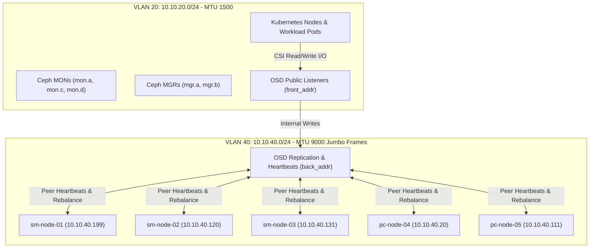

# Phase 2: Rook-Ceph 3-Tier Distributed Storage Cluster & 10GbE Storage Fabric

This guide details the production architecture, network isolation model, and operational runbooks for **[Rook-Ceph](https://rook.io/)** (Ceph v19 Squid) deployed across the 5-node hybrid Talos Linux homelab cluster.

---

## 💾 3-Tier Storage Pool Topology

The cluster provides block (`RBD`), distributed shared filesystem (`CephFS`), and object storage across 3 distinct hardware performance tiers:

| Storage Tier | Physical Drive Pool | Raw Capacity | Usable Pools | Intended Workloads |
| :--- | :--- | :--- | :--- | :--- |
| **Tier 1 (High-IOPS NVMe)** | 2x 2TB Sabrent Rocket Q NVMe (`sm-node-01/02`) + 1x 1TB Crucial P3 Plus (`pc-node-04`) + 1x 1TB Crucial P3 (`pc-node-05`) | **6.0 TB** | `nvme-high-iops-pool` | PostgreSQL/Redis databases, etcd WAL, Ceph RocksDB/WAL metadata, low-latency app PVCs. |
| **Tier 2 (SATA SSD Replicated)** | 8x 2TB Crucial MX500 SATA SSDs (`sm-node-01`: 2, `sm-node-02`: 2, `sm-node-03`: 4) | **16.0 TB** | `builtin-ssd-pool`, `ceph-filesystem` | Replicated Block (`RBD`) & File (`CephFS`) PVCs for active homelab applications. |
| **Tier 3 (Bulk HDD Array)** | 9x Mechanical HDDs in `pc-node-04` (4x 4TB NAS + 2TB Enterprise + 3TB + 1.5TB + 2x 1TB) | **22.5 TB** | `hdd-bulk-pool` | **Scratch / overflow only** (2 replicas, both on pc-node-04): re-creatable data, secondary copies, temporary bulk. Never the only copy of anything. |

> [!NOTE]
> All storage drives are declared strictly using immutable `/dev/disk/by-id/` symlinks in `kubernetes/infrastructure/rook-ceph/cluster.yaml`. Boot drives (SuperDOMs on Supermicro nodes, SATA DOMs, and OS NVMe drives) are strictly excluded from Ceph disk filtering.

---

## 🌐 Dual-Network Architecture & Storage Isolation (VLAN 40)

To eliminate contention between high-throughput Ceph replication traffic and Kubernetes API / application pod networking, Ceph operates on a **split-plane dual network**:



### Network Plane Responsibilities:

1. **Public Network (`10.10.20.0/24`, MTU 1500)**:
   - Client read/write operations initiated by Ceph CSI drivers (`rbd.csi.ceph.com`, `cephfs.csi.ceph.com`).
   - Ceph Monitor (`MON`) election and consensus heartbeat traffic.
   - Ceph Manager (`MGR`) telemetry, dashboard, and Prometheus metrics.
   - OSD client socket bindings (`front_addr` on port 6800+).

2. **Cluster Network (`10.10.40.0/24`, MTU 9000 - Jumbo Frames)**:
   - East-West OSD data replication across fault domains.
   - OSD peer failure detection heartbeats (`hb_back_addr`).
   - Dynamic placement group (PG) peering, backfill, and cluster recovery traffic.
   - OSD intra-cluster socket bindings (`back_addr` on port 6800+).

---

## 🔌 Node Physical Interfaces & Network Addressing

| Node Name | Machine UUID | Primary Interface (VLAN 20, MTU 1500) | Storage Interface (VLAN 40, MTU 9000) | Switch Port / Uplink |
| :--- | :--- | :--- | :--- | :--- |
| **`sm-node-01`** | `da165a00...` | `eno7np2` (`10.10.20.199`) | `eno8np3.40` (`10.10.40.199`) | SFP+ 10GbE to `Ceph-USW-Aggregation` Port 3 |
| **`sm-node-02`** | `9983ae00...` | `eno7np2` (`10.10.20.120`) | `eno8np3.40` (`10.10.40.120`) | SFP+ 10GbE to `Ceph-USW-Aggregation` Port 4 |
| **`sm-node-03`** | `00000000...` | `ens6f0` (`10.10.20.131`) | `ens6f1.40` (`10.10.40.131`) | SFP+ 10GbE to `Ceph-USW-Aggregation` Port 5 |
| **`pc-node-04`** | `927ef8ab...` | `enp43s0f0` (`10.10.20.20`) | `enp43s0f1.40` (`10.10.40.20`) | SFP+ 10GbE to `Ceph-USW-Aggregation` Port 1 |
| **`pc-node-05`** | `7a7d25b8...` | `enp12s0` (`10.10.20.111`, Native Untagged) | `enp12s0.40` (`10.10.40.111`, Tagged 802.1Q) | 2.5GbE Onboard RJ45 to SFP+ Multi-Gig Transceiver |

> [!IMPORTANT]
> **Talos Subnet Anchoring Invariant**:
> When nodes possess multiple active subnets (`10.10.20.0/24` and `10.10.40.0/24`), Talos must be explicitly instructed which subnet anchors the Kubernetes node internal IP. In `talos/cluster-template.yaml`, `cluster-common` defines:
> ```yaml
> machine:
>   kubelet:
>     nodeIP:
>       validSubnets:
>         - 10.10.20.0/24
> ```
> This prevents Kubelet from arbitrarily picking a storage network IP for pod CNI tunnels or API routing.

> [!WARNING]
> **Ceph `mon.d` DHCP Binding Invariant**:
> Ceph `mon.d` on `sm-node-02` binds to `--public-addr=10.10.20.121`, which is assigned via DHCP on the parent interface `eno8np3`. When declaring the tagged sub-interface `eno8np3.40` in Talos, `dhcp: true` MUST remain on `eno8np3` so `mon.d` never loses its listening address and drops out of quorum.

---

## ⚙️ Declarative Rook-Ceph Network Specification

In `kubernetes/infrastructure/rook-ceph/cluster.yaml`:

```yaml
apiVersion: ceph.rook.io/v1
kind: CephCluster
metadata:
  name: rook-ceph
  namespace: rook-ceph
spec:
  cephVersion:
    image: quay.io/ceph/ceph:v19.2.1
    allowUnsupported: false
  network:
    provider: host
    ipFamily: IPv4
    addressRanges:
      public:
        - 10.10.20.0/24
      cluster:
        - 10.10.40.0/24
```

Rook translates this manifest into Ceph configuration options stored directly in the Ceph MON configuration database:
- `global/advanced/public_network = 10.10.20.0/24`
- `global/advanced/cluster_network = 10.10.40.0/24`

---

## 🔍 Verification & Operational Runbooks

### 1. Check Overall Ceph Cluster Health
```bash
kubectl -n rook-ceph exec deploy/rook-ceph-tools -- ceph status
```

### 2. Verify Global Network Declarations in Ceph Config DB
```bash
kubectl -n rook-ceph exec deploy/rook-ceph-tools -- ceph config dump | grep -i network
```
*Expected Output:*
```text
global advanced cluster_network 10.10.40.0/24 *
global advanced public_network  10.10.20.0/24 *
```

### 3. Verify Dual Socket Bindings on OSD Daemons
```bash
kubectl -n rook-ceph exec deploy/rook-ceph-tools -- ceph osd metadata <osd-id> | grep -E 'front_addr|back_addr'
```
*Expected Output:*
```json
    "back_addr": "[v2:10.10.40.x:6800/...,v1:10.10.40.x:6801/...]",
    "front_addr": "[v2:10.10.20.x:6800/...,v1:10.10.20.x:6801/...]",
    "hb_back_addr": "[v2:10.10.40.x:6802/...,v1:10.10.40.x:6803/...]",
    "hb_front_addr": "[v2:10.10.20.x:6802/...,v1:10.10.20.x:6803/...]"
```

### 4. Test Unfragmented MTU 9000 Jumbo Frames (Don't Fragment Ping)
Launch an ephemeral diagnostic pod on any node with `hostNetwork: true` in `kube-system`:
```bash
kubectl -n kube-system run mtu-test --rm -it --image=alpine:3.20 --overrides='{"spec":{"hostNetwork":true,"nodeName":"sm-node-01"}}' -- sh -c "apk add --no-cache iputils >/dev/null 2>&1 && ping -c 3 -M do -s 8972 10.10.40.120"
```
*(Payload $8972 + 8 \text{ ICMP} + 20 \text{ IPv4} = 9000 \text{ bytes}$. Exit code 0 confirms jumbo frames traverse the switch fabric without fragmentation.)*

---

## 🧰 Runbook: Taking a Node Offline for Hardware Work

Used on 2026-10-17 to reseat a disk in `sm-node-02` (a control-plane node holding three OSDs and a monitor).

1. **Pre-checks (read-only):** `ceph pg stat` shows all PGs `active+clean`; `ceph mon stat` shows the other monitors can still form a quorum without this node; at least two other control-plane nodes are Ready.
2. **`ceph osd set noout`:** the node's OSDs going down must not trigger a rebalance of their data.
3. **Pause the operator:** `kubectl scale deploy/rook-ceph-operator -n rook-ceph --replicas=0`. Otherwise, after about 10 minutes it fails over the node's monitor to another node.
4. **`kubectl drain <node> --ignore-daemonsets --delete-emptydir-data`:** OSD and mon pods go `Pending` (they are pinned to the node).
5. **Shut down from Omni:** *Clusters → cluster → click the node → Shutdown*.
6. After power-on: `kubectl uncordon <node>`, scale the operator back to 1, wait for PGs `active+clean`, then `ceph osd unset noout`.

> [!WARNING]
> **Moving a SATA cable renames the disks.** Linux names disks in detection order, so moving a drive to another port swapped `/dev/sdb` and `/dev/sdc` on sm-node-02. The OSD Deployments carry `ROOK_BLOCK_PATH=/dev/sdX` from their last prepare run, which then points at the *other* OSD's disk. Rook's `activate` init container searches the node's devices for the OSD's UUID and treats `ROOK_BLOCK_PATH` only as a hint, so each OSD still activated its own disk. To be safe anyway, scale the affected OSD Deployments to 0 before uncordoning, start them one at a time, and check that the `activate` log reports the expected `osd ID` and device. The CephCluster spec selects disks by `/dev/disk/by-id/…` (serial number), which never changes.

> [!NOTE]
> **Restarting the operator can fail over a monitor.** On restart, the operator judged `mon.a` unhealthy and replaced it with `mon.e` on whichever node was free. Check `ceph mon stat` and the mon pods' nodes afterwards.

### Checking a disk's health
The mgr devicehealth module collects SMART data through the OSDs:
```bash
ceph device ls                                   # device IDs, host:dev, wear
ceph device scrape-health-metrics <DEVICE_ID>    # refresh now
ceph device get-health-metrics <DEVICE_ID>       # SMART JSON
```
Look at reallocated blocks (5), pending (197), uncorrectable (187/198) and interface CRC errors (199). On Crucial MX500 drives, attribute 202 `Percent_Lifetime_Remain` actually reports lifetime *used*, so `0` is good.

---

## 📍 Monitor Placement & Control-Plane Disk Space (2026-10-17)

Monitors store their data under `dataDirHostPath` (`/var/lib/rook`), on each node's `/var`. The Supermicro nodes boot from 16 GB SuperDOMs and have only **12.5 GiB** of `/var`, shared with container images, so Ceph kept raising `MON_DISK_LOW` (less than 30% free) and image pulls evicted pods.

Two changes:
1. **Earlier image garbage collection on the control-plane nodes** (Omni patch `controlplane-image-gc` in `talos/cluster-template.yaml`): the kubelet starts removing unused images at 60% disk use and stops at 50% (defaults 85/80), and removes unused images older than 7 days (`imageMaximumGCAge: 168h`). sm-node-02 went from 72% to 55% used. sm-node-03 barely moved because every image on it belongs to a running pod.
2. **Monitor placement preference** (`spec.placement.mon` in `cluster.yaml`): prefer pc-node-04 and pc-node-05, then sm-node-02. It is *preferred* rather than required, so Rook can still fail a monitor over to any node if a preferred node is lost. Placement only affects new monitors. To move an existing one, scale its Deployment to 0 and let the operator fail it over (about 10 minutes): `kubectl -n rook-ceph scale deploy/rook-ceph-mon-<id> --replicas=0`.

Apply Omni template changes with a diff first: `omnictl cluster template diff -f talos/cluster-template.yaml`, then `omnictl cluster template sync -f …`. The kubelet restarts; nodes do not reboot.

**2026-10-18:** a later failover had put mon.g on sm-node-03 (`MON_DISK_LOW` again), probably because pc-node-05 was being rebooted during the gaming-VM disk work. Scaling mon.g to 0 failed it over to mon.h on pc-node-05 as preferred. Monitors are now **d (sm-node-02), f (pc-node-04), h (pc-node-05)**. If a monitor lands on an sm node again, check whether a pc node was unavailable at the time, then repeat the scale-to-0 failover.

**2026-10-18, later: the third monitor moved from sm-node-02 to sm-node-01.** `KubeAPIErrorBudgetBurn` traced back to lease `PUT`s timing out on sm-node-02. etcd write p99 there was 2.6 s against about 80 ms on the other control planes, and its SuperDOM averaged 10.7 ms per write against 0.8 ms on sm-node-01's identical drive. SMART was healthy (6.0 Gb/s link, 0 reallocated, 16% endurance used after 4,241 h), but the drive was writing about 5× more to flash than the host sent it, which is what many small `fsync`s look like. The cause is **etcd and a Ceph monitor sharing one small SuperDOM**: both `fsync` constantly. The third placement preference is now sm-node-01, the least-loaded SuperDOM.

> [!CAUTION]
> **Change monitor placement first, then fail over, never both at once.** Applying a placement change makes Rook restart every monitor in turn so the new setting takes effect, and it checks before each restart that a majority would remain. If a monitor is already scaled to 0, that check fails (`EBUSY: not enough monitors would be available`), Rook retries every minute, and the failover never starts. Safe order: `kubectl apply` the CephCluster, wait until every `rook-ceph-mon-*` pod has restarted and `ceph quorum_status` lists all three, then scale the monitor you want to move to 0. If you get stuck, scale that monitor back to 1, let the restarts finish, and start again.

> [!TIP]
> **Read SMART on a Talos boot disk** (Ceph's devicehealth only covers OSD disks):
> ```bash
> kubectl debug node/<node> -n kube-system --profile=sysadmin -it --image=alpine:3.24 -- \
>   sh -c 'apk add -q smartmontools && smartctl -x /dev/sda'
> ```
> Delete the `node-debugger-*` pod afterwards. Per-node disk latency is also in Prometheus: `rate(node_disk_write_time_seconds_total[1h]) / rate(node_disk_writes_completed_total[1h])`.

---

## 📊 Placement Groups & the PG Autoscaler (2026-10-18)

Until 2026-10-18 every pool had **1 PG**, so each pool's data lived on exactly 3 OSDs. The NVMe pool filled osd.8, osd.0 and osd.10 to 61% while the 1.8 TiB osd.9 sat empty, and `MAX AVAIL` was based on the fullest of those disks.

**Cause: overlapping CRUSH roots.** Ceph's built-in `.mgr` pool used `replicated_rule`, which takes the whole `default` root (every device class). Every other pool uses a device-class rule (`default~nvme`, `default~ssd`, `default~hdd`). Because the same OSDs appear under two roots, the autoscaler cannot split each OSD's PG budget between pools, so it **skips every pool**. The symptom: `ceph osd pool autoscale-status` prints nothing even though `pg_autoscale_mode` is `on`.

**Fix** (`storageclasses.yaml`):
1. A `CephBlockPool` named `builtin-mgr` with `spec.name: .mgr` and `deviceClass: ssd` brings `.mgr` under Rook.
2. `nvme-high-iops-pool` has `parameters.bulk: "true"`. A bulk pool gets its full PG share up front (128). Without it, the autoscaler sizes a pool by the data it holds, so an empty pool stays tiny. The other pools are left non-bulk and grow with their data.

> [!WARNING]
> **Rook does not change the CRUSH rule of an existing pool.** Applying `builtin-mgr` adopted `.mgr` but left it on `replicated_rule`. One manual step points it at the matching existing rule (`default~ssd`, host failure domain):
> ```bash
> kubectl -n rook-ceph exec deploy/rook-ceph-tools -- ceph osd pool set .mgr crush_rule builtin-ssd-pool
> ```
> Repeat this after rebuilding the cluster. To check, every pool must appear in `ceph osd pool autoscale-status`.

The autoscaler then raises PG counts in steps (`nvme-high-iops-pool` to 128; `builtin-ssd-pool`, `hdd-bulk-pool` and `ceph-filesystem-data0` to 32; `ceph-filesystem-metadata` to 16). Expect a short backfill for the pools that hold data.

---

## ⚖️ Accepted Trade-offs

- **HDD bulk pool on a single host.** `hdd-bulk-pool` keeps 2 copies with an OSD-level failure domain, and all HDDs sit in pc-node-04, the only chassis that takes 3.5" drives. It survives a disk failure but not the loss of pc-node-04: a reboot takes the pool offline, and losing the node loses its data. `min_size 1` keeps it writable on a single copy, at the risk of losing recent writes if the second disk fails during recovery. Accepted deliberately; revisit if another node gains drive bays (an HBA in a second chassis, then `failureDomain: host`).

  **Storage placement policy (decided 2026-10-18):**
  1. **Default to the replicated tiers.** `rook-ceph-block` (SSD, the cluster default StorageClass) and `rook-ceph-block-nvme` (latency-sensitive) hold everything that matters: 3 copies across hosts. Use them until capacity runs short.
  2. **HDD pool = scratch and overflow.** Use `rook-ceph-hdd-bulk` only for data that is re-creatable or already exists elsewhere (caches, transcodes, temporary bulk, secondary copies). It must never be the only copy, and it is never the default StorageClass.
  3. **Garage NAS (Synology) = off-cluster copy.** Backups and bulk mirrors go there; see [[307-garage-synology-dr-time-machine|Garage Synology DR]].
- **Gaming VM disk outside Ceph.** The Bazzite VM's disk is local NVMe on pc-node-05 (no replication, no backups): it can only run on that node anyway, and its contents are re-downloadable. See [[303-kubevirt-bazzite-gpu-vm|Bazzite Gaming VM]].
- **pc-node-05 system disk.** Talos's EPHEMERAL fills the 1 TB Sabrent. Shrinking it means wiping EPHEMERAL, and Omni rejects `talosctl reset` through its proxy (`PermissionDenied`), so the spare space is used via a Talos *directory* user volume on EPHEMERAL instead of a separate partition.

