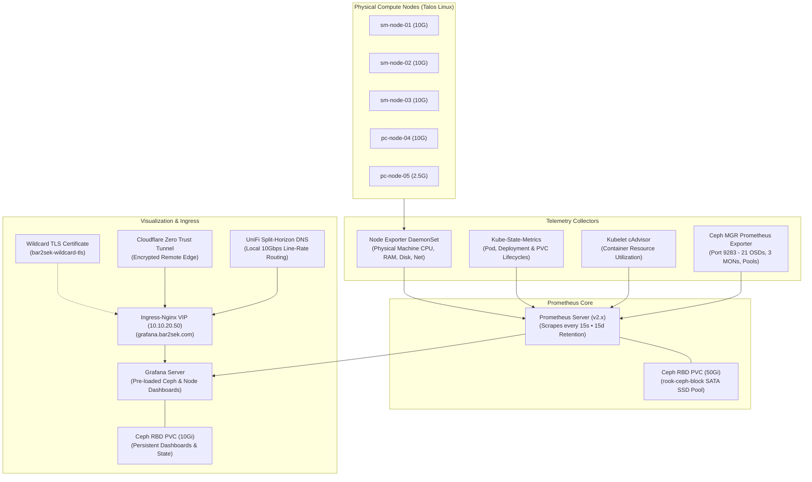
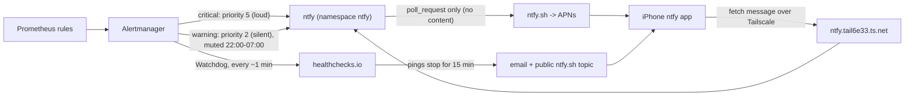

# 📊 Phase 3: Observability Stack (Prometheus, Grafana & Ceph Monitoring)

This document details the architecture, storage integration, Talos Linux node scraping configuration, and dashboard workflows for the hybrid homelab monitoring stack.

---

## 🏗 Architectural Overview

The observability stack is deployed via `kube-prometheus-stack` into the dedicated `monitoring` namespace, backed by persistent Ceph RBD block storage, and exposed through Ingress-Nginx with automated Let's Encrypt wildcard TLS.



---

## 💾 Storage Layer & Ceph Persistence

All telemetry time-series data and visualization state are persisted onto the replicated Ceph storage cluster deployed in Phase 2:

| Component | Storage Class | PVC Size | Retention Policy | Failure Domain |
| :--- | :--- | :--- | :--- | :--- |
| **Prometheus TSDB** | `rook-ceph-block` | `50Gi` | 15 days (`retentionSize: 45Gi`) | Replicated 3x (Host Failure Domain) |
| **Grafana Data** | `rook-ceph-block` | `10Gi` | Retained across pod restarts | Replicated 3x (Host Failure Domain) |
| **Alertmanager** | `rook-ceph-block` | `5Gi` | Alert silence state & notification logs | Replicated 3x (Host Failure Domain) |

---

## ⚙️ Talos Linux Compatibility & Control-Plane Scrapes

Talos Linux is an immutable, API-driven operating system without standard `/etc/os-release`, package managers, or interactive shells. To ensure 100% metrics accuracy without false alerts:

1. **Control-Plane Tolerations**:
   Control plane nodes (`sm-node-01`, `sm-node-02`, `sm-node-03`) carry the taint `node-role.kubernetes.io/control-plane:NoSchedule`. All collectors, operators, and daemonsets carry matching tolerations so physical machine telemetry is gathered across all 5 nodes.

2. **Node-Exporter Rootfs Mounting**:
   `hostRootFsMount.enabled: true` mounts `/host/proc` and `/host/sys` into the Node Exporter containers to capture actual hardware CPU cycles, memory allocations, physical disk I/O, and 10GbE network interfaces.

3. **Static Pod Scrape Suppression**:
   In Talos Linux, `kube-controller-manager` and `kube-scheduler` run as containerized static pods bound strictly to localhost or secured internal gRPC endpoints. Direct unauthenticated HTTP scrapes are disabled in `values.yaml` (`kubeControllerManager.enabled: false`, `kubeScheduler.enabled: false`, `kubeProxy.enabled: false`) to eliminate false-positive target unreachable alerts.

---

## 🐙 Rook-Ceph Storage Integration

Enabling native Ceph monitoring in `CephCluster` (`spec.monitoring.enabled: true`) activates:

1. **Ceph MGR Prometheus Module**:
   Ceph Manager daemons (`mgr-a` on `sm-node-03`, `mgr-b` on `pc-node-04`) actively serve metrics on port `9283`.

2. **Rook-Ceph ServiceMonitor**:
   The Rook operator registers `rook-ceph-mgr` in the `rook-ceph` namespace. Because Prometheus is configured with `serviceMonitorSelectorNilUsesHelmValues: false`, it automatically discovers and scrapes this endpoint without manual namespace tagging.

3. **Pre-Configured Ceph Dashboards**:
   Grafana automatically provisions official production dashboards:
   - **Ceph - Cluster Overview** (ID: 2842): Storage cluster health, raw available capacity (42.3 TiB), IOPS, and read/write bandwidth.
   - **Ceph - OSDs** (ID: 5336): Real-time breakdown of all 21 OSDs, NVMe/SSD/HDD latency heatmaps, and fill ratios.
   - **Ceph - Pools** (ID: 5337): Capacity and compression efficiency across `nvme-high-iops-pool`, `builtin-ssd-pool`, and `hdd-bulk-pool`.
   - **Node Exporter Full** (ID: 1860): Physical server telemetry across all 5 nodes.

---

## 🌐 Ingress & Split-Horizon DNS Resolution

* **Domain**: `grafana.bar2sek.com`
* **Local Resolution**: Authoritative A record on UDM-Pro (`10.0.1.1`) resolving directly to `10.10.20.50` (MetalLB Ingress-Nginx VIP).
* **Remote Resolution**: Cloudflare Zero Trust Tunnel routing traffic through encrypted QUIC tunnels with email-based authentication.
* **TLS Security**: Wildcard Let's Encrypt certificate (`bar2sek-wildcard-tls`) automatically verified by browsers with zero warnings.

---

## 🏠 Homelab Overview Dashboard (start here)

`https://grafana.bar2sek.com/d/homelab-overview` (Grafana folder **Homelab**) is the one-screen answer to *"is everything OK?"*. Source: `kubernetes/infrastructure/monitoring/dashboards/homelab-overview.yaml`, a ConfigMap labelled `grafana_dashboard: "1"` that the Grafana sidecar loads into the folder named by the `k8s-sidecar-target-directory` annotation. UI edits are disabled (`allowUiUpdates: false`), so the repo is the source of truth.

| Row | Panels | Built from |
|---|---|---|
| Is everything OK? | Nodes ready, Ceph health, Disks down, Alerts firing, Power, Oldest backup | kube-state-metrics, Ceph mgr, NUT exporter, `ALERTS` |
| Nodes | `/var` used, memory, CPU per node | node-exporter joined to `node_uname_info` for node names |
| Backups | Hours since last success per CronJob | `kube_cronjob_status_last_successful_time` |
| Storage | % used dials for Ceph total, NVMe, SSD and HDD, each with a Used / Total strip underneath; active Ceph health checks | `ceph_cluster_total_*`; per class, `ceph_osd_stat_bytes(_used)` joined `on (ceph_daemon)` to `ceph_osd_metadata{device_class=…}`; `ceph_health_detail` |
| Power and apps | UPS charge, runtime, load; ready replicas of key services | `network_ups_tools_*`, `kube_deployment_status_replicas_available` |
| Active alerts | Every firing alert and how long it has fired | `ALERTS_FOR_STATE` |

Every panel has a description (the (i) icon) saying what it measures and what to do when it is not green.

> [!NOTE]
> **Storage figures are raw, replicas included.** 1 GiB stored on NVMe or SSD counts 3 GiB (2 GiB on HDD), so *Total* is raw capacity, not usable space. The per-class dials average the tier, while Ceph's nearfull/full limits apply per disk; `ceph osd df` shows the fullest disk. Ceph does not export per-class usage directly, so the query wraps both sides in `max by (ceph_daemon)` before the join, which stops a mgr failover's briefly duplicated series from breaking it.

> [!WARNING]
> **A completely failed Ceph disk disappears from Ceph's metrics.** The mgr exporter stops publishing `ceph_osd_up`/`ceph_osd_metadata` for an OSD that has not booted since the mgr restarted, so `ceph_osd_up == 0` misses it. The *Disks down* tile therefore takes the larger of Ceph's own count and the number of Rook `rook-ceph-osd-*` Deployments with unavailable replicas. Found when osd.5 had been down for two weeks while the first version of the tile read 0.

### Alert rule tuning (2026-10-18)

Apply monitoring changes with `just monitoring-apply`: it applies the custom rules and dashboards, then runs `helm upgrade` with `values.yaml` and the chart version pinned (91.4.1). Before upgrading, confirm the live values still match the repo (`helm -n monitoring get values kube-prometheus-stack`).

- **`TargetDown` for the kubelet (since 2026-09-16):** the chart scraped `/metrics/resource/v1alpha1`, which current kubelets no longer serve (404). `kubelet.serviceMonitor.resourcePath: /metrics/resource` fixes it.
- **`KubeClientCertificateExpiration` was permanently critical.** About 225 times an hour, day and night, some client (probably Omni's or Talos's own connection) presents a certificate minted with under 30 minutes of validity. The stock rule fires when the 1st percentile of presented certificates has less than 24 hours left, so it never clears. It is disabled (`defaultRules.disabled`) and replaced by `kubernetes/infrastructure/monitoring/kube-client-cert-rule.yaml`, which counts only certificates with between 30 minutes and 7 days / 24 hours left. A long-lived certificate that is really expiring stays in that window for days; short-lived-by-design ones never enter it.

> [!TIP]
> Histogram bucket labels are floats as strings: `le="1800.0"`, not `le="1800"`. A wrong `le` matches nothing and returns an empty result, not an error.

### Phone alerts: ntfy + dead man's switch (2026-10-18)



| Piece | Where | Notes |
|---|---|---|
| ntfy server | `kubernetes/infrastructure/ntfy/ntfy.yaml` | `deny-all` default; users/ACLs/tokens from Secret `ntfy-auth` (`NTFY_AUTH_*` env); `upstream-base-url: https://ntfy.sh` for iOS push |
| Tailnet URL | Tailscale Ingress → `https://ntfy.tail6e33.ts.net` | Tailscale-issued certificate (tailnet *HTTPS Certificates* must be on). No public DNS record |
| Logins | `just ntfy-auth` | `ryan` (admin, phone app) and `alertmanager` (write-only to `homelab-alerts`, token). Re-run to rotate. Token copy in `monitoring/ntfy-alertmanager-token` |
| Routing | `alertmanager.config` in `values.yaml` | critical → priority 5, repeat 4 h; warning → priority 2, repeat 24 h, muted 22:00–07:00 America/Chicago; ntfy's built-in `?template=alertmanager` formats the message |
| Dead man's switch | Watchdog → healthchecks.io check `homelab-alertmanager` (period 5 min, grace 10 min) | Ping URL in Secret `monitoring/healthchecks-ping-url` (`url_file`), never committed |

**Ceph alerts** come from `kubernetes/infrastructure/rook-ceph/prometheus-ceph-rules.yaml`, Rook's standard rule set (89 rules) copied for the operator's version. The `rook-ceph-cluster` Helm chart would install them, but this cluster's CephCluster is a plain manifest, so until 2026-10-18 **Prometheus had no Ceph alerts at all**: a planned shutdown of sm-node-02 (3 OSDs down, `HEALTH_WARN`) produced nothing. Verified the same day with that outage: `CephOSDDownHigh` (critical, ≥10% of OSDs down) reached the phone within a minute. Update the file when upgrading Rook.

**Why both:** ntfy covers problems inside a running cluster (failed backup, full disk, OSD down, UPS on battery). It cannot report its own outage, so healthchecks.io watches for the Watchdog heartbeat to *stop* and alerts through channels outside the house.

> [!WARNING]
> Every Secret listed under `alertmanagerSpec.secrets` must exist **before** `just monitoring-apply`; a missing one keeps the Alertmanager pod from starting. On a rebuild: `just ntfy-auth`, then create `healthchecks-ping-url`:
> ```bash
> read -rs "HC_URL?healthchecks ping URL: "; echo
> kubectl -n monitoring create secret generic healthchecks-ping-url --from-literal=url="$HC_URL"; unset HC_URL
> ```

**Test end to end** (should arrive loud within a minute, then a RESOLVED message):
```bash
AM="kubectl -n monitoring exec alertmanager-kube-prometheus-stack-alertmanager-0 -c alertmanager -- amtool --alertmanager.url=http://localhost:9093"
$AM alert add HomelabTestAlert severity=critical namespace=monitoring --annotation=summary="test"
$AM alert add HomelabTestAlert severity=critical namespace=monitoring --end="$(date -u +%Y-%m-%dT%H:%M:%SZ)"   # resolve
```

**Gotchas from the build:**
- `amtool config routes test --config.file=/dev/stdin` ignores the piped config and reports `null` for everything; use `amtool config routes --config.file=/dev/stdin` (prints the tree) instead.
- The iPhone app attaches a saved login only when its *Service URL* matches the subscription's server exactly (`https://ntfy.tail6e33.ts.net`, no trailing slash). "Not authorized to read this topic" can also simply mean a wrong password: check with `curl -su ryan https://ntfy.tail6e33.ts.net/v1/account`.
- Keep Tailscale on the phone always connected (On Demand). Without it the push still arrives, but the app cannot fetch the message text.

**Adding a panel:** test the PromQL against Prometheus first (`kubectl port-forward -n monitoring svc/kube-prometheus-stack-prometheus 9090` and the `/api/v1/query` endpoint), then add it to the JSON and `kubectl apply` the ConfigMap. The sidecar reloads it within a minute.

---

## 🛠 Operational Runbook & Commands

All monitoring operations are integrated into the root `Justfile`:

```bash
# Check status of monitoring pods and persistent volume claims
just monitoring-status

# Retrieve the initial Grafana admin password
just grafana-password

# View all cluster pods including monitoring
just k8s-pods
```
