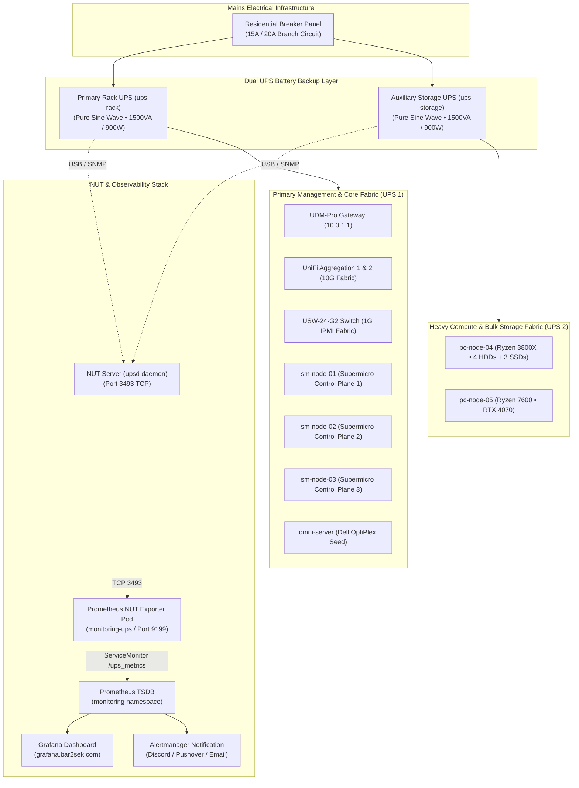

# ⚡ Phase 4: UPS Power Resiliency & Network UPS Tools (NUT) Monitoring

This document details the power distribution architecture, dual Uninterruptible Power Supply (UPS) telemetry, and automated alerting engine powering the Talos Linux bare-metal homelab cluster.

---

## 🏗️ Architectural Overview & Dual-UPS Topology

The homelab hardware stack draws continuous electrical power across computing, storage, and networking layers. To avoid cascading power failures and ensure clean line power, equipment is distributed across two dedicated UPS battery units:



---

## 🔍 Investigation: The Circuit Breaker Event

### Telemetry Findings (Post-Breaker Diagnostic)
During the recent breaker trip event, the cluster remained 100% operational due to battery backup engagement:
1. **Cluster Node Load**:
   - `sm-node-01`, `sm-node-02`, and `sm-node-03` remained in low-utilization idle states (~0.8 to 2.0 cores average, < 10% peak load).
   - `pc-node-04` (then 11 HDDs) load stayed under 1.75; no Ceph deep scrubs or mass array spin-ups were running.
   - `pc-node-05` (RTX 4070) maintained steady idle load (0.18 cores); no AI training or NVENC transcode spikes were active.
   - `bazzite-gaming-vm` maintained steady uninterrupted uptime (9+ days).
2. **Root Cause Analysis**:
   - Because the homelab cluster experienced **zero computational or I/O spikes**, the breaker trip was driven by cumulative branch circuit load (ambient household appliances, workstation peripherals, or an AFCI/GFCI nuisance trip on shared branch wiring).
   - **Why NUT is Essential**: Currently, when battery backup activates, administrators must manually verify physical status. Deploying NUT delivers immediate notifications via Alertmanager the instant grid power drops (`status="OB"`), tracking remaining runtime and battery drain before critical thresholds are reached.

---

## ⚙️ Deployment Strategy for Network UPS Tools (NUT)

### Option A: Synology DSM Native NUT Server (Zero Friction)
Our off-site backup appliance, the **Synology DS713+** (`10.0.1.223` in the garage workshop or server shelf), features a built-in, production-grade `upsd` server.
- Connect the primary UPS to the Synology USB port.
- Enable **UPS Support** in Synology DSM:
  - Check *Enable UPS Support*.
  - Check *Enable Network UPS Server*.
  - Permit access to the Kubernetes cluster subnets (`10.10.20.0/24`, `10.244.0.0/16`).
- Exposes standard port `3493` without mutating any immutable Talos Linux host configurations!

### Option B: Dedicated Seed Host (`omni-server` 10.10.10.5) — Recommended Architecture
Since the Dell OptiPlex Micro operates as our dedicated seed management node with direct physical USB-A ports, it is the ideal target to host the NUT server:
1. **Physical Attachment**: Connect both UPS USB-B cables to available USB-A ports on the OptiPlex Micro (hot-pluggable anytime without power interruptions).
2. **Containerized Daemon Deployment**: Deploy the containerized `upsd` server via `kubernetes/infrastructure/nut/nut-server-omni.yaml`:
   ```bash
   kubectl --kubeconfig=talos/omni-server/kubeconfig apply -f kubernetes/infrastructure/nut/nut-server-omni.yaml
   ```
3. **USB Device Pass-through**: Uses `hostPath: /dev/bus/usb` with `hostNetwork: true`, exposing standard port `3493` on `10.10.10.5` across VLAN 10 (`MGMT-IPMI`).
4. **Scrape Target**: The main cluster's `nut-exporter` (`kubernetes/infrastructure/nut/nut-exporter.yaml`) queries `10.10.10.5:3493` directly.

---

## 📊 Kubernetes Telemetry & Prometheus Integration

The GitOps manifests reside in `kubernetes/infrastructure/nut/`:

### 1. Prometheus NUT Exporter Deployment
The `nut-exporter` pod queries the NUT server via standard TCP gRPC/sockets and formats metrics for Prometheus scraping:
* Namespace: `monitoring-ups`
* Scrape Port: `9199/TCP`
* Target Endpoint: `/ups_metrics`

### 2. Metric Vectors Captured
| Metric Name | Type | Description |
| :--- | :--- | :--- |
| `network_ups_tools_battery_charge` | Gauge | Current battery capacity percentage (0–100%). |
| `network_ups_tools_battery_runtime` | Gauge | Estimated runtime remaining on battery (seconds). |
| `network_ups_tools_battery_voltage` | Gauge | DC battery bus voltage (e.g. 25.8V). |
| `network_ups_tools_input_voltage` | Gauge | AC mains utility grid input voltage (e.g. 119.8V). |
| `network_ups_tools_ups_load` | Gauge | Current power load as a percentage of rated capacity (e.g. 30%, 17%). |
| `network_ups_tools_ups_status` | Gauge | Operating status flags (`flag="OL"` for online, `flag="OB"` for on-battery, `flag="LB"` for low-battery). |

---

## 🚨 Alertmanager Rules & Automated Safeguards

Configured via `kubernetes/infrastructure/nut/prometheus-rules.yaml`:

1. **`UPSOnBattery` (Warning)**:
   - Triggers when `network_ups_tools_ups_status{flag="OB"} == 1` for > 30 seconds.
   - Pushes alert: *"Mains AC power dropped. Running on battery."*
2. **`UPSBatteryLow` (Critical)**:
   - Triggers when `network_ups_tools_battery_charge < 40%` or `flag="LB"` for > 1 minute.
   - Pushes critical notification: *"Battery below 40%. Graceful shutdown recommended."*
3. **`UPSLoadCritical` (Warning)**:
   - Triggers when `network_ups_tools_ups_load > 85%` for > 2 minutes.
   - Prevents oversubscribing outlets and trips during inverter power transfer.
4. **`UPSInputVoltageAbnormal` (Warning)**:
   - Triggers when line voltage drops below `105V` (brownout) or exceeds `132V` (surge).

---

## 📈 Grafana Visualization

A dedicated dashboard can be imported into Grafana at `https://grafana.bar2sek.com`:
* **Grafana Community Dashboard ID**: `14188` (or `10605` for Network UPS Tools Exporter).
* Visualizes live wattage draws, remaining battery runtime gauge, line voltage stability graphs, and real-time power source status.
