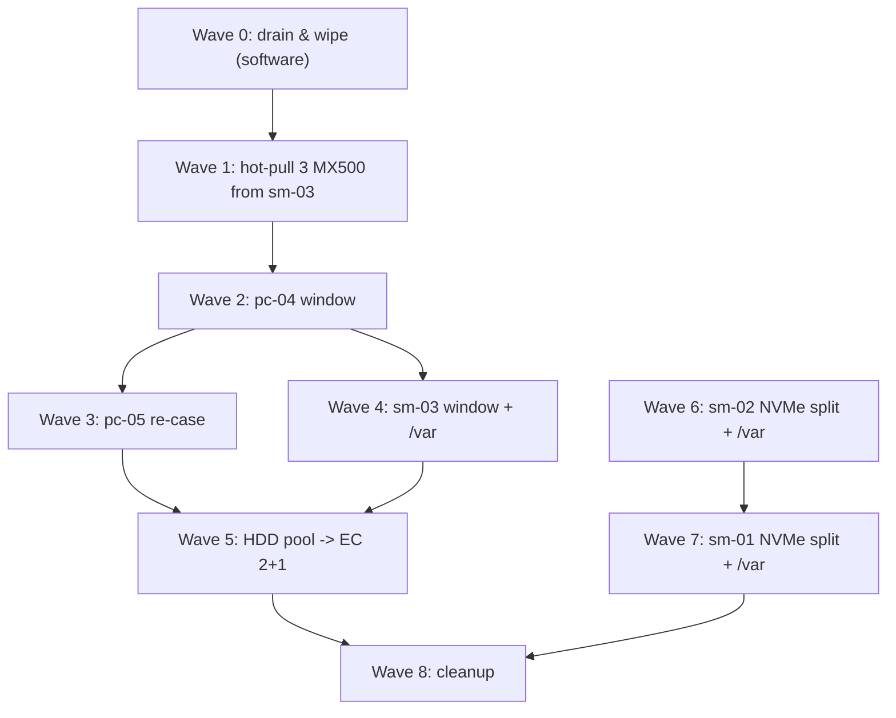

# Moving Talos `/var` off the SuperDOMs & Storage Reshuffle

The three Supermicro control-plane nodes boot from 16 GB SATA SuperDOMs. Talos puts its `EPHEMERAL` volume (`/var`: container images, logs, etcd, the Ceph monitor store) on the boot disk by default, which left each node with a **12.5 GiB `/var`**. That caused:

- pod evictions for `ephemeral-storage` (the Actual Budget backup, 2026-10-18),
- `MON_DISK_LOW` whenever a Ceph monitor landed on an sm node,
- etcd write latency up to 2.6 s on sm-node-02, where etcd and a monitor shared the SuperDOM (`KubeAPIErrorBudgetBurn`).

Interim mitigations (soft taint `homelab.bar2sek.com/small-var`, earlier image GC, monitors on the pc nodes) are recorded in [[001-deployment-journal|the journal]], Milestones 16–19. This runbook is the real fix.

---

## 🎯 Target layout (final, 2026-10-18)

Inspecting the hardware shaped the plan:
- **The E300s (sm-node-01/02) are full:** no free power header, and their only spare SATA port is the one osd.5's cable was moved off after a fault. `/var` therefore shares the NVMe.
- **pc-node-04 has three unused SSDs** and only 9 HDDs (not 11). SMART (2026-10-18): the **250 GB MX500 `2228E6489822`** is like new (1,808 h, 0% endurance used, no errors); the two Intel 335 180 GB report contradictory wear data and stay spares.
- **sm-node-03's 813M has four 3.5" hot-swap bays**; its MX500s sit in 2.5" adapters, so HDDs fit directly.
- **pc-node-05 gets re-cased** into a case with 3.5" bays, making it a third HDD host. The RTX 4070 occupies the only PCIe slot, so its HDDs use onboard SATA.
- **The WD Green 1.5 TB (osd.18) is retired:** 644 reallocated sectors at 40,131 h. The four IronWolf ST4000VN008 are healthy (about 6,400 h, no errors).

| Node | Boot | `/var` (EPHEMERAL) | Ceph OSDs after |
|---|---|---|---|
| sm-node-01 | SuperDOM | 250 GiB on the Sabrent NVMe (`BC7107061E7C02090817`) | NVMe raw partition `r-osd-nvme` (~1.57 TiB) + MX500 × 2 |
| sm-node-02 | SuperDOM | 250 GiB on the Sabrent NVMe (`F2C10719080B00006324`) | Same as sm-node-01 |
| sm-node-03 | SuperDOM (second one stays spare) | **250 GB MX500 `2228E6489822`**, dedicated | MX500 × 1 (osd.7) + **2 × 4 TB IronWolf** |
| pc-node-04 | Intel 320 80 GB | unchanged | NVMe + **3 × MX500 2 TB** (from sm-node-03) + HDD 3 TB, 2 TB, 2 × 1 TB |
| pc-node-05 | Sabrent 1 TB (also the gaming-VM disk) | unchanged | NVMe + **2 × 4 TB IronWolf** (after re-case) |

**Disk moves**
| Disk | From → to | Today |
|---|---|---|
| 3 × MX500 2 TB (`2137E5D2DE1D`, `2137E5D2DE26`, `2253E698684D`) | sm-node-03 → pc-node-04 | osd.12, osd.13, osd.4 |
| 2 × IronWolf 4 TB | pc-node-04 → sm-node-03 | two of osd.11/14/15/16 |
| 2 × IronWolf 4 TB | pc-node-04 → pc-node-05 | the other two |
| MX500 250 GB `2228E6489822` | pc-node-04 → sm-node-03 (`/var`) | unused |
| WD15EADS 1.5 TB | pc-node-04 → retired | osd.18 |
| 2 × Intel 335 180 GB | stay in pc-node-04 as spares | unused |

### Pools afterwards

| Pool | Hosts (raw) | Usable | One host down |
|---|---|---|---|
| SSD, size 3 | sm-01 3.6, sm-02 3.6, sm-03 1.8, **pc-04 5.5** TiB | **~4.5 TiB** (was 3.6) | Keeps running **and rebuilds the third copy** (was: degraded until the host returns) |
| NVMe, size 3 | pc-04 0.9, pc-05 0.9, sm-01 1.6, sm-02 1.6 TiB | ~1.6 TiB (was 1.8) | Keeps running and rebuilds |
| HDD, **erasure coded 2+1, `failureDomain: host`** | sm-03 8, pc-05 8, pc-04 7 TB | **~14 TB** (was ~11) | **Survives** (was: lost with pc-node-04) |

The HDD pool stays a scratch/overflow tier. Erasure coding 2+1 stores each object as 2 data chunks plus 1 parity chunk on three different hosts (1.5× overhead, like RAID-5 across machines). Small writes are slower than replication, which suits media, bulk data and backup copies. RBD on an EC pool needs a small replicated metadata pool (on SSD). Set `min_size` to 2 so the pool stays writable with one host down, at the cost of no redundancy during that window; acceptable for scratch. The existing `hdd-bulk-pool` is empty, so it is replaced rather than converted.

### Why
- **A replicated pool fills when its smallest host fills.** With 3 copies on exactly 3 hosts, every host holds a full copy: sm-node-03's extra SSD capacity was unusable (each host held the same 55 GiB on 2026-10-18; sm-node-03's four disks carried about half as much each). A **fourth SSD host** (pc-node-04) raises usable capacity and gives Ceph somewhere to rebuild after a host failure.
- **Three balanced HDD hosts** make erasure coding possible: more usable space *and* host-failure tolerance.
- **etcd on fast, quiet disks:** NVMe on sm-01/02 (shared with an OSD, which NVMe handles well); a dedicated SSD on sm-03.
- **Size 2 was considered for SSD and rejected:** a host outage then either blocks writes (`min_size 2`) or risks losing recent writes (`min_size 1`). The SSD pool holds everything that matters.

### pc-node-05 constraints
- **RAM:** the gaming VM requests about 20 of 32 GB. Cap the two HDD OSDs at 2 GiB each (`ceph config set osd.<id> osd_memory_target 2147483648`; the default is 4 GiB). HDD OSDs gain little from more.
- **Ports and power:** two free onboard SATA ports, SATA power from the PSU, two 3.5" bays in the new case. Confirm before buying or moving anything.

### Deferred
- **pc-node-05 boot on a spare Intel SSD** (whole Sabrent for the gaming VM): rejected; the Sabrent's 750 GiB is the VM's disk and moving it means a Bazzite rebuild.

---

## 🔬 Mechanisms (verified 2026-10-18 on Omni v1.12.0 / Talos 1.13.10)

| Need | How | Source |
|---|---|---|
| Put EPHEMERAL on a chosen disk | `VolumeConfig` named `EPHEMERAL` with `provisioning.diskSelector.match` (CEL, e.g. `disk.serial == "…"`) and `minSize`/`maxSize`/`grow` | Talos docs, *System volumes* |
| Raw partition for Ceph | `RawVolumeConfig` → unformatted partition at `/dev/disk/by-partlabel/r-<name>`. **The name must not contain `ceph`** | Talos docs, *Raw volumes* |
| OSD on a partition | Rook supports raw partitions (no filesystem) given by full udev path in `devices[].name`; not with `encryptedDevice` (ours are unencrypted) | Rook *Prerequisites*, *CephCluster CRD* |
| Re-provision EPHEMERAL | Volume config applies **only when the volume does not exist yet**. Omni blocks `talosctl reset`, but removing a machine from the cluster makes Omni reset it: STATE and EPHEMERAL are wiped, and since Talos 1.12 the partitions themselves are removed (talos#12090), so EPHEMERAL can be created elsewhere when the machine rejoins | Omni docs *Wipe a machine*; Omni v1.10 release notes; siderolabs/talos#12090 |
| Keep the other OSDs | Omni's reset does not erase non-system disks; Rook re-activates their OSDs by UUID when the node returns | Omni docs *Wipe a machine* |
| Wipe the repurposed disk | Must happen **while the node is still running**: `talosctl wipe disk` does not work on Omni-managed machines in maintenance mode (talos#13583) | GitHub issue |

---

## ✅ Pre-flight (before every node)

```bash
kubectl -n rook-ceph exec deploy/rook-ceph-tools -- ceph status        # HEALTH_OK, all PGs active+clean
kubectl -n rook-ceph exec deploy/rook-ceph-tools -- ceph mon stat      # 3 mons in quorum
talosctl -n sm-node-01,sm-node-02,sm-node-03 etcd members              # 3 members
kubectl get jobs -A | grep -i backup                                   # last night's backups succeeded
```
Also: no other maintenance in progress. Silence the expected alerts first (`CephOSDDownHigh` is critical and fires immediately); the matchers are in [[104-phase2-rook-ceph-storage|Rook-Ceph]], *Taking a Node Offline*. Never have two control-plane nodes down at once.

---

## 🌊 Execution waves

**Rules:** never two control-plane nodes (sm-01/02/03) down at once (etcd quorum); never pc-node-04 and pc-node-05 down together (they host monitors f and h); drain a disk in Ceph *before* it moves (a moved disk gets a fresh OSD); every downtime window starts with the alert silence from [[104-phase2-rook-ceph-storage|Rook-Ceph]] *Taking a Node Offline* and ends at `HEALTH_OK`. Waves can be days apart; the cluster is healthy between them.



| Wave | What | Downtime | Needs |
|---|---|---|---|
| **0** | Drain, remove and wipe: osd.12/13/4 (sm-03 MX500s), the four IronWolf OSDs and osd.18 (WD Green). The HDD pool is empty, so those are instant; the SSD drain moves sm-03's copy onto osd.7. Remove them from `cluster.yaml`. Wipe each disk from a debug pod **while its node runs** (Phase A below) | none | — |
| **1** | **Hot-pull** the three wiped MX500s from sm-node-03's hot-swap bays while it runs. This breaks the dependency loop (pc-04 needs sm-03's SSDs, sm-03 needs pc-04's disks) without a second pc-04 window. Pull one drive at a time and check that sm-node-03 stays `Ready` and Ceph stays `HEALTH_OK` | none | 0 |
| **2** | **pc-node-04 window:** silence; pause the Rook operator (mon.f); `noout`; drain; shutdown. Out: 4 × IronWolf, WD Green, 250 GB MX500. In: 3 × MX500 2 TB. Boot; add the three MX500s to pc-node-04 in `cluster.yaml` (by-id); Rook creates SSD OSDs and data rebalances onto the fourth SSD host | about 30 min; apps move to other nodes | 1 |
| **3** | **pc-node-05 re-case:** silence; stop the gaming VM; pause the operator (mon.h); `noout`; drain; shutdown. Move board, GPU and both NVMe into the new case; add 2 × IronWolf. Boot; add them to pc-node-05 in `cluster.yaml`; cap their `osd_memory_target`; start the VM | a few hours | 2 |
| **4** | **sm-node-03 window:** Omni patch `VolumeConfig` EPHEMERAL → serial `2228E6489822` (sync first; a no-op on the running node). Insert the 250 GB MX500 and 2 × IronWolf (hot-swap or powered off). Silence, `noout`, then Omni *Destroy* → maintenance → template sync re-adds it with `/var` on the 250 GB. Add the IronWolfs to sm-node-03 in `cluster.yaml` | about 1 h (etcd runs on 2 of 3) | 2 |
| **5** | **HDD pool → EC 2+1 by host:** create the new EC data pool, its replicated metadata pool and StorageClass; delete the old empty `hdd-bulk-pool` and `rook-ceph-hdd-bulk`; update docs/104 *Accepted Trade-offs* | none | 3, 4 |
| **6** | **sm-node-02:** NVMe split per the per-node procedure (osd.9) | about 1 h | — |
| **7** | **sm-node-01:** same (osd.10); pause the operator for mon.i | about 1 h | 6 |
| **8** | Remove the soft taint `homelab.bar2sek.com/small-var` (Omni patch); revisit monitor placement now that sm nodes have real `/var`; update docs 101/104/106 and the journal | none | all |

Waves 6–7 are independent of the hardware waves and can run before or after them.

**Physical steps** (drive register with serials, bay identification, what to bring): [[111-storage-reshuffle-hardware-checklist|Hardware checklist]].

---

## 🛠️ Per-node procedure (sm-node-02 shown; differences below)

### Phase A: drain and wipe the disk being repurposed
1. **Take the OSD out of Ceph** and wait for its data to move (the NVMe pool is nearly empty, so this is quick):
   ```bash
   kubectl -n rook-ceph exec deploy/rook-ceph-tools -- ceph osd out osd.9
   kubectl -n rook-ceph exec deploy/rook-ceph-tools -- ceph pg stat     # wait for all active+clean
   kubectl -n rook-ceph exec deploy/rook-ceph-tools -- ceph osd safe-to-destroy osd.9
   ```
2. **Remove the disk from `cluster.yaml`** (comment it out under sm-node-02) and apply, so Rook does not recreate the OSD.
3. **Remove the OSD:** scale `rook-ceph-osd-9` to 0, `ceph osd purge 9 --yes-i-really-mean-it`, delete the Deployment.
4. **Wipe the disk** from a privileged debug pod on the node (zap the GPT, clear the BlueStore label, discard):
   ```bash
   kubectl debug node/sm-node-02 -n kube-system --profile=sysadmin -it --image=alpine:3.24 -- sh -c \
     'apk add -q sgdisk util-linux && D=/dev/disk/by-id/nvme-Sabrent_Rocket_Q_F2C10719080B00006324 && \
      sgdisk --zap-all $D && dd if=/dev/zero of=$D bs=1M count=100 oflag=direct && blkdiscard $D && lsblk -f $D'
   ```
   `lsblk -f` must show no filesystem. Delete the `node-debugger-*` pod afterwards.

### Phase B: add the volume config (Omni template)
Add to the sm-node-02 `Machine` patches in `talos/cluster-template.yaml`, run `omnictl cluster template diff`, then `sync`. Nothing changes on the running node: its EPHEMERAL already exists.
```yaml
apiVersion: v1alpha1
kind: VolumeConfig
name: EPHEMERAL
provisioning:
  diskSelector:
    match: disk.serial == "F2C10719080B00006324"
  minSize: 250GiB
  maxSize: 250GiB
  grow: false
---
apiVersion: v1alpha1
kind: RawVolumeConfig
name: osd-nvme # becomes /dev/disk/by-partlabel/r-osd-nvme; must not contain "ceph"
provisioning:
  diskSelector:
    match: disk.serial == "F2C10719080B00006324"
  minSize: 1TiB
  grow: true
```

### Phase C: re-provision the node
1. `kubectl -n rook-ceph exec deploy/rook-ceph-tools -- ceph osd set-group noout sm-node-02` (its other OSDs will be down briefly; don't rebalance).
2. **Remove the machine from the cluster** in Omni (cluster view → machine → *Destroy*). Omni removes the etcd member and resets the machine; it reboots into maintenance mode.
3. **Re-add it:** `omnictl cluster template sync -f talos/cluster-template.yaml`. The template still lists it, so Omni adds it back with the new patches. Talos installs to the SuperDOM and provisions EPHEMERAL and `r-osd-nvme` on the NVMe.

### Phase D: verify and bring the OSD back
```bash
talosctl -n sm-node-02 get volumestatus EPHEMERAL r-osd-nvme     # EPHEMERAL on nvme0n1p?, ~250 GiB; raw volume ready
talosctl -n sm-node-02 etcd members                               # back to 3
kubectl get node sm-node-02                                       # Ready
```
Then in `cluster.yaml` set sm-node-02's NVMe entry to `/dev/disk/by-partlabel/r-osd-nvme`, apply, and wait for Rook to create the new OSD. Finally `ceph osd unset-group noout sm-node-02` and wait for `HEALTH_OK`.

### Differences for the other nodes
- **sm-node-03:** combined with the disk swap (see *Target layout*): drain osd.12, osd.13 and osd.4 (they move to pc-node-04); `VolumeConfig` for EPHEMERAL selects the 250 GB MX500 by serial (whole disk, `grow: true`, no `maxSize`), no `RawVolumeConfig`. See *Execution waves*, Wave 4 (serial `2228E6489822`).
- **sm-node-01:** like sm-node-02 with osd.10 and serial `BC7107061E7C02090817`. It holds **mon.i**; it fails over (about 10 min) while the node is out. Do this node last.

---

## ↩️ If something goes wrong
- **EPHEMERAL lands on the SuperDOM again:** the reset left the old partition. Remove the machine again; if that repeats, reset out of band (Talos ISO over IPMI virtual media → *Reset system disk*).
- **Node does not come back (volume config cannot be satisfied):** remove the new patches from the template, sync, and remove/re-add the machine again; it returns to the old layout.
- **Ceph:** while `noout` is set, a slow return costs nothing. Unset it once the node's OSDs are up.

---

## 📋 Progress

| Wave | Status |
|---|---|
| 0 Drain & wipe | Planned (SMART of spare SSDs done 2026-10-18) |
| 1 Hot-pull sm-03 MX500s | Planned |
| 2 pc-node-04 window | Planned |
| 3 pc-node-05 re-case | Planned (confirm SATA ports, bays, PSU leads) |
| 4 sm-node-03 window | Planned |
| 5 HDD pool → EC 2+1 | Planned |
| 6 sm-node-02 | Planned |
| 7 sm-node-01 | Planned |
| 8 Cleanup | Planned |
