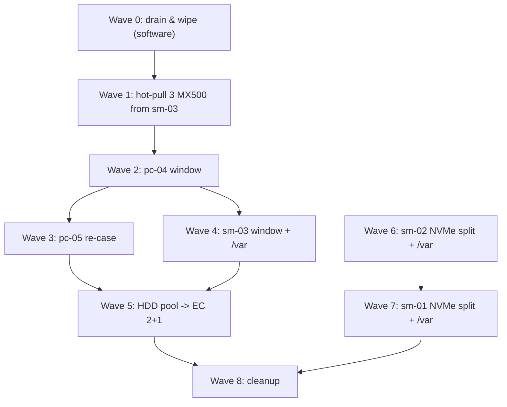

# Moving Talos `/var` off the SuperDOMs & Storage Reshuffle

The three Supermicro control-plane nodes boot from 16 GB SATA SuperDOMs. Talos puts its `EPHEMERAL` volume (`/var`: container images, logs, etcd, the Ceph monitor store) on the boot disk by default, which left each node with a **12.5 GiB `/var`**. That caused:

- pod evictions for `ephemeral-storage` (the Actual Budget backup, 2026-10-18),
- `MON_DISK_LOW` whenever a Ceph monitor landed on an sm node,
- etcd write latency up to 2.6 s on sm-node-02, where etcd and a monitor shared the SuperDOM (`KubeAPIErrorBudgetBurn`).

Interim mitigations (soft taint `homelab.bar2sek.com/small-var`, earlier image GC, monitors on the pc nodes) are recorded in [[001-deployment-journal|the journal]], Milestones 29–32. This runbook is the real fix.

---

## 🎯 Target layout (final, 2026-10-18)

Inspecting the hardware shaped the plan:
- **The E300s (sm-node-01/02) are full:** no free power header, and their only spare SATA port is the one osd.5's cable was moved off after a fault. `/var` therefore shares the NVMe.
- **pc-node-04 has three unused SSDs** and only 9 HDDs (not 11). SMART (2026-10-18): the **250 GB MX500 `2228E6489822`** is like new (1,808 h, 0% endurance used, no errors); the two Intel 335 180 GB report contradictory wear data and stay spares.
- **sm-node-03's 813M has four 3.5" hot-swap bays**; its MX500s sit in 2.5" adapters, so HDDs fit directly.
- **pc-node-05 gets re-cased** into a case with 3.5" bays, making it a third HDD host. The RTX 4070 occupies the only PCIe slot, so its HDDs use onboard SATA.
- **The WD Green 1.5 TB (osd.18) is retired:** 644 reallocated sectors at 40,131 h. The four IronWolf ST4000VN008 are healthy (about 6,400 h, no errors).

| Node | Boot | `/var` (EPHEMERAL) | Ceph OSDs after |
|---|---|---|---|
| sm-node-01 | SuperDOM | 250 GiB on the Sabrent NVMe (`BC7107061E7C02090817`) | NVMe raw partition `r-osd-nvme` (~1.57 TiB) + MX500 × 2 |
| sm-node-02 | SuperDOM | 250 GiB on the Sabrent NVMe (`F2C10719080B00006324`) | Same as sm-node-01 |
| sm-node-03 | SuperDOM (second one stays spare) | **250 GB MX500 `2228E6489822`**, dedicated | MX500 × 1 (osd.7) + **2 × 4 TB IronWolf** |
| pc-node-04 | Intel 320 80 GB | unchanged | NVMe + **3 × MX500 2 TB** (from sm-node-03) + HDD 3 TB, 2 TB, 2 × 1 TB |
| pc-node-05 | **Kingston 240 GB SATA SSD** (Wave 3b; the whole Sabrent is now the gaming-VM disk) | on the Kingston | Crucial P3 NVMe + **2 × 4 TB IronWolf** (after re-case) |

**Disk moves**
| Disk | From → to | Today |
|---|---|---|
| 3 × MX500 2 TB (`2137E5D2DE1D`, `2137E5D2DE26`, `2253E698684D`) | sm-node-03 → pc-node-04 | osd.12, osd.13, osd.4 |
| 2 × IronWolf 4 TB | pc-node-04 → sm-node-03 | two of osd.11/14/15/16 |
| 2 × IronWolf 4 TB | pc-node-04 → pc-node-05 | the other two |
| MX500 250 GB `2228E6489822` | pc-node-04 → sm-node-03 (`/var`) | unused |
| WD15EADS 1.5 TB | pc-node-04 → retired | osd.18 |
| 2 × Intel 335 180 GB | stay in pc-node-04 as spares | unused |

### Pools afterwards

| Pool | Hosts (raw) | Usable | One host down |
|---|---|---|---|
| SSD, size 3 | sm-01 3.6, sm-02 3.6, sm-03 1.8, **pc-04 5.5** TiB | **~4.5 TiB** (was 3.6) | Keeps running **and rebuilds the third copy** (was: degraded until the host returns) |
| NVMe, size 3 | pc-04 0.9, pc-05 0.9, sm-01 1.6, sm-02 1.6 TiB | ~1.6 TiB (was 1.8) | Keeps running and rebuilds |
| HDD, **erasure coded 2+1, `failureDomain: host`** | sm-03 8, pc-05 8, pc-04 7 TB | **~14 TB** (was ~11) | **Survives** (was: lost with pc-node-04) |

The HDD pool stays a scratch/overflow tier. Erasure coding 2+1 stores each object as 2 data chunks plus 1 parity chunk on three different hosts (1.5× overhead, like RAID-5 across machines). Small writes are slower than replication, which suits media, bulk data and backup copies. RBD on an EC pool needs a small replicated metadata pool (on SSD). Set `min_size` to 2 so the pool stays writable with one host down, at the cost of no redundancy during that window; acceptable for scratch. The existing `hdd-bulk-pool` is empty, so it is replaced rather than converted.

### Why
- **A replicated pool fills when its smallest host fills.** With 3 copies on exactly 3 hosts, every host holds a full copy: sm-node-03's extra SSD capacity was unusable (each host held the same 55 GiB on 2026-10-18; sm-node-03's four disks carried about half as much each). A **fourth SSD host** (pc-node-04) raises usable capacity and gives Ceph somewhere to rebuild after a host failure.
- **Three balanced HDD hosts** make erasure coding possible: more usable space *and* host-failure tolerance.
- **etcd on fast, quiet disks:** NVMe on sm-01/02 (shared with an OSD, which NVMe handles well); a dedicated SSD on sm-03.
- **Size 2 was considered for SSD and rejected:** a host outage then either blocks writes (`min_size 2`) or risks losing recent writes (`min_size 1`). The SSD pool holds everything that matters.

### pc-node-05 constraints
- **RAM:** the gaming VM requests about 20 of 32 GB. Cap the two HDD OSDs at 2 GiB each (`ceph config set osd.<id> osd_memory_target 2147483648`; the default is 4 GiB). HDD OSDs gain little from more.
- **Ports and power:** two free onboard SATA ports, SATA power from the PSU, two 3.5" bays in the new case. Confirm before buying or moving anything.

### Deferred
- ~~**pc-node-05 boot on a spare Intel SSD** (whole Sabrent for the gaming VM): rejected; the Sabrent's 750 GiB is the VM's disk and moving it means a Bazzite rebuild.~~ Reversed and done in Wave 3b with a spare Kingston SSD instead: the VM image was backed up and restored, no rebuild needed (see *Progress*).

---

## 🔬 Mechanisms (verified 2026-10-18 on Omni v1.12.0 / Talos 1.13.10)

| Need | How | Source |
|---|---|---|
| Put EPHEMERAL on a chosen disk | `VolumeConfig` named `EPHEMERAL` with `provisioning.diskSelector.match` (CEL, e.g. `disk.serial == "…"`) and `minSize`/`maxSize`/`grow` | Talos docs, *System volumes* |
| Raw partition for Ceph | `RawVolumeConfig` → unformatted partition at `/dev/disk/by-partlabel/r-<name>`. **The name must not contain `ceph`** | Talos docs, *Raw volumes* |
| OSD on a partition | Rook supports raw partitions (no filesystem) given by full udev path in `devices[].name`; not with `encryptedDevice` (ours are unencrypted) | Rook *Prerequisites*, *CephCluster CRD* |
| Re-provision EPHEMERAL | Volume config applies **only when the volume does not exist yet**. Omni blocks `talosctl reset`, but removing a machine from the cluster makes Omni reset it: STATE and EPHEMERAL are wiped, and since Talos 1.12 the partitions themselves are removed (talos#12090), so EPHEMERAL can be created elsewhere when the machine rejoins | Omni docs *Wipe a machine*; Omni v1.10 release notes; siderolabs/talos#12090 |
| Keep the other OSDs | Omni's reset does not erase non-system disks; Rook re-activates their OSDs by UUID when the node returns | Omni docs *Wipe a machine* |
| Wipe the repurposed disk | Must happen **while the node is still running**: `talosctl wipe disk` does not work on Omni-managed machines in maintenance mode (talos#13583) | GitHub issue |

---

## ✅ Pre-flight (before every node)

```bash
kubectl -n rook-ceph exec deploy/rook-ceph-tools -- ceph status        # HEALTH_OK, all PGs active+clean
kubectl -n rook-ceph exec deploy/rook-ceph-tools -- ceph mon stat      # 3 mons in quorum
talosctl -n sm-node-01,sm-node-02,sm-node-03 etcd members              # 3 members
kubectl get jobs -A | grep -i backup                                   # last night's backups succeeded
```
Also: no other maintenance in progress. Silence the expected alerts first (`CephOSDDownHigh` is critical and fires immediately); the matchers are in [[104-phase2-rook-ceph-storage|Rook-Ceph]], *Taking a Node Offline*. Never have two control-plane nodes down at once.

---

## 🌊 Execution waves

**Rules:** never two control-plane nodes (sm-01/02/03) down at once (etcd quorum); never pc-node-04 and pc-node-05 down together (they host monitors f and h); drain a disk in Ceph *before* it moves (a moved disk gets a fresh OSD); every downtime window starts with the alert silence from [[104-phase2-rook-ceph-storage|Rook-Ceph]] *Taking a Node Offline* and ends at `HEALTH_OK`. Waves can be days apart; the cluster is healthy between them.



| Wave | What | Downtime | Needs |
|---|---|---|---|
| **0** | Drain, remove and wipe: osd.12/13/4 (sm-03 MX500s), the four IronWolf OSDs and osd.18 (WD Green). The HDD pool is empty, so those are instant; the SSD drain moves sm-03's copy onto osd.7. Remove them from `cluster.yaml`. Wipe each disk from a debug pod **while its node runs** (Phase A below) | none | — |
| **1** | **Hot-pull** the three wiped MX500s from sm-node-03's hot-swap bays while it runs. This breaks the dependency loop (pc-04 needs sm-03's SSDs, sm-03 needs pc-04's disks) without a second pc-04 window. Pull one drive at a time and check that sm-node-03 stays `Ready` and Ceph stays `HEALTH_OK` | none | 0 |
| **2** | **pc-node-04 window:** silence; pause the Rook operator (mon.f); `noout`; drain; shutdown. Out: 4 × IronWolf, WD Green, 250 GB MX500. In: 3 × MX500 2 TB. Boot; add the three MX500s to pc-node-04 in `cluster.yaml` (by-id); Rook creates SSD OSDs and data rebalances onto the fourth SSD host | about 30 min; apps move to other nodes | 1 |
| **3** | **pc-node-05 re-case:** silence; stop the gaming VM; pause the operator (mon.h); `noout`; drain; shutdown. Move board, GPU and both NVMe into the new case; add 2 × IronWolf. Boot; add them to pc-node-05 in `cluster.yaml`; cap their `osd_memory_target`; start the VM | a few hours | 2 |
| **3b** | **pc-node-05 boot move (added 2026-10-18):** Talos + `/var` → the Kingston SQ500S3 240 GB (`naa.50026b768322ebd7`, SMART OK, ~18 TB written); the whole Sabrent becomes the gaming VM's own partition (~930 GiB). Back up the VM disk image (38 GiB used) to a temporary RBD volume; pin `machine.install.diskSelector` by WWID; pause the operator; remove the machine in Omni and reinstall it from the Omni USB installer (Kingston first in BIOS); wipe the Sabrent while the node runs; add the `gaming-vm` user volume as a partition; restore and start the VM. A pilot for Wave 4's Omni re-add on a worker | about 1.5 h, VM offline | 3 |
| **4** | **sm-node-03 window:** Omni patch `VolumeConfig` EPHEMERAL → `disk.wwid == "naa.500a0751e6489822"` (the MX250; **not** its serial: Talos reports no serial for SATA disks, so a serial selector would match nothing). Sync first; a no-op on the running node. Insert the 250 GB MX500 and 2 × IronWolf (hot-swap or powered off). Silence, `noout`, then Omni *Destroy* → maintenance → template sync re-adds it with `/var` on the 250 GB. Add the IronWolfs to sm-node-03 in `cluster.yaml` | about 1 h (etcd runs on 2 of 3) | 2 |
| **5** | **HDD pool → EC 2+1 by host:** create the new EC data pool, its replicated metadata pool and StorageClass; delete the old empty `hdd-bulk-pool` and `rook-ceph-hdd-bulk`; update docs/104 *Accepted Trade-offs* | none | 3, 4 |
| **6** | **sm-node-02:** NVMe split per the per-node procedure (osd.9) | about 1 h | — |
| **7** | **sm-node-01:** same (osd.10); pause the operator for mon.i | about 1 h | 6 |
| **8** | Remove the soft taint `homelab.bar2sek.com/small-var` (Omni patch); revisit monitor placement now that sm nodes have real `/var`; update docs 101/104/106 and the journal | none | all |

Waves 6–7 are independent of the hardware waves and can run before or after them.

**Physical steps** (drive register with serials, bay identification, what to bring): [[111-storage-reshuffle-hardware-checklist|Hardware checklist]].

---

## 🛠️ Per-node procedure (sm-node-02 shown; differences below)

### Phase A: drain and wipe the disk being repurposed
1. **Take the OSD out of Ceph** and wait for its data to move (the NVMe pool is nearly empty, so this is quick):
   ```bash
   kubectl -n rook-ceph exec deploy/rook-ceph-tools -- ceph osd out osd.9
   kubectl -n rook-ceph exec deploy/rook-ceph-tools -- ceph pg stat     # wait for all active+clean
   kubectl -n rook-ceph exec deploy/rook-ceph-tools -- ceph osd safe-to-destroy osd.9
   ```
2. **Remove the disk from `cluster.yaml`** (comment it out under sm-node-02) and apply, so Rook does not recreate the OSD.
3. **Remove the OSD:** scale `rook-ceph-osd-9` to 0, `ceph osd purge 9 --yes-i-really-mean-it`, delete the Deployment.
4. **Wipe the disk** from a privileged debug pod on the node (zap the GPT, clear the BlueStore label, discard):
   ```bash
   kubectl debug node/sm-node-02 -n kube-system --profile=sysadmin -it --image=alpine:3.24 -- sh -c \
     'apk add -q sgdisk util-linux && D=$(readlink -f /host/dev/disk/by-id/nvme-Sabrent_Rocket_Q_F2C10719080B00006324) && [ -b "$D" ] && \
      sgdisk --zap-all $D && dd if=/dev/zero of=$D bs=1M count=100 oflag=direct && blkdiscard $D && lsblk -f $D'
   ```
   `lsblk -f` must show no filesystem. Delete the `node-debugger-*` pod afterwards.

   > [!WARNING]
   > Inside a `kubectl debug node` pod, `/dev/disk/by-id/` **does not exist**: udev symlinks live on the host, whose `/dev` is mounted at `/host/dev`. Always resolve `readlink -f /host/dev/disk/by-id/<id>` and guard with `[ -b "$D" ]`. An empty path otherwise slips past a "not the system disk" check (found 2026-10-19 in the sm-node-03 Wave 4 prep scan).

> [!CAUTION]
> **Ceph Squid keeps backup BlueStore labels at 1, 10, 100 and 1000 GiB** (`bluestore_bdev_label_multi`, Ceph 19.2+). `blkdiscard` clears them on SSD/NVMe, but **HDDs do not support discard**, so on an HDD the wipe above only clears the first 100 MiB. `ceph-volume raw list` then finds a backup label, and the Rook prepare job, which scans *every* disk on the node, not just the ones in `cluster.yaml`, **re-activates the purged OSD with its old ID**. Talos `discoveredvolumes` and `lsblk -f` do not recognise the label, so the disk *looks* blank.
>
> This happened on 2026-10-18: osd.11/14/15/16/18 came back on pc-node-04 about an hour after Wave 0. They were classless, so no CRUSH rule selected them and they held 0 PGs. For every disk (and always for HDDs), zero each label offset too, then **verify by reading the offsets**, not with `lsblk`:
> ```bash
> # inside the debug pod, D=/dev/disk/by-id/...
> for g in 0 1 10 100 1000; do dd if=/dev/zero of=$D bs=1M seek=$((g*1024)) count=1 oflag=direct conv=notrunc; done
> for g in 0 1 10 100 1000; do printf "@%sGiB: " $g; dd if=$D bs=1M skip=$((g*1024)) count=1 status=none | head -c 64 | tr -c '[:print:]' .; echo; done   # all dots = clean
> ```
> Do it with the **Rook operator scaled to 0**, after deleting the OSD Deployment, so a reconcile cannot re-create the OSD in between.

### Phase B: add the volume config (Omni template)
Add the **`VolumeConfig` only** to the sm-node-02 `Machine` patches in `talos/cluster-template.yaml`, run `omnictl cluster template diff`, then `sync`. Nothing changes on the running node: its EPHEMERAL already exists. **The `RawVolumeConfig` is added later, in Phase C step 4.**

> [!CAUTION]
> **Do not sync the `RawVolumeConfig` before the reset.** EPHEMERAL's config is used only when EPHEMERAL is *created*, but a `RawVolumeConfig` is a **user volume**: Talos provisions it **as soon as it is synced** if a matching disk has room. After Phase A the NVMe is blank, so `grow: true` would claim the whole disk on the running node, and since the reset wipes only system volumes, EPHEMERAL would find no room afterwards. Order: EPHEMERAL config → reset/re-add (EPHEMERAL takes its 250 GiB) → raw volume config → sync (fills the rest). Caught before syncing on 2026-10-19 (Wave 6).
```yaml
apiVersion: v1alpha1
kind: VolumeConfig
name: EPHEMERAL
provisioning:
  diskSelector:
    match: disk.serial == "F2C10719080B00006324"
  minSize: 250GiB
  maxSize: 250GiB
  grow: false
---
apiVersion: v1alpha1
kind: RawVolumeConfig
name: osd-nvme # becomes /dev/disk/by-partlabel/r-osd-nvme; must not contain "ceph"
provisioning:
  diskSelector:
    match: disk.serial == "F2C10719080B00006324"
  minSize: 1TiB
  grow: true
```

### Phase C: re-provision the node
1. `kubectl -n rook-ceph exec deploy/rook-ceph-tools -- ceph osd set-group noout sm-node-02` (its other OSDs will be down briefly; don't rebalance).
2. **Remove the machine from the cluster** in Omni (cluster view → machine → *Destroy*). Omni removes the etcd member and resets the machine; it reboots into maintenance mode.
3. **Gate, then re-add.** In maintenance mode, confirm `omnictl get machineinstalldiskstatus <id>` names the SuperDOM (by WWID in `talosctl --talosconfig <generic> -n <id> get disks`) and that the NVMe is blank. Then `omnictl cluster template sync -f talos/cluster-template.yaml`: Omni adds it back, Talos installs to the SuperDOM and creates EPHEMERAL (250 GiB) on the NVMe.
4. **Add the `RawVolumeConfig`** (below) to the same patch and sync again. On the running node Talos creates `r-osd-nvme` in the remaining space (`talosctl get volumestatus r-osd-nvme` → `ready`, ~1.7 TB).
   ```yaml
   apiVersion: v1alpha1
   kind: RawVolumeConfig
   name: osd-nvme # becomes /dev/disk/by-partlabel/r-osd-nvme; must not contain "ceph"
   provisioning:
     diskSelector:
       match: disk.serial == "<NVMe serial>"
     minSize: 1TiB
     grow: true
   ```

> [!IMPORTANT]
> **Proven on pc-node-05 in Wave 3b (2026-10-18):**
> - **Removing the machine** = `omnictl delete machinesetnode <machine-id>` (the UI's *Destroy*). Omni resets it and it is back in **maintenance mode within about 60 s**, booted from its own disk, without a full BIOS restart. Re-adding with the template sync took about 1 minute.
> - **Monitor and OSDs survive the reset.** `/var/lib/rook` is wiped with EPHEMERAL, yet mon.h rebuilt itself from the other two and rejoined quorum, and every OSD on a non-system disk re-activated by UUID. Pause the operator first so it does not fail the mon over to another node in the meantime.
> - **Omni picks the install disk from `MachineInstallDiskConfig`** (`talos/machine-install-disks.yaml`, applied with `omnictl apply -f`), not from the template. It writes its choice into `machine.install.disk`, which overrides any `install.diskSelector` in a patch. Those entries were `/dev/sdX` names; pc-node-05's now uses a CEL `diskselector` on the WWID. **Check sm-node-03's entry (`/dev/sde`) before Wave 4**: Wave 4 keeps its SuperDOM as the install disk, but the disk names there changed in Wave 1/2.
> - **"Already installed" wins over the selector.** Omni and Talos both reuse a disk that still holds Talos partitions. Moving the install disk needs the old one fully wiped: boot the Omni USB installer → *Reset system disk* (the second run left the Sabrent completely blank), boot the installer again, and **wait until `omnictl get machinestatus` refreshes** (`installed` label gone, `machineinstalldiskstatus` naming the new disk) before re-adding. Re-adding against the stale status installed onto the old disk once.
> - **Disk names are unstable on the B650I** (`nvme0n1`/`nvme1n1` swapped on every boot). Select by serial/WWID everywhere; read names from the current boot only.
> - **Maintenance-mode access:** `omnictl talosconfig <file> --merge=false` gives a generic talosconfig that reaches machines outside any cluster (`talosctl --talosconfig <file> -n <machine-id> get discoveredvolumes`). `omnictl machine-logs <id>` shows the kernel's disk detection.

### Phase D: verify and bring the OSD back
```bash
talosctl -n sm-node-02 get volumestatus EPHEMERAL r-osd-nvme     # EPHEMERAL on nvme0n1p?, ~250 GiB; raw volume ready
talosctl -n sm-node-02 etcd members                               # back to 3
kubectl get node sm-node-02                                       # Ready
```
Then in `cluster.yaml` set sm-node-02's NVMe entry to `/dev/disk/by-partlabel/r-osd-nvme`, apply, and wait for Rook to create the new OSD. Finally `ceph osd unset-group noout sm-node-02` and wait for `HEALTH_OK`.

### Differences for the other nodes
- **sm-node-03:** combined with the disk swap (see *Target layout*): drain osd.12, osd.13 and osd.4 (they move to pc-node-04); `VolumeConfig` for EPHEMERAL selects the 250 GB MX500 by **WWID** `naa.500a0751e6489822` (whole disk, `minSize: 200GiB`, `grow: true`, no `maxSize`), no `RawVolumeConfig`. See *Execution waves*, Wave 4. sm-01/02 can keep `disk.serial`: Talos does report NVMe serials.
- **sm-node-01:** like sm-node-02 with osd.10 and serial `BC7107061E7C02090817`. It holds **mon.i**; it fails over (about 10 min) while the node is out. Do this node last.

---

## ↩️ If something goes wrong
- **EPHEMERAL lands on the SuperDOM again:** the reset left the old partition. Remove the machine again; if that repeats, reset out of band (Talos ISO over IPMI virtual media → *Reset system disk*).
- **Node does not come back (volume config cannot be satisfied):** remove the new patches from the template, sync, and remove/re-add the machine again; it returns to the old layout.
- **Ceph:** while `noout` is set, a slow return costs nothing. Unset it once the node's OSDs are up.

---

## 📋 Progress

> [!NOTE]
> **Migration complete (2026-10-19).** Every node's `/var` is off a SuperDOM: sm-node-01/02 on a 250 GiB slice of their Sabrent NVMe (rest = NVMe OSD), sm-node-03 on a 250 GB MX500, pc-node-05 on its Kingston SSD. The HDD tier is erasure coded 2+1 across three hosts. 20 OSDs, 41 TiB raw, HEALTH_OK.

| Wave | Status |
|---|---|
| 0 Drain & wipe | **Done 2026-10-18**: 8 OSDs out → backfill (55 GiB to osd.7) → purged; 8 disks wiped. The 3 sm-03 MX500s are clean at every label offset. **The 5 HDDs were not:** backup BlueStore labels survived, and Rook re-activated osd.11/14/15/16/18 (0 PGs, classless). Fixed the same day: operator scaled to 0, the five re-purged, label offsets zeroed and verified (0 non-zero bytes at 0/1/10/100/1000 GiB); back to 13 OSDs, HEALTH_OK |
| 1 Hot-pull sm-03 MX500s | **Done 2026-10-18**: MX-DE1D, MX-DE26, MX-684D detached (`/sys/block/…/device/delete`) and pulled; bay LEDs show no SSD activity on this backplane, so the "detach all, then pull" fallback was used. osd.7 (MX-6843) untouched |
| 2 pc-node-04 window | **Done 2026-10-18**: drained (apps → pc-node-05; only the empty hdd-bulk-pool went stale; AirPrint is pinned to pc-04 so it was offline), shut down, 4 × IronWolf + WD Green + MX250 out, 3 × MX500 in. All existing OSDs re-activated by UUID despite new `/dev/sdX` letters. New SSD OSDs osd.4 (684D), osd.11 (DE1D), osd.12 (DE26); backfill of ~35% of the SSD pool took about 6 min; HEALTH_OK, 16 OSDs. MX250 + IW-H5S + IW-RSJ hot-inserted into sm-node-03 the same day (unused until Wave 4) |
| 3 pc-node-05 re-case | **Done 2026-10-18**: VM stopped, drained (apps → pc-node-04), re-cased with IW-65H + IW-889 on onboard SATA. New HDD OSDs osd.13 (IW-65H) and osd.14 (IW-889), capped at 2 GiB via `spec.cephConfig` in `cluster.yaml`; osd.0 re-activated. HEALTH_OK, 18 OSDs; VM + Sunshine back. An unplanned Kingston SQ500S3 SATA SSD appeared as `sdc` (not in `cluster.yaml`, unused) |
| 3b pc-node-05 boot → Kingston | **Done 2026-10-18**: decided whole Sabrent for gaming, no Ceph OSD (the NVMe pool is nearly empty; a split would add only ~140 GiB usable). VM image backed up and restored (sha256 matched); Talos + 238 GB EPHEMERAL on the Kingston; `gaming-vm` partition volume = whole Sabrent (932 GB). Needed two reset cycles: the first reinstalled onto the Sabrent because `MachineInstallDiskConfig` pinned `/dev/nvme1n1` and Omni's status was stale (see Phase C *Proven* callout). HEALTH_OK, VM + Sunshine back |
| 4 sm-node-03 window | **Done 2026-10-19** (11:34–11:52 CDT): drained, silenced, `noout`; Omni *Destroy* → maintenance in ~60 s; install disk re-checked in maintenance mode (`machineinstalldiskstatus` = `/dev/sde`, WWID `…9a000069`, fresh status version; STATE/EPHEMERAL gone from the SuperDOM); re-added via a scratch template; node `Ready` ~2 min after the Destroy. **`/var` = MX250 `sdc1`, 250 GB XFS** (was 14 GB). etcd back to 3 members; osd.7 re-activated by UUID within a minute. IronWolfs → **osd.15 (IW-H5S) and osd.16 (IW-RSJ)**, hdd; 20 OSDs, 41 TiB raw, HEALTH_OK. See *Wave 4 lessons* below |
| 5 HDD pool → EC 2+1 | **Done 2026-10-19**: `hdd-ec-data-pool` (k=2 m=1, host, hdd, `min_size 2`, `bulk`, `ec_overwrites`) + `hdd-ec-meta-pool` (3x SSD) + StorageClass `rook-ceph-hdd-ec`. CRUSH rule `take default~hdd` → `chooseleaf_indep host`. Smoke test: 1 GiB written at ~98 MB/s with fsync, stored 1.0 GiB = used 1.5 GiB; MAX AVAIL 13 TiB; autoscaler grew it to 128+ PGs. Old `hdd-bulk-pool` / `rook-ceph-hdd-bulk` (empty) deleted. Dashboard tooltip updated |
| 6 sm-node-02 | **Done 2026-10-19** (12:29–12:43 CDT): osd.9 out → safe-to-destroy → operator 0 → purged; Sabrent wiped (zap + discard; label offsets 0/1/10/100/1000 GiB read back as zeros). `cluster.yaml` entry → `/dev/disk/by-partlabel/r-osd-nvme`. EPHEMERAL `VolumeConfig` synced alone (raw volume held back, see Phase B caution); Destroy → maintenance in 71 s; gate passed (install disk `/dev/sda` = SuperDOM `…0a000103`); re-add → `Ready` in 20 s; **`/var` = `nvme0n1p1` 250 GiB**. Then `RawVolumeConfig` synced → `r-osd-nvme` = `nvme0n1p2` 1.7 TB; operator 1 → new **osd.9** (ID reused) on the partition, 1.575 TiB. HEALTH_OK, 497 PGs clean |
| 7 sm-node-01 | **Done 2026-10-19** (12:45–12:55 CDT): same as Wave 6 with osd.10. **mon.i:** the operator stayed at 0 from the purge until sm-01 was `Ready` again, so mon.i was never failed over; during the window quorum was f,h. After the reset mon.i rebuilt its store from f and h on the new `/var` and rejoined (monmap still epoch e15: no mon was added or removed). Destroy → maintenance 81 s; gate passed (`/dev/sda` = SuperDOM `…0a000088`); `Ready` under 2 min after the Destroy; `/var` = `nvme0n1p1` 250 GiB; `r-osd-nvme` 1.7 TB → new **osd.10** (1.575 TiB). The drain waited a few seconds on KubeVirt's `virt-exportproxy` PodDisruptionBudget. HEALTH_OK, 497 PGs clean |
| 8 Cleanup | **Done 2026-10-19** (12:56–13:00 CDT): Omni patch `controlplane-prefer-no-schedule` deleted via template sync → taint `homelab.bar2sek.com/small-var` gone from all sm nodes, applied live (no reboot; uptimes unchanged). OSD toleration for it left in `cluster.yaml` as inert (removing it would roll every OSD). Monitor placement reviewed, unchanged (f/h/i on three nodes). Dead `Error` pods: none left (deleted with the old Node objects during the resets). `CephNodeDiskspaceWarning` on pc-node-05 = ghost series of the pre-Wave-3b `/var` (`nvme1n1p4`) inside `predict_linear[2d]`; narrow silence until 2026-10-22. `controlplane-image-gc` (60/50 %, 7 days) kept: harmless with 250 GiB `/var` |

### Wave 4 lessons (2026-10-19)

> [!WARNING]
> **Rook silently skips nodes with an untolerated taint, even `PreferNoSchedule`.** The new IronWolfs got no prepare job; the operator log said `skipping creation of OSDs on nodes [sm-node-01 sm-node-02 sm-node-03]: placement settings do not match`. Cause: the soft taint `homelab.bar2sek.com/small-var` (Omni patch `controlplane-prefer-no-schedule`), added after the existing sm OSDs were created. Fix: `placement.osd.tolerations` for that key in `cluster.yaml` (OSDs only; mgr/mds keep preferring the PCs). Waves 6–7 depend on this too.

> [!IMPORTANT]
> **Any change to the OSD placement restarts every OSD.** The pod spec changes, so Rook rolls all OSD Deployments one host at a time (it checks `ok-to-stop` first). Expect a few minutes of `host down` / `degraded` flapping in `ceph -s`; it settled to `241 active+clean` in about 10 minutes here. Silence first, and do it outside other maintenance.

> [!TIP]
> **Syncing the shared template while another change is pending in it:** another session's unsynced pc-node-05 network change sat in `talos/cluster-template.yaml`, and the re-add requires a sync. Build a scratch copy from `git show HEAD:talos/cluster-template.yaml` plus only the hunk you need, and require `omnictl cluster template diff -f <scratch>` to be **empty** before relying on it. (`omnictl cluster template export` is not a clean substitute: it also exports the `MachineInstallDiskConfigs`, and syncing it would make the template take ownership of them.)

- **Disk names moved again on sm-node-03 after the reset** (IronWolfs `sda`/`sdb`, MX250 `sdc`). Every selector involved was by WWID or by-id, so nothing cared.
- **`talosctl get volumeconfigs` is `PermissionDenied` through Omni's proxy;** verify a synced patch with `omnictl get configpatches <id> -o yaml` and `omnictl get clustermachineconfigstatus <machine-id>` (`lastconfigerror` empty).
- **The API VIP** (`10.10.20.10`) was on sm-node-03 and moved automatically; kubectl via Omni's proxy (`10.10.10.5:8100`) was unaffected.
- **`CephNodeDiskspaceWarning` (pc-node-05)** names `/dev/nvme1n1p4` with mountpoint `/var`, a device from before Wave 3b. Likely stale, not a space problem; investigate separately.

### Open items before Wave 4 (as of 2026-10-19)
- [x] **Install disks by WWID:** `talos/machine-install-disks.yaml` rewritten 2026-10-19 so every node uses a CEL `diskselector` on `disk.wwid` instead of `/dev/sdX`. Model/serial selectors don't work here: Talos reports no serial for any SATA disk, and sm-node-03 has two identical SuperDOMs. Applied 2026-10-19; `omnictl get machineinstalldiskstatus` re-evaluated the four changed entries (version +1) and still names the current system disk on all five nodes. Note that a running node reports *Talos is already installed on …*, so the selector itself is only exercised at the next reset (Wave 4 for sm-node-03): check this status again in maintenance mode before the template sync.
- [x] **Wipe sm-node-03's spare SuperDOM** (`sdf`, WWID `naa.515d94519a000032`; old non-Talos install with an EFI partition, so the BIOS could boot it after the reset): see [[111-storage-reshuffle-hardware-checklist|docs/111]] Wave 4.
- [x] **Wipe the MX250's old `zfs_member` signature** in sm-node-03 (now `sda`, WWID `naa.500a0751e6489822`) while the node runs: see [[111-storage-reshuffle-hardware-checklist|docs/111]] Wave 4.
- [x] **Wipes done 2026-10-19** (both disks via `kubectl debug` + `/host/dev/disk/by-id/wwn-…`): the MX250 still had **two `zfs_member` labels in its last 512 KiB** (ZFS L2/L3, pool `database_pool`); Talos `discoveredvolumes` called it blank because it only probes the start of the disk, but `wipefs` (list mode) found them. The spare SuperDOM held an old ZFS-on-root boot disk (EF02 BIOS-boot + EF00 ESP + BF01 ZFS). Per-partition `wipefs -a`, `sgdisk --zap-all`, whole-disk `wipefs -a` and `blkdiscard` (worked on both, the SuperDOM included); afterwards `wipefs`/`blkid -p` show nothing and Talos lists both as plain disks.
- [x] **Pod-network MTU mismatch:** pc-node-05's flannel `cni0` was 8950 (derived from its 9000-byte NIC with VLAN 20 untagged) while the other nodes were 1450, which fired `CephNodeInconsistentMTU`. Talos-managed flannel has no MTU setting, so VLAN 20 is now tagged on pc-node-05 (`enp12s0` 9000 with no IP, `enp12s0.20` 1500, `enp12s0.40` 9000) and USW Aggregation Port 6 is native None, tagged 20 + 40. **Done 2026-10-19**: all `cni0` at 1450, `HEALTH_OK`, alert cleared. Runbook and reasoning in [[201-unifi-network-topology|docs/201]].
- [ ] **Watch** `CephNodeDiskspaceWarning` on pc-node-05: a trend alert from the fresh `/var` and the restore; it should clear by itself.
- [ ] **BIOS on pc-node-05:** set the Kingston as first boot device at the next reboot (optional; it is the only bootable disk).
- [ ] **Re-auth helper:** a generic talosconfig for maintenance-mode machines is not stored in the repo; recreate it with `omnictl talosconfig <file> --merge=false` (see Phase C *Proven*).
