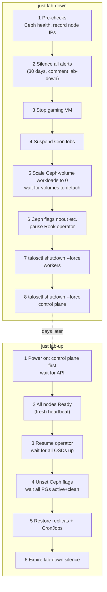

# 🔌 Cluster Cold Stop & Start (Weekend Lab Mode)

**Why:** the stack draws about 380 W around the clock (UPS telemetry, 2026-10-22), roughly $33 a month at $0.12/kWh. Until it runs services that need to be always-on (cameras, Home Assistant), the cluster runs as a **weekend lab**: powered on when in use, off the rest of the week. The network, `omni-server` and the Synology stay on.

**How:** two Justfile recipes wrap the whole procedure:

```bash
just lab-down   # silence, stop apps, freeze Ceph, power off every node
just lab-up     # wait for nodes, thaw Ceph, restore apps, un-silence
```

> [!IMPORTANT]
> Status: **`lab-down` proven (2026-10-24), `lab-up` not yet run.** See *First Run Log* below. Set `status: evergreen` once the first `lab-up` is done and recorded here and in the [[001-deployment-journal|deployment journal]].

This is the whole-cluster version of *Runbook: Taking a Node Offline for Hardware Work* in [[104-phase2-rook-ceph-storage|docs/104]]. That runbook keeps the cluster up while one node leaves; this one stops everything, so the order matters more.

---

## 💡 What Stays On, What Goes Dark

| Stays on (about 80–100 W, to be measured) | Off |
| :--- | :--- |
| UDM-Pro, both USW-Aggregation, USW-24-G2, garage switch and APs (home internet) | All 5 Talos nodes |
| `omni-server` (Omni, Dex, NUT server, PXE booter) | Bazzite gaming VM |
| Synology DS713+ (Time Machine, backup copies) | Every in-cluster app |
| Both UPSes | |

| Service while the cluster is off | Effect |
| :--- | :--- |
| Actual Budget | Clients work offline and sync when it's back |
| Authentik SSO | Unavailable. **Omni login is unaffected**: Dex runs on `omni-server` ([[108-omni-dex-platform-architecture\|docs/108]]) |
| Backups (S3 + NAS CronJobs) | Suspended; each runs **one catch-up job** when `lab-up` resumes it |
| ntfy, Grafana, UPS dashboards | Unavailable. The UPSes themselves keep working; NUT runs on `omni-server` |
| Cloudflare tunnel apps | Unreachable from outside, including `nas.bar2sek.com` (`cloudflared` runs in the cluster). On the LAN, use `https://10.0.1.223:5001` |

**Expected savings:** if the cluster is about 280–300 W of the 380 W and runs roughly 2.5 days a week, about 65% off-time saves around **$15–18 a month**. Confirm with the Kill-A-Watt: measure each UPS input with the cluster off.

---

## 🧭 The Sequence and Why It's Ordered This Way



### `lab-down`, step by step

1. **Pre-checks.** Shows `ceph health` and the nodes, and asks before continuing if Ceph isn't `HEALTH_OK`. It records node IPs here because `kubectl` stops answering once the control plane is down.
2. **Silence every alert for up to 30 days** (`alertname=~".+"`, comment `lab-down`). Alertmanager saves silences to its volume, so the silence is still there at the next boot. That keeps the dozens of "node down" and "target down" alerts from boot and shutdown off the phone. `lab-up` expires it.
3. **Stop the gaming VM** if it's running (`virtctl stop`). With `runStrategy: Manual` it stays off afterwards.
4. **Suspend CronJobs** and mark each with `homelab.bar2sek.com/lab-down-suspended`, so `lab-up` resumes only what was running before (anything you suspended yourself stays suspended).
5. **Scale every workload that mounts a Ceph volume to 0**, then wait until no `rook-ceph` VolumeAttachments remain. This is the key step. An app writing to an RBD volume while the OSDs behind it disappear can hang the node's unmount or lose its last writes; stopping apps while Ceph is fully up lets them flush and unmount cleanly.
   - Targets are found automatically: pods (not Jobs or VMs) whose PVC uses a `rook-ceph*` StorageClass, traced up to whatever owns their replica count. As of 2026-10-24 that's 7: `actual-budget`, `authentik-db`, `ntfy`, `airprint-bridge`, `kube-prometheus-stack-grafana`, and the **Prometheus** and **Alertmanager** resources. Those last two are operator-managed: scaling their StatefulSets directly would be reverted, so the recipe patches `spec.replicas` on the custom resource.
   - Each target's replica count is saved in the annotation `homelab.bar2sek.com/lab-down-replicas`, stored in etcd, which survives the shutdown. New apps (Frigate, Home Assistant) are picked up without editing the recipe.
6. **Freeze Ceph and pause the operator.**
   - `noout`, `norebalance`, `nobackfill`, `norecover` stop Ceph from treating vanishing OSDs as failures and starting to re-replicate terabytes.
   - The Rook operator is scaled to 0. Otherwise a node that takes more than about 10 minutes to come back during `lab-up` (say, pc-node-05 waiting on its power button) gets its **monitor failed over** to another node.
7. **Power off the workers**, then 8. **the control plane**, with `talosctl shutdown --force`. `--force` skips Talos's cordon-and-drain, which is safe because the apps are already stopped, and necessary because a drain needs the Kubernetes API. Once two control-plane nodes are down, etcd loses quorum and the API is gone. Talos's own shutdown doesn't need the API, and etcd recovers from a full stop once two members are back.

Steps 1, 5 (if volumes won't detach) and 7 stop and ask. `LAB_YES=1 just lab-down` skips the prompts, but use that only once the procedure has been proven.

### `lab-up`, step by step

1. **Power on the nodes, control plane first.**
   - **sm-node-01..03:** IPMI web UI at `https://10.10.10.11`, `.12` and `.13` (*Remote Control → Power Control → Power On*), or the front button.
   - **pc-node-04 and pc-node-05:** the power button. See *Remote Power-On* below for alternatives.
   - The recipe polls the Kubernetes API through Omni's proxy until it answers (up to 30 min).
2. **Wait for every node to be `Ready` with a heartbeat newer than when `lab-up` started.** After a full stop, the API can briefly report the last *pre-shutdown* status, which says `Ready`, so a plain `kubectl wait` could pass while nodes are still off.
3. **Resume the Rook operator and wait until every OSD is up** (`num_up_osds == num_osds`, 20 today).
4. **Unset the Ceph flags and wait until every PG is `active+clean`.** Then print `ceph health`. A leftover `HEALTH_WARN` (e.g. a recent daemon crash report) is not a blocker; read it.
5. **Restore** every annotated workload to its saved replica count, and resume the annotated CronJobs. Each CronJob runs one catch-up job right away, because its schedule was missed while the cluster was off.
6. **Expire the `lab-down` silence**, then list any pods not `Running`/`Completed`. Authentik's server pods crash-loop until its database is back, then settle.

The gaming VM stays off. Start it with `just bazzite-start` and stop it with `just bazzite-stop`.

---

## 🧪 First Run (Attended)

Do the first cycle with a terminal open and Grafana/Ceph status visible, on a day when an hour of trouble is acceptable.

1. **Before:** Ceph `HEALTH_OK`, a recent good backup on the Synology, and the Kill-A-Watt on one UPS input to read the "cluster off" draw.
2. Run `just lab-down` **without** `LAB_YES`. At each prompt, check what the previous step printed:
   - After step 5: `kubectl get volumeattachments` shows no `rook-ceph` entries.
   - After step 6: `ceph osd dump | grep flags` shows the four flags.
3. **After power-off:** note the wattage at each UPS. That is the real "lab off" cost.
4. **Next session:** `just lab-up`, power on the nodes, and time each phase. Afterwards check:
   ```bash
   just ceph-status                                   # HEALTH_OK, 20 OSDs up/in
   kubectl get pods -A | grep -vE 'Running|Completed' # empty after a few minutes
   kubectl get cronjobs -A                            # SUSPEND = False
   ```
   Also log into Actual Budget and Grafana, and check that the catch-up backups landed on the NAS and in S3.
5. Record the timings and wattage here and in the deployment journal, and set this note's `status` to `evergreen`.

### First Run Log

**`lab-down`, 2026-10-24: clean, 7 min 28 s end to end.**

- **Before:** `HEALTH_OK`, 20/20 OSDs, 497 PGs `active+clean`. All 6 backup jobs from that night had completed. `talosctl` reached all 5 nodes through Omni (Admin role).
- **VM:** `runStrategy: Manual` applied just before. Step 3 stopped the running VMI on pc-node-05 without trouble.
- **Step 4:** suspended 6 CronJobs (3 S3, 3 NAS).
- **Step 5:** found the 7 expected targets. Attachments went 7 → 6 → 1 and reached 0 in about 40 s; the last one to detach was a ReadWriteOnce volume finishing its unmount. Scaling Grafana printed a PodSecurity `restricted` warning about its `init-chown-data` container. That warning is about the chart's existing pod spec, not the scale, and is harmless here.
- **Steps 7–8:** each node finished its Talos shutdown sequence (`stopEverything`). Afterwards none of the 5 IPs answered ping.
- **Gotcha:** both prompts were answered in one go, before the step 6 check could happen. The log (`~/lab-down-<timestamp>.log`, written with `tee`) confirmed everything afterwards, so keep the `tee` habit.
- **Lab-off wattage:** _to be measured with the Kill-A-Watt._

**`lab-up`:** _not yet run._

---

## 🔋 Remote Power-On

| Node | Today | Possible later |
| :--- | :--- | :--- |
| sm-node-01..03 | IPMI web UI (`10.10.10.11-13`) or button | `ipmitool -I lanplus -H 10.10.10.1x -U <user> -E chassis power on` (password in `IPMI_PASSWORD`, never on the command line), with `ipmitool` added through nix-darwin |
| pc-node-04, pc-node-05 | Power button | **Smart plug:** BIOS already has *Restore AC Power Loss: Power On* ([[301-pxe-boot-node-provisioning\|docs/301]]), so after `lab-down`, turning the plug off and on boots the PC. **Wake-on-LAN:** enabled in BIOS, but a magic packet from the Mac (default VLAN) can't cross into VLAN 20. It would have to come from `omni-server`, which has a VLAN 20 address (`10.10.20.5`) |

---

## ⚠️ Gotchas & Recovery

- **`lab-down` stopped partway (you answered "no", or something failed).** Everything it did is reversible by `lab-up`: it only acts on annotated objects, and unsetting flags that aren't set is harmless. If the nodes are still on, run `just lab-up` and it passes straight through the wait steps.
- **Volumes won't detach in step 5.** Some pod still uses a Ceph volume: `kubectl get volumeattachments` → find the PV → `kubectl get pv <pv> -o jsonpath='{.spec.claimRef}'` → see which pod mounts that claim. Usually it's a backup Job that started just before the CronJobs were suspended; wait for it to finish.
- **`lab-up` times out on OSDs.** A node didn't boot, or a disk didn't come up: `ceph osd tree | grep down` shows which. The Ceph flags are still set at that point, so nothing rebalances while you look.
- **A monitor is missing after boot.** The operator was paused, so it can't have failed over. `ceph mon stat` shows which mon is out of quorum, which tells you which node to check.
- **Apps that need 24/7.** Frigate ([[507-frigate-nvr-cameras|docs/507]]) and Home Assistant are always-on services. Once they're deployed, revisit whether weekend mode still fits, or whether only the gaming VM should stay on-demand.
- **Ansible against the VM.** `just bazzite-setup` and the other `bazzite-*` playbook recipes need the VM running. Run `just bazzite-start` first.
- **Talos and Kubernetes upgrades.** Don't start one before `lab-down`; let it finish, or do it during a lab session.
