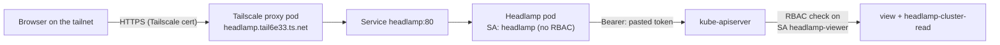

# 🔦 Headlamp: Read-Only Kubernetes Web UI

> [!NOTE]
> **Status (2026-11-03): deployed and verified.** Pod running, Tailscale ingress serving `https://headlamp.tail6e33.ts.net` (HTTP 200), `just headlamp-rbac-check` 7/7.

## 🎯 Why Headlamp, and why not Portainer

Grafana ([[106-observability-prometheus-grafana|docs/106]]) shows **trends**: CPU over a week, Ceph capacity, alert history. Headlamp shows **current state**: which pods are crash-looping, what an event says, what a container logged a minute ago, how a Deployment is wired to its Service and PVC.

| Option | Verdict |
| :--- | :--- |
| **Headlamp** | Chosen. Official Kubernetes SIG UI project; uses Kubernetes RBAC directly. |
| Portainer | Built around Docker. Its Kubernetes mode is a second-class citizen and adds its own user database next to Authentik. |
| Kubernetes Dashboard | Retired upstream; Headlamp is its recommended successor. |
| k9s | Great terminal companion, not a replacement (worth adding via nix-darwin). |

## 🏛️ How it works



**Key idea:** Headlamp has no permissions of its own. It forwards the token you paste at login, and the API server checks RBAC on *that* identity. The UI can only ever show what the token can read.

### Two ServiceAccounts, on purpose

| ServiceAccount | Used for | Permissions |
| :--- | :--- | :--- |
| `headlamp` | The pod itself (`-in-cluster` reads the API address and CA from its mounted files) | **None.** No bindings. |
| `headlamp-viewer` | Your login token | Built-in `view` ClusterRole + `headlamp-cluster-read` |

> [!WARNING]
> **The upstream Helm chart's default binds the pod's own ServiceAccount to `cluster-admin`** (`clusterRoleBinding.create: true`). Anyone who could reach the UI would effectively be cluster-admin, and the login screen would be decoration. That is why this repo uses a plain manifest (same style as ntfy) instead of the chart.

### Why the extra ClusterRole

The built-in `view` role only covers **namespaced** resources, and it deliberately excludes Secrets. Nodes, PersistentVolumes, StorageClasses, CRDs and node metrics are **cluster-scoped**, so without `headlamp-cluster-read` those pages show "forbidden". The extra role adds read-only access to exactly those.

## 🚀 Deploy

Prerequisites: the Tailscale operator ([[203-tailscale-mesh-vpn|docs/203]]) with HTTPS certificates enabled in the tailnet (already true for ntfy).

```bash
just headlamp-apply
just headlamp-token          # 30-day token by default
just headlamp-token 168h     # or pick a shorter one
```

Open `https://headlamp.tail6e33.ts.net`, choose **token** login, paste the output of `just headlamp-token`.

> [!TIP]
> The token is printed once and stored nowhere. It lives in the browser session (`-session-ttl=86400`, one day). When it expires, run `just headlamp-token` again. Nothing to rotate, nothing to commit.

## ✅ Verification

```bash
kubectl -n headlamp get pods,svc,ingress
# Ingress ADDRESS should show headlamp.tail6e33.ts.net

just headlamp-rbac-check
# ok   headlamp-viewer  list    nodes                allowed=true
# ok   headlamp-viewer  get     pods/log             allowed=true
# ok   headlamp-viewer  list    persistentvolumes    allowed=true
# ok   headlamp-viewer  list    secrets              allowed=false
# ok   headlamp-viewer  delete  pods                 allowed=false
# ok   headlamp         list    pods                 allowed=false
# ok   headlamp         list    secrets              allowed=false
```

> [!WARNING]
> **Don't trust `kubectl auth can-i --as=...` here.** The workstation kubeconfig goes through Omni's Kubernetes proxy, which authenticates you and then makes the request as your Omni identity, so `--as` answers reflect *your* admin rights ("yes" to everything, including `delete pods`). `just headlamp-rbac-check` creates `SubjectAccessReview` objects instead: the API server's authorizer evaluates RBAC for the named ServiceAccount directly, and nothing is stored.

In the UI: Cluster → Nodes lists all five nodes; a pod's Logs tab streams; Secrets shows "forbidden" (expected).

## 🩺 Troubleshooting

| Symptom | Cause / fix |
| :--- | :--- |
| Nodes or Storage page says forbidden | `headlamp-cluster-read` binding missing: re-run `just headlamp-apply`. |
| Pod CrashLoops with a read-only filesystem error | Something needs a writable path besides `/tmp`. Check `kubectl -n headlamp logs deploy/headlamp` and add an `emptyDir` for that path. |
| Node CPU/memory graphs empty | No metrics-server in the cluster. The RBAC already allows `metrics.k8s.io`; deploying metrics-server would light them up. |
| Login says "unauthorized" | Token expired. `just headlamp-token`. |
| URL times out right after deploy | The Tailscale proxy pod (`tailscale` namespace, `ts-headlamp-*`) is still joining the tailnet and getting its certificate. Took about a minute on first deploy. |

## 🔮 Later

- **Authentik SSO:** add OIDC flags to the kube-apiserver through a Talos patch, add an Authentik provider, and bind RBAC to Authentik groups. That gives per-person identity instead of a shared viewer token. It's a rolling control-plane change, so it's deferred.
- **Write access:** if restarting a Deployment from the UI becomes useful, add a separate `headlamp-operator` ServiceAccount with a narrow role (e.g. `patch` on deployments) rather than widening the viewer.
