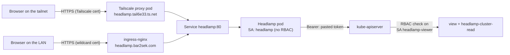

# 🔦 Headlamp: Read-Only Kubernetes Web UI

> [!NOTE]
> **Status (2026-11-03): deployed and verified.** Pod running, Tailscale ingress serving `https://headlamp.tail6e33.ts.net` (HTTP 200), `just headlamp-rbac-check` 7/7.
>
> **Status (2026-11-05): LAN name live.** `https://headlamp.bar2sek.com` serves HTTP 200 with the wildcard certificate, WebSocket upgrade returns 101, no public DNS answer, tailnet URL unaffected, `just headlamp-rbac-check` 7/7. Token login in a browser not yet exercised on this name.

## 🌐 Which URL to use

| Where you are | URL | Why |
| :--- | :--- | :--- |
| At home | `https://headlamp.bar2sek.com` | UniFi local DNS points at ingress-nginx, which serves the wildcard certificate. |
| Away, on the tailnet | `https://headlamp.tail6e33.ts.net` | The `bar2sek.com` name has no public DNS record, so it doesn't resolve off the LAN. |

Both reach the same pod and use the same token login.

> [!NOTE]
> Adding the LAN name widens who can reach the **login screen**: any device that can route to the ingress VIP, not only tailnet members. That is acceptable because the page grants nothing without a token, and even a valid token is read-only with no access to Secrets. There is deliberately no public DNS record or Cloudflare tunnel route.

## 🎯 Why Headlamp, and why not Portainer

Grafana ([[106-observability-prometheus-grafana|docs/106]]) shows **trends**: CPU over a week, Ceph capacity, alert history. Headlamp shows **current state**: which pods are crash-looping, what an event says, what a container logged a minute ago, how a Deployment is wired to its Service and PVC.

| Option | Verdict |
| :--- | :--- |
| **Headlamp** | Chosen. Official Kubernetes SIG UI project; uses Kubernetes RBAC directly. |
| Portainer | Built around Docker. Its Kubernetes mode is a second-class citizen and adds its own user database next to Authentik. |
| Kubernetes Dashboard | Retired upstream; Headlamp is its recommended successor. |
| k9s | Great terminal companion, not a replacement (worth adding via nix-darwin). |

## 🏛️ How it works



**Key idea:** Headlamp has no permissions of its own. It forwards the token you paste at login, and the API server checks RBAC on *that* identity. The UI can only ever show what the token can read.

### Two ServiceAccounts, on purpose

| ServiceAccount | Used for | Permissions |
| :--- | :--- | :--- |
| `headlamp` | The pod itself (`-in-cluster` reads the API address and CA from its mounted files) | **None.** No bindings. |
| `headlamp-viewer` | Your login token | Built-in `view` ClusterRole + `headlamp-cluster-read` |

> [!WARNING]
> **The upstream Helm chart's default binds the pod's own ServiceAccount to `cluster-admin`** (`clusterRoleBinding.create: true`). Anyone who could reach the UI would effectively be cluster-admin, and the login screen would be decoration. That is why this repo uses a plain manifest (same style as ntfy) instead of the chart.

### Why the extra ClusterRole

The built-in `view` role only covers **namespaced** resources, and it deliberately excludes Secrets. Nodes, PersistentVolumes, StorageClasses, CRDs and node metrics are **cluster-scoped**, so without `headlamp-cluster-read` those pages show "forbidden". The extra role adds read-only access to exactly those.

## 🚀 Deploy

Prerequisites: the Tailscale operator ([[203-tailscale-mesh-vpn|docs/203]]) with HTTPS certificates enabled in the tailnet (already true for ntfy).

```bash
just tf-apply unifi          # adds headlamp.bar2sek.com local DNS
just headlamp-apply
just headlamp-token          # 30-day token by default
just headlamp-token 168h     # or pick a shorter one
```

Open `https://headlamp.bar2sek.com` (or the tailnet URL when away), choose **token** login, paste the output of `just headlamp-token`.

> [!TIP]
> The token is printed once and stored nowhere. It lives in the browser session (`-session-ttl=86400`, one day). When it expires, run `just headlamp-token` again. Nothing to rotate, nothing to commit.

## ✅ Verification

```bash
kubectl -n headlamp get pods,svc,ingress
# Ingress ADDRESS should show headlamp.tail6e33.ts.net (headlamp)
# and 10.10.20.50 (headlamp-lan)

just headlamp-rbac-check
# ok   headlamp-viewer  list    nodes                allowed=true
# ok   headlamp-viewer  get     pods/log             allowed=true
# ok   headlamp-viewer  list    persistentvolumes    allowed=true
# ok   headlamp-viewer  list    secrets              allowed=false
# ok   headlamp-viewer  delete  pods                 allowed=false
# ok   headlamp         list    pods                 allowed=false
# ok   headlamp         list    secrets              allowed=false
# ok   sso-viewer       list    nodes                allowed=true
# ok   sso-viewer       get     pods/log             allowed=true
# ok   sso-viewer       list    persistentvolumes    allowed=true
# ok   sso-viewer       list    secrets              allowed=false
# ok   sso-viewer       delete  pods                 allowed=false
# ok   sso-no-group     list    nodes                allowed=false
# ok   sso-no-group     list    pods                 allowed=false
```

The `sso-*` rows describe a user the API server can't authenticate yet, because a SubjectAccessReview only asks what RBAC would allow. They prove the bindings, not the login. `sso-no-group` is the negative control: the same user without the group gets nothing.

> [!WARNING]
> **Don't trust `kubectl auth can-i --as=...` here.** The workstation kubeconfig goes through Omni's Kubernetes proxy, which authenticates you and then makes the request as your Omni identity, so `--as` answers reflect *your* admin rights ("yes" to everything, including `delete pods`). `just headlamp-rbac-check` creates `SubjectAccessReview` objects instead: the API server's authorizer evaluates RBAC for the named ServiceAccount directly, and nothing is stored.

To confirm the LAN name stays private, ask a public resolver over HTTPS. The response should have no `Answer` section:

```bash
curl -s -H "accept: application/dns-json" "https://cloudflare-dns.com/dns-query?name=headlamp.bar2sek.com&type=A"
```

> [!WARNING]
> **Don't use `dig @1.1.1.1` for this.** The UDM intercepts outbound port 53, so it returns the local answer and looks like a public record exists. See [[205-split-horizon-dns-ipv6-leak|docs/205]].

In the UI: Cluster → Nodes lists all five nodes; a pod's Logs tab streams; Secrets shows "forbidden" (expected).

## 🔑 SSO through Authentik (in progress)

> [!NOTE]
> **Status (2026-11-06): phases 1 to 3 of 5 done.** All three API servers trust Authentik and passed the token tests. Headlamp isn't configured yet, so token login is still the only login.

Headlamp forwards whatever you log in with to the API server, so the API server has to trust the identity provider. That is why SSO needs a control-plane change and not only Headlamp flags.

| Phase | Change | Status |
| :--- | :--- | :--- |
| 1. Authentik | `headlamp` OIDC provider, application and `headlamp-viewers` group | Done |
| 2. Permissions | Bind `authentik:headlamp-viewers` to `view` and `headlamp-cluster-read` | Done |
| 3. API server | Check the node network reaches Authentik, then add OIDC flags through the Omni template | Done |
| 4. Headlamp | Add OIDC flags and the client secret, test both URLs | Not started |
| 5. Entra (later) | Enable Entra as Authentik's upstream login ([[407-azure-entra-id-authentik-federation|docs/407]]) | Not started |

Token login stays as the way in when Authentik is down.

SSO sends the browser to `auth.bar2sek.com`, which has a public DNS record pointing at Cloudflare, while `headlamp.bar2sek.com` has none. Sign-in away from home should therefore reach Authentik through Cloudflare, with Headlamp itself still reachable only at home or over Tailscale. Not yet tested from outside the LAN.

### What phase 1 created

```bash
just headlamp-sso-apply      # secret, blueprint ConfigMap, Authentik manifest, applies the blueprint
```

- **`kubernetes/infrastructure/authentik/blueprints/headlamp.yaml`** defines the provider, application, group and access binding. It is the first Authentik blueprint in this repo. The Grafana client has no definition here.
- **`headlamp-oidc` Secret** (namespaces `identity` and `headlamp`) holds the client secret. `just headlamp-oidc-secret` generates it in place, never prints it, and keeps the existing value on re-run. To rotate, delete it in both namespaces, then re-run `just headlamp-sso-apply`.
- **Issuer:** `https://auth.bar2sek.com/application/o/headlamp/`, client ID `headlamp`.

### What phase 2 created

`headlamp-sso-view` and `headlamp-sso-cluster-read` bind the group to the same roles as the token. They are separate from the token's bindings so SSO can be removed on its own. They do nothing until the API server trusts Authentik.

> [!IMPORTANT]
> **The group name must match the API server's prefix.** The bindings expect `authentik:headlamp-viewers`, so phase 3 must set `--oidc-groups-prefix=authentik:`. A different prefix means sign-in succeeds but every page says forbidden.

### Phase 3: one API server first

The flags now live in the `controlplane-oidc` patch in `talos/cluster-template.yaml`. They started as a temporary `controlplane-oidc-canary` patch on `sm-node-03`, because doing one node first limits a bad flag or an untrusted certificate chain to one of three API servers. Use the same approach for future API server flag changes.

```bash
omnictl cluster template diff -f talos/cluster-template.yaml   # expect only the intended patch
omnictl cluster template sync -f talos/cluster-template.yaml
```

The sync restarted only that node's `kube-apiserver` pod. The node did not reboot, and it was serving again in under a minute.

**To undo it:** delete the patch and run the same two commands. Omni runs outside the cluster, so this doesn't depend on the API server being healthy. Removing `controlplane-oidc` now restarts all three API servers and turns SSO off, and token login keeps working.

**Result on 2026-11-06:** test tokens signed with Authentik's real key, sent directly to each node's port 6443:

| Node | Token | Request | Result | What it proves |
| :--- | :--- | :--- | :--- | :--- |
| `sm-node-03` | In the group | Who am I | 201, `authentik:canary-test` in `authentik:headlamp-viewers` | Signature, issuer and both prefixes work |
| `sm-node-03` | In the group | List nodes | 200 | The phase 2 bindings apply |
| `sm-node-03` | In the group | List Secrets | 403 | Still read-only |
| `sm-node-03` | No group | List nodes | 403 | Access comes from the group |
| `sm-node-03` | Wrong audience | List nodes | 401 | Tokens for other apps are rejected |
| `sm-node-03` | ServiceAccount | List nodes | 200 | Token login still works |
| `sm-node-01` | In the group | List nodes | 401 | The control: no flags, no trust |
| `sm-node-01` | ServiceAccount | List nodes | 200 | Token login unaffected |

> [!NOTE]
> **This doesn't test a real sign-in.** The claims were written by hand to match what the API server expects, using `OAuth2Provider.encode()` in `ak shell`, which stores nothing. Whether Authentik's own ID tokens carry `preferred_username` and `groups` in that form is first tested by a browser login in phase 4.

> [!WARNING]
> **Test each node directly, not through the VIP or `kubectl`.** The VIP can land on an API server without the flags, and the Omni proxy replaces your identity. During the canary, an SSO login through the VIP can fail depending on which node answers, so Headlamp must wait until all three have the flags.

> [!TIP]
> **`omnictl cluster template status` can end in `context deadline exceeded` when nothing is wrong.** It happened on this sync even though the change had applied. `omnictl get clusterstatus homelab-k8s -o yaml` showed the cluster ready with 5/5 machines healthy. Confirm the flags on the pod too.

To check the flags:

```bash
kubectl -n kube-system get pod kube-apiserver-sm-node-03 -o json | jq -r '.spec.containers[0].command[]' | grep oidc
```

### Phase 3: all three API servers

It takes two syncs, so `sm-node-03` never loses its flags:

1. **Done 2026-11-06: add `controlplane-oidc` to the ControlPlane patches and keep the canary.** `sm-node-02` restarted at 14:10:02Z and `sm-node-01` at 14:10:23Z, one after the other, about a minute after the sync. `sm-node-03` kept the same values and did not restart. A check every few seconds during the rollout saw no API errors. All three then passed the six token tests from the table above, with the same flags on each.
2. **Done 2026-11-06: delete `controlplane-oidc-canary` in a separate sync.** This changed nothing on the nodes, because the shared patch sets the same values.

Syncing both changes at once could remove the canary first, depending on the order Omni applies them, and leave `sm-node-03` without the flags until the new patch lands.

A two-minute check after step 2 showed no restarts, all three still had the flags, and the token tests passed again.

### Gotchas

> [!WARNING]
> **Add group members in the blueprint, not the Authentik UI.** The worker re-applies blueprints on a schedule, so UI edits to these objects get overwritten, including `headlamp-viewers` membership. This matters when Entra users arrive.

> [!WARNING]
> **Never set `groups` on a user in a blueprint.** That could replace the user's whole list and remove `akadmin` from `authentik Admins`. Membership is set from the group side.

> [!IMPORTANT]
> `authentik-worker` now requires the `authentik-blueprints` ConfigMap and `headlamp-oidc` Secret. On a rebuilt cluster, run `just headlamp-sso-apply` rather than applying `authentik.yaml` alone, or the worker will not start.

- **A signing key is required.** The API server rejects symmetric tokens, and without a signing key Authentik issues HS256. Discovery should list `RS256`.
- **`offline_access` is what prevents hourly sign-outs.** The ID token expires with the one-hour access token, and the refresh token lasts 30 days. Headlamp must also request this scope in phase 4.
- **Test blueprint changes without applying them** using `Importer.from_string(text).validate()` in `ak shell`, which rolls back. Any `!Env` value must be set in that shell.

### Verify phase 1

```bash
curl -s https://auth.bar2sek.com/application/o/headlamp/.well-known/openid-configuration
# issuer as above, RS256, scopes include offline_access, claims include groups
kubectl -n identity exec deploy/authentik-worker -- ak apply_blueprint custom/headlamp.yaml
```

## 🩺 Troubleshooting

| Symptom | Cause / fix |
| :--- | :--- |
| Nodes or Storage page says forbidden | `headlamp-cluster-read` binding missing: re-run `just headlamp-apply`. |
| Pod CrashLoops with a read-only filesystem error | Something needs a writable path besides `/tmp`. Check `kubectl -n headlamp logs deploy/headlamp` and add an `emptyDir` for that path. |
| Node CPU/memory graphs empty | No metrics-server in the cluster. The RBAC already allows `metrics.k8s.io`; deploying metrics-server would light them up. |
| Login says "unauthorized" | Token expired. `just headlamp-token`. |
| `headlamp.bar2sek.com` doesn't resolve | Expected off the LAN (use the tailnet URL). At home: `just tf-apply unifi` hasn't run, or the client isn't using UniFi for DNS. Check with `dig +short headlamp.bar2sek.com`. |
| URL times out right after deploy | The Tailscale proxy pod (`tailscale` namespace, `ts-headlamp-*`) is still joining the tailnet and getting its certificate. Took about a minute on first deploy. |

## 🔮 Later

- **Write access:** if restarting a Deployment from the UI becomes useful, add a separate `headlamp-operator` ServiceAccount with a narrow role (e.g. `patch` on deployments) rather than widening the viewer.
