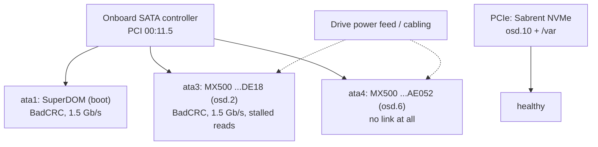

# 🩺 sm-node-01 SATA Fault: osd.6 Missing After the 2026-11-08 Restart

> [!IMPORTANT]
> **Current status (2026-11-09): sm-node-01 is a long-term down node, by choice.** The hardware fix is parked; there are higher-priority projects. Ceph was switched to long-outage mode so it no longer depends on the node: all its OSDs are out and every PG has three copies on the other hosts again. See [[#Long-term outage mode (2026-11-09)]]. Step B stays documented below for whenever the node comes back.

> [!IMPORTANT]
> **Update 2026-11-08 22:29Z: Step A done, all 497 PGs `active+clean`, three copies everywhere.** `ceph osd out 6` and `ceph osd unset noout` ran at 22:20Z; recovery took about eight minutes. During it **osd.2 crashed five times** (22:20–22:25Z, crash `KernelDevice::_aio_thread got r=-5 (Input/output error)`): under backfill load the kernel returned I/O errors from the bad SATA link and BlueStore aborts on purpose rather than risk bad data. It restarted each time and is up now, but it will keep doing this under load until the hardware is fixed. See *Step A result* in section 4. Step B (hardware) is still open.
>
> **Original status (2026-11-08, read-only diagnosis).** osd.6's SSD is not visible to the kernel on sm-node-01 at all, and the two SATA devices that *are* visible on that node (osd.2's SSD and the SuperDOM boot disk) are throwing interface CRC errors on links that fell back from 6.0 to 1.5 Gb/s. Media health is clean on both. This is a **SATA connection fault on sm-node-01** (cables, power or the onboard controller), which appeared during the planned power-down for the house EM16P install. It is not a Rook or Ceph bug and probably not a dead drive. Fix steps below wait for approval.

## 1. Context

On 2026-11-08 the whole cluster went through `just lab-down` / `just lab-up` ([[112-cluster-cold-stop-start|docs/112]]) so the house panel could be opened for the Refoss EM16P install. The nodes came back around 17:24Z. `lab-up` waits up to 20 minutes for every OSD to be up; osd.6 never came up, so `lab-up` timed out **before its thaw step**. That is why `noout` is still set. The other three flags (`norebalance`, `nobackfill`, `norecover`) were later unset by hand, and `noout` was kept on purpose until the drive was looked at. `noout` was not set by anything unexpected.

## 2. Evidence

| Check | Result |
| :--- | :--- |
| `ceph osd metadata 6` | MX500 serial `2351E88AE052`, `/dev/sdc`, `pci-0000:00:11.5-ata-4` |
| `ceph osd metadata 2` | MX500 serial `2137E5D2DE18`, `/dev/sdb`, `pci-0000:00:11.5-ata-3` |
| Omni `MachineStatus` block devices for sm-node-01 | Only three disks: Sabrent NVMe, SuperDOM (`ata1`), MX500 `…DE18` (`ata3`). **No device on `ata4`.** |
| osd-6 `activate` init container | `ceph-volume raw list /dev/sdc` fails with `not a block device`; the scan of every remaining device finds osd.2 and osd.10 but not osd.6 |
| Rook prepare job for sm-node-01 | Sees `sda`, `sdb`, `nvme0n1` only; the by-id path for `…AE052` does not exist |
| Kernel log (read from inside the osd.2 pod) | Since boot: `ata1` (SuperDOM) 522 error lines and 141 link resets, `ata3` (osd.2) 101 errors and 25 resets, `ata4` **nothing at all**. Errors are `SError: { UnrecovData HostInt 10B8B BadCRC }` followed by `hard resetting link` and `SATA link up 1.5 Gbps`. Reads on `sda` and `sdb` fail with I/O errors. Still happening at the time of the check. |
| `smartctl` on sm-node-01 now | SuperDOM: `UDMA_CRC_Error_Count` 289, link 1.5 of 6.0 Gb/s, 0 reallocated, 0 pending. MX500 `…DE18`: CRC **1634**, link 1.5 of 6.0 Gb/s, 0 reallocated, 0 pending, 0 uncorrectable, `Unexpect_Power_Loss_Ct` still 5 (so the shutdown itself was clean). |
| Ceph device-health history (daily SMART since 2026-09-14) | Both sm-node-01 MX500s had **CRC 0 and a 6.0 Gb/s link** every day up to the last sample before the restart (2026-11-08 00:09Z). sm-node-02's MX500 for comparison: CRC 1, unchanged since September. |
| `ceph health detail` | osd.2 `BLUESTORE_SLOW_OP_ALERT` and `DB_DEVICE_STALLED_READ_ALERT`: the Ceph view of the same failed reads and link resets |

### How to read it

- **CRC errors are a transport problem, not a flash problem.** Attribute 199 counts frames that arrived corrupted on the SATA wire. The drive's own media counters (reallocated, pending, uncorrectable) are all zero. After repeated link resets the kernel renegotiates at a lower speed to cope, which is why every reset here ends in `SATA link up 1.5 Gbps`.
- **All three SATA devices on the node changed at once, at the restart.** Two months of zero CRC errors, then hundreds to thousands within four hours, on two different ports, plus a third port that no longer links up at all. One bad drive cannot do that. Something they share does: the drives' power feed, their data cables, or the onboard SATA controller (`0000:00:11.5`, all three hang off it). The NVMe (separate PCIe path) is fine.
- **Same failure mode as osd.5 on sm-node-02 in October.** That drive also dropped off the SATA bus with clean SMART and came back after a cable/port change (Milestone 28 in [[001-deployment-journal|the journal]]). The two E300-9D boxes are tightly packed ("chassis full: no spare power header or usable SATA port", [[101-hardware-inventory|hardware inventory]]), so a connector that is marginal or got nudged is the most likely single cause.



### Ranked causes

1. **Disturbed or marginal SATA power or data cabling inside sm-node-01** (most likely). Fits the timing (the box was powered off and on, possibly moved or bumped during the panel work), the earlier osd.5 incident on the twin box, and clean media.
2. **Onboard SATA controller or board fault.** Fits "every port at once" just as well; the SuperDOM sits directly on a board connector and is affected too, which argues a little for this. Only a reseat/recable test can separate 1 from 2.
3. **osd.6's drive itself died.** Possible but least likely: it would not explain the CRC errors on the other two devices.
4. **Renamed device or Rook problem.** Ruled out. Rook searches by OSD UUID across every block device, and the disk is absent from the kernel, Omni and Talos alike. The `aborting OSD provisioning after waiting more than 20 minutes` reconcile error is a *consequence*: the operator is waiting for an OSD that cannot start.

## 3. Risk Right Now

- **No data is offline and nothing is lost.** All PGs are `active`. 41 PGs are `undersized` (two copies instead of three); 15 of them hold data (`builtin-ssd-pool` and `hdd-ec-meta-pool`). Total data on osd.6 was only about 20 GiB.
- **`noout` keeps them degraded indefinitely.** With `noout`, osd.6 stays "in", CRUSH keeps mapping a copy to it, and Ceph never rebuilds the third copy elsewhere. Without `noout` it would have rebuilt within minutes of the 10-minute `mon_osd_down_out_interval`.
- **The next failure is close by.** osd.2 sits on the same faulty bus and is already resetting its link. If it, or any SSD OSD on another host, drops while these PGs have two copies, the PGs that lose a second copy fall below `min_size 2` and **stop serving I/O** (data still safe on one copy, apps hang). Losing a third copy before recovery would lose data.
- **The SuperDOM is the Talos boot/system disk of a control-plane node.** `/var` (and etcd) moved to the NVMe in Wave 7 ([[110-ephemeral-var-migration|docs/110]]), so etcd is not exposed, but read errors on the boot disk could stop sm-node-01 from booting next time. etcd keeps quorum with the other two control planes.

## 4. Recommended Fix (awaiting approval)

### Step A: restore three copies now (mutating, Tier 2)

Do not wait for the hardware visit. Mark osd.6 out so Ceph re-replicates its ~20 GiB onto the other SSD hosts, then clear the leftover flag:

```bash
kubectl -n rook-ceph exec deploy/rook-ceph-tools -- ceph osd out 6
kubectl -n rook-ceph exec deploy/rook-ceph-tools -- ceph osd unset noout
kubectl -n rook-ceph exec deploy/rook-ceph-tools -- ceph -s   # watch until all PGs active+clean
```

Optional, to stop osd.2 serving reads over the bad link while it is flaky (reads go to a PG's primary; writes still reach it):

```bash
kubectl -n rook-ceph exec deploy/rook-ceph-tools -- ceph osd primary-affinity osd.2 0
```

> [!NOTE]
> Backfill may place some new copies on osd.2, since it is still a valid sm-node-01 target. That is acceptable at 20 GiB; the alternative (`ceph osd out 2` too) would leave sm-node-01 with no SSD OSD and push 40 GiB through the cluster for a problem the hardware visit should fix.

**Rollback:** `ceph osd in 6` (and `ceph osd primary-affinity osd.2 1`). Marking an OSD out deletes nothing on its disk; when the drive returns and is marked in, Ceph backfills the changed objects back.

### Step A result (2026-11-08)

- 22:20:30Z `osd out 6` + `unset noout` (primary-affinity left unchanged). Backfill ran at 50–430 MiB/s.
- Progress repeatedly jumped back to 56 undersized PGs with `peering`/`stale`: that was osd.2 crashing and rejoining (`RECENT_CRASH` lists 22:20:32, 22:21:45, 22:22:22, 22:24:03; one more at 22:25:43 in the pod log). Each crash came from the kernel returning `EIO` on `/dev/sdb`.
- 22:28:52Z: `497 active+clean`. Health is only `RECENT_CRASH` (archive with `ceph crash archive-all` once read).

**Open decision: take osd.2 out too?** With osd.6 out, sm-node-01 still holds a copy of its PGs on the flaky osd.2, and every load spike (backfill, scrub, a big write) can crash it again, briefly dropping those PGs to two copies. The pools are size 3 with `failureDomain: host`, and pc-node-04, sm-node-02 and sm-node-03 also have SSD OSDs, so `ceph osd out 2` leaves room for three copies on three hosts. Cost: ~21 GiB moves, and sm-node-01 holds no SSD data until Step B. Rollback: `ceph osd in 2`.

### Step B log (2026-11-08)

- ~22:40Z: pre-checks passed (497 `active+clean`, mons j+l keep quorum, no blocking PDB). Alertmanager silences for 3 h (ids `e5421b3d…`, `f73b484f…`), `ceph osd set-group noout sm-node-01`, Rook operator scaled to 0 (the node holds mon.i), node drained.
- 22:42Z: `talosctl -n sm-node-01 shutdown` (talosctl works again after an Omni browser sign-in with a freshly generated `omnictl talosconfig`). Node stopped answering ping and the Talos API; Omni still showed it connected for a few minutes afterwards (stale). Ceph: 187 PGs `active+undersized`, none inactive; mgr failed over within the cluster.
- BIOS SATA page (before any change): port 0 SuperDOM, port 1 empty, port 2 MX500, **port 3 MX500 (osd.6's drive, detected)**, port 4 "not installed". BIOS ports count from 0, Linux `ataN` from 1, so this matched Linux exactly: the drive answered the BIOS but Linux could not hold a link to it. The board has three regular SATA connectors (ports 1–3, left to right) plus the SuperDOM's own port 0; port 4 has no connector.
- Chassis: osd.6's drive was on the connector **closest to the CPU** (port 3), the same position as osd.5's on sm-node-02 in October. Moved it to port 1 (farthest from the CPU), the same fix that worked on sm-node-02.
- **After the move the node will not boot.** POST sits on the logo screen for a long time, ignores Del, then falls through to network boot ("No Media Present") and loops. Most likely a SATA device is stalling the BIOS's SATA probe, so it never reaches the SuperDOM. Not yet isolated.
- 2026-11-08 evening: **paused by the user; node left powered off.** Cluster state at the pause: sm-node-01 cordoned, per-node `noout` set, Rook operator at 0, mon quorum j+l (mon.i down), silences expire about 01:40Z on 2026-11-09. Switching to long-outage mode (clear the node's `noout` so Ceph rebuilds three copies, operator back to 1 so it replaces mon.i) was offered and **declined: left as is on purpose.** Until the node returns, the affected PGs have two copies and there are two monitors, so do not take down sm-node-02 or sm-node-03.

**Resume here:** power off, unplug osd.6's drive's data cable, power on. If POST is quick and Del works, the drive, its cable or port 1 is the culprit. If not, unplug osd.2's drive too, then check the SuperDOM. Note the POST code (bottom-right of the logo screen) during the stall. A physical USB keyboard catches Del more reliably than iKVM. Once in the BIOS, check the SuperDOM is on port 0 and first among the disks in the boot order (network PXE stays first overall, docs/103).

### Long-term outage mode (2026-11-09)

**Decision:** leave sm-node-01 powered off indefinitely rather than finish Step B now. Why it's safe: without sm-node-01, each device class still spans three hosts, which is what `size 3` / `failureDomain: host` needs (SSD: pc-node-04, sm-node-02, sm-node-03; NVMe: pc-node-04, pc-node-05, sm-node-02; HDD never had OSDs on sm-node-01). Only ~60 GiB of data is stored, so capacity isn't a concern.

| Time (UTC) | Action | Result |
| :--- | :--- | :--- |
| 00:37Z | `ceph osd unset-group noout sm-node-01` · `ceph osd out 2 10` (osd.6 was already out) | Backfill onto the other hosts |
| 00:37Z | `kubectl -n rook-ceph scale deploy rook-ceph-operator --replicas=1` | Operator back, mon health checks resume |
| 00:41Z | | **497/497 PGs `active+clean`**, about 4 minutes |
| 00:48Z | Operator: *mon "i" NOT found in quorum after timeout. Mon pod is not scheduled. Retrying* | **No failover.** Rook doesn't fail over a mon whose pod is still `Pending`; it treats that as a scheduling delay and restarts the timer. mon.i is pinned to sm-node-01 (`nodeSelector`), so it would wait forever |
| 00:52Z | `kubectl -n rook-ceph scale deploy rook-ceph-mon-i --replicas=0` | Rook's documented way to force a failover: with no pod, the next 10-minute timeout replaces the mon |
| 01:00Z | Operator fails over: canary on pc-node-05, *ensuring removal of unhealthy monitor i* | **mon.m on pc-node-05**, quorum `j,l,m`. The `rook-ceph-mon-i` deployment is gone |
| 01:01Z | `ceph crash archive-all` (the five osd.2 crashes, already recorded above) | **`HEALTH_OK`**, 497/497 `active+clean` |

Mons now: j (sm-node-03), l (pc-node-04), m (pc-node-05). Ceph no longer depends on sm-node-01 in any way.

**Left alone on purpose:**

* **etcd membership.** sm-node-01's etcd member stays registered. With 3 members and 1 down, quorum is 2 of 3; removing it would give 2 of 2. Both survive zero more failures, and removing it makes the rejoin harder. **While sm-node-01 is down, the cluster has no control-plane redundancy: sm-node-02 and sm-node-03 must both stay up** (no rolling Talos/Kubernetes upgrades or `lab-down` of either without accepting a control-plane outage).
* **The Kubernetes node object** stays (cordoned, `NotReady`). Omni would re-register it anyway. DaemonSet pods (flannel, kube-proxy, node-exporter) and Rook's per-node pods show `Pending` for it; that's expected noise.
* **The OSDs aren't purged.** They're `down`+`out` and hold no PG copies. If the node comes back with its disks intact they rejoin with `ceph osd in`; if not, purge them then.

**Alerts:** muted declaratively with `null` routes in `kubernetes/infrastructure/monitoring/values.yaml` (applied 2026-11-09 01:30Z; the temporary maintenance silences were expired). Scope and trade-offs: *Long-term muted node* in [[106-observability-prometheus-grafana|docs/106]].

**Bringing it back later:** do Step B. After the node is healthy, **remove the sm-node-01 `null` routes from `values.yaml` and run `just monitoring-apply`**. Then: `kubectl uncordon sm-node-01`, check the disks per Step B §3, then `ceph osd in 2 10` (and `6` once it's visible). Rook manages mon placement; the mon placement rule prefers pc-node-04/05 and only weights sm-node-01 at 50.

### Step B: hardware visit on sm-node-01 (mutating, Tier 2, planned window)

Single-node maintenance per [[104-phase2-rook-ceph-storage|docs/104]] (per-node `noout`, drain, shutdown from Omni). sm-node-01 is a control plane; the other two keep etcd quorum.

1. `ceph osd set-group noout sm-node-01`, drain the node, shut it down from Omni.
2. Open the chassis. Reseat **both ends** of every SATA data cable and every SATA power connector (including any splitter), and reseat the SuperDOM. Look for a pinched cable or a connector that sat half-out. If spare cables exist, replace the data cables for both MX500s.
3. Boot. Check, before uncordoning:
   - Omni `MachineStatus` (or `talosctl get disks`) lists **four** disks, with `…AE052` back.
   - Kernel log: `SATA link up 6.0 Gbps` on `ata1`, `ata3`, `ata4`; no new `BadCRC` lines for 30 minutes.
   - `smartctl -A` on each drive: attribute 199 no longer increasing (the count never resets; only the delta matters).
4. Uncordon, `ceph osd unset-group noout sm-node-01`. osd.6 should activate by UUID (the `activate` log reports `osd ID 6`); then `ceph osd in 6` (and `ceph osd in 2` if it was taken out).

**If the errors persist with new cables:** the controller or board is the suspect. Options are a Supermicro RMA of the board, or moving the MX500s to another host. **If only osd.6's drive stays missing** while the others are clean: test it in another machine; if it is dead, purge osd.6 and replace the drive (separate approval).

**Rollback for B:** cabling changes are physically reversible; Ceph state is untouched by the visit itself because of the per-node `noout`.

## 5. Gotchas & Follow-ups Found Along the Way

- **No alert fired for CRC errors or the link-speed drop.** The devicehealth data had it (CRC 0 → 1634), but nothing alerts on attribute 199 deltas or on `interface_speed`. Worth a Prometheus rule (smartctl exporter or mgr metrics).
- **`lab-up` timing out leaves `noout` set** with no reminder. The recipe could print a warning naming the down OSDs and the flags still set.
- **sm-node-01's node IP is now `10.10.20.145`**, not `10.10.20.199` as in [[104-phase2-rook-ceph-storage|docs/104]] and the `talos-uptime` Justfile recipe. osd.6's last address in the OSD map is still `.199`. Not the cause here, but the DHCP reservation is worth checking.
- **`talosctl` with the Omni-generated config needs its own browser sign-in** (a separate key for the `omni-server-homelab-k8s` context). For this diagnosis `omnictl get machinestatus` and the privileged OSD pod (`dmesg`, `smartctl`) were enough.

## 6. Diagnostic Commands Used (all read-only)

```bash
kubectl -n rook-ceph exec deploy/rook-ceph-tools -- ceph osd metadata 6 | grep -E 'device_ids|device_paths'
kubectl -n rook-ceph exec deploy/rook-ceph-tools -- ceph device get-health-metrics CT2000MX500SSD1_2137E5D2DE18
kubectl -n rook-ceph logs <osd-6 pod> -c activate
kubectl -n rook-ceph logs <rook-ceph-osd-prepare-sm-node-01 pod>
omnictl get clustermachineidentities -o yaml          # machine id -> node name
omnictl get machinestatus <machine-id> -o yaml        # hardware.blockdevices
kubectl -n rook-ceph exec <osd-2 pod> -c osd -- dmesg
kubectl -n rook-ceph exec <osd-2 pod> -c osd -- smartctl -i -A /dev/sdb
```

> [!TIP]
> The OSD pods are privileged and see the host's `/dev` and kernel ring buffer, so they are a handy read-only window into a Talos node when `talosctl` access is broken. The ring buffer is small: on this node it had already rolled past the boot messages after four hours of link resets.
