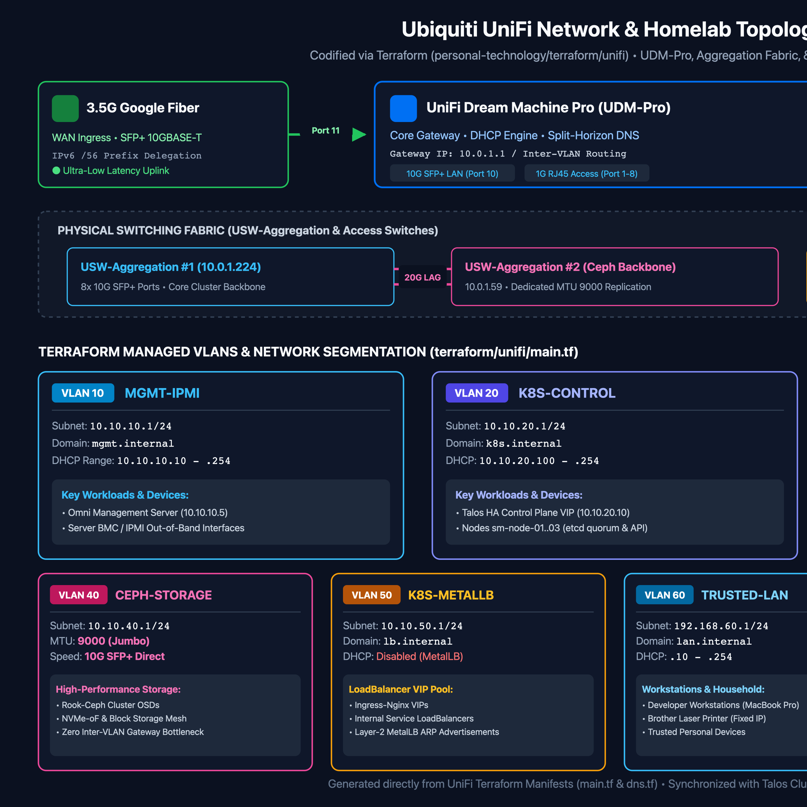
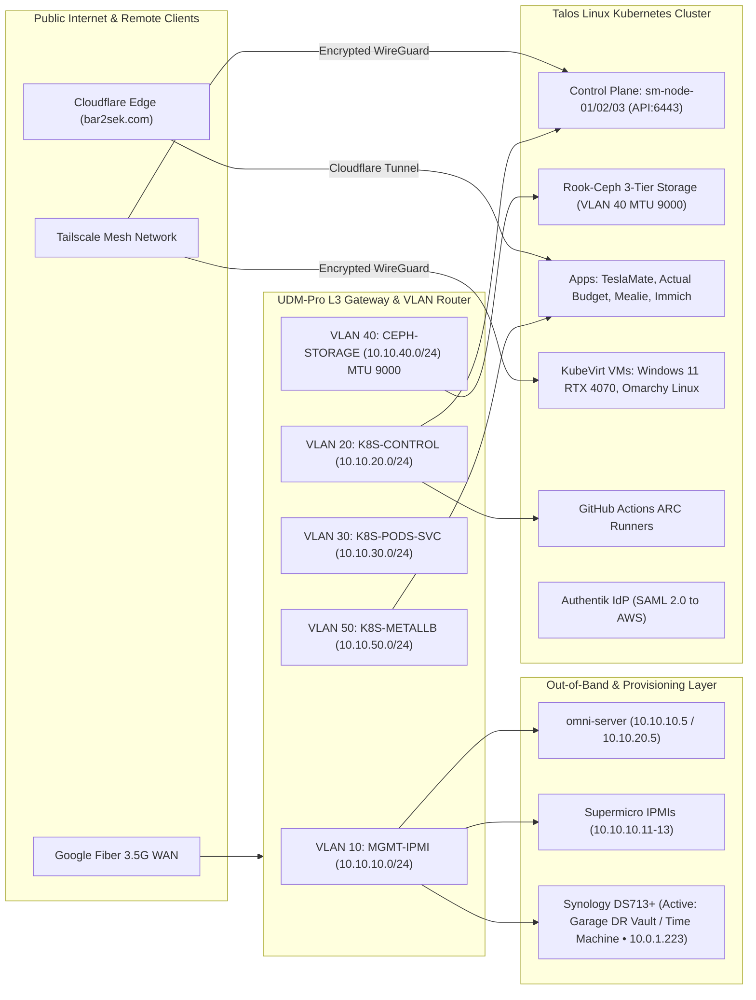
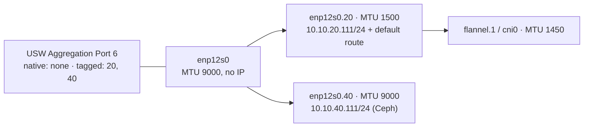

# UniFi Network Topology & VLAN Architecture

This document details the physical network topology, switch interconnects, WAN configuration, and VLAN layout for the Talos Linux homelab cluster.

---

## 🗺️ Live Network & VLAN Architecture


*Vector source:* [`architecture-unifi.svg`](architecture-unifi.svg)

---

## 🌐 Physical Network Infrastructure

### Core Hardware & Discovered MACs

- **Gateway / Router**: Ubiquiti UniFi Dream Machine Pro (UDM-Pro) (`68:d7:9a:xx:xx:xx` - `10.0.1.1`)
- **WAN Interface**: 3.5 Gbps Google Fiber connected to **UDM-Pro Port 11 (SFP+ WAN2)** via TP-Link `TL-SM5310-T` SFP+ to 10GBASE-T Transceiver (negotiated at 10G; IPv6 Prefix Delegation `/56`).
- **Core Switches**: 2x **UniFi Switch Aggregation (USW-Aggregation)**
  - **USW-Aggregation #1** (`f4:92:bf:xx:xx:xx` - `10.0.1.224`)
  - **Ceph-USW-Aggregation (#2)** (`f4:e2:c6:xx:xx:xx` - `10.0.1.59`)
  - Inter-Switch Backbone: **20 Gbps LAG (2-Port 10G SFP+ Link Aggregation)** on Ports 7 & 8 between Aggregation Switch 1 and Aggregation Switch 2.
  - Uplink: UDM-Pro Port 10 (SFP+ 10G) connected to USW-Aggregation fabric.
- **Access Switch (Core)**: 1x **UniFi Switch 24 (USW-24-G2)** (`24:5a:4c:xx:xx:xx` - `10.0.1.30`) (24x 1GbE RJ45 + 2x 1G SFP)
  - Dedicated access switch for Out-of-Band IPMI/BMC ports, Omni Mini PC 1GbE NIC, and 1GbE management interfaces.
  - Uplink: Port 8 connected to UDM-Pro / USW-Aggregation.
- **Access Switch (Garage)**: 1x **UniFi Switch Lite 8 PoE (USW-Lite-8-PoE)** (`78:45:58:xx:xx:xx` - `10.0.1.40`)
  - 8-port Gigabit switch with 802.3at PoE+ located in the garage to power garage AP, garage peripherals, and isolated backup storage.
  - Uplink: 1GbE RJ45 connection (Port 1) to core UDM-Pro (Port 2).
  - Port 2: Synology DS713+ (Active: 2x 2TB HDDs - `10.0.1.223`, Tier 3 bulk backup target, macOS Time Machine server, and isolated DR vault).
  - Port 8: PoE+ connection to U6-Lite WAP.
- **Wireless Infrastructure (Access Points)**:
  - **Home Wi-Fi 7 AP**: 1x **UniFi U7 Pro WAP** (`94:2a:6f:xx:xx:xx` - `10.0.1.214`) connected to USW-24-G2 Port 6 for primary household wireless coverage.
  - **Garage Wi-Fi 6 AP**: 1x **UniFi U6-Lite WAP** (`24:5a:4c:xx:xx:xx` - `10.0.1.45`) connected to USW-Lite-8-PoE Port 1 for garage/outdoor IoT and vehicle wireless coverage.
- **Node 05 Multi-Gig Uplink**: `pc-node-05` 2.5GbE Onboard RJ45 connected to **USW Aggregation (#1) Port 6** (UniFi port name `pc-node-05-2.5G-GPU`) via TP-Link Multi-Gig SFP+ 10GBASE-T Transceiver (auto-negotiated at **2.5 Gbps**). It is a trunk port with VLANs 20 and 40 both tagged; see *pc-node-05: single-NIC trunk and the pod MTU* below.

---

## 🔌 Physical Cabling & Port Interconnect Diagram

The diagram below details the physical cables, interface types (10G SFP+, 2.5G SFP+, 1G SFP, 1G RJ45), and port assignments connecting every device in the homelab:

```mermaid
graph TD
    %% Internet & Core Gateway
    WAN["3.5G Google Fiber WAN"] -->|10GBASE-T SFP+ Transceiver| UDMP_P11["UDM-Pro Port 11 (SFP+ WAN)"]
    
    %% Gateway Uplinks
    UDMP_P10["UDM-Pro Port 10 (10G SFP+ LAN)"] -->|10G SFP+ DAC Cable| AGG1_P1["USW-Aggregation #1 Port 1"]
    UDMP_P1["UDM-Pro Port 1 (1G RJ45)"] -->|Cat6 RJ45| U7PRO["U7 Pro WAP (Home Wi-Fi 7)"]
    UDMP_P2["UDM-Pro Port 2 (1G RJ45)"] -->|Cat6 RJ45| LITE8_P1["USW-Lite-8-PoE Port 1 (Garage Switch)"]

    %% Garage Switch, AP & Storage
    LITE8_P8["USW-Lite-8-PoE Port 8 (802.3at PoE)"] -->|Cat6 RJ45| U6LITE["U6-Lite WAP (Garage Wi-Fi 6)"]
    LITE8_P2["USW-Lite-8-PoE Port 2 (1G RJ45)"] -->|Cat6 RJ45| SYNOLOGY["Synology DS713+ (Garage DR & Time Machine • 10.0.1.223)"]

    %% Core Switch Aggregation 20G LAG Backbone
    AGG1_P7["USW-Agg #1 Port 7 (10G SFP+)"] ===|10G SFP+ DAC - 20G LAG| AGG2_P7["USW-Agg #2 Port 7 (10G SFP+)"]
    AGG1_P8["USW-Agg #1 Port 8 (10G SFP+)"] ===|10G SFP+ DAC - 20G LAG| AGG2_P8["USW-Agg #2 Port 8 (10G SFP+)"]

    %% Switch Aggregation to 1G Access Switch
    AGG1_P2["USW-Agg #1 Port 2 (10G SFP+)"] -->|1G SFP Transceiver| USW24_SFP1["USW-24-G2 SFP Port 25 (1G SFP)"]

    %% 10G SFP+ Server & PC Connections
    AGG1_P3["USW-Agg #1 Port 3 (10G SFP+)"] -->|10G SFP+ Fiber/DAC| SM1_10G1["sm-node-01 Port 1 (10G SFP+)"]
    AGG2_P3["USW-Agg #2 Port 3 (10G SFP+)"] -->|10G SFP+ Fiber/DAC| SM1_10G2["sm-node-01 Port 2 (10G SFP+)"]

    AGG1_P4["USW-Agg #1 Port 4 (10G SFP+)"] -->|10G SFP+ Fiber/DAC| SM2_10G1["sm-node-02 Port 1 (10G SFP+)"]
    AGG2_P4["USW-Agg #2 Port 4 (10G SFP+)"] -->|10G SFP+ Fiber/DAC| SM2_10G2["sm-node-02 Port 2 (10G SFP+)"]

    AGG1_P5["USW-Agg #1 Port 5 (10G SFP+)"] -->|10G SFP+ Fiber/DAC| SM3_10G1["sm-node-03 Port 1 (10G SFP+)"]
    AGG2_P5["USW-Agg #2 Port 5 (10G SFP+)"] -->|10G SFP+ Fiber/DAC| SM3_10G2["sm-node-03 Port 2 (10G SFP+)"]

    AGG1_P6["USW-Agg #1 Port 6 (10G SFP+)"] -->|10G SFP+ Fiber/DAC| PC4_10G1["pc-node-04 Port 1 (10G SFP+)"]
    AGG2_P6["USW-Agg #2 Port 6 (10G SFP+)"] -->|10G SFP+ Fiber/DAC| PC4_10G2["pc-node-04 Port 2 (10G SFP+)"]

    AGG1_P6["USW-Agg #1 Port 6 (10G SFP+)"] -->|2.5G SFP+ Transceiver| PC5_2G["pc-node-05 2.5GbE Onboard RJ45"]

    %% USW-24-G2 1G Management Connections
    USW24_P1["USW-24-G2 Port 1 (1G RJ45)"] -->|1G RJ45| OMNI["omni-server (Dell OptiPlex)"]
    USW24_P2["USW-24-G2 Port 2 (1G RJ45)"] -->|1G RJ45| SM1_IPMI["sm-node-01 IPMI Port"]
    USW24_P3["USW-24-G2 Port 3 (1G RJ45)"] -->|1G RJ45| SM2_IPMI["sm-node-02 IPMI Port"]
    USW24_P4["USW-24-G2 Port 4 (1G RJ45)"] -->|1G RJ45| SM3_IPMI["sm-node-03 IPMI Port"]
    USW24_P5["USW-24-G2 Port 5 (1G RJ45)"] -->|1G RJ45| PC4_1G["pc-node-04 1GbE Onboard"]
    USW24_P6["USW-24-G2 Port 6 (1G RJ45)"] -->|1G RJ45| PC5_USB["pc-node-05 1GbE USB Adapter"]
    USW24_P23["USW-24-G2 Port 23 (100M RJ45)"] -->|10/100M RJ45| BROTHER["Brother DCP-7065DN (10.0.1.25)"]
```



---

## 🌐 Logical Network & Traffic Flow Architecture

This diagram illustrates how traffic flows logically across subnets, VLANs, remote access tunnels, and Kubernetes service layers:



---

## 🏷 VLAN & Subnet Architecture (Proposed)

To ensure maximum security, QOS, and high storage performance for Rook-Ceph, we propose the following VLAN layout in UniFi:

| VLAN ID | Name | Subnet Range | Purpose & Traffic Description |
| :--- | :--- | :--- | :--- |
| **VLAN 10** | `MGMT-IPMI` | `10.10.10.0/24` | Out-of-Band Management (Supermicro IPMI / BMC ports, UDM-Pro admin, Omni Mini PC). |
| **VLAN 20** | `K8S-CONTROL` | `10.10.20.0/24` | Talos API (`6443`), Kubelet, etcd (`2379/2380`), and Omni provisioning traffic. |
| **VLAN 30** | `K8S-PODS-SVC` | `10.10.30.0/24` | Kubernetes Pod CNI network (Cilium / Calico) & Service nodeports. |
| **VLAN 40** | `CEPH-STORAGE` | `10.10.40.0/24` | Dedicated **10G SFP+** East-West storage replication network for Rook-Ceph OSDs. |
| **VLAN 50** | `K8S-METALLB` | `10.10.50.0/24` | Ingress LoadBalancer VIP pool allocated by MetalLB / Cilium BGP to route traffic from UniFi. |

---

## ⚙️ UniFi Configuration Notes

1. **Jumbo Frames (MTU 9000)**: Enable Jumbo Frames on the `CEPH-STORAGE` VLAN and USW-Aggregation switch ports connected to the nodes to maximize 10GbE Ceph throughput and lower CPU overhead.
2. **BGP Routing (Optional)**: If using Cilium for CNI, UniFi Dream Machine Pro / USW-Aggregation supports BGP routing to dynamically advertise Kubernetes LoadBalancer IPs directly into the network.
3. **pc-node-05 trunk port (USW Aggregation Port 6, `pc-node-05-2.5G-GPU`; not the Ceph switch)**: native VLAN **none**, tagged **20 + 40**. pc-node-05 has a single NIC, so both VLANs are tagged sub-interfaces on it. See below for the reason. This port setting is made in the UniFi UI; `terraform/unifi` doesn't manage switch ports.

### pc-node-05: single-NIC trunk and the pod MTU

**Why both VLANs are tagged.** The other four nodes have two NICs: a 1500-byte NIC for VLAN 20 and a 9000-byte NIC for VLAN 40. pc-node-05 has one 2.5 GbE NIC (RTL8125), and a VLAN sub-interface can't have a larger MTU than its parent. With VLAN 20 untagged, the NIC (`enp12s0`) had to run at 9000 for VLAN 40, and VLAN 20 inherited that. That caused two problems:

- **Pod MTU.** Flannel sets the VXLAN MTU from the link MTU of the default-route interface, minus 50. It ignores route MTUs. pc-node-05 got `cni0` = 8950 while every other node had 1450, and `CephNodeInconsistentMTU` fired. Talos-managed flannel has no MTU setting: in Talos v1.13 `net-conf.json` is hard-coded, and `cluster.network.cni.flannel` only offers `extraArgs` and `kubeNetworkPoliciesEnabled`. flanneld has no MTU flag either; the vxlan backend's `MTU` key is only read from `net-conf.json`.
- **Jumbo frames on VLAN 20.** The Talos route `10.10.20.0/24 mtu 1500` didn't take effect. The kernel's own connected route (metric 0, no MTU) wins over it (metric 1024), so traffic to hosts on the VLAN 20 subnet could leave at up to 9000 bytes. The switches carry jumbo frames, but the 1500-byte NICs on the other end drop them without sending an error back. TCP was unaffected because MSS negotiation keeps segments small, but large UDP datagrams and VXLAN packets from pc-node-05 pods were lost. The default route's `mtu: 1500` did work, so traffic through the gateway was fine.

**The layout.** `enp12s0` runs at 9000 with no address. `enp12s0.20` runs at 1500 and holds `10.10.20.111/24` and the default route. `enp12s0.40` runs at 9000 for Ceph. This matches the other nodes, so flannel derives 1450. The config is in the pc-node-05 `Machine` patch in `talos/cluster-template.yaml`.



#### Cutover runbook (planned outage of pc-node-05, about 10 minutes)

> [!NOTE]
> **Done 2026-10-19.** pc-node-05 was off the network for about 10 minutes in total, most of it spent finding the right switch port. The node came back about 5 s after the port change was applied, and again about 55 s after the reboot. Results: `enp12s0` 9000, `enp12s0.20` 1500, `enp12s0.40` 9000, `flannel.1`/`cni0` 1450 on all five nodes. An 8972-byte DF ping to 10.10.40.120 passes, and a 1473-byte DF ping on VLAN 20 is refused locally. `HEALTH_OK`, and `CephNodeInconsistentMTU` has cleared.
>
> **Gotchas:** the UniFi port names are stale. Ceph-USW-Aggregation Port 2 is named `pc-node-04-2.5G` but connects pc-node-04's onboard NIC (`stor01`), so use the Connection column. Wait for the Ceph/node alerts to resolve before expiring the silences.

> [!WARNING]
> **Order matters: Talos first, then the switch.** After the sync, the node sends VLAN 20 tagged but the port still delivers it untagged, so pc-node-05 is cut off (from Omni too) until the port change. Changing the switch first would cut it off before Omni could push the config. If it doesn't come back after step 4, use a monitor and keyboard on pc-node-05: the Talos console dashboard shows the link and address state.

1. **Prepare.** Shut down the gaming VM (GPU passthrough means it can't migrate). Then follow steps 1–5 of *Runbook: Taking a Node Offline for Hardware Work* in [[104-phase2-rook-ceph-storage|docs/104]]: pre-checks, alert silences, `ceph osd set-group noout pc-node-05`, pausing the Rook operator (pc-node-05 holds `mon.h`), and the drain. While pc-node-05 is down, `hdd-ec-data-pool` (EC 2+1) runs on 2 of 3 chunks: still writable, but with no redundancy. Keep the window short.
2. **Review the diff.** Run `omnictl cluster template diff -f talos/cluster-template.yaml`. It should show only pc-node-05's `interfaces` block (checked 2026-10-19), plus any other patch that hasn't been synced since.
3. **Sync.** Run `omnictl cluster template sync -f talos/cluster-template.yaml`. pc-node-05 drops off the network within seconds.
4. **Switch.** In the UniFi UI, open **USW Aggregation** (not Ceph-USW-Aggregation) → Ports → **Port 6** `pc-node-05-2.5G-GPU` (Connection column: pc-node-05) and set Native VLAN to *None* and tagged VLANs to *Custom: K8S-CONTROL (20), CEPH-STORAGE (40)*. Apply. Within about a minute the node's SideroLink reconnects, and Omni shows it as connected.
5. **Reboot pc-node-05** (Omni UI or `talosctl -n 10.10.20.111 reboot`). This recreates the bridge: an existing `cni0` and its veths keep the old 8950 MTU even after flannel restarts.
6. **Verify.**
   ```bash
   talosctl -n 10.10.20.111 get links   # enp12s0 9000, enp12s0.20 1500, enp12s0.40 9000, flannel.1 + cni0 1450
   talosctl -n 10.10.20.111 get routes  # default via 10.10.20.1 on enp12s0.20
   ```
   Then confirm jumbo frames still pass on VLAN 40 using the DF ping in [[104-phase2-rook-ceph-storage|docs/104]], with `nodeName: pc-node-05`.
7. **Restore.** Follow step 7 of the docs/104 runbook: uncordon, scale the operator back to 1, `ceph osd unset-group noout pc-node-05`, wait for `HEALTH_OK`, and expire the silences. Then start the gaming VM and check that `CephNodeInconsistentMTU` has cleared in Alertmanager.

### VLAN 20 DHCP Pool

**Decision (2026-10-19):** the K8S-CONTROL dynamic pool is `10.10.20.100 – .254`, matching what the UDM has been running. `terraform/unifi/main.tf` was changed to match the live pool. The UDM was not changed.

| Range | Use |
|---|---|
| `.1` | UDM gateway |
| `.5` | omni-server (iPXE provisioning) |
| `.10` | Talos control-plane VIP |
| `.20` | pc-node-04 (fixed-IP reservation) |
| `.50 – .60` | MetalLB `homelab-pool` (ingress `.50`, gaming VM `.52`) |
| `.100 – .254` | Dynamic pool. It also contains the node reservations `.111` (pc-node-05), `.120` (sm-node-02), `.131` (sm-node-03), `.199` (sm-node-01). |

**Why the reservations can sit inside the pool:** a UniFi fixed-IP client is a per-MAC reservation in the UDM's DHCP server. The UDM never gives that address to any other client, so it doesn't need to be outside the pool. The static carve-out `.10 – .99` only matters for addresses that are *not* handed out by DHCP: the VIPs (Talos and MetalLB).

**Why we didn't shrink the pool to `.200`:** Milestone 21 (2026-10-04) changed the code to `.200` but never applied it, so the code and the live UDM disagreed. An audit of `.100 – .199` found three dynamic leases. Each is on the untagged parent of a storage NIC, whose `.40` sub-interface needs `dhcp: true` on the parent (see [[104-phase2-rook-ceph-storage|docs/104]]):

| IP | Node | Interface |
|---|---|---|
| `.121` | sm-node-02 | `eno8np3` |
| `.133` | sm-node-03 | `ens6f1` |
| `.162` | pc-node-04 | `enp43s0f1` |

Shrinking the pool would make the UDM refuse those leases at renewal and renumber live interfaces on a running cluster. Nothing would be gained, since the reservations already protect the node IPs. No VIP, reservation or Ceph mon address (mons are on `.199`, `.20`, `.111`) conflicts with the `.100` pool.

> [!TIP]
> To check this again, run `talosctl -n <node> get addresses` on each node and ping-sweep `10.10.20.100-199`. Every live address should be either a node reservation or a storage-NIC parent lease.

---

## 🤖 Infrastructure as Code (Terraform UniFi Provider)

All UniFi networks, VLANs, static DHCP reservations, and firewall rules can be declaratively managed using Terraform via the [UniFi Terraform Provider](https://registry.terraform.io/providers/paultag/unifi/latest/docs).

### Example `unifi_network` Terraform Resource:

```hcl
resource "unifi_network" "ceph_storage" {
  name          = "CEPH-STORAGE"
  purpose       = "corporate"
  vlan        = 40
  subnet      = "10.10.40.1/24"
  domain_name = "ceph.homelab.local"

  dhcp_server = {
    enabled = true
    start   = "10.10.40.10"
    stop    = "10.10.40.254"
  }
}

resource "unifi_client" "sm_node_01" {
  mac            = "00:25:90:xx:xx:xx"
  name           = "sm-node-01-10g"
  fixed_ip       = "10.10.40.11"
  network_id     = unifi_network.ceph_storage.id
  allow_existing = true
}


---

## 🌐 Dual-Stack IPv4 / IPv6 Architecture

Having **Google Fiber IPv6 Prefix Delegation (DHCPv6-PD)** enabled on your UDM-Pro unlocks native **Dual-Stack Kubernetes networking**:

1. **Native IPv6 Routing (No NAT Overhead)**:
   - Google Fiber delegates a public IPv6 `/56` or `/64` prefix to your UDM-Pro.
   - Pods running inside Cilium CNI can receive globally-routable IPv6 addresses or ULA (Unique Local Address) prefixes, enabling direct end-to-end IPv6 routing without Network Address Translation (NAT64/NAT44).
2. **Talos Linux Dual-Stack Support**:
   - Talos Linux natively supports dual-stack `ip` configurations in machine specs. Node interfaces automatically pick up IPv6 SLAAC / DHCPv6 addresses.
3. **AWS Route53 & ExternalDNS IPv6 (AAAA Records)**:
   - ExternalDNS and AWS ACK can publish both `A` (IPv4) and `AAAA` (IPv6) records to AWS Route53 for external cluster endpoints.

---

## 🛡️ Zone-Based Inter-VLAN Firewall Policy Matrix

The UDM-Pro enforces a zone-based firewall architecture across our 7 VLANs. While L2/L3 subnets and DHCP reservations are declared via Terraform in `terraform/unifi/main.tf`, firewall rules are applied via the UniFi OS Network Engine to leverage dynamic stateful inspection:

| Source Zone (VLAN) | Destination Zone (VLAN) | Action | Permitted Ports / Traffic | Rationale / Security Boundary |
| :--- | :--- | :--- | :--- | :--- |
| **All Zones** | **Any** | **ALLOW** | State: `Established`, `Related` | Return traffic permitted for initiated connections. |
| **LAN / Workstation** (30) | **K8S-CONTROL** (20) | **ALLOW** | TCP 6443 (API), 50000 (Talos API), 80/443 (HTTP/S) | Cluster administration, `kubectl`, `talosctl`, web UIs. |
| **LAN / Workstation** (30) | **MGMT-IPMI** (10) | **ALLOW** | TCP 80/443 (Web KVM), 623 (IPMI UDP) | Out-of-band server hardware management. |
| **K8S-CONTROL** (20) | **CEPH-STORAGE** (40) | **ALLOW** | TCP 6789 (Mon), 6800-7300 (OSDs), MTU 9000 | Rook-Ceph storage clustering and CSI data path. |
| **Any non-K8s Zone** | **CEPH-STORAGE** (40) | **BLOCK** | **ALL** | Strict isolation: Ceph fabric unreachable from user LAN or IoT. |
| **IoT** (60) | **RFC1918 Private Subnets** | **BLOCK** | **ALL** | Prevent smart devices from scanning or probing internal hosts. |
| **IoT** (60) | **K8S-CONTROL** (20) | **ALLOW** | TCP 1883 (MQTT / Home Assistant) | Smart sensor telemetry publishing strictly to Home Assistant. |
| **GUEST** (90) | **RFC1918 Private Subnets** | **BLOCK** | **ALL** | Complete guest isolation; Internet access only. |
| **K8S-CONTROL** (20) | **WAN (Internet)** | **ALLOW** | TCP 443 (Cloudflare Tunnel, OIDC, S3 backups) | Outbound cluster egress for container registries and backups. |

