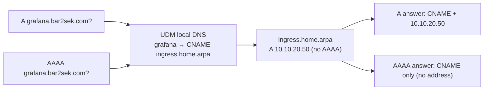

# Split-Horizon DNS: Closing the IPv6 (AAAA) Leak

Internal clients reach `omni`, `ceph`, `grafana` and `auth` (`*.bar2sek.com`) over the LAN, using local DNS records on the UDM-Pro (`terraform/unifi/dns.tf`). Those names **also exist publicly** in Cloudflare (proxied / tunnel records). This note explains why that combination leaked IPv6 traffic to Cloudflare, how it is fixed, and the rule for adding new names.

## The problem (until 2026-10-19)

The UDM only answers the record **types** it holds for a name. Every other query for that name is forwarded upstream.

- `A omni.bar2sek.com` → answered locally: `10.10.10.5` ✅
- `AAAA omni.bar2sek.com` → no local AAAA, so forwarded → Cloudflare's public IPv6 addresses ❌

macOS (and most modern clients, using Happy Eyeballs) prefer IPv6, so traffic for these names went **out to Cloudflare** instead of across the LAN:

- `omnictl`/`talosctl` hit Cloudflare Access and failed with `server closed the stream without sending trailers` (see [[108-omni-dex-platform-architecture|Omni]], *Workstation CLI Access*).
- Grafana/Authentik/Ceph traffic took the WAN round trip through the tunnel.
- Tailscale clients were affected too: MagicDNS (`100.100.100.100`) forwards `bar2sek.com` to the UDM and got the same answers.

The stopgap was two `/etc/hosts` lines on the Mac (`10.10.10.5` and `::ffff:10.10.10.5`), which helped only that one machine and only for `omni`.

## The fix: CNAME to a local-only `home.arpa` target

A CNAME applies to **every** record type of its owner name. So instead of an `A` record, each leaking name is a local CNAME to a target that exists only on the UDM and only has an `A` record:



| Public + local name | Local record | Target (local only) |
|---|---|---|
| `omni.bar2sek.com` | CNAME | `omni.home.arpa` → `10.10.10.5` |
| `ceph.bar2sek.com` | CNAME | `ingress.home.arpa` → `10.10.20.50` |
| `grafana.bar2sek.com` | CNAME | `ingress.home.arpa` → `10.10.20.50` |
| `auth.bar2sek.com` | CNAME | `ingress.home.arpa` → `10.10.20.50` |

Why this works and is safe:

- **`home.arpa`** is reserved for home networks (RFC 8375). No public resolver will ever return an address for it, so the empty AAAA answer can't be "filled in" from outside.
- **TLS is unchanged.** The client still connects to `grafana.bar2sek.com` (SNI/Host header), so the `*.bar2sek.com` wildcard certificate still matches. The CNAME target name never reaches the server.
- **Remote access is unchanged.** The public Cloudflare records are untouched; only LAN and Tailscale clients see the local answers.

Names that have **no** public record (`gaming`, `printer`, `printing`, `k8s`) stay as plain `A` records: their forwarded AAAA query finds nothing upstream, so they never leaked.

> [!IMPORTANT]
> **Rule for new names:** if a hostname exists (or will exist) in the public Cloudflare zone *and* gets a local override, make the local record a **CNAME to `ingress.home.arpa`** (or a new `*.home.arpa` target), never a plain `A` record. Otherwise its IPv6 traffic will go to Cloudflare.

### Why not the other options

| Option | Why not chosen |
|---|---|
| Local AAAA with IPv4-mapped address (`::ffff:10.10.10.5`) | Non-standard, works in macOS `/etc/hosts` but breaks some clients and IPv6-only sockets |
| Own resolver (CoreDNS/AdGuard) filtering AAAA | Extra critical service; in-cluster it would make Omni's DNS depend on the cluster Omni manages |
| Internal-only subdomain / delete public records | Breaks Cloudflare Tunnel remote access, or means renaming Omni (URL baked into Dex and SideroLink) |
| Real IPv6 for services (ULA/GUA + AAAA) | Correct long term, but cluster and MetalLB are IPv4-only today |

## Verification

From any LAN or Tailscale client:

```bash
for n in omni ceph grafana auth; do
  h=$n.bar2sek.com
  echo "$h  A=$(dig +short A $h @10.10.20.1 | tr '\n' ' ')  AAAA=$(dig +short AAAA $h @10.10.20.1 | grep ':')"
done
```

Expected: `A` shows the `*.home.arpa` CNAME and a private IP; `AAAA` is empty. Repeat with `@100.100.100.100` (Tailscale MagicDNS) and the UDM's IPv6 resolver address (from `scutil --dns`).

End-to-end check, which must print a `10.10.x.x` address and never `2606:4700:…`:

```bash
curl -s -o /dev/null -w '%{remote_ip}\n' https://grafana.bar2sek.com/
```

Results on 2026-10-19: all four names returned CNAME + private IP for `A` and no address for `AAAA` on the UDM (IPv4 and IPv6) and on Tailscale MagicDNS; `curl` connected to `10.10.20.50`/`10.10.10.5`; all Omni machines stayed connected and all nodes `Ready`.

## Troubleshooting & gotchas

> [!WARNING]
> **Plain `dig @1.1.1.1` lies on this network.** Outbound port-53 queries are intercepted and answered by the UDM, so `dig @1.1.1.1 omni.bar2sek.com` returns `10.10.10.5`. To see the real public records, use DNS over HTTPS:
> ```bash
> curl -s -H 'accept: application/dns-json' 'https://cloudflare-dns.com/dns-query?name=omni.bar2sek.com&type=AAAA'
> ```

- **Testing a change safely:** create a throwaway pair (`dnstest.home.arpa` A + `dnstest.bar2sek.com` CNAME) with `terraform apply -target=...`, check `dig AAAA` returns CNAME only, then delete it. This is how the fix was proven before touching real records.
- **Stale answers:** records have a 300 s TTL. On macOS flush with `sudo dscacheutil -flushcache; sudo killall -HUP mDNSResponder`.
- **`/etc/hosts` overrides win:** if a name still resolves oddly on one machine, check `/etc/hosts` for old workaround lines.
- **Apply with `-target` while unrelated drift exists.** On 2026-10-19 the full plan also wanted to change the K8S-CONTROL DHCP pool start (`.100` live vs `.200` in code); that was excluded and is tracked separately in the [[001-deployment-journal|journal]] backlog.
- **Provider cache outside Drive:** `TF_DATA_DIR=~/.terraform-data/unifi terraform -chdir=terraform/unifi ...` keeps the provider binary out of the synced vault.

## Related

- [[201-unifi-network-topology|UniFi Network Topology]]
- [[202-cloudflare-tunnel-zero-trust|Cloudflare Tunnel & Zero Trust]]
- [[203-tailscale-mesh-vpn|Tailscale Mesh VPN]]
- [[108-omni-dex-platform-architecture|Omni Platform Architecture]]
