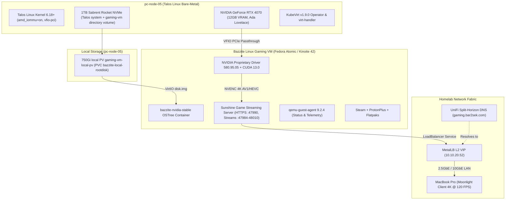

# KubeVirt Bazzite Gaming VM with NVIDIA RTX 4070 GPU Passthrough

This document outlines the architecture, kernel configuration, and deployment workflow to run a **Bazzite Linux Cloud Gaming Virtual Machine** with **NVIDIA GeForce RTX 4070 VFIO PCIe Passthrough** inside our bare-metal Talos Linux Kubernetes cluster using **KubeVirt**.

---

## 🎯 Architecture Overview



---

## 🛠 Step 1: Talos Linux Kernel Configuration (`pc-node-05`)

VFIO GPU Passthrough on the AMD Ryzen 5 7600 (AM5 B650I platform) is declared in `talos/cluster-template.yaml`:

```yaml
machine:
  kernel:
    args:
      - amd_iommu=on
      - iommu=pt
      - vfio-pci.ids=10de:2786,10de:22bc # Vendor:Device IDs for RTX 4070 Video & Audio
```

- **`amd_iommu=on iommu=pt`**: Enables IOMMU hardware isolation for PCIe devices.
- **`vfio-pci.ids`**: Binds the RTX 4070 video and audio controllers to `vfio-pci` at boot so host Talos drivers do not claim them.

---

## 🚀 Step 2: KubeVirt Device Plugins (`kubevirt-cr.yaml`)

GPU & HostDevice Passthrough is enabled in `kubernetes/infrastructure/kubevirt/kubevirt-cr.yaml`:

```yaml
apiVersion: kubevirt.io/v1
kind: KubeVirt
metadata:
  name: kubevirt
  namespace: kubevirt
spec:
  configuration:
    developerConfiguration:
      featureGates:
        - GPU
        - HostDevices
        - VMPersistentState
        - HotplugVolumes
    permittedHostDevices:
      pciHostDevices:
        - pciVendorSelector: "10DE:2786"
          resourceName: "nvidia.com/RTX_4070"
        - pciVendorSelector: "10DE:22BC"
          resourceName: "nvidia.com/RTX_4070_Audio"
  vmStateStorageClass: rook-ceph-filesystem
```

---

## 📦 Step 3: Containerized Data Importer (CDI) ISO Ingestion

The official Bazzite NVIDIA Stable ISO is ingested into Ceph block storage using `kubernetes/infrastructure/kubevirt/bazzite-iso-dv.yaml`:

```yaml
apiVersion: cdi.kubevirt.io/v1beta1
kind: DataVolume
metadata:
  name: bazzite-nvidia-iso
  namespace: vms
spec:
  source:
    http:
      url: "https://download.bazzite.gg/bazzite-nvidia-stable-amd64.iso"
  storage:
    accessModes:
      - ReadWriteOnce
    resources:
      requests:
        storage: 15Gi
    storageClassName: rook-ceph-block
    volumeMode: Filesystem
```

---

## 🎮 Step 4: Production Bazzite VirtualMachine Manifest

The production manifest is defined in `kubernetes/infrastructure/kubevirt/bazzite-vm.yaml`. Once the OS is installed, installation media is removed and only the root disk remains attached.

> [!NOTE]
> **Since 2026-10-18 the root disk is local NVMe, not Ceph.** It is a 750 GiB claim (`bazzite-local-rootdisk`) on a static local PersistentVolume at `/var/mnt/gaming-vm` on pc-node-05 (see *Local Disk & Rebuild Runbook* below). The excerpt below predates that change; the repo file is the source of truth.

```yaml
apiVersion: kubevirt.io/v1
kind: VirtualMachine
metadata:
  name: bazzite-gaming-vm
  namespace: vms
  labels:
    app: bazzite-gaming
    special: bazzite-gaming
spec:
  runStrategy: Always
  template:
    metadata:
      labels:
        app: bazzite-gaming
        kubevirt.io/domain: bazzite-gaming-vm
    spec:
      nodeSelector:
        kubernetes.io/hostname: pc-node-05
      domain:
        cpu:
          model: host-passthrough
          cores: 12
          threads: 1
          sockets: 1
        resources:
          requests:
            memory: 16Gi
          limits:
            memory: 16Gi
        devices:
          autoattachGraphicsDevice: false
          disks:
            - name: rootdisk
              bootOrder: 1
              disk:
                bus: virtio
          interfaces:
            - name: default
              masquerade: {}
          gpus:
            - name: rtx4070
              deviceName: nvidia.com/RTX_4070
            - name: rtx4070-audio
              deviceName: nvidia.com/RTX_4070_Audio
          inputs:
            - type: tablet
              bus: usb
              name: tablet
        features:
          acpi: {}
          apic: {}
        firmware:
          bootloader:
            efi:
              secureBoot: false
      networks:
        - name: default
          pod: {}
      volumes:
        - name: rootdisk
          persistentVolumeClaim:
            claimName: windows-gaming-nvme-pvc
---
apiVersion: v1
kind: Service
metadata:
  name: bazzite-gaming-lan
  namespace: vms
  annotations:
    metallb.universe.tf/loadBalancerIPs: 10.10.20.52
spec:
  type: LoadBalancer
  selector:
    kubevirt.io/domain: bazzite-gaming-vm
  ports:
    - name: ssh
      port: 22
      targetPort: 22
      protocol: TCP
    - name: sunshine-ui
      port: 47990
      targetPort: 47990
      protocol: TCP
    - name: sunshine-https
      port: 47984
      targetPort: 47984
      protocol: TCP
    - name: sunshine-http
      port: 47989
      targetPort: 47989
      protocol: TCP
    - name: sunshine-ctrl-tcp
      port: 48010
      targetPort: 48010
      protocol: TCP
    - name: sunshine-rtsp
      port: 48010
      targetPort: 48010
      protocol: UDP
    - name: sunshine-video
      port: 47999
      targetPort: 47999
      protocol: UDP
    - name: sunshine-audio
      port: 47998
      targetPort: 47998
      protocol: UDP
    - name: sunshine-ctrl-udp
      port: 48000
      targetPort: 48000
      protocol: UDP
    - name: sunshine-mic
      port: 48002
      targetPort: 48002
      protocol: UDP
```

---

## 📡 Step 5: High-Performance Remote Streaming (Sunshine + Moonlight)

1. **Dedicated LAN VIP (`10.10.20.52`)**: MetalLB exposes ports `47984-48010` (Sunshine HTTP/RTSP/UDP streams) and `22` (OpenSSH).
2. **Sunshine Server**: Pre-installed in Bazzite, running as a systemd user service capturing the RTX 4070 NVENC frame buffer with zero latency.
3. **Web Configuration UI**: Access `https://10.10.20.52:47990` in your web browser to configure PIN pairing for Moonlight clients.
4. **Moonlight Client**: Connect from your MacBook Pro over the **2.5GbE / 10GbE UniFi network** for buttery-smooth 4K 120 FPS gaming with AV1/HEVC encoding!

---

## ⚙️ Operational Commands (`Justfile`)

```bash
# Ping the Bazzite Gaming VM via Ansible
just bazzite-ping

# Run automated post-install configuration & status check
just bazzite-setup

# Force reboot / restart the VM if frozen (via Justfile shortcut or virtctl)
just bazzite-restart
virtctl restart --force --grace-period=0 bazzite-gaming-vm -n vms

# SSH directly into the VM
ssh bazzite@10.10.20.52 "nvidia-smi"

# Or SSH directly over KubeVirt API (bypasses LAN/LoadBalancer)
virtctl ssh bazzite@vmi/bazzite-gaming-vm -n vms --identity-file ~/.ssh/id_ed25519
```

---

## 🎮 Step 6: Non-Steam Blizzard / Battle.net Setup (GE-Proton)

To play Blizzard titles (Diablo IV, World of Warcraft, Overwatch 2) directly inside Steam without third-party launcher bloat:

1. **Automated Prerequisites via Ansible**:
   Running `just bazzite-setup` automatically:
   * Downloads and installs the latest stable **GE-Proton** (`GE-Proton10-34`) into `/home/bazzite/.local/share/Steam/compatibilitytools.d/`.
   * Pre-stages the official `Battle.net-Setup.exe` into `/home/bazzite/Downloads/`.
2. **Initial Setup in Steam (via Moonlight)**:
   * Restart Steam so it detects the newly placed `GE-Proton10-34` runner in `compatibilitytools.d`.
   * In the top menu, select **Games** $\rightarrow$ **Add a Non-Steam Game to My Library...**
   * Click **Browse...**, select `/home/bazzite/Downloads/Battle.net-Setup.exe`, and click **Add Selected Programs**.
   * In your Steam Library, right-click `Battle.net-Setup.exe` $\rightarrow$ **Properties** $\rightarrow$ **Compatibility**:
     * Check **Force the use of a specific Steam Play compatibility tool**.
     * Select **GE-Proton10-34** from the dropdown.
   * Click **Play** to run the Blizzard installer and complete the setup wizard.
3. **Switch Shortcut to Battle.net Launcher**:
   * Once installation finishes, right-click the shortcut in Steam $\rightarrow$ **Properties**:
     * Name: `Battle.net`
     * Target: `"/home/bazzite/.local/share/Steam/steamapps/compatdata/<compat_id>/pfx/drive_c/Program Files (x86)/Battle.net/Battle.net Launcher.exe"`
     * Start In: `"/home/bazzite/.local/share/Steam/steamapps/compatdata/<compat_id>/pfx/drive_c/Program Files (x86)/Battle.net/"`
     * Launch Options: `DXVK_NVAPI_DRIVER_VERSION=59571 %command%`
4. **Automated Steam Library Integration (`sync-steam-shortcuts.py`)**:
   * Running `just bazzite-setup` automatically discovers installed Blizzard games in the Battle.net prefix and registers distinct, first-class Steam shortcuts for them:
     * **Diablo IV** (`--exec="launch Fen"`)
     * **StarCraft II** (`--exec="launch S2"`)
     * **Warcraft III** (`--exec="launch W3"`)
   * **Seamless Authentication & Zero Overhead**:
     * Automatically assigns **GE-Proton10-34** via `config.vdf`.
     * Symlinks each game's `compatdata/<appid>` to the primary Battle.net prefix (`3234450451`) to share DirectX shaders, settings, and credentials without duplicating storage.
     * Tunes `Battle.net.config` with `"GameLaunchWindowBehavior": "2"` (exits Battle.net completely once the game starts) and `"HardwareAcceleration": "false"` (prevents CEF interface deadlocks).


---

## 💾 Local Disk & Rebuild Runbook (2026-10-18)

### Why local storage
The VM can only run on pc-node-05 (GPU passthrough), and game files do not need replication. Its old disk was a 1000 GiB RBD image in the 3x-replicated Ceph NVMe pool (576 GiB used, about 1.7 TB raw). It now lives on pc-node-05's own Sabrent NVMe: lower latency, and the Ceph capacity comes back. If that drive dies, reinstall and re-download; there are no backups by design.

### Retiring the old Ceph disk (done 2026-10-18)
The old claim `vms/windows-gaming-nvme-pvc` was deleted once the VM was running from the local disk. The `bazzite-nvidia-iso` claim stays, because the install patch uses it.

> [!IMPORTANT]
> The Ceph StorageClasses use `reclaimPolicy: Retain`. Deleting only the PVC leaves the PV `Released` and the RBD image (and its replicated space) in Ceph. Switch the PV to `Delete` first so Ceph-CSI removes the image:
> ```bash
> kubectl patch pv <pv-name> -p '{"spec":{"persistentVolumeReclaimPolicy":"Delete"}}'
> kubectl delete pvc -n vms <pvc-name>
> ```

Ceph-CSI moves the image to the RBD trash, and the manager then purges it in the background (about 7 minutes for 570 GiB). Check progress with `rbd trash ls -p nvme-high-iops-pool` and `ceph df` in the toolbox. Result: the nvme device class went from 1.7 TiB raw used to 5.8 GiB.

### Storage layout
| Piece | Where |
|---|---|
| Talos directory user volume `gaming-vm` → `/var/mnt/gaming-vm` | Omni patch `gpu-worker-volumes` (`talos/cluster-template.yaml`, pc-node-05 only) |
| StorageClass `local-gaming-vm`, PV `gaming-vm-local-pv` (750Gi, `claimRef`, node affinity), PVC `vms/bazzite-local-rootdisk` | `kubernetes/infrastructure/kubevirt/gaming-vm-local-storage.yaml` |
| VM disk image | KubeVirt creates a sparse `disk.img` sized to the claim on first boot |

> [!WARNING]
> **A directory volume has no hard size limit.** It shares pc-node-05's ~930 GiB `/var` with container images and logs. The 750 GiB disk image leaves about 150 GiB of headroom. A separate partition is not possible without wiping EPHEMERAL, and Omni rejects `talosctl reset` (`PermissionDenied`). Watch pc-node-05 on the Homelab Overview *System disk used* panel.

> [!NOTE]
> Changing an existing user volume from `partition` to `directory` left Talos reporting the old type. Removing the patch, syncing, and re-adding it cleared the state.

### Rebuild procedure
1. **Install mode** (adds the ISO as a CD-ROM and a VNC display, and **detaches the GPU**, because with the GPU attached the NVIDIA installer opens its UI on the 4070's monitor output instead of VNC):
   ```bash
   virtctl stop bazzite-gaming-vm -n vms
   kubectl patch vm bazzite-gaming-vm -n vms --type json --patch-file kubernetes/infrastructure/kubevirt/bazzite-vm-install-patch.yaml
   virtctl start bazzite-gaming-vm -n vms
   virtctl vnc bazzite-gaming-vm -n vms --proxy-only --port 5900
   ```
   Connect **TigerVNC Viewer** to `localhost:5900` (in the nix-darwin flake). macOS Screen Sharing refuses VNC servers without a password, and KubeVirt's VNC has none. There is no clipboard sharing.
2. **Install:** the ~805 GB virtio disk, automatic partitioning, **no disk encryption** (production mode has no screen to type a passphrase), user `bazzite` as administrator.
3. **Bootstrap SSH** (the only typing in the VM): `sudo systemctl enable --now sshd`. Then install the key through the Kubernetes API (see the playbook header), and refresh `known_hosts` (`ssh-keygen -R 10.10.20.52`).
4. **Production mode:** `kubectl apply -f kubernetes/infrastructure/kubevirt/bazzite-vm.yaml` (GPU attached, no ISO or VNC), then `virtctl restart`.
5. **Configure:** `just bazzite-setup` (prompts for the sudo password). It updates the image and reboots, sets up autologin, Sunshine, gamepads and Proton, and is idempotent.
6. **Manual by design:** Sunshine admin credentials and Moonlight PIN pairing (`https://10.10.20.52:47990`), Steam and Battle.net logins.

### Gotchas from the 2026-10-18 rebuild
- **UDM IPS blocks SSH after a reinstall.** Host-key mismatches plus retries look like an SSH scan; the UDM blocks the Mac's SSH to `10.10.20.52` silently (timeouts, nothing in the VM's sshd log). Fixed with *Suppress Signature for Source IP* for the Mac (`10.0.1.108`, which should have a DHCP reservation). The Kubernetes API path (`virtctl ssh`) is not affected.
- **Ansible `become` times out on Bazzite with a TTY.** The shell startup sends terminal queries (OSC 10/11, cursor position) and waits for replies, so sudo's prompt never appears. `ansible.cfg` sets `usetty = False`.
- **The OS update changes Python.** Bazzite 42 had python3.13 and 44 has python3.14, so the inventory pins `ansible_python_interpreter=/usr/bin/python3`.
- **Bazzite's own updater (`uupd`) may stage the update first.** The playbook reboots whenever a staged deployment is not the booted one.
- **Sunshine packaging differs by version.** Bazzite 42 ships an RPM (`sunshine.service`); 44+ uses the Flatpak (`app-dev.lizardbyte.app.Sunshine`). The Flatpak's `additional-install.sh` uses `pkexec` prompts, so the playbook performs those steps itself from the Flatpak's shipped files.
- **Sunshine web UI: "CSRF Protection Error".** Behind KubeVirt masquerade and MetalLB, Sunshine does not recognise `https://10.10.20.52:47990` as its own origin. The playbook sets `csrf_allowed_origins` in the Flatpak config (`~/.var/app/dev.lizardbyte.app.Sunshine/config/sunshine/sunshine.conf`) and restarts Sunshine; re-apply with `ansible-playbook playbooks/configure-bazzite-vm.yml --tags sunshine` (no sudo needed).
- **Sunshine needs a logged-in desktop.** Autologin only applies after a reboot; until then Sunshine logs `Video failed to find working encoder`. The playbook reboots when it changes the autologin config.
- **The screen-sharing portal dialog can't be clicked.** A Flatpak cannot use KMS capture, so on KDE Wayland Sunshine goes through the remote-desktop portal, which asks for approval on the VM's own screen. USB devices plugged into pc-node-05 reach Talos, not the VM (only the GPU is passed through). The playbook pre-authorizes Sunshine instead (`flatpak permission-set kde-authorized remote-desktop dev.lizardbyte.app.Sunshine yes`, Plasma 6.3+, run as the user). Result: PipeWire capture plus `h264_nvenc`/`hevc_nvenc`/`av1_nvenc`.
- **Moonlight shows a login screen after idle.** That is KDE's screen lock (`loginctl show-session <id> -p LockedHint` = `yes`), not a failed autologin. The playbook disables `Autolock`/`LockOnResume` in `kscreenlockerrc`; to unlock immediately over SSH, run `loginctl unlock-session <id>`.
- **Sunshine web UI login loops in Safari** (`Web UI: not authorized` in the log): Safari may not keep the session cookie for a self-signed certificate. Use Chrome or Brave.
- **`externalTrafficPolicy` stays `Cluster`.** `Local` was tried on 2026-10-18 and reverted; the connection failures at the time turned out to be the IPS block above, so `Local` itself is untested.

---

## ⚠️ Troubleshooting & Gotchas

### Steam "An error occurred while launching the game. Compatibility tool failed"
* **Root Cause**: GE-Proton 11 (`GE-Proton11-x`) mandates **Steam Linux Runtime 4.0** (`steamrt4`, AppID `4183110`), which requires Debian 13 / Python $\ge 3.11$. If Valve's Steam client pulls or lacks the public depot manifest for AppID `4183110`, Steam deletes the runtime directory, causing dependent Proton tools to fail instantly (`unsupported version 0; dependent tool cmdline wrap failed`).
* **Resolution**: Standardize on **`GE-Proton10-34`**, which natively targets the stable **Steam Linux Runtime 3.0 (sniper)** (AppID `1628350`). Ensure `shortcuts.vdf` and `config.vdf` map games to `GE-Proton10-34`.

### Diablo IV / Blizzard "Graphics Drivers Out of Date" Warning
* **Root Cause**: Blizzard's game engine performs a strict check against Windows NVIDIA driver version numbers (e.g. demanding $\ge 595.71$). Under Linux/Proton, DXVK-NVAPI queries the host kernel driver (`580.178.04`) and maps it to `580.99`. Because $580.99 < 595.71$, Diablo IV halts with an out-of-date error despite the RTX 4070 hardware acceleration being fully functional.
* **Resolution**:
  1. **DXVK-NVAPI Version Override**: Set `DXVK_NVAPI_DRIVER_VERSION=59571` in `/etc/environment` or in the Steam shortcut's **Launch Options** (`DXVK_NVAPI_DRIVER_VERSION=59571 %command%`).
  2. **In-Launcher Driver Bypass**: Inside Battle.net, click the gear icon next to **Play** on Diablo IV $\rightarrow$ **Game Settings** $\rightarrow$ check **Additional command line arguments** $\rightarrow$ add:
     ```text
     -bypassgpudrivercheck
     ```

### Frozen VM / Unresponsive Guest OS or Moonlight Stream
* **Root Cause**: If the desktop compositor (KDE Plasma/Wayland), graphics driver, or guest kernel locks up, the Moonlight stream freezes and network timeouts occur on `10.10.20.52`. Because the VM is managed by KubeVirt with `spec.runStrategy: Always`, a forced restart can be commanded immediately from the host or Mac.
* **Resolution**:
  1. **One-Liner Fast Restart (`virtctl` or `just`)**:
     ```bash
     just bazzite-restart
     # or directly:
     virtctl restart --force --grace-period=0 bazzite-gaming-vm -n vms
     ```
  2. **Alternative (Delete VMI via `kubectl`)**:
     ```bash
     kubectl delete vmi bazzite-gaming-vm -n vms
     ```
     KubeVirt will automatically terminate the stale launcher pod and start a clean pod with the local root disk PVC and RTX 4070 GPU passthrough re-attached.
  3. **Out-of-Band SSH & Serial Console**:
     ```bash
     # Direct SSH tunnel over Kubernetes API (bypasses LAN/LoadBalancer):
     virtctl ssh bazzite@vmi/bazzite-gaming-vm -n vms --identity-file ~/.ssh/id_ed25519

     # Serial console:
     virtctl console bazzite-gaming-vm -n vms
     ```


