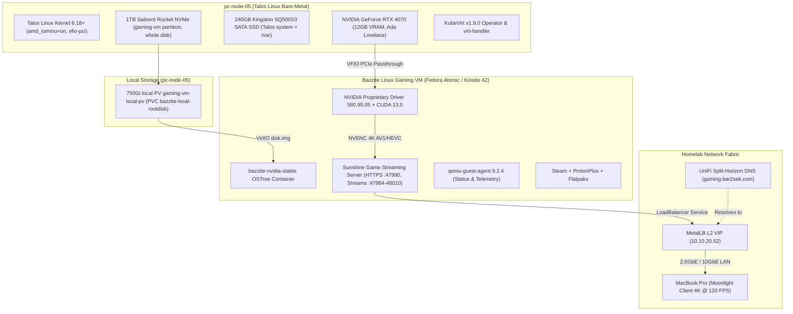
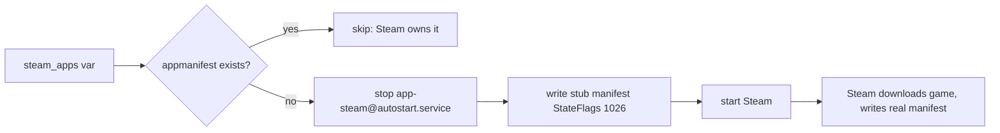
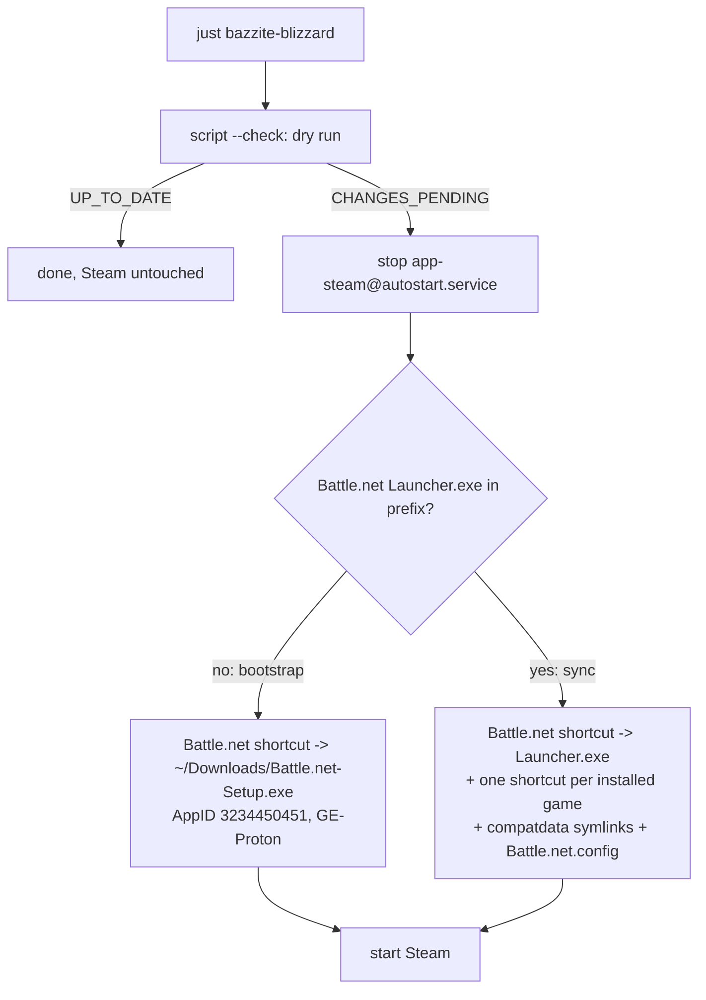

# KubeVirt Bazzite Gaming VM with NVIDIA RTX 4070 GPU Passthrough

This document outlines the architecture, kernel configuration, and deployment workflow to run a **Bazzite Linux Cloud Gaming Virtual Machine** with **NVIDIA GeForce RTX 4070 VFIO PCIe Passthrough** inside our bare-metal Talos Linux Kubernetes cluster using **KubeVirt**.

---

## 🎯 Architecture Overview



---

## 🛠 Step 1: Talos Linux Kernel Configuration (`pc-node-05`)

VFIO GPU Passthrough on the AMD Ryzen 5 7600 (AM5 B650I platform) is declared in `talos/cluster-template.yaml`:

```yaml
machine:
  kernel:
    args:
      - amd_iommu=on
      - iommu=pt
      - vfio-pci.ids=10de:2786,10de:22bc # Vendor:Device IDs for RTX 4070 Video & Audio
```

- **`amd_iommu=on iommu=pt`**: Enables IOMMU hardware isolation for PCIe devices.
- **`vfio-pci.ids`**: Binds the RTX 4070 video and audio controllers to `vfio-pci` at boot so host Talos drivers do not claim them.

---

## 🚀 Step 2: KubeVirt Device Plugins (`kubevirt-cr.yaml`)

GPU & HostDevice Passthrough is enabled in `kubernetes/infrastructure/kubevirt/kubevirt-cr.yaml`:

```yaml
apiVersion: kubevirt.io/v1
kind: KubeVirt
metadata:
  name: kubevirt
  namespace: kubevirt
spec:
  configuration:
    developerConfiguration:
      featureGates:
        - GPU
        - HostDevices
        - VMPersistentState
        - HotplugVolumes
    permittedHostDevices:
      pciHostDevices:
        - pciVendorSelector: "10DE:2786"
          resourceName: "nvidia.com/RTX_4070"
        - pciVendorSelector: "10DE:22BC"
          resourceName: "nvidia.com/RTX_4070_Audio"
  vmStateStorageClass: rook-ceph-filesystem
```

---

## 📦 Step 3: Containerized Data Importer (CDI) ISO Ingestion

The official Bazzite NVIDIA Stable ISO is ingested into Ceph block storage using `kubernetes/infrastructure/kubevirt/bazzite-iso-dv.yaml`:

```yaml
apiVersion: cdi.kubevirt.io/v1beta1
kind: DataVolume
metadata:
  name: bazzite-nvidia-iso
  namespace: vms
spec:
  source:
    http:
      url: "https://download.bazzite.gg/bazzite-nvidia-stable-amd64.iso"
  storage:
    accessModes:
      - ReadWriteOnce
    resources:
      requests:
        storage: 15Gi
    storageClassName: rook-ceph-block
    volumeMode: Filesystem
```

---

## 🎮 Step 4: Production Bazzite VirtualMachine Manifest

The production manifest is defined in `kubernetes/infrastructure/kubevirt/bazzite-vm.yaml`. Once the OS is installed, installation media is removed and only the root disk remains attached.

> [!NOTE]
> **Since 2026-10-18 the root disk is local NVMe, not Ceph.** It is a 750 GiB claim (`bazzite-local-rootdisk`) on a static local PersistentVolume at `/var/mnt/gaming-vm` on pc-node-05 (see *Local Disk & Rebuild Runbook* below). The excerpt below predates that change; the repo file is the source of truth.

```yaml
apiVersion: kubevirt.io/v1
kind: VirtualMachine
metadata:
  name: bazzite-gaming-vm
  namespace: vms
  labels:
    app: bazzite-gaming
    special: bazzite-gaming
spec:
  runStrategy: Always
  template:
    metadata:
      labels:
        app: bazzite-gaming
        kubevirt.io/domain: bazzite-gaming-vm
    spec:
      nodeSelector:
        kubernetes.io/hostname: pc-node-05
      domain:
        cpu:
          model: host-passthrough
          cores: 12
          threads: 1
          sockets: 1
        resources:
          requests:
            memory: 16Gi
          limits:
            memory: 16Gi
        devices:
          autoattachGraphicsDevice: false
          disks:
            - name: rootdisk
              bootOrder: 1
              disk:
                bus: virtio
          interfaces:
            - name: default
              masquerade: {}
          gpus:
            - name: rtx4070
              deviceName: nvidia.com/RTX_4070
            - name: rtx4070-audio
              deviceName: nvidia.com/RTX_4070_Audio
          inputs:
            - type: tablet
              bus: usb
              name: tablet
        features:
          acpi: {}
          apic: {}
        firmware:
          bootloader:
            efi:
              secureBoot: false
      networks:
        - name: default
          pod: {}
      volumes:
        - name: rootdisk
          persistentVolumeClaim:
            claimName: windows-gaming-nvme-pvc
---
apiVersion: v1
kind: Service
metadata:
  name: bazzite-gaming-lan
  namespace: vms
  annotations:
    metallb.universe.tf/loadBalancerIPs: 10.10.20.52
spec:
  type: LoadBalancer
  selector:
    kubevirt.io/domain: bazzite-gaming-vm
  ports:
    - name: ssh
      port: 22
      targetPort: 22
      protocol: TCP
    - name: sunshine-ui
      port: 47990
      targetPort: 47990
      protocol: TCP
    - name: sunshine-https
      port: 47984
      targetPort: 47984
      protocol: TCP
    - name: sunshine-http
      port: 47989
      targetPort: 47989
      protocol: TCP
    - name: sunshine-ctrl-tcp
      port: 48010
      targetPort: 48010
      protocol: TCP
    - name: sunshine-rtsp
      port: 48010
      targetPort: 48010
      protocol: UDP
    - name: sunshine-video
      port: 47999
      targetPort: 47999
      protocol: UDP
    - name: sunshine-audio
      port: 47998
      targetPort: 47998
      protocol: UDP
    - name: sunshine-ctrl-udp
      port: 48000
      targetPort: 48000
      protocol: UDP
    - name: sunshine-mic
      port: 48002
      targetPort: 48002
      protocol: UDP
```

---

## 📡 Step 5: High-Performance Remote Streaming (Sunshine + Moonlight)

1. **Dedicated LAN VIP (`10.10.20.52`)**: MetalLB exposes ports `47984-48010` (Sunshine HTTP/RTSP/UDP streams) and `22` (OpenSSH).
2. **Sunshine Server**: Pre-installed in Bazzite, running as a systemd user service capturing the RTX 4070 NVENC frame buffer with zero latency.
3. **Web Configuration UI**: Access `https://10.10.20.52:47990` in your web browser to configure PIN pairing for Moonlight clients.
4. **Moonlight Client**: Connect from your MacBook Pro over the **2.5GbE / 10GbE UniFi network** for buttery-smooth 4K 120 FPS gaming with AV1/HEVC encoding!

---

## ⚙️ Operational Commands (`Justfile`)

```bash
# Ping the Bazzite Gaming VM via Ansible
just bazzite-ping

# Run automated post-install configuration & status check
just bazzite-setup

# Queue only the Steam games in `steam_apps` (no OS upgrade, no reboot)
just bazzite-steam-games

# Force reboot / restart the VM if frozen (via Justfile shortcut or virtctl)
just bazzite-restart
virtctl restart --force --grace-period=0 bazzite-gaming-vm -n vms

# SSH directly into the VM
ssh bazzite@10.10.20.52 "nvidia-smi"

# Or SSH directly over KubeVirt API (bypasses LAN/LoadBalancer)
virtctl ssh bazzite@vmi/bazzite-gaming-vm -n vms --identity-file ~/.ssh/id_ed25519
```

---

## 🎮 Step 6: Declarative Steam Game Installs

The playbook's `steam_apps` var lists the Steam games the VM should have, by store app ID (the number in `store.steampowered.com/app/<id>`). `just bazzite-steam-games` (or a full `just bazzite-setup`) queues any that are missing, and the logged-in Steam client downloads them.

**How it works:** no `steamcmd`, which would need the Steam password and a Steam Guard code inside Ansible. Instead, the playbook writes a stub `steamapps/appmanifest_<appid>.acf` with `StateFlags "1026"` ("update required"). Steam reads manifests at startup, treats the game as installed-but-outdated, and downloads it with the session that is already logged in. Steam then replaces the stub with the real manifest, and the task (`force: false`) never touches it again.



* Steam runs as the KDE autostart user unit `app-steam@autostart.service`. It is stopped while stubs are written (Steam rewrites `steamapps/` on exit) and only when something new is queued, so a normal re-run never interrupts a game.
* **Install-only:** removing an entry does not uninstall the game. Uninstall from Steam.
* **Verify:** downloads show in Steam's Downloads page (via Moonlight), or from the Mac: `ssh bazzite@10.10.20.52 'grep -H StateFlags ~/.local/share/Steam/steamapps/appmanifest_*.acf'` (`4` = fully installed).
* **Gotchas:** an app ID the account does not own just sits there and never downloads. Some titles have several store entries (Horizon Zero Dawn Complete Edition `1151640` vs Remastered `2561580`); use the one the account owns. Steam must be logged in, or the stubs wait until it is.

---

## 🎮 Step 7: Blizzard Games in Steam (Battle.net under GE-Proton)

Battle.net, Diablo IV, StarCraft II, Diablo II: Resurrected and Warcraft III run as non-Steam shortcuts in Steam's library, all sharing **one** GE-Proton Wine prefix (`compatdata/3234450451`). One prefix means one Battle.net install, one login, and shared shader caches and settings, with no duplicated storage.

Managed by `ansible/files/sync_steam_shortcuts.py`, deployed and run by the playbook (`just bazzite-blizzard`, or as part of `just bazzite-setup`). The script works in two phases and decides which one applies on each run:



### Procedure (fresh VM)

1. **Bootstrap:** `just bazzite-blizzard`. The **Battle.net** entry in Steam now runs the installer.
2. **In Steam (via Moonlight):** press **Play** on **Battle.net**, finish the installer, log in (2FA), and install the games from inside Battle.net. Installs must use the default location (`C:\Program Files (x86)\<Game>`), which is where the script looks.
3. **Sync:** `just bazzite-blizzard` again. The same shortcut switches to the launcher, and each installed game gets its own shortcut. Re-run it whenever a game is added.

Battle.net login and game installs stay manual: there is no supported CLI for them (Battle.net's `--exec` only does `launch`), and the login needs 2FA.

### What the script manages

| Item | Detail |
|---|---|
| Battle.net shortcut | Fixed AppID `3234450451`, so the installer creates the prefix that the launcher and games use. Same AppID in both phases. |
| Game shortcuts | Added only if the game's folder exists in the prefix. Launch options `DXVK_NVAPI_DRIVER_VERSION=59571 %command% --exec="launch <code>"`: Diablo IV `Fen`, StarCraft II `S2`, Diablo II: Resurrected `OSI`, Warcraft III `W3`, StarCraft Remastered `S1`, Diablo `D1`. To find a new game's code, grep Battle.net's log for `productCode=` (`users/steamuser/AppData/Local/Battle.net/Logs/` in the prefix): the code is the part before `_retail` (`D1_retail` → `D1`). The product IDs in `product.db` / `aggregate.json` (`fenris`, `drtl`) are **not** launch codes: `--exec="launch DRTL"` just opens Battle.net. AppID = CRC32(Exe + name), as Steam computes it. |
| `config.vdf` `CompatToolMapping` | Every Proton shortcut forced to `GE-Proton10-34` (creates the block on a fresh install, where Steam has not written it yet). **No global default** (`"0"`): Steam also applies it to unmapped non-Steam shortcuts, so it ran the native DevilutionX shortcut inside Wine. The script removes a `"0"` → `GE-Proton10-34` entry left by older versions and leaves any other `"0"` choice alone. |
| `compatdata/<game appid>` | Symlink to `3234450451` (the shared prefix). |
| `Battle.net.config` | `GameLaunchWindowBehavior: 2` (Battle.net exits when a game starts), `HardwareAcceleration: false` (avoids CEF UI deadlocks), Diablo IV `-bypassgpudrivercheck`. Written by Battle.net on first login, so this applies from the sync phase. |

Only the shortcut fields above are managed. Steam's own fields (play time, collections, hidden flag) and any other non-Steam shortcuts are preserved, and an unreadable `shortcuts.vdf` aborts the run instead of being recreated.

> [!IMPORTANT]
> Steam reads `shortcuts.vdf` only at startup and rewrites `config.vdf` when it exits, so the files are only edited with Steam stopped. The playbook stops the unit only when the dry run reports `CHANGES_PENDING`, so a no-op re-run does not interrupt downloads. Stopping the unit also stops Battle.net and any running game (same cgroup); Steam downloads resume when it starts again.

> [!NOTE]
> `59571` is deliberate, not stale: Blizzard requires Windows driver 595.71 or later, and DXVK-NVAPI would otherwise report the Linux driver (see *Graphics Drivers Out of Date* below).

### Diablo via DevilutionX (native)

The 1996 Diablo runs under Proton, but its menus render as a blank white screen: it draws through 8-bit palettized DirectDraw, which Wine handles poorly (the intro video uses a different path and plays fine). [DevilutionX](https://github.com/diasurgical/devilutionX) is an open-source native Linux port of the engine that plays the original data files, with widescreen, controller support and Hellfire. It is the recommended way to play Diablo here. The Proton **Diablo** shortcut stays, but only reaches Battle.net's Diablo page.

When the Battle.net Diablo install exists, `just bazzite-blizzard` (which now prompts for the sudo password):

1. Installs the `org.diasurgical.DevilutionX` Flatpak system-wide (Flathub).
2. **Hardlinks** `DIABDAT.MPQ` and the four Hellfire MPQs (`hellfire`, `hfmonk`, `hfmusic`, `hfvoice`) from the Wine prefix into `~/.var/app/org.diasurgical.DevilutionX/data/diasurgical/devilution/`. The Flatpak sandbox can only read its own data directory, and a hardlink is a second name for the same file (same btrfs filesystem), so the sandbox can read it at no extra disk cost. Names are lowercase, as DevilutionX expects on Linux.
3. Adds a native **Diablo (DevilutionX)** Steam shortcut (`/usr/bin/flatpak run org.diasurgical.DevilutionX`, Flatpak icon) with **no** Proton mapping and no prefix symlink.

> [!WARNING]
> A native shortcut must not get a compatibility tool, and neither must the global default. If DevilutionX "launches" and quits within a second, check Steam's `logs/console-linux.txt`: `Proton: Upgrading prefix ... compatdata/<its appid>` means Steam started `flatpak` under Proton. Remove the mapping (or the Properties → Compatibility override) and delete that stray `compatdata/<appid>` prefix.

> [!TIP]
> With the Hellfire files present, DevilutionX asks at startup whether to play Diablo or Hellfire. Saves and settings live in the same data directory.

**Gotcha:** if Battle.net repairs or patches the MPQs by replacing the files, the hardlinks keep pointing at the old copies, which is harmless (the data does not change). Delete them and re-run to re-link.

**Verify:** dry-run on the VM without changing anything:

```bash
ssh bazzite@10.10.20.52 python3 ~/.local/bin/sync-steam-shortcuts.py --check
```

`UP_TO_DATE` means Steam matches. Each write keeps a `.bak` of the previous file next to it.


---

## 💾 Local Disk & Rebuild Runbook (2026-10-18)

### Why local storage
The VM can only run on pc-node-05 (GPU passthrough), and game files do not need replication. Its old disk was a 1000 GiB RBD image in the 3x-replicated Ceph NVMe pool (576 GiB used, about 1.7 TB raw). It now lives on pc-node-05's own Sabrent NVMe: lower latency, and the Ceph capacity comes back. If that drive dies, reinstall and re-download; there are no backups by design.

Since the Wave 3b reinstall (2026-10-18, [[110-ephemeral-var-migration|docs/110]]) Talos and `/var` run from a 240 GB Kingston SATA SSD, and **the whole Sabrent is the VM's partition** (932 GB), no longer shared with `/var`.

### Retiring the old Ceph disk (done 2026-10-18)
The old claim `vms/windows-gaming-nvme-pvc` was deleted once the VM was running from the local disk. The `bazzite-nvidia-iso` claim stays, because the install patch uses it.

> [!IMPORTANT]
> The Ceph StorageClasses use `reclaimPolicy: Retain`. Deleting only the PVC leaves the PV `Released` and the RBD image (and its replicated space) in Ceph. Switch the PV to `Delete` first so Ceph-CSI removes the image:
> ```bash
> kubectl patch pv <pv-name> -p '{"spec":{"persistentVolumeReclaimPolicy":"Delete"}}'
> kubectl delete pvc -n vms <pvc-name>
> ```

Ceph-CSI moves the image to the RBD trash, and the manager then purges it in the background (about 7 minutes for 570 GiB). Check progress with `rbd trash ls -p nvme-high-iops-pool` and `ceph df` in the toolbox. Result: the nvme device class went from 1.7 TiB raw used to 5.8 GiB.

### Storage layout
| Piece | Where |
|---|---|
| Talos **partition** user volume `gaming-vm` → `/var/mnt/gaming-vm`, the whole Sabrent (selected by serial `03850709175D88299755`; `nvme0n1`/`nvme1n1` swap between boots) | Omni patch `gpu-worker-volumes` (`talos/cluster-template.yaml`, pc-node-05 only) |
| StorageClass `local-gaming-vm`, PV `gaming-vm-local-pv` (750Gi, `claimRef`, node affinity), PVC `vms/bazzite-local-rootdisk` | `kubernetes/infrastructure/kubevirt/gaming-vm-local-storage.yaml` |
| VM disk image | KubeVirt creates a sparse `disk.img` sized to the claim on first boot |

### Growing the VM disk (done 2026-10-18: 750 → 840 GiB)
The xfs partition holds 868 GiB. Keep `disk.img` below that with some headroom: it is sparse, so an image larger than the partition would only fail once games fill it, and a full host filesystem pauses the VM.
1. `virtctl stop bazzite-gaming-vm -n vms`.
2. **Kubernetes:** set the new size in both the PV and the PVC in `gaming-vm-local-storage.yaml`. A static local PV cannot be resized (`only dynamically provisioned pvc can be resized`), so `kubectl delete` the PVC and PV, then `kubectl apply` the file. Deleting a local PV never touches the files.
3. **Image:** a one-off Job on pc-node-05 mounting the claim runs `truncate -s 840G /d/disk.img` (instant; KubeVirt's `ExpandDisks` feature gate is off here). Start the VM; `lsblk` in the guest shows the new `vda` size.
4. **Inside Bazzite** (sudo asks for the password, so run it in an SSH session):
   ```bash
   echo ', +' | sudo sfdisk --no-reread -N 3 /dev/vda   # vda3 (btrfs) is the last partition; "busy" re-read warning is expected
   sudo partx -u /dev/vda                               # kernel picks up the new partition size
   sudo btrfs filesystem resize max /var/home           # live; any read-write mount of the filesystem works
   ```
   On Fedora Atomic, `/` is a composefs image (`not a btrfs filesystem`) and `/sysroot` is mounted read-only, so resize through `/var/home`. Result: 839G, 801G free.

> [!NOTE]
> Until 2026-10-18 this was a `directory` volume inside EPHEMERAL on the Sabrent. Changing an existing user volume between `partition` and `directory` leaves Talos reporting the old type; removing the patch, syncing, and re-adding it clears the state.

### Moving the disk image (backup and restore)
Used for the Wave 3b reinstall, which wiped the Sabrent. Stop the VM, then copy `disk.img` into a temporary 800Gi `rook-ceph-block` claim with a Job pinned to pc-node-05 that mounts both claims and runs `cp --sparse=always`, then `sha256sum` on both files. Restore is the same Job in reverse. `--sparse=always` keeps the 750 GiB image at its real size (37 GiB on 2026-10-18); each copy plus checksum took about 20 minutes. Delete the temporary claim afterwards the `Retain` way (patch its PV to `Delete` first, see above).

### Rebuild procedure
1. **Install mode** (adds the ISO as a CD-ROM and a VNC display, and **detaches the GPU**, because with the GPU attached the NVIDIA installer opens its UI on the 4070's monitor output instead of VNC):
   ```bash
   virtctl stop bazzite-gaming-vm -n vms
   kubectl patch vm bazzite-gaming-vm -n vms --type json --patch-file kubernetes/infrastructure/kubevirt/bazzite-vm-install-patch.yaml
   virtctl start bazzite-gaming-vm -n vms
   virtctl vnc bazzite-gaming-vm -n vms --proxy-only --port 5900
   ```
   Connect **TigerVNC Viewer** to `localhost:5900` (in the nix-darwin flake). macOS Screen Sharing refuses VNC servers without a password, and KubeVirt's VNC has none. There is no clipboard sharing.
2. **Install:** the ~805 GB virtio disk, automatic partitioning, **no disk encryption** (production mode has no screen to type a passphrase), user `bazzite` as administrator.
3. **Bootstrap SSH** (the only typing in the VM): `sudo systemctl enable --now sshd`. Then install the key through the Kubernetes API (see the playbook header), and refresh `known_hosts` (`ssh-keygen -R 10.10.20.52`).
4. **Production mode:** `kubectl apply -f kubernetes/infrastructure/kubevirt/bazzite-vm.yaml` (GPU attached, no ISO or VNC), then `virtctl restart`.
5. **Configure:** `just bazzite-setup` (prompts for the sudo password). It updates the image and reboots, sets up autologin, Sunshine, gamepads and Proton, and is idempotent.
6. **Manual by design:** Sunshine admin credentials and Moonlight PIN pairing (`https://10.10.20.52:47990`), Steam and Battle.net logins.

### Gotchas from the 2026-10-18 rebuild
- **UDM IPS blocks SSH after a reinstall.** Host-key mismatches plus retries look like an SSH scan; the UDM blocks the Mac's SSH to `10.10.20.52` silently (timeouts, nothing in the VM's sshd log). Fixed with *Suppress Signature for Source IP* for the Mac (`10.0.1.108`, which should have a DHCP reservation). The Kubernetes API path (`virtctl ssh`) is not affected.
- **Ansible `become` times out on Bazzite with a TTY.** The shell startup sends terminal queries (OSC 10/11, cursor position) and waits for replies, so sudo's prompt never appears. `ansible.cfg` sets `usetty = False`.
- **The OS update changes Python.** Bazzite 42 had python3.13 and 44 has python3.14, so the inventory pins `ansible_python_interpreter=/usr/bin/python3`.
- **Bazzite's own updater (`uupd`) may stage the update first.** The playbook reboots whenever a staged deployment is not the booted one.
- **Sunshine packaging differs by version.** Bazzite 42 ships an RPM (`sunshine.service`); 44+ uses the Flatpak (`app-dev.lizardbyte.app.Sunshine`). The Flatpak's `additional-install.sh` uses `pkexec` prompts, so the playbook performs those steps itself from the Flatpak's shipped files.
- **Sunshine web UI: "CSRF Protection Error".** Behind KubeVirt masquerade and MetalLB, Sunshine does not recognise `https://10.10.20.52:47990` as its own origin. The playbook sets `csrf_allowed_origins` in the Flatpak config (`~/.var/app/dev.lizardbyte.app.Sunshine/config/sunshine/sunshine.conf`) and restarts Sunshine; re-apply with `ansible-playbook playbooks/configure-bazzite-vm.yml --tags sunshine` (no sudo needed).
- **Sunshine needs a logged-in desktop.** Autologin only applies after a reboot; until then Sunshine logs `Video failed to find working encoder`. The playbook reboots when it changes the autologin config.
- **The screen-sharing portal dialog can't be clicked.** A Flatpak cannot use KMS capture, so on KDE Wayland Sunshine goes through the remote-desktop portal, which asks for approval on the VM's own screen. USB devices plugged into pc-node-05 reach Talos, not the VM (only the GPU is passed through). The playbook pre-authorizes Sunshine instead (`flatpak permission-set kde-authorized remote-desktop dev.lizardbyte.app.Sunshine yes`, Plasma 6.3+, run as the user). Result: PipeWire capture plus `h264_nvenc`/`hevc_nvenc`/`av1_nvenc`.
- **Moonlight shows a login screen after idle.** That is KDE's screen lock (`loginctl show-session <id> -p LockedHint` = `yes`), not a failed autologin. The playbook disables `Autolock`/`LockOnResume` in `kscreenlockerrc`; to unlock immediately over SSH, run `loginctl unlock-session <id>`.
- **Sunshine web UI login loops in Safari** (`Web UI: not authorized` in the log): Safari may not keep the session cookie for a self-signed certificate. Use Chrome or Brave.
- **`externalTrafficPolicy` stays `Cluster`.** `Local` was tried on 2026-10-18 and reverted; the connection failures at the time turned out to be the IPS block above, so `Local` itself is untested.

---

## 🧠 GPU Ownership & Bazzite as a GPU Server

> [!IMPORTANT]
> **The RTX 4070 belongs to this VM only.** `vfio-pci.ids` in `talos/patches/gpu-worker.yaml` binds the card to `vfio-pci` at boot, so the NVIDIA driver never loads on Talos and no pod can request the GPU. The VM's `runStrategy: Always` means it holds the card permanently. The `nvidia.com/gpu.present` node labels in the same patch only describe the hardware; there is no device plugin offering the GPU to pods.

**Direction (decided 2026-10-20):** when a cluster app needs GPU compute, the **Bazzite VM serves it**, rather than moving the card or buying hardware. The VM already has the NVIDIA driver and CUDA, so a GPU workload runs as a container inside the guest (Podman on Bazzite). It's exposed to the cluster with a Kubernetes Service, the same way Sunshine is exposed. Clients must fall back to a CPU path when the VM is off.

| Preference | Approach | Notes |
| :--- | :--- | :--- |
| 1 | CPU in the cluster | Always available; the fallback for everything |
| 2 | **GPU service inside Bazzite** | First user: Immich ML (see [[504-immich-photo-backup\|Immich plan]], D6). Planned next: **Ollama** (ClusterIP Service `ollama` in `vms`, port 11434) serving Frigate's GenAI descriptions and Home Assistant's Assist agent (see [[507-frigate-nvr-cameras\|Frigate plan]], Phase 2b). Managed by `ansible/playbooks/configure-bazzite-vm.yml`, not by hand |
| 3 | Second GPU for the cluster | Last resort (purchase); e.g. Intel Arc in `pc-node-04` |

**Trade-offs to remember:**
- Games and GPU services share **12 GB of VRAM**. A large model loaded while gaming can make the game stutter or crash.
- GPU services are only available while the VM is running, and Install mode (see the rebuild procedure) **detaches the GPU**. Plan for the CPU fallback, not around it.
- Switching the card to the host instead ("cluster mode") would mean removing `vfio-pci.ids`, adding Talos's NVIDIA system extensions and the device plugin, and rebooting for every switch. That was rejected as too clunky.

---

## ⚠️ Troubleshooting & Gotchas

### Steam "An error occurred while launching the game. Compatibility tool failed"
* **Root Cause**: GE-Proton 11 (`GE-Proton11-x`) mandates **Steam Linux Runtime 4.0** (`steamrt4`, AppID `4183110`), which requires Debian 13 / Python $\ge 3.11$. If Valve's Steam client pulls or lacks the public depot manifest for AppID `4183110`, Steam deletes the runtime directory, causing dependent Proton tools to fail instantly (`unsupported version 0; dependent tool cmdline wrap failed`).
* **Resolution**: Standardize on **`GE-Proton10-34`**, which natively targets the stable **Steam Linux Runtime 3.0 (sniper)** (AppID `1628350`). Ensure `shortcuts.vdf` and `config.vdf` map games to `GE-Proton10-34`.

### Diablo IV / Blizzard "Graphics Drivers Out of Date" Warning
* **Root Cause**: Blizzard's game engine performs a strict check against Windows NVIDIA driver version numbers (e.g. demanding $\ge 595.71$). Under Linux/Proton, DXVK-NVAPI queries the host kernel driver (`580.178.04`) and maps it to `580.99`. Because $580.99 < 595.71$, Diablo IV halts with an out-of-date error despite the RTX 4070 hardware acceleration being fully functional.
* **Resolution**:
  1. **DXVK-NVAPI Version Override**: Set `DXVK_NVAPI_DRIVER_VERSION=59571` in `/etc/environment` or in the Steam shortcut's **Launch Options** (`DXVK_NVAPI_DRIVER_VERSION=59571 %command%`).
  2. **In-Launcher Driver Bypass**: Inside Battle.net, click the gear icon next to **Play** on Diablo IV $\rightarrow$ **Game Settings** $\rightarrow$ check **Additional command line arguments** $\rightarrow$ add:
     ```text
     -bypassgpudrivercheck
     ```

### Frozen VM / Unresponsive Guest OS or Moonlight Stream
* **Root Cause**: If the desktop compositor (KDE Plasma/Wayland), graphics driver, or guest kernel locks up, the Moonlight stream freezes and network timeouts occur on `10.10.20.52`. Because the VM is managed by KubeVirt with `spec.runStrategy: Always`, a forced restart can be commanded immediately from the host or Mac.
* **Resolution**:
  1. **One-Liner Fast Restart (`virtctl` or `just`)**:
     ```bash
     just bazzite-restart
     # or directly:
     virtctl restart --force --grace-period=0 bazzite-gaming-vm -n vms
     ```
  2. **Alternative (Delete VMI via `kubectl`)**:
     ```bash
     kubectl delete vmi bazzite-gaming-vm -n vms
     ```
     KubeVirt will automatically terminate the stale launcher pod and start a clean pod with the local root disk PVC and RTX 4070 GPU passthrough re-attached.
  3. **Out-of-Band SSH & Serial Console**:
     ```bash
     # Direct SSH tunnel over Kubernetes API (bypasses LAN/LoadBalancer):
     virtctl ssh bazzite@vmi/bazzite-gaming-vm -n vms --identity-file ~/.ssh/id_ed25519

     # Serial console:
     virtctl console bazzite-gaming-vm -n vms
     ```


