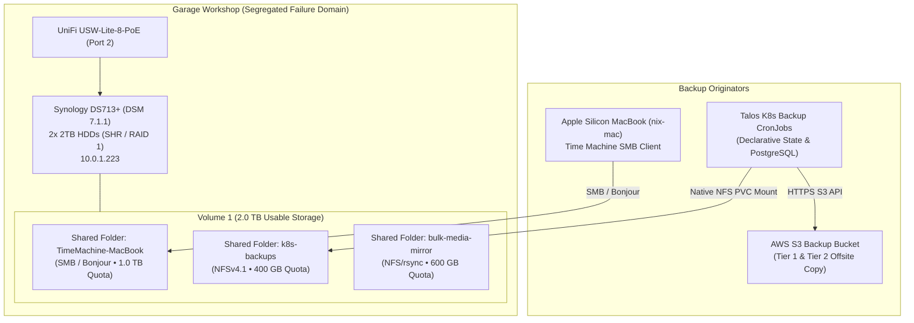
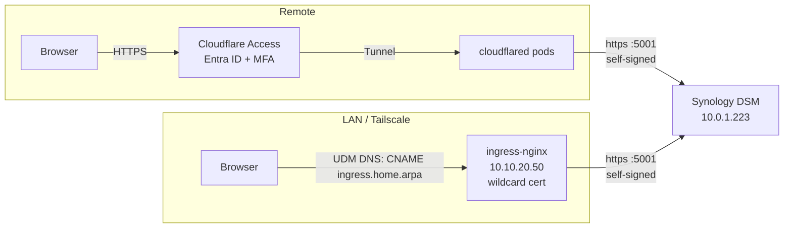

# 🛡️ Garage Synology NAS: Time Machine & Local Tier-3 DR Mirroring

This runbook guides the complete end-to-end onboarding of the **Garage Synology NAS (DiskStation DS713+)**, establishing a physically segregated failure domain for continuous macOS workstation backups (`nix-mac`) and automated local Tier-3 disaster recovery mirroring for the Talos Kubernetes cluster.

---

## 🏗️ Architecture & Failure Domain Isolation



### Key Architectural Tenets
1. **Physical Failure Domain Segregation**: The NAS is physically deployed in the detached garage workshop on `USW-Lite-8-PoE` (Port 2). If the main house or server rack experiences a localized power surge, thermal event, or hardware failure, the garage vault remains isolated and intact.
2. **3-2-1 Data Protection (target)**:
   - **3 Copies**: Production Rook-Ceph storage, offsite AWS S3 bucket (`s3-aws-backups-prod-use2-001`), and local garage Synology NAS.
   - **2 Media Types**: High-speed Ceph block storage & Synology SHR mechanical hard drive array.
   - **1 Offsite Copy**: AWS S3 in `us-east-2`.
3. **Zero-Egress Rapid Recovery**: Cluster state and database dumps mirrored locally over NFS, enabling local recovery without S3 egress costs or WAN connectivity.

> [!NOTE]
> **Status (2026-10-17): Fully Live and Verified.** Both the macOS Time Machine encrypted backup and the Kubernetes Tier-3 local DR NFS mirror (`pv-synology-nfs-backups` / `pvc-synology-nfs-backups`) are actively deployed and verified. Daily automated CronJobs copy `age`-encrypted cluster state and PostgreSQL database backups directly to the Synology NAS alongside AWS S3 Object Lock.

---

## 💽 Phase 1: Storage Pool & Volume Initialization (DSM)

> [!TIP]
> **Why Wipe and Create a Clean Storage Pool?**
> If your DS713+ contains an older SHR/RAID volume from past installations, reformatting is strongly recommended. Legacy pools often use outdated superblock formats, can lack proper shared folder quota enforcement, or retain orphaned DSM packages. A fresh pool guarantees optimal 4K sector alignment, clean Btrfs/ext4 metadata, and guaranteed quota isolation.

### Step-by-Step DSM Pool Setup:
1. Log into DSM: `https://10.0.1.223:5001`
2. Open **Storage Manager** > **Storage**.
3. If an old volume exists and contains no needed data:
   - Select the volume / pool -> Click **Remove**.
4. Click **Create** > **Create Storage Pool**:
   - **RAID Type**: Select **Synology Hybrid RAID (SHR)** (or **RAID 1**). Both provide 1-drive fault tolerance across the 2x 2TB disks.
   - Select both 2TB hard drives.
   - Perform drive check (recommended for newly slotted drives).
5. Click **Create Volume**:
   - Assign to Storage Pool 1.
   - Allocate **Max Capacity** (~1.8 - 2.0 TB usable).
   - **File System**: Select **Btrfs** if available on your DSM build (or **ext4**).

---

## 📂 Phase 2: Dedicated Shared Folders & Quotas

To prevent Apple Time Machine from expanding indefinitely and filling the entire storage pool, strict folder/user quotas are enforced.

### 1. Create `TimeMachine-MacBook` Shared Folder
1. Go to **Control Panel** > **Shared Folder** > **Create**.
2. **Name**: `TimeMachine-MacBook`.
3. **Recycle Bin**: **Uncheck** "Enable Recycle Bin" (*Critical: Time Machine manages its own snapshot pruning; recycle bins cause quota errors*).
4. **Encryption**: Leave unencrypted (Time Machine handles client-side FileVault encryption directly).
5. **Advanced Settings**:
   - If using Btrfs, check **Enable shared folder quota** and set to **1000 GB** (1.0 TB).
   - (If using ext4, user quota on `tm-macbook` will enforce this limit in Phase 3).
6. Click **Next** to save.

### 2. Create `k8s-backups` Shared Folder (NFS DR Target)
1. Go to **Control Panel** > **Shared Folder** > **Create**.
2. **Name**: `k8s-backups`.
3. **Recycle Bin**: Uncheck.
4. **Quota**: Set to **400 GB**.
5. Switch to the **NFS Permissions** tab and click **Create**:
   - **Hostname or IP**: `10.10.20.0/24` *(Kubernetes node CIDR only; no other clients need access)*.
   - **Privilege**: `Read/Write`.
   - **Squash**: `Map all users to admin`. *(Required: with `No mapping`, non-root pods such as the `finance` backup jobs are denied, because DSM has no user with their UID.)*
   - **Security**: `sys`.
   - **Enable asynchronous**: Checked.
   - **Allow connections from non-privileged ports (>1024)**: **Checked** (*Required for Kubernetes NFS client mounts*).
   - **Allow users to access mounted subfolders**: Checked.
6. Click **Apply**. Note the mount path displayed at the bottom: `/volume1/k8s-backups`.

---

## 👤 Phase 3: Service Accounts & File Services

### 1. Create Dedicated Time Machine Service User
1. Go to **Control Panel** > **User & Group** > **Create** > **Create User**.
2. **Name**: `tm-macbook`.
3. Set a strong password (and record securely in 1Password / Keychain).
4. **Group**: `users` only (do NOT assign to `administrators`).
5. **Permissions**:
   - `TimeMachine-MacBook`: **Read/Write**.
   - All other shared folders: **No Access**.
6. **User Quota** (if ext4): Set `TimeMachine-MacBook` quota to **1000 GB**.
7. **Applications**: Deny access to DSM desktop applications (DSM, File Station, etc.) to enforce least privilege.

### 2. Enable SMB & Bonjour Time Machine Broadcast
1. Go to **Control Panel** > **File Services** > **SMB**:
   - Check **Enable SMB service**.
   - **Workgroup**: `WORKGROUP`.
   - Click **Advanced Settings** > Ensure **Minimum SMB protocol** is `SMB2` and **Maximum** is `SMB3`.
2. Switch to **Advanced** tab:
   - Check **Enable Bonjour service discovery to locate DiskStation**.
   - Check **Enable Bonjour Time Machine broadcast via SMB**.
   - Click **Set Up Time Machine Folders**.
   - Select `TimeMachine-MacBook` and click **Apply**.

### 3. Enable NFS Service
1. Go to **Control Panel** > **File Services** > **NFS**:
   - Check **Enable NFS service**.
   - **Maximum NFS protocol**: `NFSv4.1` (or `NFSv3`).
   - Click **Apply**.

---

## 💻 Phase 4: `nix-mac` Time Machine Configuration

Configure the macOS workstation (`nix-mac`) to authenticate and back up continuously to the Synology SMB share.

### 1. Save SMB Credentials in macOS Keychain
```bash
security add-internet-password -a "tm-macbook" -s "10.0.1.223" -r "smb " -w "<YOUR_TM_PASSWORD>"
```

### 2. Set Time Machine Destination
```bash
sudo tmutil setdestination -p "smb://tm-macbook:<YOUR_TM_PASSWORD>@10.0.1.223/TimeMachine-MacBook"
```

### 3. Exclude Ephemeral & Reproducible Directories
Because `nix-mac` is declaratively managed via `flake.nix` and system stores are fully reproducible, excluding them saves massive backup space and bandwidth:

```bash
# Exclude reproducible Nix store
sudo tmutil addexclusion -p /nix

# Exclude local user and application caches
sudo tmutil addexclusion -p "$HOME/Library/Caches"

# Exclude Google Drive local mirror (already backed up in cloud)
sudo tmutil addexclusion -p "$HOME/Library/CloudStorage"

# Exclude temporary build outputs
sudo tmutil addexclusion -p "$HOME/.cargo"
sudo tmutil addexclusion -p "$HOME/.rustup"
```

### 4. Verify & Trigger Initial Backup
```bash
# Verify destination binding
tmutil destinationinfo

# Start initial backup run
tmutil startbackup --auto
```

---

## ☸️ Phase 5: Kubernetes Tier-3 Local DR Mirroring (Active & Verified)

> [!NOTE]
> Deployed and verified on 2026-10-17. The volume mounts natively via `nfsvers=4` (matching DSM 7.1.1 on DS713+).

The NFS PersistentVolume and Claim are codified in `kubernetes/infrastructure/backups/` (`pv-synology-nfs.yaml`, `pvc-synology-nfs.yaml`) and bound to the cluster:

1. **NFS Export Verified:** Synology DSM exports `/volume1/k8s-backups` with read/write access to `10.10.20.0/24`.
2. **Applied Volume & Claim:**
   ```bash
   kubectl apply -f kubernetes/infrastructure/backups/pv-synology-nfs.yaml
   kubectl apply -f kubernetes/infrastructure/backups/pvc-synology-nfs.yaml
   kubectl get pvc -n backups pvc-synology-nfs-backups
   ```
3. **Separate NAS CronJobs:** each dataset has its own NAS CronJob (`backup-cluster-state-nas`, `backup-postgres-databases-nas`, `finance/backup-actual-budget-nas`) that writes the **already-encrypted** `*.age` artifact to the share and prunes copies older than 35 days. They run separately from the S3 jobs, so a NAS outage cannot block the offsite backup, and they hold no AWS credential. The NAS stores only encrypted ciphertext. Details: backups README, *Backup tiers*.
4. **Verified (2026-10-17):** all three NAS jobs and all three S3 jobs run by hand; files land under `/volume1/k8s-backups/{cluster-state,postgres/authentik,apps/actual}/`.

---

## 🌐 Remote Web Access

The DSM web UI is published at **`nas.bar2sek.com`**, which takes two paths. Off the LAN it goes through the shared Cloudflare Tunnel, behind Cloudflare Access with Entra ID sign-in and an MFA requirement (see [[202-cloudflare-tunnel-zero-trust]]), so DSM's login page is never exposed to the internet. On the LAN and Tailscale, split-horizon DNS (see [[205-split-horizon-dns-ipv6-leak]]) sends it to ingress-nginx, which serves the trusted `*.bar2sek.com` wildcard cert and proxies to DSM. Both paths carry browser traffic only. SMB, NFS, Time Machine and the DS mobile apps stay LAN/Tailscale-only.



**Codified in:**
- Remote: `infra-cloud-deployments/terraform/cloudflare/` (`locals.tf` Access app, `main.tf` tunnel ingress rule and CNAME). Origin is `https://10.0.1.223:5001` with `no_tls_verify` because DSM serves a self-signed certificate.
- LAN: `terraform/unifi/dns.tf` (`unifi_dns_record.nas`) and `kubernetes/infrastructure/ingress/synology-nas-ingress.yaml` (selector-less Service, manual EndpointSlice for `10.0.1.223:5001`, and Ingress).

> [!WARNING]
> **The LAN path has no Entra MFA.** It is the same exposure as browsing to `10.0.1.223:5001`, so DSM's own login is the only gate there. Enable DSM 2FA: DSM → *Personal* → *Account* → *Security* → *2-Factor Authentication*, using an authenticator app.

> [!NOTE]
> **Both paths need the cluster** (`cloudflared` and ingress-nginx run in it). If the cluster is down, open `https://10.0.1.223:5001` directly from the LAN and accept the self-signed certificate warning. That direct route matters during DR.

**DSM hardening checklist** (DSM → *Control Panel*):
- [x] *External Access* → *QuickConnect*: **disabled**. QuickConnect relays DSM through Synology's servers at `quickconnect.to/<ID>`, which bypasses Cloudflare Access and leaves a password-only login on the internet. Remote DS mobile apps then need the LAN or Tailscale. *Verified 2026-10-20: the QuickConnect directory (`global.quickconnect.to/Serv.php`, `get_server_info`) returns `errno 4` with no sites for the ID.*
- [x] *External Access* → *DDNS*: no entries (no `*.synology.me`). *Verified 2026-10-20: empty.*
- [x] *External Access* → *Router Configuration*: no port-forwarding rules. In UniFi, confirm there are no port forwards to `10.0.1.223` and that UPnP is off. In UniFi Network 9.x, check *Settings → Policy Engine → Policy Table*, filtered to Port Forwarding. *Verified 2026-10-20: DSM has never configured the router, Port Forwarding shows (0), and UPnP is off.*
- [x] *Personal* → *Account* → *Security*: 2FA enabled. *Done 2026-10-20 (authenticator app).* Lockout risk: if the phone is lost, the authenticator app's own backup or sync is the recovery path. Keep that backup on.
- [x] *Security* → *Protection*: `10.10.20.0/24` allow-listed for auto-block (see Troubleshooting). Enter it as *Subnet*: `10.10.20.0` with mask `255.255.255.0` (DSM rejects CIDR notation in the address field). *Done 2026-10-20.* Trade-off: anything on the cluster subnet is exempt from auto-block, which is why 2FA matters.

**Apply (LAN path):**
```bash
just tf unifi apply -target=unifi_dns_record.nas
kubectl apply -f kubernetes/infrastructure/ingress/synology-nas-ingress.yaml
```

**Verification:**
1. Remote: from off-LAN (for example on cellular), `https://nas.bar2sek.com` goes to the Access login. Or use the DoH check in doc 205 to confirm the public records.
2. LAN: `dig +short A nas.bar2sek.com @10.10.20.1` shows `ingress.home.arpa.` and `10.10.20.50`. `dig +short AAAA nas.bar2sek.com @10.10.20.1` shows no address.
3. LAN: `curl -s -o /dev/null -w '%{remote_ip} %{http_code}\n' https://nas.bar2sek.com/` prints `10.10.20.50` and a `200`, with no certificate error.
4. In a browser, log in to DSM and check that File Station and Control Panel open (WebSockets).

**Troubleshooting:**
- *LAN 502/504 from nginx:* the ingress pods cannot reach `10.0.1.223:5001`. Same firewall check as below, run from the `ingress-nginx` namespace.
- *DSM auto-block locks everyone out on the LAN path:* DSM sees every LAN client as an ingress pod IP, so failed logins block that IP for all users. Add the cluster node subnet (`10.10.20.0/24`) to DSM → *Control Panel* → *Security* → *Protection* → *Allow/Block List* allow list, or to *Trusted Proxies* if your DSM version offers it.
- *Cloudflare 502 / 1033:* `cloudflared` pods cannot reach `10.0.1.223:5001`. The cluster VLAN (`10.10.20.0/24`) already reaches the NAS over NFS, so check the UniFi inter-VLAN firewall rules for TCP 5001. Test with `kubectl run -n cloudflare-system nettest --rm -it --image=curlimages/curl -- curl -skI https://10.0.1.223:5001`.
- *"Invalid host" or redirect loop from DSM:* check DSM → *Control Panel* → *Security* → *Advanced* for HTTP host header and redirect settings.
- *Large File Station uploads fail:* Cloudflare's free tier caps request size. Use SMB over LAN or Tailscale for bulk transfers.

---

## 🚨 Emergency Disaster Recovery Runbook (once Phase 5 is live)

Restore from the NAS when offsite access is unavailable. The artifacts are `age`-encrypted, so the offline identity is still required. Full procedure: Backups README, *Restore Runbook*.

```bash
mkdir -p /Volumes/SynologyBackups
mount_nfs 10.0.1.223:/volume1/k8s-backups /Volumes/SynologyBackups
ls -lt /Volumes/SynologyBackups/cluster-state/
mkdir -p ~/restore && age -d -i /path/to/homelab-backups.identity.age /Volumes/SynologyBackups/cluster-state/<archive>.tar.gz.age | tar -xzf - -C ~/restore
```
