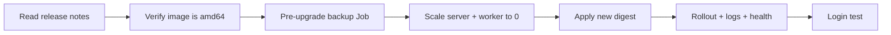

# Single Sign-On (SSO) & AWS SAML 2.0 Identity Federation

> [!NOTE] Architectural Reference / Staged Implementation
> Authentik is active and running in the cluster (`kubernetes/infrastructure/authentik/`) serving local SSO (e.g. Grafana). The upstream SAML 2.0 federation with AWS IAM Identity Center documented below is an enterprise reference design staged for activation.

This guide outlines the enterprise architecture, security flow, and Kubernetes deployment manifest for **[Authentik](https://goauthentik.io/)** — our master External Identity Provider (External IdP) federated with **AWS IAM Identity Center** via SAML 2.0.

---

## 🚀 Enterprise Architecture: Authentik + AWS IAM Identity Center

In enterprise cloud environments, organizations use a dedicated External Identity Provider (External IdP) to manage user authentication, enforcing strong MFA/Passkeys before federating access into AWS.

In our architecture, **Authentik** operates as the master External IdP, issuing signed SAML 2.0 assertions to **AWS IAM Identity Center**.

### Federation Flow Diagram:

```
  +--------------------------------------------------------------------------------+
  |                     Hybrid Identity Federation Topology                        |
  |                                                                                |
  |  1. USER AUTHENTICATION (Authentik Master IdP in Homelab)                      |
  |     - User logs into Authentik using Passkeys (TouchID / FaceID), YubiKey, or PIN.|
  |                                                                                |
  |  2. SAML 2.0 FEDERATION (Authentik ---> AWS IAM Identity Center)               |
  |     - Authentik issues a signed SAML 2.0 assertion token to AWS.              |
  |     - AWS Security Token Service (STS) calls AssumeRoleWithSAML.               |
  |                                                                                |
  |  3. AUTHORIZED CLOUD ACCESS (AWS Console / CLI / ACK / Terraform)              |
  |     - User receives temporary, short-lived AWS IAM credentials for AWS Console,  |
  |       AWS CLI (`aws sso login`), Terraform, and AWS ACK Kubernetes CRDs!        |
  +--------------------------------------------------------------------------------+
```

---

## 🏢 Enterprise Corporate vs Homelab Architecture Alignment

| Architectural Component | Enterprise Corporate Pattern | Our Homelab Implementation |
| :--- | :--- | :--- |
| **External Identity Provider (IdP)** | Okta / Entra ID (Azure AD) / Ping | **Authentik** (Self-Hosted in Kubernetes) |
| **Federation Protocol** | SAML 2.0 / OIDC | **SAML 2.0 / OIDC** |
| **AWS Single Sign-On Target** | AWS IAM Identity Center | **AWS IAM Identity Center** |
| **Credential Issuance** | AWS STS (`AssumeRoleWithSAML`) | **AWS STS (`AssumeRoleWithSAML`)** |
| **User Authentication** | Enterprise SSO + Hardware Keys | **Passkeys (TouchID / FaceID) + Authentik** |

---

## 🔐 Standardized IdP Access Group Mapping

All Authentik groups and AWS IAM Identity Center permission sets follow the global naming standard:

```html
<idp-source>-<platform>-<product>-<env>-<resource-id>-<permission-set>
```

### Examples:
- **`authentik-aws-homelab-prod-73t0-admin`**: Maps to AWS Permission Set `pset-aws-homelab-prod-admin` (Full Administrator Access).
- **`authentik-aws-homelab-prod-73t0-read`**: Maps to AWS Permission Set `pset-aws-homelab-prod-read` (ReadOnly Access).
- **`authentik-aws-immich-prod-73t0-admin`**: Immich Photo Manager Administrator Group.

## 📚 AWS Certification Exam Topics Mastered with this Architecture

- **AWS Solutions Architect (Associate & Professional)**: *Federated Single Sign-On using SAML 2.0 / OIDC External Identity Providers*.
- **AWS Security Specialty**: *AWS Security Token Service (STS) `sts:AssumeRoleWithSAML`*, *Cross-Account IAM Roles*, *Attribute-Based Access Control (ABAC)*.
- **Hands-On Skills**: Configures AWS CLI `aws sso login` backed by our custom `bar2sek.com` domain!

## 📦 Authentik Kubernetes Deployment Manifest (`authentik.yaml`)

> [!NOTE]
> Excerpt only. The live source of truth is `kubernetes/infrastructure/authentik/authentik.yaml`. Since 2025.10 Authentik runs on PostgreSQL alone; there is no Redis.

```yaml
apiVersion: v1
kind: Namespace
metadata:
  name: identity
---
# PostgreSQL PVC backed by Rook-Ceph SSD Pool
apiVersion: v1
kind: PersistentVolumeClaim
metadata:
  name: authentik-db-pvc
  namespace: identity
spec:
  accessModes:
    - ReadWriteOnce
  storageClassName: rook-ceph-block
  resources:
    requests:
      storage: 10Gi
---
# Authentik Server Deployment
apiVersion: apps/v1
kind: Deployment
metadata:
  name: authentik-server
  namespace: identity
spec:
  replicas: 1
  selector:
    matchLabels:
      app: authentik-server
  template:
    metadata:
      labels:
        app: authentik-server
    spec:
      containers:
        - name: authentik-server
          # Always pin version AND digest; `:latest` stopped updating at 2025.2
          image: ghcr.io/goauthentik/server:<version>@sha256:<index-digest>
          args: ["server"]
          env:
            - name: AUTHENTIK_WEB__BASE_URL
              value: https://auth.bar2sek.com
            - name: AUTHENTIK_POSTGRESQL__HOST
              value: authentik-db
            - name: AUTHENTIK_POSTGRESQL__NAME
              value: authentik
            - name: AUTHENTIK_POSTGRESQL__USER
              value: authentik
            - name: AUTHENTIK_POSTGRESQL__PASSWORD
              valueFrom:
                secretKeyRef:
                  name: authentik-secrets
                  key: db-password
          ports:
            - containerPort: 9000
              name: http
            - containerPort: 9443
              name: https
```

---

## 🔁 Upgrade Runbook (Raw Manifests)

Authentik must be upgraded **one release at a time** (2025.2 → 2025.4 → …). Each release's database migrations assume the previous release's ran, and since 2026.8 the startup tooling refuses to skip. The 2026-10-12 upgrade from 2024.12.5 to 2026.8.3 took eight hops using this procedure.

### Per-hop procedure



1. **Read the release notes** for breaking changes. Most "breaking" items target the Helm chart's bundled Postgres/Redis and do not apply here; check environment variables, probes, storage paths and OAuth behavior.
2. **Resolve the tag to a digest and check its platforms.** The tag must resolve to an image *index* that contains an `amd64` manifest:

   ```bash
   T=$(curl -s "https://ghcr.io/token?scope=repository:goauthentik/server:pull" | jq -r .token)
   curl -s -H "Authorization: Bearer $T" \
     -H "Accept: application/vnd.oci.image.index.v1+json" \
     https://ghcr.io/v2/goauthentik/server/manifests/<version> | jq '.manifests[].platform'
   ```

3. **Take a pre-upgrade backup** by cloning the nightly CronJob into a one-off Job pinned to a pc-node (the sm-nodes run short of ephemeral storage and evict pods):

   ```bash
   kubectl create job authentik-preupgrade-<ver> --from=cronjob/backup-postgres-databases \
     -n backups --dry-run=client -o yaml > job.yaml
   # add spec.template.spec.affinity (kubernetes.io/hostname In [pc-node-04, pc-node-05])
   kubectl apply -f job.yaml
   kubectl wait --for=condition=complete job/authentik-preupgrade-<ver> -n backups --timeout=300s
   kubectl logs -n backups job/authentik-preupgrade-<ver> | grep "backup successful"
   ```

4. **Scale server and worker to 0** so migrations run against a quiet database instead of overlapping with old pods during a rolling update:

   ```bash
   kubectl scale deploy/authentik-server deploy/authentik-worker -n identity --replicas=0
   kubectl wait --for=delete pod -l 'app in (authentik-server,authentik-worker)' \
     --field-selector=status.phase=Running -n identity --timeout=120s
   ```

5. **Apply** the manifest with the new digest. `replicas: 1` in the manifest scales both back up.
6. **Verify:** `kubectl rollout status`, then look in the logs for one pod `Applying …` migrations and the other `No migrations to apply.` (a database lock ensures only one runs them). Check `/-/health/live/` and `/-/health/ready/` return 200.
7. **Login test:** Grafana SSO in a private window (Access → Authentik password → passkey).

> [!WARNING]
> **Gotchas seen in practice**
> - **Single-arch tags.** `ghcr.io/goauthentik/server:2025.2.4` is an arm64-only manifest with no index. On amd64 nodes it fails with `exec /ak-root/venv/bin/dumb-init: exec format error` before any migration runs; 2025.2.3 was used instead. Step 2 exists because of this.
> - **Leftover `Completed` pods.** Old pods left behind by node restarts keep their labels, so a plain `kubectl wait --for=delete -l …` hangs and `kubectl logs deploy/…` can pick a dead pod. Use `--field-selector=status.phase=Running`, `kubectl rollout status`, or name the pod.
> - **Removed objects are not pruned.** `kubectl apply` does not delete resources removed from the file; delete them explicitly (the Redis Deployment and Service were removed this way after 2025.10).

### Release-specific notes (2024.12 → 2026.8)

| Release | Relevant change | Action taken |
|---|---|---|
| 2025.4 | Sessions moved from cache to database | Everyone re-logs in once |
| 2025.8 | Background tasks no longer use Redis; DB must be `UTF8` | Verified `SHOW server_encoding` = `UTF8` |
| 2025.10 | Redis no longer used at all; OAuth `email_verified` now defaults to `false` | Removed Redis Deployment/Service and `AUTHENTIK_REDIS__HOST`; Grafana does not check `email_verified` |
| 2025.12 | DB-level unique group names; direct user permissions migrated to roles; `/media` → `/files` | No duplicates; one permission became `ak-migrated-role--user-<id>`; no media mount in use |
| 2026.2 | `User.ak_groups` deprecated; image drops `curl` | No custom code uses `ak_groups`; probes are `httpGet` |
| 2026.5 | Listen address defaults to `[::]` | Verified pods are dual-stack (IPv4 connects to a `[::]` listener) |
| 2026.8 | `X-Forwarded-*` honored only from trusted proxies; `base_url` required from 2026.11 | ingress-nginx pod IPs fall in the default trusted `10.0.0.0/8`; set `AUTHENTIK_WEB__BASE_URL` |

