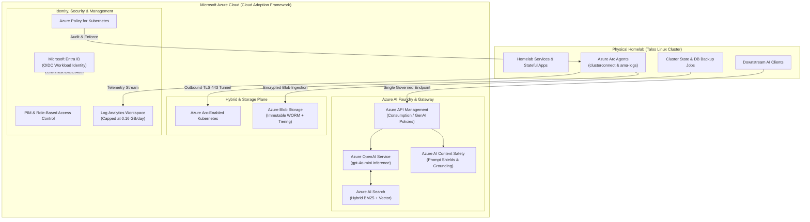
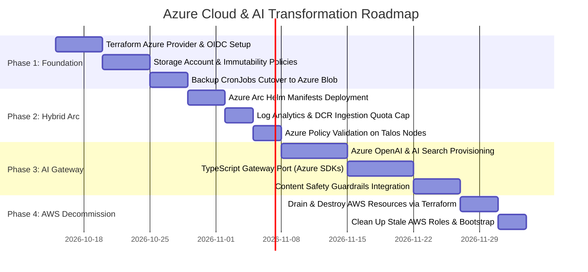

# 🔷 Azure Cloud & AI Transformation Roadmap: Homelab Hybrid Architecture

> [!IMPORTANT] Strategic Transformation Objective
> This document establishes the master architectural blueprint and execution roadmap for migrating our hybrid cloud integrations from AWS to **Microsoft Azure**. The goal is twofold: operational alignment with enterprise Azure hybrid design, and hands-on preparation for the **AZ-104 (Administrator)**, **AZ-305 (Solutions Architect Expert)**, and **AI-102 (Azure AI Engineer Associate)** certifications.

---

## 🏛️ Executive Architecture & Paradigm Shift

Our homelab previously maintained hybrid integrations with AWS (AWS EKS Connector, S3 Object Lock backups, and an Amazon Bedrock RAG gateway). While functional, transitioning these workloads to **Microsoft Azure** elevates our platform architecture into a tightly governed enterprise hybrid model.

---

## 🔄 Service Translation: AWS Estate to Azure Target

| Architectural Capability | Current AWS Footprint | Target Azure Target | Certification Alignment |
| :--- | :--- | :--- | :--- |
| **Generative AI Gateway** | `bedrock-ai-gateway` (CDK + Lambda) | **Azure AI Foundry / APIM + Azure Functions** | **AI-102 & AZ-305** |
| **Vector Search & RAG** | Bedrock Knowledge Base (S3 Vectors + Titan) | **Azure AI Search** (Vector + Semantic Ranker) | **AI-102** |
| **AI Safety & Guardrails** | Bedrock Guardrails (PII / Grounding) | **Azure AI Content Safety** (Prompt Shields) | **AI-102** |
| **Hybrid Kubernetes Control** | AWS EKS Connector (SSM tunnel) | **Azure Arc-Enabled Kubernetes** | **AZ-104 & AZ-305** |
| **Offsite Disaster Recovery** | S3 Bucket (Object Lock WORM + Lifecycle) | **Azure Blob Storage** (Time-based Immutability) | **AZ-305** |
| **Identity & Access Management** | IAM Identity Center + Authentik SAML | **Microsoft Entra ID** + Authentik Federation | **AZ-104 & AZ-305** |
| **Multi-Tier Governance** | AWS Organizations & SCPs | **Management Groups & Azure Policy** | **AZ-104 & AZ-305** |
| **CI/CD Authentication** | GitHub Actions AWS OIDC | **GitHub Actions Azure Federated Credentials** | **AZ-305** |

---

## 🚫 Architectural Decision: Elimination of Local Emulators (Floci & Azurite)

In early architectural revisions, local cloud emulators (**Floci** for AWS S3/SQS and **Azurite** for Azure Storage) were evaluated to enable offline testing. 

**Decision: Deprecate and remove all local cloud emulators.**

### Rationale:
1. **Control Plane vs. Data Plane Gap**: Emulators mock individual storage APIs, but cannot emulate Azure Resource Manager (ARM), Azure Arc agents, Azure OpenAI inference profiles, or Entra ID OAuth flows. Testing against an emulator provides zero validation for actual ARM templates, Bicep, or Terraform `azurerm` provider logic.
2. **Resource Efficiency**: Running mock services on cluster NVMe storage and RAM detracts from production homelab workloads (Ceph, KubeVirt, Home Assistant).
3. **Speculative Plan Pattern**: Infrastructure validation is far more accurately performed via GitHub Actions PR speculative plans (`terraform plan`) against isolated Azure sandbox resource groups using short-lived OIDC workload identity tokens.
4. **Static Tooling**: Linting and semantic syntax verification are handled instantaneously on workstations via `terraform fmt`, `terraform validate`, and `tflint`.

---

## 🛠️ Workload Specifications & Engineering Details

### 1. Azure AI Gateway (`azure-ai-gateway`)
Replaces the AWS Bedrock CDK stack with an enterprise Azure AI stack:
* **LLM Engine**: Azure OpenAI Service running `gpt-4o-mini`.
* **RAG & Search**: Azure AI Search leveraging hybrid retrieval (dense vector embeddings via `text-embedding-3-small` combined with BM25 full-text keyword indexing and semantic re-ranking).
* **Guardrails & Evaluation**: Azure AI Content Safety integrating:
  * Prompt Shields against jailbreak and indirect prompt injection.
  * Protected Material detection.
  * Groundedness detection comparing model output against retrieved search chunks.
* **Edge Governance**: Azure API Management (Consumption Tier) providing API key validation, subscription usage limits, and token rate limiting.

### 2. Azure Arc-Enabled Talos Cluster
Codified in [[408-azure-arc-hybrid-kubernetes|docs/408-azure-arc-hybrid-kubernetes.md]]:
* **Zero Firewall Pinholes**: Outbound-only WebSocket reverse tunnel (`clusterconnect-agent`) over TCP port 443 to the Azure cloud.
* **Strict Telemetry Budgeting**:
  * Log Analytics Workspace (`law-azure-monitoring-prod-cus-001`) capped with `daily_quota_gb = 0.16` (~5 GB/month).
  * Data Collection Rules (DCR) filter out verbose container stdout/stderr, collecting strictly essential cluster metrics, pod inventories, and events.
* **Azure Policy Enforcement**: Enforces Azure baseline pod security standards directly on bare-metal Talos nodes.

### 3. Encrypted Immutable Offsite Backups
* **Storage Account**: `stazurebackupsprodcus001` (Central US, GRS or LRS).
* **Immutability Policy**: Time-based retention policies (WORM compliant) ensuring cluster state manifests and PostgreSQL database dumps cannot be deleted or overwritten by any identity (ransomware guardrail).
* **Lifecycle Automation**: Automated tier transition (Hot $\to$ Cool after 7 days $\to$ Archive after 30 days) and automated purge after 35 days.

### 4. Identity & CI/CD Workload Federation
* **Entra ID + Authentik**: Seamless enterprise SSO between local Authentik IdP and Microsoft Entra ID per [[407-azure-entra-id-authentik-federation|docs/407-azure-entra-id-authentik-federation.md]].
* **GitHub Actions Workload Identity**: Zero static credentials in GitHub Secrets. Ephemeral OIDC tokens minted per-job via `token.actions.githubusercontent.com` matching the `production` environment subject claim.

---

## 📅 Phased Execution Roadmap

### Phase 1: Storage & Cloud Foundation
1. Extend `infra-cloud-deployments/terraform/azure/`:
   - Declare resource groups (`rg-azure-workloads`, `rg-azure-monitoring`).
   - Provision `stazurebackupsprodcus001` with time-based immutable container `backups`.
2. Update Kubernetes backup CronJobs in `personal-technology/kubernetes/infrastructure/backups/` to target Azure Blob Storage using `azcopy` or Azure CLI with workload tokens.

### Phase 2: Azure Arc Hybrid Onboarding
1. Deploy Azure Arc Connected Cluster agents into the `azure-arc` namespace on Talos.
2. Verify node health, cluster workloads, and event streaming in the Azure Portal.
3. Validate that Log Analytics daily quota limits are active and alerting on threshold breaches.

### Phase 3: Azure AI Gateway
1. Deploy Azure OpenAI Service (`gpt-4o-mini`) and Azure AI Search index in `infra-cloud-deployments`.
2. Port `bedrock-ai-gateway` application code from `@aws-sdk/client-bedrock-runtime` to `@azure/openai` and `@azure/search-documents`.
3. Integrate Azure AI Content Safety evaluation hooks and verify prompt defense and groundedness.

### Phase 4: AWS Decommission & Sunset
1. Verify 100% operational autonomy on Azure.
2. Run `terraform destroy` against `infra-cloud-deployments/terraform/aws/`.
3. Archive or delete legacy AWS documentation and decommission `bedrock-ai-gateway`.
