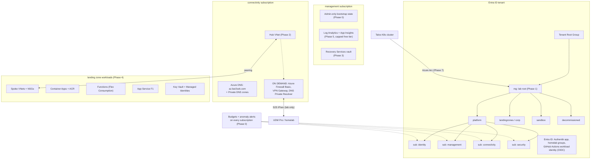

# 🏢 Azure Mini Enterprise: Low-Cost CAF Lab Architecture & Roadmap

A small, always-on Azure estate that complements the homelab and is **maintained over time**, not deployed once. It follows the Cloud Adoption Framework (CAF) landing-zone shape at hobby-budget scale: the free governance and identity services run all the time, and the expensive networking services are deployed on demand and torn down after each lab session.

> [!IMPORTANT] Cost rule
> Budgets and anomaly alerts are created **before** anything else (Phase 0). Anything billed per hour (Azure Firewall, VPN Gateway, DNS Private Resolver) lives in a separate on-demand Terraform root with its own state, and a nightly teardown workflow destroys it. Costs and the reasoning behind them: [[412-azure-lab-cost-guardrails|docs/412]].

---

## 🧭 Why a Rebuild (2026-11-09)

The previous footprint was an Azure Landing Zones (ALZ) accelerator deployment from a GitHub organization: 12 management groups, ~130 policy assignments, and 191 custom policy definitions. It deployed almost nothing, yet cost a few dollars a month. **Its `Deploy-MDFC-Config` policy kept re-enabling every paid Defender for Cloud plan**, and Defender CSPM billed for the Terraform-state storage account. It was torn down with the Azure CLI and the lab is rebuilt from scratch here, one understood piece at a time. Incident write-up: [[412-azure-lab-cost-guardrails#Incident: Defender CSPM Charges from ALZ Policy|docs/412]].

---

## 🏛️ Target Architecture

### Subscriptions (kept from the old deployment, renamed 2026-11-09 to the [[105-naming-conventions|docs/105]] pattern, free)

| Subscription | Role in the lab |
|---|---|
| `subscr-azure-identity-homelab-prod-0bb5` | Default for `bootstrap/azure`; GitHub Actions Contributor (to be re-scoped in Phase 1) |
| `subscr-azure-management-homelab-prod-0bb5` | Admin-only bootstrap state, monitoring, backup |
| `subscr-azure-connectivity-homelab-prod-0bb5` | Hub network, DNS, on-demand Firewall/VPN labs |
| `subscr-azure-security-homelab-prod-0bb5` | Defender for Cloud posture (free tier), security tooling |

---

## ☁️ Cloud Placement Policy (AWS + Azure)

*Decided 2026-11-09. Replaces the "migrate everything to Azure" plan in [[410-azure-cloud-and-ai-transformation-roadmap|docs/410]].*

> [!IMPORTANT] The rule
> 1. **What already runs in AWS stays in AWS.** It works, it's hardened and drilled, and it costs pennies. No migrations.
> 2. **New work goes to the best product or the best price.** When the two clouds are roughly even, **Azure wins the tie**. AWS is the day job; Azure is the one to learn and enjoy in free time.
> 3. **AWS designs that were never built** are dropped in favour of the Azure equivalent, so nothing gets built twice.
>
> This isn't anti-AWS. Each cloud does what it's best at, which is also a stronger story than "moved everything to one cloud". The S3 photo-archive decision below is rule 2 in action: S3 has the better product for that job.

### Stays in AWS (running today)

| Piece | Where it's codified | Why it stays |
|---|---|---|
| S3 backup bucket: Object Lock (governance), write-only uploader, `*.age`-only policy | `bootstrap/aws/backups.tf` (guardrails), `infra-cloud-deployments` (bucket body) | The "governance lock, bypass denied to every principal" pattern has no direct Azure equivalent. Azure immutability is either *unlocked* (any admin can delete the policy) or *locked* (nobody can shorten it). |
| Terraform state for the AWS roots | `bootstrap/aws/storage.tf` | Each cloud keeps its own state. |
| GitHub Actions OIDC roles (plan, apply, CDK gateway) | `bootstrap/aws/oidc*.tf` | Per-cloud trust is required anyway; Azure has its own ([[409-github-cloud-oidc-gitops\|409]]). |
| SNS email alerts | `bootstrap/aws/alerts.tf` | Covers AWS-side events, which Azure can't see. |
| ~~`bedrock-ai-gateway` (CDK)~~ | `bootstrap/github/bedrock-ai-gateway.tf` + its own repo | **Being decommissioned (2026-11-09):** a one-off lab, unused, and the only CDK in the estate. Not ported. Runbook: [[413-bedrock-ai-gateway-decommission\|docs/413]]. |

### Goes to Azure

| Capability | Azure service | Phase | Replaces / improves |
|---|---|---|---|
| Hybrid Kubernetes management | **Azure Arc** | 7 | Replaces the never-deployed **EKS Connector** ([[402-aws-eks-connector\|402]]) |
| Secrets for cluster workloads | **Key Vault Secrets Provider** via Arc | 3 + 7 | New. Removes gitignored secret YAML from the Drive-synced vault |
| Keyless cloud credentials for pods | **Arc workload identity** (Arc hosts the cluster's public OIDC issuer) | 7 | **Improves AWS:** AWS IAM can trust the same issuer, so the backup uploader's long-lived IAM user key is replaced with `AssumeRoleWithWebIdentity` (supersedes the IAM Roles Anywhere roadmap item) |
| Workforce identity hub | **Entra ID**, federated with Authentik ([[407-azure-entra-id-authentik-federation\|407]]) | 1, 8 | Entra becomes the single IdP for both clouds: Entra → AWS IAM Identity Center (SAML + SCIM) replaces the direct Authentik ↔ Identity Center design ([[403-identity-sso-authentik-aws\|403]]) |
| Governance & policy | Management groups, Azure Policy | 1, 7 | New |
| Off-site cluster telemetry | Container Insights (capped) | 5 + 7 | New |
| New AI workloads | **Azure AI Foundry**, AI Search, Content Safety | 9 | New (AI-102). The Bedrock gateway is retired, not ported |
| Any other new app, function or container | Container Apps, Functions, App Service | 4 | New |

> [!NOTE] Correction (2026-11-09): AWS Organizations was never applied
> `bootstrap/aws_organization/` ([[404-aws-landing-zone-organizations-terraform|404]], [[405-aws-account-factory-terraform|405]]) has no state, and the AWS account reports `AWSOrganizationsNotInUseException`. It's a design, not a running piece. Phase 8 needs a **minimal** AWS Organization (free): only an organization instance of IAM Identity Center can grant access to AWS accounts through permission sets. The rest of that root (member accounts, Control Tower, which bills for Config and CloudTrail) gets reviewed on product and price when Phase 8 starts.

### Dropped (no replacement)

- **ACK** for S3 and Route53 ([[401-aws-ack-hybrid-architecture|401]]): cloud resources stay in Terraform per the repo's declarative rule, so neither ACK nor its Azure twin (Azure Service Operator) is adopted. DNS is on Cloudflare, so the Route53 records were never usable anyway.

> [!NOTE] Immich photo archive stays on S3 (decided 2026-11-09)
> The monthly photo archive in [[504-immich-photo-backup|docs/504]] is not built yet. Prices are a wash against Azure Blob **Archive** tier, so the product decides: **S3 Deep Archive**, as docs/504 already plans. It reuses the proven backup model (write-only, `*.age`-only uploader, governance Object Lock with bypass denied to every principal), which Azure can't reproduce exactly. Extensions of the existing S3 backup system count as "what already runs in AWS".

---

## 📅 Phased Roadmap

| Phase | Scope | Monthly cost | Status |
|---|---|---|---|
| **0** | Budgets + anomaly alerts on all subscriptions; admin-only bootstrap state; `azurerm` 4.x; Terraform ≥ 1.9 | ~$0.05 | ✅ Complete 2026-11-09 (applied, state migrated to Azure) |
| **1** | Management groups, Azure Policy (audit → enforce) via `avm-ptn-alz` with cost-bearing policies removed, scoped RBAC for CI, Defender Foundational CSPM only | $0 | 🔨 Code ready 2026-11-09, plans clean, awaiting apply ([[416-azure-management-groups-and-policy\|docs/416]]) |
| **2** | Hub-and-spoke VNets, NSGs, Azure DNS delegated from Cloudflare, Private DNS zones | ~$1 | ⏳ |
| **3** | Key Vault, managed identities, Azure Backup with restore drills | ~$6 | ⏳ |
| **4** | ACR, Container Apps, Functions, App Service | ~$5 | ⏳ |
| **5** | Azure Monitor, Log Analytics + KQL, Application Insights | $0 (capped) | ⏳ |
| **6** | On-demand labs: Firewall, VPN Gateway ↔ UDM Pro, Private Endpoints, DNS Private Resolver | pay per session | ⏳ |
| **7** | Azure Arc for the Talos cluster: connect + Entra RBAC, Key Vault secrets / workload identity, Policy (audit), capped Container Insights ([[#Phase 7 Scope: Azure Arc Feature Shortlist\|shortlist]]); cluster OIDC issuer trusted by AWS IAM so the S3 backup uploader drops its static key | ~$0 (verify) | ⏳ |
| **8** | Entra ID as identity hub for AWS: create a minimal AWS Organization (prerequisite), then Entra → AWS IAM Identity Center (SAML + SCIM), replacing the docs/403 design. Also replaces the fragile `aws login` browser flow with `aws sso login` (docs/409 troubleshooting #6) | $0 | ⏳ |
| **9** | New AI workloads on Azure AI Foundry (AI Search, Content Safety) if Azure wins on product/price; `bedrock-ai-gateway` is retired, not ported ([[413-bedrock-ai-gateway-decommission\|docs/413]]) | pay per use, free tiers first | ⏳ |

Each phase is a checkpoint: plan output reviewed, then an explicit approval before apply.

### Code locations

- **`bootstrap/azure/`** (this repo, applied locally): identity work CI must not hold rights for: Entra apps, OIDC trust for the split plan/apply CI identities, budgets, the admin-only state account and the CI state account ([[418-azure-ci-rbac-and-state|docs/418]]).
- **`bootstrap/azure-governance/`** (this repo, applied locally, decided 2026-11-09): management groups, subscription placement, Azure Policy (`avm-ptn-alz`) and CI role assignments at MG scope ([[416-azure-management-groups-and-policy|docs/416]]). A separate root so policy churn never re-plans the root holding the SSO secret.
- **Workload roots:** `infra-cloud-deployments`, applied through GitHub Actions OIDC (plan identity on PRs, apply identity behind the `production` environment). CI's rights cover only the landingzones and sandbox MGs.

---

## 🌐 Phase 7 Scope: Azure Arc Feature Shortlist

*Decided 2026-11-09.* The cluster already runs Prometheus, Grafana, Alertmanager, ntfy, Headlamp and Tailscale, so Arc is used only where it adds something that stack can't: **off-cluster** visibility and **Entra ID / Key Vault** integration. Everything else stays on self-hosted tools.

> [!NOTE] How Arc for Kubernetes works
> Arc agents run as pods in the `azure-arc` namespace and keep an outbound-only TLS 443 connection to Azure (no inbound ports on the UDM Pro). The cluster becomes an Azure resource (`Microsoft.Kubernetes/connectedClusters`), and features install on top as cluster **extensions**. Nothing is installed on the Talos host OS, which is why Arc for *Kubernetes* works on Talos while Arc for *Servers* does not.

> [!WARNING] Name collision
> `kubernetes/infrastructure/arc/` is GitHub **Actions Runner Controller** (ARC), not Azure Arc. Put Azure Arc manifests and values somewhere clearly named, e.g. `kubernetes/infrastructure/azure-arc/`.

### ✅ In scope (in rollout order)

| # | Feature | What it adds over the current stack | Depends on | Expected cost |
|---|---|---|---|---|
| 1 | **Arc connect + Cluster Connect + Entra ID RBAC** | Portal view of workloads; `az connectedk8s proxy` kubectl access with no VPN; Entra users/groups bound to Azure roles. A second way into the cluster that doesn't depend on Tailscale. | Phase 1 (management group placement, RBAC) | Free (base connect) |
| 2 | **Key Vault Secrets Provider + workload identity** | Secrets (e.g. backup credentials) read from Key Vault at runtime, so no gitignored secret YAML has to sync to Google Drive. Pods get short-lived federated tokens for Azure (same model as [[409-github-cloud-oidc-gitops\|GitHub OIDC]]). | Phase 3 (Key Vault) | Key Vault operations only (cents) |
| 3 | **Azure Policy for Kubernetes (audit mode)** | Gatekeeper/OPA compliance dashboard (privileged pods, missing limits, `:latest` images) next to the rest of the lab's governance. Overlaps with Pod Security Admission labels, so it's mainly for learning; never `deny` platform namespaces. | Phase 1 (policy assignments) | Verify |
| 4 | **Container Insights, capped, events + inventory only** | An **off-site record** that survives the cluster going down (sm-node-01 fault, cold stops): `KubeEvents`, `KubeNodeInventory`, `KubePodInventory`. Plus an Azure alert when the connected cluster goes **offline**, a "whole house down" signal Alertmanager can't send. | Phase 5 (Log Analytics workspace, daily cap) | $0 inside the free 5 GB/mo with the 0.16 GB/day cap |

### ❌ Out of scope

| Feature | Why not |
|---|---|
| Flux GitOps via the Arc extension | Billed per vCPU beyond a small free allowance on Arc clusters (verify). Run upstream Flux directly: same tool, free. |
| Defender for Containers | Billed per vCPU; see the Defender incident in [[412-azure-lab-cost-guardrails\|412]]. |
| Azure Monitor managed Prometheus / Managed Grafana | Duplicates the local stack ([[106-observability-prometheus-grafana\|106]]); metric ingestion is billed. |
| Container stdout/stderr log collection | Would hit the 0.16 GB/day cap within hours, which stops all ingestion for the day. |
| Arc data services, App Service on Arc, AKS on Arc | Too heavy and costly for a homelab. |

### ⚠️ Talos & cost gotchas to check during the Phase 7 plan

- **Pod Security:** `ama-logs` needs privileged access and host paths, so label the `azure-arc` namespace `pod-security.kubernetes.io/enforce: privileged`. Keep `restricted` everywhere else.
- **Pricing check before apply:** confirm on the Azure Arc and Azure Policy pricing pages that base connect, Azure Policy for Kubernetes and the Key Vault extension are free, and look up the current Flux/GitOps per-vCPU rate. Prices above are from memory, not verified.
- **Policy creep:** make sure no Phase 1 ALZ policy assignment auto-enables Defender for Containers or Container Insights on Arc clusters (same failure mode as `Deploy-MDFC-Config`).
- **Agent footprint:** Arc agents plus `ama-logs` use several hundred MB of RAM across the cluster. Record the actual usage after onboarding.
- **Workload identity on Talos:** it needs the API server's `service-account-issuer` set to the Arc-hosted issuer URL, a Talos machine-config patch in `talos/patches/`. Keep the current issuer as a second `--service-account-issuer` value during the cutover so existing tokens stay valid (the first value signs new tokens, all values are accepted).
- **AWS side of the issuer federation:** add an `aws_iam_openid_connect_provider` for the Arc issuer and a role whose trust policy pins the backup ServiceAccount's `sub`, in `bootstrap/aws/backups.tf`. Keep the same write-only, `*.age`-only permissions, then delete the IAM user and its key. Update `kubernetes/infrastructure/backups/README.md` when done.

---

## 🔗 Related

- [[412-azure-lab-cost-guardrails|412 - Azure Lab Cost Guardrails & Bootstrap State]]
- [[407-azure-entra-id-authentik-federation|407 - Entra ID & Authentik Federation]]
- [[408-azure-arc-hybrid-kubernetes|408 - Azure Arc-Enabled Kubernetes]]
- [[409-github-cloud-oidc-gitops|409 - GitHub Actions Multi-Cloud OIDC]]
- [[410-azure-cloud-and-ai-transformation-roadmap|410 - Azure Cloud & AI Transformation Roadmap]] (superseded by the placement policy above)
- [[402-aws-eks-connector|402 - AWS EKS Connector]] (parked, replaced by Arc) · [[401-aws-ack-hybrid-architecture|401 - AWS ACK]] (dropped) · [[403-identity-sso-authentik-aws|403 - Authentik ↔ AWS SSO]] (replaced by Phase 8)
- [[105-naming-conventions|105 - Naming Conventions]]
