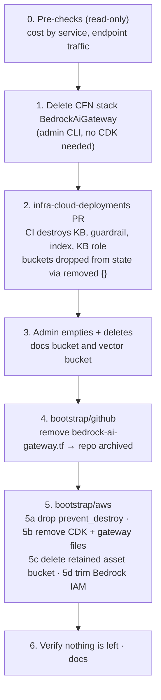

# 🧹 Bedrock AI Gateway Decommission Runbook

**Decided 2026-11-09.** The Bedrock RAG gateway was a one-off lab that is no longer needed. It's unused, and it's the only AWS CDK in the estate. It is retired instead of ported to Terraform. A future AI lab goes wherever the product or price is best ([[411-azure-mini-enterprise-architecture#Cloud Placement Policy (AWS + Azure)|placement policy]]); Phase 9 of docs/411 covers Azure AI Foundry.

> [!IMPORTANT] Every stage is a checkpoint
> Each stage changes live resources. Review the plan or the command first, run it, check the verification, then move on. The order matters: each stage removes something a later stage would otherwise still depend on.

---

## 📦 What Gets Removed

| Part | Where it's defined | How it's removed | Idle cost today |
|---|---|---|---|
| **`BedrockAiGateway` stack**: REST API (API key + usage plan), `ChatFunction` Lambda, `UsageLog` DynamoDB (on-demand), log group, alarms, dashboard | `bedrock-ai-gateway` repo (CDK) | Stage 1: delete the CloudFormation stack | ~$0 (dashboard may be ~$3/mo if over the free 3) |
| **Knowledge Base** + data source, **S3 Vectors** index, **Guardrail** + version, KB service role | `infra-cloud-deployments/terraform/aws/bedrock-*.tf` | Stage 2: CI PR | ~$0 (S3 Vectors bills storage only) |
| KB source-docs bucket, vector bucket | same | Stage 3: admin CLI (CI is denied bucket deletion) | ~$0 |
| GitHub repo, `production` environment, secrets, branch protection | `bootstrap/github/bedrock-ai-gateway.tf` | Stage 4: local apply, repo is **archived** (`archive_on_destroy = true`) | $0 |
| **CDKToolkit** stack (asset bucket, ECR repo, `cdk-*` roles, SSM parameter), CFN exec policy, gateway boundary, gateway diff/deploy roles, Bedrock IAM statements | `bootstrap/aws/` | Stage 5: local applies + admin CLI for the retained asset bucket | Pennies |

> [!NOTE] Things that stay
> The SNS topic `sns-aws-alerts-prod-use2-001` (the gateway's alarm target) belongs to `bootstrap/aws/alerts.tf` and stays. So do the backup bucket, the Terraform state, and the GitHub OIDC plan/apply roles.

---

## 🔀 Order of Operations



**Why this order:**

- **The stack goes first.** Its Lambda calls the Knowledge Base and Guardrail, so they must outlive it.
- **CI's Bedrock permissions in `bootstrap/aws/oidc.tf` must still exist during Stage 2.** CI needs them to delete the KB and guardrail, so the IAM trim is the very last step.
- **`bootstrap/github` reads the gateway role ARNs from `bootstrap/aws` state** (`terraform_remote_state`). It has to drop that file before `bootstrap/aws` removes those outputs.
- **The CDKToolkit stack also goes after Stage 1.** CloudFormation deletes the gateway stack using the `cdk-*-cfn-exec-role`, which belongs to CDKToolkit.

---

## 0️⃣ Pre-checks (read-only)

```bash
aws login   # 400 Bad Request? Open the printed URL in a private window: docs/409 troubleshooting #6
# What AWS actually billed, by service (each Cost Explorer API call costs $0.01; the Billing console is free)
aws ce get-cost-and-usage --time-period Start=2026-10-01,End=2026-11-09 \
  --granularity MONTHLY --metrics UnblendedCost --group-by Type=DIMENSION,Key=SERVICE
# Confirm the endpoint is idle (sum of requests over 30 days)
aws cloudwatch get-metric-statistics --region us-east-2 --namespace AWS/ApiGateway \
  --metric-name Count --dimensions Name=ApiName,Value=<api-name> \
  --start-time "$(date -u -v-30d +%FT%TZ)" --end-time "$(date -u +%FT%TZ)" \
  --period 2592000 --statistics Sum
# Snapshot the stack's resources, to check against in Stage 6
aws cloudformation list-stack-resources --region us-east-2 --stack-name BedrockAiGateway \
  --query 'StackResourceSummaries[].[ResourceType,PhysicalResourceId]' --output table
```

`<api-name>` is the REST API name in the stack resources list (`bedrock-ai-gateway`).

### ✅ Stage 0 results (2026-11-09)

| Check | Result |
|---|---|
| **Cost, before credits** | Sep **$0.0008** · Oct **$0.035** (Bedrock $0.028 from deploy-day testing, S3 $0.007, API Gateway $0.0004) · Nov to date **$0.002** (S3). All of it was offset by account credits, so **$0.00 billed**. |
| **Traffic** | `ChatFunction`: 16 invocations in 30 days, **all on 2026-10-10** (deploy-day tests). Idle since. |
| `BedrockAiGateway` stack | `UPDATE_COMPLETE`, 20 resources, as in the table above. One dashboard (the only one in the account, so inside the free 3) and one alarm. API key `demo-consumer` enabled. |
| `CDKToolkit` stack | `UPDATE_COMPLETE`. Staging bucket has **12 object versions**, 0 delete markers (Stage 5c). ECR repo has **0 images**, so its deletion won't fail. |
| Knowledge Base | `kb-aws-company-handbook-prod-use2-001` `ACTIVE`. Guardrail `gr-aws-company-handbook-prod-use2-001` `READY`. |
| Bedrock buckets | `s3-aws-bedrock-prod-use2-001`: **4 objects, not versioned** (a plain `s3 rm --recursive` is enough in Stage 3). `s3v-aws-bedrock-prod-use2-001`: index `idx-company-handbook-001`. |

**Conclusion:** the gateway is idle and effectively free. It's being removed for simplicity and to shrink the attack surface (a public endpoint with an enabled API key), not to save money.

---

## 1️⃣ Delete the `BedrockAiGateway` stack

No CDK is needed for this. CloudFormation deletes the stack with the execution role it was deployed with (`cdk-<qualifier>-cfn-exec-role`), and `policy-aws-cdk-cfn-exec-prod-001` already grants every delete action, because rollbacks need them too.

```bash
aws cloudformation delete-stack --region us-east-2 --stack-name BedrockAiGateway
aws cloudformation wait stack-delete-complete --region us-east-2 --stack-name BedrockAiGateway
```

**Verify:** `aws cloudformation describe-stacks --stack-name BedrockAiGateway` returns *does not exist*. The DynamoDB table and the function log group use `RemovalPolicy.DESTROY`, so they're gone too. If the stack ends in `DELETE_FAILED`, `describe-stack-events` names the resource and the AccessDenied action. That would mean the exec policy is missing a delete permission.

> [!TIP] ✅ Done 2026-11-09
> `delete-stack` plus `wait stack-delete-complete` finished cleanly, with no `DELETE_FAILED`. Checked afterwards: no REST API, API key, usage plan, `BedrockAiGateway*` Lambda or role, DynamoDB table, log group, dashboard or alarm remain. `CDKToolkit` is the only stack left. The Knowledge Base is still `ACTIVE`, as intended, for Stage 2.

> [!NOTE]
> This is a one-off imperative teardown of something CDK created. There is no declarative "delete" for it once you stop using CDK, and nothing is left to drift afterwards.

---

## 2️⃣ `infra-cloud-deployments` PR: destroy the Bedrock workload

**The CI apply role deliberately has no `s3:DeleteBucket` or `s3vectors:DeleteVectorBucket`** (doc 409's "configuration only, never delete a bucket" rule). Without a workaround, a plain "delete the files" PR would fail halfway. So the PR **destroys** what CI is allowed to destroy and **forgets** the two buckets:

1. Delete `terraform/aws/bedrock-kb.tf`, `terraform/aws/bedrock-guardrail.tf` and `kb-corpus/`.
2. Delete the `bedrock_*` outputs in `terraform/aws/outputs.tf`, and the Bedrock locals in `locals.tf`.
3. Delete the **"Sync Bedrock Knowledge Base Corpus & Ingest"** step in `.github/workflows/aws-deploy.yml`, along with the `terraform_wrapper` comment that exists only for it. Without this, the first apply after the merge fails on the missing outputs.
4. Add `removed` blocks so Terraform drops the buckets from state **without** destroying them:

   ```hcl
   # Bedrock decommission (2026-11-09): CI may not delete buckets.
   # An admin deletes these by hand (personal-technology docs/413, stage 3).
   removed {
     from = aws_s3_bucket.bedrock_docs
     lifecycle { destroy = false }
   }
   removed {
     from = aws_s3_bucket_server_side_encryption_configuration.bedrock_docs
     lifecycle { destroy = false }
   }
   removed {
     from = aws_s3_bucket_public_access_block.bedrock_docs
     lifecycle { destroy = false }
   }
   removed {
     from = aws_s3vectors_vector_bucket.bedrock
     lifecycle { destroy = false }
   }
   ```

5. Mark `docs/bedrock-knowledge-base.md` and `docs/bedrock-guardrail.md` as archived, and update the architecture diagrams if they show Bedrock.

**Expected PR plan:** *destroy* for the knowledge base, the data source, the vector index, the guardrail and its version, the KB role and its policy, and `time_sleep`. *Removed from state, not destroyed* for the four resources above. **Nothing else.** Stop if the plan touches the backup bucket or the EKS connector role.

The data source has `data_deletion_policy = "DELETE"`, so Bedrock deletes the vectors it wrote before the index is removed.

> [!TIP] ✅ Done 2026-11-09 (`infra-cloud-deployments` PR #11)
> CI plan matched the local plan exactly; the merge apply succeeded. Follow-up cleanup (delete `bedrock-decommission.tf`, drop the `time` provider and its lock entry) is prepared on branch `chore/bedrock-decommission-cleanup`; its plan shows **No changes**. Checked afterwards: no knowledge bases, guardrails, vector indexes or `bedrock` IAM roles remain. Both buckets still exist, as intended (docs bucket: 4 objects).
>
> *Original preparation notes:*
> The changes are in the `infra-cloud-deployments` working tree, with the `removed` blocks in `terraform/aws/bedrock-decommission.tf`. An admin plan against the real state (`-lock=false`, read-only) showed exactly **8 to destroy** (KB, data source, index, guardrail and its version, KB role and policy, `time_sleep`) plus **4 no longer managed** (the two buckets, their encryption config and public-access block), and **0 to add or change**. CI's PR plan must match.
>
> **Keep the `time` provider** in `providers.tf` for now: Terraform needs it to destroy `time_sleep`. Remove it in the follow-up PR.

The `removed` blocks can be deleted in a follow-up PR once Stage 3 is done. They have no effect once the resources have left state.

---

## 3️⃣ Admin: delete the two Bedrock buckets

> [!TIP] ✅ Done 2026-11-09
> Both buckets were deleted by `admin-cli` (the commands below were run from the terminal). CloudTrail shows `DeleteBucket` on the docs bucket at 22:47 UTC. `s3api list-buckets` now shows only the backup, state and CDK asset buckets, and `s3vectors list-vector-buckets` is empty.

Use your own admin session, not CI. Bucket names follow `locals.tf`.

```bash
# Source documents (not versioned): empty, then delete
aws s3 rm "s3://s3-aws-bedrock-prod-use2-001" --recursive
aws s3api delete-bucket --bucket s3-aws-bedrock-prod-use2-001 --region us-east-2
# Vector bucket: the index is already gone after Stage 2
aws s3vectors list-indexes --vector-bucket-name s3v-aws-bedrock-prod-use2-001 --region us-east-2
aws s3vectors delete-vector-bucket --vector-bucket-name s3v-aws-bedrock-prod-use2-001 --region us-east-2
```

Check the real names against `locals.tf` before running (`s3-${platform}-bedrock-${env}-${region_code}-${iteration}`).

---

## 4️⃣ `bootstrap/github`: archive the repository

> [!CAUTION] Incident 2026-11-09: the gateway redeployed itself (fixed)
> The gateway repo's workflow has **no path filter**, and its deploy secret and `production` environment were still in place. Merging the README "Archived" PR (#14) and then a Dependabot bump (#13) each started a `deploy` job. Both were approved at the reviewer gate, and `BedrockAiGateway` was recreated at 22:58 UTC with a new public endpoint and API key. It couldn't do anything useful (the KB and Guardrail were already gone) and cost ~$0. It was deleted again with the Stage 1 commands, and a full re-check came back clean.
>
> **Lesson:** retire an app's ability to deploy (this stage) *before* making any final commits to its repo, or reject every pending deployment. Don't merge anything in `bedrock-ai-gateway` until Stage 4 has been applied.

> [!TIP] ✅ Done 2026-11-09
> `just tf-apply github`: 6 destroyed (deploy and diff secrets, `production` environment, branch protection, vulnerability alerts, repository). GitHub reports the repo as `archived: true`, `visibility: public`, with 0 secrets and no environments. A re-plan shows **No changes**. Nothing in the repo can deploy any more.

1. Optional, done by you: push a final README note to `bedrock-ai-gateway` saying it's archived and why. An archived repo is read-only.
2. Optional: make it private first by setting `visibility = "private"` and applying.
3. Delete `bootstrap/github/bedrock-ai-gateway.tf`, then:

```bash
just tf-plan github    # expect: destroy environment, secrets, branch protection, vulnerability alerts; repo archived (not deleted)
just tf-apply github
```

`archive_on_destroy = true` means the repository and its history survive. Deleting it later is a separate, deliberate step in the GitHub UI.

---

## 5️⃣ `bootstrap/aws`: remove CDK and the gateway roles

**5a. Lift the destroy guard.** Remove the `lifecycle { prevent_destroy = true }` block from `aws_cloudformation_stack.cdk_toolkit`, then plan and apply. The plan should show no changes: the guard lives only in config.

**5b. Remove the files.** Delete these and plan/apply (`just tf-plan aws`, `just tf-apply aws`):

- `cdk-bootstrap.tf`: the CDKToolkit stack, `policy-aws-cdk-cfn-exec-prod-001` and `policy-aws-cdk-gateway-boundary-prod-001`
- `templates/cdk-bootstrap-v32.yaml`
- `oidc-cdk-gateway.tf`: the gateway diff and deploy roles
- The gateway and CDK locals in `locals.tf` (`github_gateway_repo_immutable`, `iam_role_github_gateway_*`, `iam_policy_cdk_*`, `cdk_qualifier`)
- The `github_gateway_*_role_arn` outputs in `outputs.tf`

**5c. Clean up what CloudFormation leaves behind.** The CDK bootstrap template sets `DeletionPolicy: Retain` on the **asset bucket**, and the bucket is versioned. Deleting the stack leaves it in place.

```bash
B=cdk-<qualifier>-assets-<account-id>-us-east-2
# Delete every object version and delete marker, then the bucket
aws s3api delete-objects --bucket "$B" --delete "$(aws s3api list-object-versions --bucket "$B" \
  --query '{Objects: [Versions, DeleteMarkers][][].{Key: Key, VersionId: VersionId}}' --output json)"
aws s3api delete-bucket --bucket "$B" --region us-east-2
# The ECR repo has no Retain policy, but a non-empty repo makes deletion fail. The gateway used zip assets, so it should be empty:
aws ecr describe-repositories --region us-east-2 --query 'repositories[?starts_with(repositoryName, `cdk-`)].repositoryName'
```

`delete-objects` takes at most 1,000 keys per call. Repeat until `list-object-versions` returns nothing.

**5d. Trim the Bedrock IAM statements** in `oidc.tf`, then plan and apply:

| Policy | Remove | Keep |
|---|---|---|
| Plan role | `RefreshBedrockResourceTags` | `DenyVectorAndAgentMemoryReads`. AWS `ReadOnlyAccess` still grants those reads; the deny is free insurance for any future vector store |
| Workload boundary | `KnowledgeBase*` statements | everything else |
| Apply role | `ManageBedrock*` statements, and `iam:PassRole` to `bedrock.amazonaws.com` on `role-aws-bedrock-*` | everything else |

---

## 6️⃣ Verify & document

```bash
aws cloudformation list-stacks --region us-east-2 --stack-status-filter CREATE_COMPLETE UPDATE_COMPLETE \
  --query 'StackSummaries[].StackName'                                       # no CDKToolkit, no BedrockAiGateway
aws bedrock-agent list-knowledge-bases --region us-east-2                   # empty
aws bedrock list-guardrails --region us-east-2                              # empty
aws s3 ls | grep -E 'bedrock|cdk-'                                          # nothing
aws logs describe-log-groups --region us-east-2 --query 'logGroups[?contains(logGroupName, `Bedrock`)].logGroupName'
aws iam list-roles --query 'Roles[?contains(RoleName, `gateway`) || starts_with(RoleName, `cdk-`) || contains(RoleName, `bedrock`)].RoleName'
just tf-plan aws && just tf-plan github                                     # no changes
```

Then check that **Cost Explorer shows $0 for Bedrock, Lambda, API Gateway and DynamoDB** in the following month.

**Docs to update when done:**
- docs/411: remove `bedrock-ai-gateway` from "Stays in AWS".
- docs/409: mark the CDK gateway roles and the "Amazon Bedrock permissions" section as historical.
- docs/410: note that it was retired instead of ported.
- Add a journal milestone.
- Set this doc to `status: archive`.

---

## ⚠️ Gotchas

- **Don't run `cdk destroy`.** It needs the CDK toolchain and the repo's context. `aws cloudformation delete-stack` does the same job.
- **Don't drop the IAM statements early.** Removing CI's Bedrock permissions before Stage 2 leaves CI unable to delete the KB, and the apply fails part-way.
- **A dashboard over the free allowance** is the only likely recurring charge today. If cost is the only worry, Stage 1 alone removes it.
- **The EKS connector role** in `infra-cloud-deployments/terraform/aws/main.tf` (parked, see [[402-aws-eks-connector|402]]) is out of scope here. Removing it is a separate, small PR if you want it gone.
