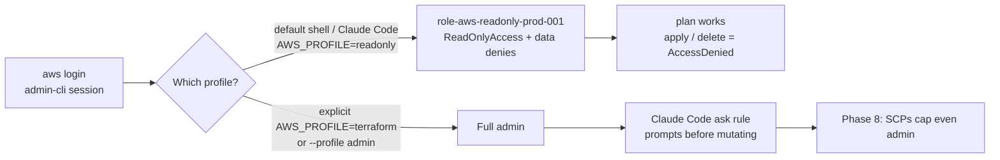

# AWS Access Hygiene: Read-Only Default, Agent Guardrails & SCP Plan

> [!NOTE] Why this exists
> During the [[413-bedrock-ai-gateway-decommission|Bedrock decommission]] it became clear that GitHub branch protection and environment approvals only gate **pipelines**. A human (or a coding agent) holding the admin login session can still run `aws ... delete-*` directly. These four layers narrow that gap until [[411-azure-mini-enterprise-architecture|Phase 8]] replaces the login flow with Entra → IAM Identity Center.



| Layer | Stops | Doesn't stop | Status |
|---|---|---|---|
| 1. `aws logout` | A stale session on an unattended laptop | Anything while logged in | ✅ habit |
| 2. Read-only role by default | Accidental mutation from a default shell or agent | Deliberate `--profile admin` | ✅ applied 2026-11-09 (Claude Code shell) |
| 3. Claude Code ask rules | The agent mutating without a prompt | You approving a bad prompt | ✅ in `~/.claude/settings.json` |
| 4. SCPs (AWS Organizations) | Even admin deleting backups or leaving guardrails | Nothing inside the guardrail | ⏳ Phase 8 |

---

## 1. `aws logout` hygiene

`aws login` caches a refreshable session under `~/.aws/login/cache/`. It stays valid for hours, so end each working block with:

```bash
aws logout
```

Verify: `aws sts get-caller-identity` should now fail with an expired or missing-token error.

> [!TIP]
> If `aws login` gives a 400 error, the cause is browser cookies. See [[409-github-cloud-oidc-gitops|doc 409, troubleshooting #6]].

---

## 2. Read-only role as the default

**Code:** `bootstrap/aws/iam-readonly-human.tf` (role `role-aws-readonly-prod-001`, output `readonly_human_role_arn`).

- **Trust:** only the `admin-cli` IAM user, which `aws login` signs in as.
- **Permissions:** the AWS-managed `ReadOnlyAccess` policy, minus data reads:
  - object reads outside the Terraform state bucket (backups stay unreadable);
  - Secrets Manager, SSM parameter values, `kms:Decrypt` and DynamoDB items.
- **Terraform:** plan works under this role (state read plus the `.tflock` object, the same as the PR plan role). Apply fails with AccessDenied, by design.

### Apply (done 2026-11-09)

```bash
just tf-plan aws    # expect: 3 to add, 0 to change, 0 to destroy
just tf-apply aws
```

### CLI profile (`~/.aws/config`, not tracked)

```ini
[profile readonly-assume]
role_arn       = arn:aws:iam::<account-id>:role/role-aws-readonly-prod-001
source_profile = default
region         = us-east-2

# Go SDK (Terraform) can't read login_session sources; the CLI resolves it here.
[profile readonly]
credential_process = aws configure export-credentials --profile readonly-assume
region             = us-east-2
```

> [!WARNING] Why two profiles
> A plain `role_arn` + `source_profile = default` profile works for the AWS CLI. Terraform's Go SDK can't use it, and fails with `failed to load assume role ... of profile default`, because the Go SDK doesn't understand the `login_session` credential source. Wrapping it in `credential_process`, the same trick the `terraform` profile uses, lets both tools resolve it.

Your own terminal stays as it is: the `terraform` alias and the Justfile `_tf` wrapper still default to `AWS_PROFILE=terraform`. Only Claude Code's shell gets `AWS_PROFILE=readonly`, through `env` in `~/.claude/settings.json`. Because `_tf` uses `${AWS_PROFILE:-terraform}`, an agent's `just tf-plan` runs as read-only and an agent's `just tf-apply` cannot succeed.

> [!WARNING] Gotchas
> - **`aws login` under `AWS_PROFILE=readonly`** tries to log the *readonly* profile in, and fails. Run `aws login --profile default`, or run it from your own terminal. This is why `AWS_PROFILE` is never set globally in nix-mac's `home.nix`.
> - **Plan will show AccessDenied** if a provider ever needs a data read the denies block, such as `ssm:GetParameter` for a `data "aws_ssm_parameter"`. In that case run that plan as `terraform`, or narrow the deny.

### Verify

```bash
AWS_PROFILE=readonly aws sts get-caller-identity          # ...assumed-role/role-aws-readonly-prod-001/...
AWS_PROFILE=readonly aws s3 ls                            # works
AWS_PROFILE=readonly just tf-plan aws                     # "No changes" (state read + lock work)
```

Results on 2026-11-09 (`aws iam simulate-principal-policy` against the role): `s3:ListAllMyBuckets` and `ec2:DescribeInstances` were allowed. `sns:CreateTopic`, `s3:DeleteBucket`, `iam:CreateUser` and `cloudformation:DeleteStack` got an implicit deny. `secretsmanager:GetSecretValue`, `kms:Decrypt` and `s3:GetObject` on the backup bucket got an explicit deny. The plan as `readonly` returned "No changes".

> [!TIP] zsh gotcha when scripting ARNs
> In zsh, `"arn:aws:iam::$ACCT:role/..."` expands `$ACCT:r` as a *modifier* and silently drops `:r`, which produces `...123456789012ole/...`. Always write `${ACCT}` before a colon.

---

## 3. Claude Code permission ask rules

These live in **user-level** `~/.claude/settings.json`, so they apply in every repository and are never committed. The `ask` rules force a prompt even in auto mode. Covered:

| Area | Patterns |
|---|---|
| AWS | `aws * delete-*`, `remove-*`, `terminate-*`, `put-*`, `update-*`, `create-*`, `attach-*`, `detach-*`, `deregister-*`, `disable-*`, `cloudformation deploy`, `s3 rm / rb / mv / sync` |
| Terraform | `terraform apply / destroy / import / state rm / state mv / state push / force-unlock`, `just tf-apply`, `just tf-destroy` |
| GitHub | `gh api` with `-X DELETE / PUT / PATCH`, `gh repo delete / archive / edit`, `gh release delete`, `gh secret`, `gh variable`, `gh workflow run`, `gh pr merge` |
| Cluster | `kubectl delete / apply / patch / replace / scale / drain / edit`, `talosctl apply-config / reset / upgrade / reboot / shutdown` |
| Azure | `az * delete*` |
| Git | `git commit`, `git push` (AGENTS.md: the user owns commits) |

> [!IMPORTANT]
> Ask rules are a speed bump, not a boundary: a prompt you approve still runs. Layer 2 is what makes a mistaken approval harmless, and Layer 4 is what makes it impossible.

---

## 4. SCP guardrails (Phase 8 design)

> [!CAUTION] SCPs never apply to the management account
> If an Organization were created **from the current account**, that account would become the management account, and no SCP would ever restrict it. The workload account must be a **member**.

**Plan:**

1. Create a new, empty AWS account to act as the **management account**, holding only Organizations, IAM Identity Center and billing.
2. From it, create the Organization and **invite the existing account** as a member. Its resources, state and OIDC roles all stay put.
3. Attach SCPs to the member account:

| SCP | Effect |
|---|---|
| `DenyBackupAndStateDeletion` | Deny `s3:DeleteBucket`, `s3:PutBucketPolicy`, `s3:PutLifecycleConfiguration` and `s3:BypassGovernanceRetention` on the backup and tfstate buckets. |
| `DenyLeaveOrganization` | Deny `organizations:LeaveOrganization`. |
| `ProtectAuditTrail` | Deny `cloudtrail:StopLogging` and `DeleteTrail`, and changes to the alerts SNS topic. |
| `RegionAllowlist` | Deny non-global services outside `us-east-2` (and `us-east-1` for global endpoints). |
| `DenyRootUser` | Deny every action by the member account's root user. |

4. Codify this in Terraform. `bootstrap/aws_organization/` already exists but has never been applied. It must be rewritten to run with **management-account** credentials. Running `just tf-apply-aws-org` as it is today would make the current account the management account, which is the trap described above.
5. Then wire Entra → IAM Identity Center (SAML + SCIM) with two permission sets, `read` (the default) and `admin`. That retires the `admin-cli` user and the `aws login` flow, and this read-only role becomes a permission set.

SCPs, Organizations and Identity Center cost $0.

---

## Related

- [[409-github-cloud-oidc-gitops|409: GitHub OIDC & CI roles]]
- [[411-azure-mini-enterprise-architecture|411: Cloud placement & Phase 8]]
- [[413-bedrock-ai-gateway-decommission|413: Bedrock decommission]]
