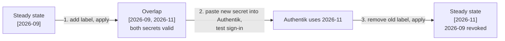

# 🔁 Entra ID Client Secret Rotation: Zero-Downtime Rotation Ring

How the Authentik app registration's client secret (`app-azure-authentik-prod-001`) is rotated with **no sign-in outage**. Code: `bootstrap/azure/entra.tf` (`azuread_application_password.authentik`), `variables.tf` (`authentik_secret_versions`, `authentik_secret_lifetime`).

> [!NOTE] Why rotate now (2026-11-09)
> Until Phase 0 this root kept its state in the Google Drive–synced vault, and Terraform state stores the secret in plaintext. The state now lives in an admin-only Azure account ([[412-azure-lab-cost-guardrails|docs/412]]), but **Drive's version history may still hold old copies**. Rotating is the only thing that makes those copies worthless.

---

## 🧠 How the Rotation Ring Works

An Entra app registration can hold **several valid client secrets at the same time**. The ring uses that: each label in `authentik_secret_versions` is one live secret.



- The output `entra_app_client_secret` always returns the **newest** label (`YYYY-MM` sorts chronologically).
- Validations keep the ring at **1 or 2** secrets. An empty set would revoke the live secret.
- New secrets last **6 months** (`authentik_secret_lifetime = "4380h"`), which makes rotation a twice-yearly maintenance habit instead of a once-a-year surprise. The expiry is sent as an explicit `end_date = timeadd(timestamp(), lifetime)`, computed once at creation.

> [!CAUTION] azuread 2.53 ignores `end_date_relative`
> The provider stores `end_date_relative` in state but doesn't send it to Entra, so Entra applies its **2-year default**. Both early secrets show this: `8760h` and `4380h` were requested, and both got 2 years. An Entra secret's expiry can't be edited after creation, so always set `end_date` explicitly. Check `entra_app_client_secret_versions` after every rotation.

> [!WARNING] The `ignore_changes` gotcha
> In azuread 2.x, **every** argument of `azuread_application_password` forces replacement. Without `ignore_changes = [display_name, end_date, end_date_relative]`, changing the lifetime or the naming scheme would destroy and recreate **every** live secret in one apply, which means an instant SSO outage. `end_date` must be in the list anyway, because `timestamp()` returns a new value on every plan. With it, new settings apply only to newly added labels, which is exactly what rotation needs.

> [!TIP] `moved` block
> The original secret (created 2026-09-21, resource `authentik_secret`) was adopted into the ring as label `2026-09` with a `moved` block. The plan showed `has moved to …["2026-09"]`, a state-only rename with no API call to Entra. Once that apply had run, the block was removed. Keep any future `moved` block for one apply only.

---

## 📋 Runbook

### Step 1: Add the new secret (overlap)

```hcl
# bootstrap/azure/variables.tf (or override in terraform.tfvars)
authentik_secret_versions = ["2026-09", "2026-11"]
```

```bash
just tf-plan azure    # expect: 1 to add, 0 to change, 0 to destroy
just tf-apply azure
just tf azure output entra_app_client_secret_versions   # both labels with expiry dates
```

### Step 2: Switch Authentik to the new secret

1. Check whether Authentik actually uses this secret: Authentik admin → **Directory → Federation and Social login**. Look for an OpenID source with slug `entra-id`.
   - **No such source** (doc 407 is still `status: design`): nothing to switch. Go to step 3.
2. Print the new secret **in your own terminal** (never paste it into chat or a file in the vault):
   ```bash
   just tf azure output -raw entra_app_client_secret | pbcopy   # copies the newest label's value
   ```
3. Edit the `entra-id` source → **Consumer secret** → paste → **Update**. Then clear the clipboard.
4. Test: open a private window → `https://auth.bar2sek.com` → sign in with **Microsoft Entra ID**. You should land on the Authentik user interface.

### Step 3: Revoke the old secret

```hcl
authentik_secret_versions = ["2026-11"]
```

```bash
just tf-plan azure    # expect: 0 to add, 0 to change, 1 to destroy (["2026-09"])
just tf-apply azure
```

Then confirm `just tf-plan azure` shows **No changes**, and that `az ad app credential list` (below) lists only the new label.

### Next rotation

Before the newest secret expires (`entra_app_client_secret_versions` shows the date), repeat the three steps with the next `YYYY-MM` label.

---

## ✅ Verification

```bash
# Exactly the expected secrets exist in Entra (names + expiry, no values)
az ad app credential list --id "$(just tf azure output -raw entra_app_client_id)" \
  --query "[].{name:displayName, hint:hint, ends:endDateTime}" -o table

# Terraform and Entra agree
just tf-plan azure    # No changes
```

`hint` is the first three characters of each secret. It lets you match a credential to what Authentik holds without exposing the value.

---

## 📜 Rotation History

| Date | Added | Revoked | Authentik switched? | Notes |
|---|---|---|---|---|
| 2026-11-09 | `2026-11` (hint `u8K`, expires 2028-11-10) | `2026-09` (hint `qlX`): revoked 2026-11-09, verified (only `u8K` remains, plan shows No changes) | Not needed: no `entra-id` source exists yet (doc 407 still `design`) | First rotation. It found the `end_date_relative` bug; the next secret will get a real 6-month expiry. |

---

## 🛠️ Troubleshooting

- **`AADSTS7000215: Invalid client secret provided`** on Entra sign-in. Authentik still holds a revoked secret. Re-run step 2 with the current output.
- **The plan wants to replace an existing secret.** Something in the `lifecycle.ignore_changes` list was removed, or an argument outside it changed (e.g. `application_id`). Stop and don't apply.
- **A new secret expires in 2 years instead of 6 months.** Something is setting `end_date_relative` instead of `end_date` (see the caution above). The expiry can't be changed after creation, so rotate again.
- **`Error: Invalid value for variable`.** The ring is empty, has more than 2 labels, or a label isn't `YYYY-MM`.

---

## 🔗 Related

- [[407-azure-entra-id-authentik-federation|407 - Entra ID & Authentik Federation]]
- [[412-azure-lab-cost-guardrails|412 - Admin-Only Bootstrap State]]
- [[409-github-cloud-oidc-gitops|409 - Known Risk: Bootstrap State]]
- The **Cloudflare Zero Trust Access** app registration has its **own** secret (expires 2027-04-02). It's configured by hand outside Terraform (see `SECURITY.md`) and is **not** part of this ring.
