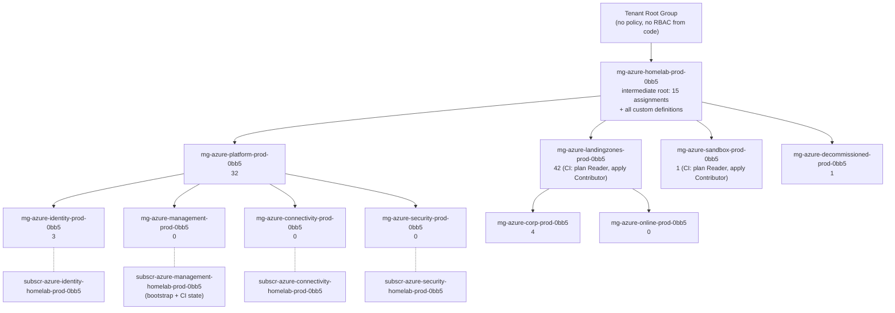
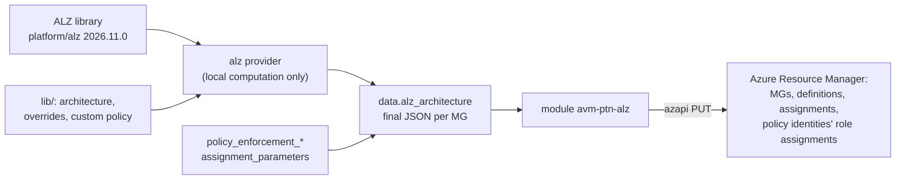

# 🏛️ Azure Mini Enterprise Phase 1: Management Groups, Policy & CI RBAC

Phase 1 of the [[411-azure-mini-enterprise-architecture|Azure Mini Enterprise]]. It builds the governance skeleton every later phase lands in. It costs **$0**: management groups, policy and RBAC are free, and every policy that would *create* something billable is removed or disabled before the first apply.

| Doc | Covers |
|---|---|
| **416 (this note)** | Hierarchy, where the code lives, the milestone runbook, verification, gotchas |
| [[417-azure-policy-cost-safe-alz\|417]] | Which ALZ assignments were removed and why, hidden Defender traps, custom guardrails, the audit → enforce plan |
| [[418-azure-ci-rbac-and-state\|418]] | Split plan/apply CI identities, CI state account, what `infra-cloud-deployments` must change |

Code: `bootstrap/azure-governance/` (new root) and `bootstrap/azure/` (`entra.tf`, `ci_state.tf`).

---

## 🧭 Decisions (2026-11-09)

| Decision | Choice | Why |
|---|---|---|
| Hierarchy shape | ALZ/CAF default tree, minus `local` | The [ALZ library](https://github.com/Azure/Azure-Landing-Zones-Library)'s 2026 tree has a native **security** MG, so the 4 existing subscriptions map 1:1. Same shape as a real enterprise; `local` (Azure Local) has no use here. |
| Code home | **New root `bootstrap/azure-governance`** | Keeps the alz provider (which downloads the library on every plan) and policy churn out of the root holding the Authentik SSO secret. Smaller blast radius, faster plans, its own state key. |
| Who applies | The operator, locally | Creating MGs, policy and MG-scope RBAC needs Owner-level rights at the lab root. A pipeline holding that could rewrite its own guardrails. |
| Policy engine | `avm-ptn-alz` 0.22.0 + a custom `lib/` | The ALZ library is how enterprises run Azure Policy at scale. Overrides declare what's *removed* instead of forking 190 definitions, so library upgrades stay a version bump. |
| Rollout | Everything `DoNotEnforce` first | Compliance data without blast radius. Enforce one MG at a time once the results are read ([[417-azure-policy-cost-safe-alz#🚦 Audit → Enforce Plan (M5)\|417]]). |
| CI | Split plan / apply identities, own state account | [[418-azure-ci-rbac-and-state\|418]] |
| Telemetry | `enable_telemetry = false` | AVM modules send a tracking deployment to Microsoft by default. |

---

## 🌳 Hierarchy

IDs follow [[105-naming-conventions|docs/105]]: `mg-azure-<category>-<env>-<tenant-4>`. Management groups are foundation containers, so they are always `prod` (including sandbox); the `lab` env belongs to the disposable subscriptions inside.



Numbers are policy assignments per MG with `policy_enabled = true` (98 in total). Assignments inherit downwards, so the identity subscription is evaluated against 15 + 32 + 3 = 50.

### Why an intermediate root instead of Tenant Root

- Policy and RBAC at **Tenant Root** apply to everything in the tenant, including subscriptions that haven't been placed yet, and nothing below can opt out.
- An intermediate root keeps an escape hatch: a subscription moved back to Tenant Root leaves all lab policy behind. That's also how you test a hierarchy change without affecting everything.
- Tenant Root stays empty of code-managed policy, so a broken lab apply can't lock you out of the tenant.

### Subscription placement

Placement is computed, not hard-coded. `main.tf` lists subscriptions with `azapi_resource_list`, keeps the `subscr-azure-*` ones, and maps the `<category>` name node to the MG of the same name. No subscription IDs appear in code or tfvars. A new `subscr-azure-corp-homelab-prod-0bb5` or `subscr-azure-sandbox-homelab-lab-0bb5` lands in its MG on the next apply with no code change.

> [!NOTE] The workload MGs are empty
> landingzones, corp, online and sandbox have no subscription yet, so CI's rights there grant nothing until Phase 4 creates one. Creating a subscription is free on pay-as-you-go but needs billing-account rights; it's a portal or `az account alias create` step, not this root.

---

## 🗂️ Code Layout

```text
bootstrap/azure-governance/
├── providers.tf        # alz (library 2026.11.0 + ./lib), azapi, azuread; azurerm backend
├── variables.tf        # policy_enabled, enforcement modes, ci_rbac_enabled, guardrail lists
├── main.tf             # subscription discovery, enforcement/parameter overrides, module "alz"
├── ci_rbac.tf          # CI role assignments at MG scope (docs/418)
├── outputs.tf
├── backend.hcl.example # copy to backend.hcl (gitignored): same admin-only account, own key
├── scripts/alz_inventory.py   # re-run before every library bump (docs/417)
└── lib/
    ├── homelab.alz_architecture_definition.yaml            # M3: trimmed policy
    ├── homelab-hierarchy.alz_architecture_definition.yaml  # M2 / rollback: no policy
    ├── homelab_empty.alz_archetype_definition.yaml
    ├── homelab_*.alz_archetype_override.yaml               # removals per MG
    ├── Deny-Paid-Defender-Plans.alz_policy_definition.json
    └── <6 custom guardrail>.alz_policy_assignment.json
```

### How the pieces fit



The **alz provider never calls ARM to change anything.** It merges the library with `lib/` and hands finished JSON to the module, which creates resources through azapi. So a library change shows up as an ordinary Terraform diff you can read before applying.

### The `policy_enabled` switch

| Value | Architecture | Result |
|---|---|---|
| `false` (default) | `homelab-hierarchy` | Management groups + subscription placement, **zero policy** (M2) |
| `true` | `homelab` | Trimmed ALZ policy, all `DoNotEnforce` (M3) |

Both architecture files have the same MG IDs, so switching never recreates a management group. Setting it back to `false` is the **rollback**: one apply removes every assignment and definition and leaves the hierarchy in place.

---

## 🚀 Runbook

Each milestone is a separate apply, run by the operator. Plans below were checked read-only on 2026-11-09 with `-lock=false`.

### Prerequisites

```bash
# run from the personal-technology repo root (just resolves bootstrap/<dir>)
cp bootstrap/azure-governance/backend.hcl.example bootstrap/azure-governance/backend.hcl   # fill in the management sub ID
just tf-init azure-governance
```

Your account needs Owner on the 4 subscriptions (moving a subscription needs it on the source) and the right to create MGs under Tenant Root (allowed by default). The creator of a management group becomes its Owner, which covers the policy and role-assignment writes below it.

### M2: hierarchy + placement (no policy)

```bash
just tf-plan azure-governance        # expect: 22 to add (11 MGs, 4 placements, module helpers)
just tf-apply azure-governance
```

### M3: trimmed policy, audit only

Add `policy_enabled = true` to `bootstrap/azure-governance/terraform.tfvars` (gitignored; nothing in it is secret, but it keeps the switches local).

```bash
just tf-plan azure-governance        # expect: 425 to add, 0 change, 0 destroy, no warnings
just tf-apply azure-governance       # 150 definitions, 44 initiatives, 5 roles, 98 assignments, 106 role assignments
```

### M4: CI identities + state, then CI RBAC

Order matters: governance looks the plan identity up by name, so it must exist first.

```bash
just tf-plan azure    # expect: 12 add, 2 change (renames), 3 destroy (2 old OIDC creds + old Contributor)
just tf-apply azure
# then set ci_rbac_enabled = true in bootstrap/azure-governance/terraform.tfvars
just tf-plan azure-governance        # expect: 4 role assignments to add
just tf-apply azure-governance
```

### M5: enforce

Per [[417-azure-policy-cost-safe-alz#🚦 Audit → Enforce Plan (M5)|docs/417]]: read the compliance results, then flip one MG at a time with `policy_enforcement_by_mg`.

---

## ✅ Verification

```bash
# Hierarchy and placement
az account management-group show -n mg-azure-homelab-prod-0bb5 -e -r \
  --query "children[].{name:name, children:children[].name}" -o json
just tf azure-governance output subscription_placement

# Assignments and their enforcement mode at a scope
az policy assignment list --scope /providers/Microsoft.Management/managementGroups/mg-azure-homelab-prod-0bb5 \
  --query "[].{name:name, mode:enforcementMode}" -o table

# Compliance (first results ~30 min after assignment; force a scan on one sub)
az policy state trigger-scan --subscription subscr-azure-identity-homelab-prod-0bb5 --no-wait
az policy state summarize --management-group mg-azure-homelab-prod-0bb5 \
  --query "policyAssignments[?results.nonCompliantResources>\`0\`].{a:policyAssignmentId, n:results.nonCompliantResources}" -o table

# Still no paid Defender plan anywhere (expect only Discovery + FoundationalCspm)
for s in $(az account list --query "[?starts_with(name,'subscr-azure-')].id" -o tsv); do
  az rest --method get --url "https://management.azure.com/subscriptions/$s/providers/Microsoft.Security/pricings?api-version=2024-01-01" \
    --query "value[?properties.pricingTier=='Standard'].name" -o tsv
done
```

---

## 🛠️ Troubleshooting & Gotchas

- **MG IDs are literal in `lib/` YAML.** The alz library can't template them, so `0bb5` is written into both architecture files. `terraform_data.naming_guard` fails the *plan* if they stop matching `mg-azure-<category>-prod-<tenant-4>` (e.g. a different tenant). MG IDs are immutable: renaming one means delete and recreate, which moves its subscriptions out.
- **Edit both architecture files or neither.** They must keep the same tree; only the archetype names differ.
- **`PolicyRoleAssignmentError … vM_UAI_DINE` warning.** The provider can't compute roles for MCSB v2 members that take a user-assigned identity. MCSB v2 pins every `*_DINE` member to `AuditIfNotExists`, so it's suppressed in `providers.tf`. Re-check after a library upgrade.
- **Library upgrades can add cost.** Inherited archetypes pick up new upstream assignments automatically. Before changing `ref`, run `scripts/alz_inventory.py` on the new release and diff it against [[417-azure-policy-cost-safe-alz|docs/417]].
- **DINE/Modify assignments need a managed identity and role assignments.** The module creates both (106 role assignments). They can take minutes to propagate; a remediation started immediately after apply may fail with `AuthorizationFailed`. Wait and retry.
- **Destroying the root moves subscriptions out first.** `subscription_placement_destroy_behavior = "default"` sends them to the tenant's default MG (Tenant Root, since no hierarchy settings are configured) before their MG is deleted.
- **Hierarchy settings are deliberately not set yet.** Making `sandbox` the default MG for new subscriptions and requiring authorization for MG creation are both good controls, but they write to Tenant Root and need Owner or Management Group Contributor there. Backlog item, not Phase 1.
- **Plans need no lock.** Reviewing with `just tf-plan azure-governance -lock=false` writes nothing to state, not even a lease.

---

## 📝 Resume Bullets (Phase 1)

- Designed and codified a CAF/ALZ-aligned Azure management group hierarchy (11 MGs, intermediate root, platform/landing-zone split) in Terraform with Azure Verified Modules (`avm-ptn-alz`), placing subscriptions by naming convention with no IDs in code.
- Customised the Azure Landing Zones policy library through archetype overrides: removed 30 cost-bearing DeployIfNotExists/Modify assignments and neutralised hidden paid Defender for Cloud members inside ALZ guardrail initiatives, after tracing a recurring charge to an ALZ DINE policy that kept re-enabling paid plans.
- Rolled out 98 policy assignments in `DoNotEnforce` (audit) mode with a per-management-group enforcement switch and a one-variable rollback; added custom cost guardrails (allowed regions and VM SKUs, denied premium resource types, keyless storage) and a custom policy that denies paid Defender plans.
- Replaced a single over-privileged GitHub Actions identity with split OIDC plan/apply workload identities: plan holds Reader plus read-only state access for PR runs, apply holds Contributor only on workload management groups behind a protected environment, with separate admin-only and CI Terraform state accounts.

---

## 🔗 Related

- [[411-azure-mini-enterprise-architecture|411 - Azure Mini Enterprise Architecture & Roadmap]]
- [[412-azure-lab-cost-guardrails|412 - Azure Lab Cost Guardrails & Bootstrap State]] (the Defender incident)
- [[417-azure-policy-cost-safe-alz|417 - Cost-Safe ALZ Policy]] · [[418-azure-ci-rbac-and-state|418 - Azure CI RBAC & State]]
- [[409-github-cloud-oidc-gitops|409 - GitHub Actions Multi-Cloud OIDC]]
- [[105-naming-conventions|105 - Naming Conventions]]
