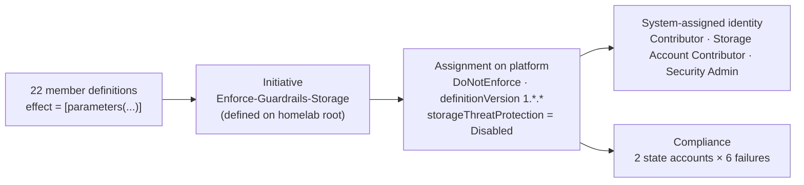

# 🛡️ Cost-Safe ALZ Policy: What Was Removed, Hidden Defender Traps & Guardrails

Policy half of [[416-azure-management-groups-and-policy|Phase 1]]. The goal: keep as much of the Azure Landing Zones (ALZ) policy baseline as possible, because that's what enterprises run, while making sure **no assignment can create anything billable**. The previous ALZ deployment failed exactly there ([[412-azure-lab-cost-guardrails#🚨 Incident: Defender CSPM Charges from ALZ Policy|docs/412]]).

Library: `platform/alz` **2026.11.0**, 95 assignments across 12 archetypes. Inventory method: `bootstrap/azure-governance/scripts/alz_inventory.py`, plus `az policy set-definition show` for the built-in initiatives the script can't expand offline.

---

## 🧠 How Policy Creates Cost

| Effect | Does it change anything? | Cost risk |
|---|---|---|
| `Audit`, `AuditIfNotExists` | No: compliance record only | None |
| `Deny`, `DenyAction` | Blocks the request | None (it can block a deployment you wanted, which is a different risk) |
| `Modify`, `Append` | Rewrites the resource's properties on create/update | Low, **unless** the property attaches a paid thing (e.g. a DDoS plan) |
| `DeployIfNotExists` (DINE) | Deploys a related resource or setting with the assignment's managed identity | **High**: Defender plans, backup vaults, agents and data collection rules (→ Log Analytics ingestion) |

> [!IMPORTANT] Rule used for every decision below
> Keep an assignment unless its DINE/Modify path creates or attaches something billable, or needs a resource that doesn't exist yet (Log Analytics workspace, DDoS plan, private DNS zones). Removed is not "bad policy": most of these come back in the phase that builds the thing they need.

`DoNotEnforce` is **not** the same as removal. It stops Deny from blocking and stops DINE from remediating *new* resources, but anyone can still run a **remediation task** against a DoNotEnforce DINE assignment, and a later flip to `Default` arms it. Cost-bearing assignments are therefore removed outright, not just left unenforced.

---

## ❌ Removed Assignments (30)

Implemented as `policy_assignments_to_remove` in `lib/homelab_*.alz_archetype_override.yaml`. Overrides are the approach the AVM module recommends over `creation_enabled = false`, because the library then stays the single source of truth.

| Assignment | Removed at | Why | Comes back |
|---|---|---|---|
| `Deploy-MDFC-Config-H224` | root | Turns on every paid Defender plan: **the 2026-10 incident** | Never in this lab |
| `Deploy-MDFC-OssDb`, `Deploy-MDFC-SqlAtp` | root | Defender for OSS DBs / SQL (paid) | Never |
| `Deploy-MDEndpoints`, `Deploy-MDEndpointsAMA` | root | Defender for Endpoint needs Defender for Servers (paid) | Never |
| `Deploy-AzActivity-Log` | root | Needs a Log Analytics workspace | Phase 5 (activity log ingestion is free) |
| `Deploy-Diag-LogsCat` | root | Diagnostic logs for every resource into Log Analytics: billed ingestion | Phase 5, scoped down |
| `Deploy-SvcHealth-BuiltIn` | root | Creates an RG + alert rules in every subscription | Phase 5 |
| `Deploy-MDFC-DefSQL-AMA` | platform, landingzones | Defender for SQL on VMs + AMA | Never |
| `Deploy-VM/VMSS/vmArc-ChangeTrack` (3) | platform, landingzones | AMA + data collection rule → ingestion | Maybe Phase 5 |
| `Deploy-VM/VMSS/vmHybr-Monitoring` (3) | platform, landingzones | VM Insights → ingestion | Maybe Phase 5 |
| `DenyAction-DeleteUAMIAMA` | platform | Protects an AMA identity that doesn't exist | With AMA |
| `Deploy-VM-Backup` | identity, landingzones | Creates Recovery Services vaults; protected-instance fees | Phase 3 does backup on purpose |
| `Enable-DDoS-VNET` | connectivity, landingzones | Attaches VNets to a DDoS Network Protection plan (~$2,944/mo) | Never |
| `Deploy-AzSqlDb-Auditing` | landingzones | SQL auditing into Log Analytics | Phase 5 if SQL is used |
| `Deploy-SQL-Threat` | landingzones | SQL Advanced Threat Protection = Defender for SQL (paid) | Never |
| `Deploy-Private-DNS-Zones` | corp | Needs the hub's private DNS zones | **Phase 2** |

The `local` archetype (Azure Local) isn't used at all: no `local` MG.

---

## 🪤 Hidden Traps Inside "Guardrail" Initiatives

The headline effect of the ALZ `Enforce-GR-*` initiatives is parameterised, so the assignment list makes them look harmless. Expanding their members showed **six that enable a paid per-resource Defender plan**. A per-resource plan bills even while the subscription-level plan is Free, so the custom deny below wouldn't catch them.

| Assignment (platform + landingzones) | Member | Parameter set to `Disabled` |
|---|---|---|
| `Enforce-GR-Storage0` | `Dine-Storage-Threat-Protection` (Defender for Storage) | `storageThreatProtection` |
| `Enforce-GR-CosmosDb0` | `Dine-CosmosDb-Atp` | `cosmosDbAtp` |
| `Enforce-GR-MySQL0` | `Dine-MySql-Adv-Threat-Protection` | `mySqlAdvThreatProtection` |
| `Enforce-GR-PostgreSQL0` | `Dine-PostgreSql(-Flexible)-Adv-Threat-Protection` | `postgreSqlAdvThreatProtection` |
| `Enforce-GR-SQL0` | `Dine-Sql-Managed-Defender` | `sqlManagedDefender` |
| `Enforce-GR-Synapse0` | `Dine-Synapse-Defender` | `synapseDefender` |
| `Enforce-GR-Network0` | `Modify-vNet-DDoS` (attach a DDoS plan) | `vnetModifyDdos` |

These stay **assigned** (the other ~20 members of each are useful Deny/Modify guardrails: no public endpoints, no local auth, TLS minimums). Only the paid member is switched off, through `local.assignment_parameters` in `main.tf`. Checked in the 2026-11-09 plan: all seven show `"Disabled"` in both the platform and landingzones assignments.

> [!TIP] Interview takeaway
> "We removed the Defender policy" isn't enough. Cost can hide in initiatives whose names say *guardrails*. Expand every initiative to its members and resolve each effect parameter before trusting an archetype.

### Checked and kept

| Assignment | Why it's safe |
|---|---|
| `Deploy-MCSB2-Monitoring`, `Deploy-ASC-Monitoring` (MCSB v2/v1) | Every `*_DINE`-named member is pinned to `AuditIfNotExists`. Free, and it feeds the Defender for Cloud secure score (Foundational CSPM, free). |
| `Deploy-GuestAttest` | No deploying members resolved; installs a free attestation extension on Trusted Launch VMs |
| `Enable-AUM-CheckUpdates` | Periodic update assessment is free on Azure VMs. **Billed on Arc-enabled servers**, but none are planned (Talos can't run Arc for Servers). |
| `Enforce-ACSB` | Guest Configuration audit: free on Azure VMs, billed per Arc server (same note) |
| `Enforce-TLS-SSL-Q225`, `Enforce-GR-AppServices0`, `-KeyVaultSup0`, ... | DINE/Modify members only change settings (TLS, debugging, public access); they create nothing billable |

---

### ✅ Resolved finding: unused privileged roles on the MCSB v2 identity (accepted 2026-11-09, removed in the M5 trim)

> [!NOTE] Superseded 2026-11-22
> The whole `Deploy-MCSB2-Monitoring` assignment is removed in [[#✂️ Trim: Privilege & Fit (M5, 2026-11-22)|the trim]], which takes its identity and all 9 grants with it. The text below is kept as the record of why.

The alz provider grants each DINE/Modify assignment's managed identity every role its member definitions *declare*, whatever their effective effect. `Deploy-MCSB2-Monitoring` has no deploying members (all pinned to `AuditIfNotExists`), yet its identity received **8 roles at `mg-azure-homelab-prod-0bb5`, including User Access Administrator** (9 after Microsoft added *Guest Configuration Resource Contributor* to a built-in member in November 2026, see [[416-azure-management-groups-and-policy#🛠️ Troubleshooting & Gotchas|416]]), plus Backup Contributor and Log Analytics Contributor. Nobody can sign in as a policy assignment's system-assigned identity, but anyone able to edit the assignment (MG Owner, Resource Policy Contributor) could turn it into an escalation path, and an access review would flag standing UAA on a non-human identity.

Applied as the ALZ default for now. **Fix when wanted:** set `role_assignments_enabled = false` for `Deploy-MCSB2-Monitoring` in `local.policy_assignments_to_modify` (`main.tf`). The assignment, identity and compliance data stay; the 8 grants are destroyed. Re-check if a library upgrade gives MCSB v2 a real DINE member.

```bash
az role assignment list --all --assignee "$(az ad sp list --display-name Deploy-MCSB2-Monitoring --query '[0].id' -o tsv)" --query "[].roleDefinitionName" -o tsv
```

## ➕ Custom Cost Guardrails (added at the intermediate root)

All `lib/*.alz_policy_assignment.json`, added through `homelab_root`'s `policy_assignments_to_add`. List values come from Terraform variables, so they're changed in `variables.tf`, not JSON. Each file pins `definitionVersion` to the built-in's current major version (`2.*.*` for the resource-type and shared-key policies, `1.*.*` for the rest). A missing pin defaults to `1.*.*` and fails on v2 built-ins ([[416-azure-management-groups-and-policy#🛠️ Troubleshooting & Gotchas|416]]).

| Assignment | Policy | Effect | Value |
|---|---|---|---|
| `Allowed-Locations` | built-in `e56962a6…` | Deny | `centralus`, `eastus2` (`global` resources are exempt) |
| `Allowed-RG-Locations` | built-in `e765b5de…` | Deny | same |
| `Allowed-VM-SKUs` | built-in `cccc23c7…` | Deny | B-series v1/v2 up to 2 vCPU (also covers VMSS and AKS node pools) |
| `Deny-Costly-ResTypes` | built-in `6c112d4e…` | Deny | DDoS plans, ExpressRoute circuits/ports/gateways, AVS, SQL MI |
| `Deny-Storage-SharedKey` | built-in `8c6a50c6…` | Deny | Entra-only storage; stops anyone re-enabling keys on the state accounts ([[412-azure-lab-cost-guardrails#🔐 Admin-Only Bootstrap State\|412]]) |
| `Deny-Paid-Defender` | **custom** `Deny-Paid-Defender-Plans` | Deny | Any `Microsoft.Security/pricings` set to `Standard`, except `Discovery` and `FoundationalCspm` (both always report Standard and are free) |

`Deny-Paid-Defender-Plans` is the *preventive* control the incident lacked: budgets and anomaly alerts only tell you a day later. It uses the `Microsoft.Security/pricings/pricingTier` alias (verified to exist on 2026-11-09). Because pricings is a subscription-level extension resource, its Deny behaviour must be **proven by test** before it's trusted (M5 step 4).

---

## ✂️ Trim: Privilege & Fit (M5, 2026-11-22)

The first trim (above) removed what **costs money**. The second removes what grants **standing privilege for no benefit**. It came from tracing one assignment end to end (`Enforce-GR-Storage0`, platform MG):



What that trace taught:

- **Effective effect = initiative default, unless the assignment overrides it.** Members say `[parameters('…')]`; defaults here were 18 Deny, 3 Modify, 1 DINE. One parameter on the assignment turned off the paid Defender member.
- **Roles are granted per member, regardless of its effect.** The disabled (and deprecated) Defender for Storage *Classic* member still gave the identity **Security Admin**; one niche Azure File Sync Modify gave it **Contributor on all of platform**.
- **Compliance evaluates even under `DoNotEnforce`,** and reports the effect as `deny`/`modify`. That's the preview of what enforcement would block.

Across the lab, 120 live assignments; the ones with identities held roles like Contributor, User Access Administrator, Event Hubs/Service Bus **Data Owner** and SQL Security Manager for services the lab will never run.

### The rule

> [!IMPORTANT] Keep test
> An assignment **without** a managed identity (Audit/Deny only) stays: it can only observe or block. One **with** an identity stays only if it targets a service on the roadmap ([[411-azure-mini-enterprise-architecture|docs/411]]: VNets/NSGs, Container Apps + ACR, Functions, App Service, Key Vault, Storage, Recovery Services, Log Analytics, DNS, Arc for Kubernetes). Removing an assignment keeps its definition on the root, so re-adding one is deleting a line in `lib/`.

| Scope | Removed (47) | Why |
|---|---|---|
| homelab root | `Deploy-MCSB2-Monitoring` | UAA + Contributor at the root; MCSB already comes from `Deploy-ASC-Monitoring` (MG) and Defender's `SecurityCenterBuiltIn` (per subscription) |
| homelab root | `Enforce-ACSB` | VM guest-config baseline, Contributor at the root; no VMs; Guest Configuration bills Arc servers |
| platform + landingzones | `Enforce-GR-` BotService, CogServ, OpenAI, MachLearn, CosmosDb, MySQL, PostgreSQL, SQL, Synapse, DataExpl, DataFactory, EventHub, ServiceBus, EventGrid, APIM, VirtualDesk, Kubernetes (AKS), Automation, ContInst; `Enforce-Encrypt-CMK0` | services not on the roadmap |
| platform + landingzones | `Enable-AUM-CheckUpdates`, `Deploy-GuestAttest` | VM/Arc-server only; Update Manager bills Arc servers |
| landingzones | `Deploy-SQL-TDE` | SQL only |

**Kept with identities:** `Enforce-GR-` Storage, KeyVault, KeyVaultSup, ContReg, ContApps, AppServices, Network, Compute; `Enforce-TLS-SSL-Q225`; `Deploy-ASC-Monitoring`; `Enforce-ALZ-Decomm`. The `assignment_parameters` overrides for the removed database guardrails were deleted from `main.tf`; restore one first if its guardrail is re-added.

> [!TIP] Why not just block unused services?
> An enterprise keeps every guardrail because it can't predict what teams deploy. The lab can: anything expensive is already denied by type (`Deny-Costly-ResTypes`) and region/SKU. If a removed service is ever needed, its guardrail comes back in the same PR that introduces the service.

### Fix before you exempt: the state accounts

The 6 failures on the two Terraform state accounts were split by cost of fixing:

| Member | Resolution |
|---|---|
| `Deny-Storage-CopyScope` | **Fixed** in `bootstrap/azure`: `allowed_copy_scope = "AAD"` (in-place) |
| `Deny-Storage-NetworkAclsBypass` | **Fixed**: `network_rules { default_action = "Allow", bypass = ["None"] }` (in-place; no access change) |
| `Deny-Storage-NetworkRules`, `-Restrict-NetworkRules`, `Modify-Storage-Account-PublicEndpoint` | **Exempted**: default-deny needs a Private Endpoint (~$7.30/mo each) and a self-hosted runner |
| `Deny-Storage-ServicesEncryption` | **Exempted**: queue/table `keyType = Account` is create-time only, so fixing it means rebuilding state accounts |

The exemption (`bootstrap/azure-governance/exemptions.tf`) is one `Microsoft.Authorization/policyExemptions` per state resource group, against `Enforce-GR-Storage0` on platform, **limited to the 4 members** by `policyDefinitionReferenceIds`. The other 18 storage rules (shared keys, TLS, infrastructure encryption, etc.) still apply to the state accounts.

- **Category `Waiver`, not `Mitigated`.** *Mitigated* claims the control's intent is met another way; a public endpoint is **accepted risk**, compensated (not mitigated) by Entra-only auth and data-plane RBAC.
- **No expiry, on purpose.** An expired waiver would silently start denying state updates. Review it whenever Phase 2 networking adds Private Endpoints.

### Apply order

```bash
just tf-plan azure
just tf-apply azure
```

Expect **0 add / 2 change / 0 destroy** (the two state accounts, in-place).

```bash
just tf-plan azure-governance
just tf-apply azure-governance
```

Expect **2 add / 0 change / 129 destroy**: 47 assignments and the 82 role assignments their identities held, plus the 2 exemptions. Both counts were confirmed by read-only plans on 2026-11-22. Then verify:

```bash
az policy exemption list --resource-group rg-azure-tfstate-ci-prod-cus-001 --subscription subscr-azure-management-homelab-prod-0bb5 --query "[].{name:name, category:exemptionCategory, members:policyDefinitionReferenceIds}" -o json
```

```bash
az policy state trigger-scan --resource-group rg-azure-tfstate-ci-prod-cus-001 --subscription subscr-azure-management-homelab-prod-0bb5
```

```bash
az policy state list --management-group mg-azure-platform-prod-0bb5 --filter "policyAssignmentName eq 'Enforce-GR-Storage0' and complianceState eq 'NonCompliant'" --query "[].{ref:policyDefinitionReferenceId, resource:resourceId}" -o table
```

After the scan the last command should return **nothing** (exempt resources report `Exempt`, fixed ones `Compliant`). Only then flip `platform` to `Default` (M5 step 3).

> [!WARNING] `az policy exemption list --scope <rg id>` returns `[]` for these exemptions
> Even though they exist. Use `--resource-group … --subscription …` (above) or `az policy exemption show --name Waiver-TfState-Storage-Network --resource-group …`.

**Applied 2026-11-22:** `bootstrap/azure` 0/2/0, governance 2 add / 129 destroy. Verified live: both exemptions `Waiver` with the 4 members; **no User Access Administrator** left on any lab MG; the root's only policy-identity role is *Guest Configuration Resource Contributor* (`Deploy-ASC-Monitoring`); assignments homelab 13, platform 10, landingzones 19.

**Compliance after a scoped scan (2026-11-22, `az policy state trigger-scan --resource-group …`, ~10 min):** each state account 12 `Compliant` + 4 `Exempt` + 0 `NonCompliant` on `Enforce-GR-Storage0`; nothing under platform is non-compliant with a Deny/Modify/DINE effect. **Platform is clear to enforce.** Check the evaluation timestamp first: a read right after the apply still showed the pre-change 6 failures.

> [!NOTE] Remaining Contributor holders (accepted, kept on purpose)
> Policy identities with Contributor at MG scope after the trim: `Enforce-GR-Storage0` (platform, landingzones; from the Azure File Sync Modify member), `Enforce-GR-ContReg0` (both), `Enforce-TLS-SSL-Q225` (landingzones). Plus the CI apply identity on landingzones, by design ([[418-azure-ci-rbac-and-state|418]]). The alz provider grants roles per member regardless of effect, so disabling the File Sync member wouldn't remove its grant; the only lever is `role_assignments_enabled = false` on the whole assignment, which would also stop its legitimate Modify members. Revisit if a library version splits File Sync out.

---

## 🚦 Audit → Enforce Plan (M5)

Everything starts `DoNotEnforce` (`policy_enforcement_default`). Flip per MG with `policy_enforcement_by_mg` in the governance root's `terraform.tfvars`, applying and checking after each step:

1. **Read compliance** (about 30 min after M3, or `az policy state trigger-scan`). Almost nothing is deployed, so expect findings mainly on the two state accounts in management (LRS fails the zone-resiliency audit; the public endpoint fails the private-endpoint audits), both accepted in [[412-azure-lab-cost-guardrails|docs/412]]. Note anything that would be *denied* under enforcement before flipping its MG.
2. **Empty MGs first:** `sandbox`, `decommissioned`, `landingzones`, `corp`. Nothing lives there, so enforcement can't break anything, and Phase 4 starts on enforced ground. ✅ **Applied 2026-11-21** (48 assignments, verified live).
   ```hcl
   policy_enforcement_by_mg = { sandbox = "Default", decommissioned = "Default", landingzones = "Default", corp = "Default" }
   ```
3. **Platform MGs:** `platform`, `identity`. ✅ **Applied 2026-11-22** after the trim and the compliance gate (13 assignments: platform 10, identity 3; verified live `Default`; both roots then planned `No changes` with state locking, so Terraform still reads and writes both state accounts under enforcement).
   ```hcl
   policy_enforcement_by_mg = { sandbox = "Default", decommissioned = "Default", landingzones = "Default", corp = "Default", platform = "Default", identity = "Default" }
   ```
   Re-check that the two state accounts are compliant with `Deny-Storage-SharedKey` (they're keyless) and that nothing in identity has a public IP.

   > [!CAUTION] Compliance read 2026-11-21: `Enforce-GR-Storage0` (platform MG) would break Terraform state
   > Both state accounts (`stazubootstrapprodcus001`, `stazutfciprodcus001`, management subscription) fail **5 Deny** members (`Deny-Storage-NetworkRules`, `-Restrict-NetworkRules`, `-NetworkAclsBypass`, `-CopyScope`, `-ServicesEncryption`) and **1 Modify** (`Modify-Storage-Account-PublicEndpoint`). Enforced on `platform`, the next Terraform update to either account is **denied**, and the Modify (on update, or via a remediation task) **turns off public network access**, which locks out the workstation and GitHub-hosted runners. Decide before flipping `platform`: a policy **exemption** (category `Waiver`) scoped to the two `rg-azure-tfstate-*` resource groups, recorded in code with its reason, or a private endpoint plus self-hosted runner (costs money). Everything else non-compliant (78 resources, 2026-11-21) is Audit/AuditIfNotExists: Defender plans left on Free, no activity-log export, LRS, no private link, all accepted in [[412-azure-lab-cost-guardrails|docs/412]]. The `SecurityCenterBuiltIn` rows are Defender's own subscription-level default assignment, outside Terraform.
   >
   > **Resolved in code 2026-11-22:** 2 members fixed on the accounts, 4 exempted with a scoped `Waiver` ([[#Fix before you exempt: the state accounts|Trim section]]). Flip `platform` only after the compliance check there comes back empty.
4. **Intermediate root last** (`homelab = "Default"`), because it carries the custom denies that reach every subscription. Then **test the Defender deny** in the security subscription with the cheapest plan (Key Vault, billed per transaction):
   ```bash
   az security pricing create -n KeyVaults --tier standard --subscription subscr-azure-security-homelab-prod-0bb5
   ```
   Expect `RequestDisallowedByPolicy` naming `Deny-Paid-Defender`. If it **succeeds**, the deny doesn't work on pricings: set the plan straight back and record the result here.
   ```bash
   az security pricing create -n KeyVaults --tier free --subscription subscr-azure-security-homelab-prod-0bb5
   ```
5. Once everything is enforced, set `policy_enforcement_default = "Default"` and drop the per-MG map.

> [!WARNING] Enforcing DINE is not retroactive
> Flipping a DINE/Modify assignment to `Default` only affects resources created or updated afterwards. Existing resources need a **remediation task** (`az policy remediation create`). That's the step that could create cost, so run one only after re-reading the assignment.

---

## 🔁 Before Every Library Upgrade

```bash
mkdir -p /tmp/alzlib && curl -sL \
  https://codeload.github.com/Azure/Azure-Landing-Zones-Library/tar.gz/refs/tags/platform/alz/<new-ref> | tar xz -C /tmp/alzlib
python3 -I bootstrap/azure-governance/scripts/alz_inventory.py /tmp/alzlib/*/platform/alz > /tmp/alz-new.txt
```

Compare `/tmp/alz-new.txt` against this note: any **new** assignment or deploying member on root, platform, landing_zones, identity, connectivity, corp, sandbox or decommissioned needs a decision. Then bump `ref` in `providers.tf`, plan, and read the diff. The plan is the second safety net, because a new assignment shows up as `will be created`.

---

## 🔗 Related

- [[416-azure-management-groups-and-policy|416 - Phase 1 Hub & Runbook]]
- [[412-azure-lab-cost-guardrails|412 - Cost Guardrails & the Defender Incident]]
- [[411-azure-mini-enterprise-architecture|411 - Azure Mini Enterprise Roadmap]] (Phase 7 "policy creep" check on Arc)
