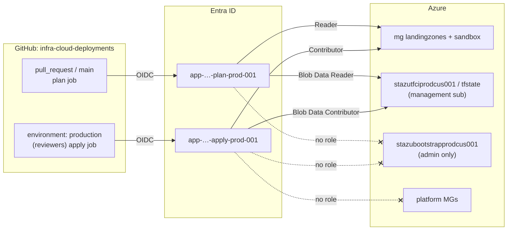

# 🔑 Azure CI RBAC & State: Split Plan/Apply OIDC Identities

CI half of [[416-azure-management-groups-and-policy|Phase 1]] (milestone M4). It replaces one GitHub Actions identity that had **Contributor on a platform subscription** and was trusted for pull requests, with two narrowly scoped identities and a CI-only state account. The same model as the AWS plan/apply roles in [[409-github-cloud-oidc-gitops|docs/409]].

Code: `bootstrap/azure/entra.tf` (identities, OIDC trust), `bootstrap/azure/ci_state.tf` (state account), `bootstrap/azure-governance/ci_rbac.tf` (role assignments at MG scope).

---

## 🧠 Why Split

A pull request's workflow runs **the PR author's code** in the plan job: `terraform plan` executes providers and `external` data sources, so HCL in a PR can run arbitrary commands. Whatever identity that job holds, a malicious PR holds too. So:

- The **plan** identity must be unable to change anything: Reader on the workloads, read-only on state.
- The **apply** identity is only reachable from the GitHub **environment `production`**, which is where required reviewers and branch rules are enforced. Its OIDC subject (`…:environment:production`) can't be minted by a PR.

| | Before (Phase 0) | After (M4) |
|---|---|---|
| Identities | `app-azure-github-actions-prod-001` | `app-azure-github-actions-plan-prod-001`, `app-azure-github-actions-apply-prod-001` (the old app, renamed in place, same client ID) |
| OIDC subjects | `pull_request`, `ref:refs/heads/main`, `environment:production` on one app | plan: `pull_request`, `ref:refs/heads/main` · apply: `environment:production` only |
| Azure RBAC | Contributor on the **identity** (platform) subscription | plan: Reader · apply: Contributor, both on `mg-azure-landingzones-*` and `mg-azure-sandbox-*` only |
| State | Old `stazutfstateprodcus001`, deleted in the teardown, so CI was already broken | `stazutfciprodcus001` in management; apply: Blob Data Contributor, plan: Blob Data Reader, **container scope** |



---

## 🗄️ CI State Account

`rg-azure-tfstate-ci-prod-cus-001` / `stazutfciprodcus001`, **management** subscription, same hardening as the bootstrap account ([[412-azure-lab-cost-guardrails#🔐 Admin-Only Bootstrap State|docs/412]]): shared keys off, TLS 1.2, infrastructure encryption, versioning with 30-day purge, soft delete, `CanNotDelete` lock, `prevent_destroy`. A few cents a month.

Why a **separate** account, and why **container-scope data roles** only:

- **Separate:** bootstrap state holds the Authentik client secret. If CI and admin shared an account, anyone who can open a PR could read it ([[409-github-cloud-oidc-gitops|docs/409]] finding 1).
- **Data plane only:** Contributor (management plane) on a storage account can re-enable shared keys and list them, which bypasses every data-plane role. A `Storage Blob Data *` role on one container can't.
- **Plan can't lock:** a Terraform lock on the azurerm backend is a **blob lease**, which is a write. Giving the plan job write access to take a lease would also let a PR overwrite the state. PR plans are speculative, so they run with `-lock=false`; the apply job takes the lock.

> [!NOTE] Is the management subscription off-limits to CI?
> Management-plane, yes: CI has no role on any management-group or subscription scope that covers `rg-azure-tfstate-*`. The only access is the two container-scoped blob roles on the CI container, which is the narrowest scope Azure RBAC offers.

---

## 🚀 Apply Order

```bash
just tf-plan azure        # 12 add, 2 change (display-name renames), 3 destroy
just tf-apply azure
# bootstrap/azure-governance/terraform.tfvars:  ci_rbac_enabled = true
just tf-plan azure-governance   # 4 role assignments
just tf-apply azure-governance
just tf azure output github_plan_client_id
just tf azure output github_apply_client_id
just tf azure output ci_tfstate
```

The 3 destroys are the old app's `pull_request` and `main` federated credentials (recreated on the plan app) and the old Contributor on the identity subscription. Nothing live used them: the CI repo's Azure workflow pointed at a state account that the teardown deleted.

### Verify

```bash
# Each SP's role assignments (expect MG scopes + the CI container only)
for n in plan apply; do
  id=$(az ad sp list --display-name app-azure-github-actions-$n-prod-001 --query "[0].id" -o tsv)
  az role assignment list --assignee "$id" --all --query "[].{role:roleDefinitionName, scope:scope}" -o table
done

# OIDC subjects per app
for n in plan apply; do
  az ad app federated-credential list --id "$(az ad app list --display-name app-azure-github-actions-$n-prod-001 --query '[0].id' -o tsv)" --query "[].subject" -o tsv
done
```

---

## 🔧 Follow-up in `infra-cloud-deployments` (separate repo, separate PR)

The `terraform/azure` root and `.github/workflows/azure-deploy.yml` there still assume the Phase 0 setup:

1. **Backend:** `rg-azure-tfstate-ci-prod-cus-001` / `stazutfciprodcus001` / `tfstate` with `use_azuread_auth = true`. The backend's `subscription_id` is the management subscription; pass it as `ARM_SUBSCRIPTION_ID` for init only, or as `-backend-config`.
2. **Variables:** `AZURE_CLIENT_ID_PLAN` (repo variable) for the plan job; `AZURE_CLIENT_ID` on the `production` environment for the apply job. Client IDs aren't secrets, but keep them out of committed files anyway.
3. **Plan job:** `terraform plan -lock=false`.
4. **Target subscription:** a workload subscription in landingzones (`subscr-azure-corp-homelab-prod-0bb5`) or sandbox (`subscr-azure-sandbox-homelab-lab-0bb5`). **None exists yet** (Phase 4), so CI has rights that cover no subscription today. That's intended.
5. **Versions:** the workflow pins Terraform 1.7.0 and `azurerm ~> 3.90`; move to the Phase 0 baseline (Terraform ≥ 1.9, `azurerm` 4.x).

### Phase 4 note: role assignments from CI

Contributor can't create role assignments, so CI can't give a Container App `AcrPull` or a Function app a Key Vault role. When Phase 4 needs that, grant the apply identity **Role Based Access Control Administrator** on the workload MGs **with an ABAC condition** limiting it to a short list of data-plane roles, never Owner, UAA or RBAC Admin itself. The AVM module's `management_group_role_assignments` takes the `condition` string directly.

---

## 🔗 Related

- [[416-azure-management-groups-and-policy|416 - Phase 1 Hub & Runbook]] · [[417-azure-policy-cost-safe-alz|417 - Cost-Safe ALZ Policy]]
- [[409-github-cloud-oidc-gitops|409 - GitHub Actions Multi-Cloud OIDC]]
- [[412-azure-lab-cost-guardrails|412 - Cost Guardrails & Admin-Only Bootstrap State]]
