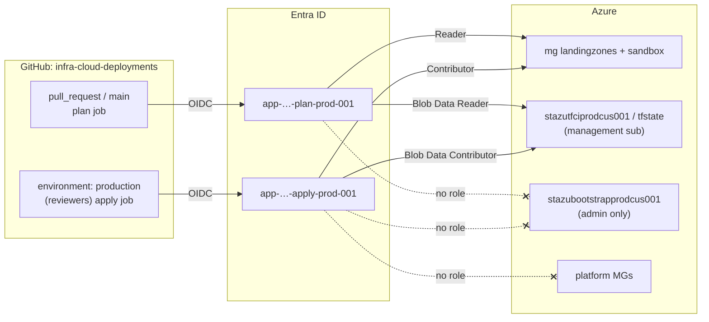
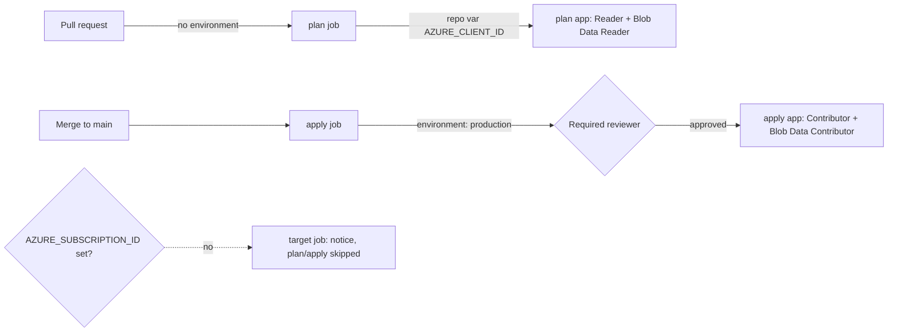

# 🔑 Azure CI RBAC & State: Split Plan/Apply OIDC Identities

CI half of [[416-azure-management-groups-and-policy|Phase 1]] (milestone M4). It replaces one GitHub Actions identity that had **Contributor on a platform subscription** and was trusted for pull requests, with two narrowly scoped identities and a CI-only state account. The same model as the AWS plan/apply roles in [[409-github-cloud-oidc-gitops|docs/409]].

Code: `bootstrap/azure/entra.tf` (identities, OIDC trust), `bootstrap/azure/ci_state.tf` (state account), `bootstrap/azure-governance/ci_rbac.tf` (role assignments at MG scope).

---

## 🧠 Why Split

A pull request's workflow runs **the PR author's code** in the plan job: `terraform plan` executes providers and `external` data sources, so HCL in a PR can run arbitrary commands. Whatever identity that job holds, a malicious PR holds too. So:

- The **plan** identity must be unable to change anything: Reader on the workloads, read-only on state.
- The **apply** identity is only reachable from the GitHub **environment `production`**, which is where required reviewers and branch rules are enforced. Its OIDC subject (`…:environment:production`) can't be minted by a PR.

| | Before (Phase 0) | After (M4) |
|---|---|---|
| Identities | `app-azure-github-actions-prod-001` | `app-azure-github-actions-plan-prod-001`, `app-azure-github-actions-apply-prod-001` (the old app, renamed in place, same client ID) |
| OIDC subjects | `pull_request`, `ref:refs/heads/main`, `environment:production` on one app | plan: `pull_request`, `ref:refs/heads/main` · apply: `environment:production` only |
| Azure RBAC | Contributor on the **identity** (platform) subscription | plan: Reader · apply: Contributor, both on `mg-azure-landingzones-*` and `mg-azure-sandbox-*` only |
| State | Old `stazutfstateprodcus001`, deleted in the teardown, so CI was already broken | `stazutfciprodcus001` in management; apply: Blob Data Contributor, plan: Blob Data Reader, **container scope** |



---

## 🗄️ CI State Account

`rg-azure-tfstate-ci-prod-cus-001` / `stazutfciprodcus001`, **management** subscription, same hardening as the bootstrap account ([[412-azure-lab-cost-guardrails#🔐 Admin-Only Bootstrap State|docs/412]]): shared keys off, local users off, TLS 1.2, infrastructure encryption, versioning with 30-day purge, soft delete, `CanNotDelete` lock, `prevent_destroy`. A few cents a month.

Why a **separate** account, and why **container-scope data roles** only:

- **Separate:** bootstrap state holds the Authentik client secret. If CI and admin shared an account, anyone who can open a PR could read it ([[409-github-cloud-oidc-gitops|docs/409]] finding 1).
- **Data plane only:** Contributor (management plane) on a storage account can re-enable shared keys and list them, which bypasses every data-plane role. A `Storage Blob Data *` role on one container can't.
- **Plan can't lock:** a Terraform lock on the azurerm backend is a **blob lease**, which is a write. Giving the plan job write access to take a lease would also let a PR overwrite the state. PR plans are speculative, so they run with `-lock=false`; the apply job takes the lock.

### Local users off (2026-11-24)

**Local users** are a second identity system on a storage account, separate from Entra ID. Each one is a username on the account with an SSH key or an Azure-generated password. They exist for SFTP (and NFSv3/SMB on some account types). Azure turns `isLocalUserEnabled` on by default, and **`shared_access_key_enabled = false` doesn't cover them**. Both state accounts had it on, with no local users created. **Applied 2026-11-24** (0 add / 2 change / 0 destroy); verified live: `False` on both; follow-up plan `No changes`.

Why turn it off when SFTP is off and HNS is off:

- **No Entra in the loop.** A local user's credential doesn't go through Conditional Access, MFA or sign-in logs, and Entra can't revoke it. It's the same class of risk as an account key, which we already turned off.
- **Who could add one.** Creating a local user is a management-plane write (`Microsoft.Storage/storageAccounts/localUsers/write`), so anyone with Contributor or Storage Account Contributor on the account could add one. With `local_user_enabled = false`, that person also has to change the account setting first. That change shows in the activity log, and Terraform reverts it as drift on the next plan.
- **It's free and nothing uses it.** The change is in place, with no data movement and no downtime.

Applied to **both** state accounts (`ci_state.tf`, `storage.tf`), because the bootstrap one holds the Authentik secret and the two accounts are meant to stay identical.

```bash
just tf-plan azure      # expect 0 to add, 2 to change (local_user_enabled true -> false), 0 to destroy
just tf-apply azure
```

**Verify** (expect `False` on both; local-user list empty):

```bash
sub=$(az account list --query "[?contains(name,'management')].id | [0]" -o tsv)
az storage account list --subscription "$sub" --query "[?starts_with(name,'stazu')].{name:name, localUser:isLocalUserEnabled, sharedKey:allowSharedKeyAccess}" -o table
```

> [!TIP] Gotcha
> The ARM property is `isLocalUserEnabled`, the Terraform argument is `local_user_enabled`. If you ever need SFTP, set it back to true and also enable HNS. HNS can be enabled on an existing account, but only one way; it can't be turned off again.

> [!NOTE] Is the management subscription off-limits to CI?
> Management-plane, yes: CI has no role on any management-group or subscription scope that covers `rg-azure-tfstate-*`. The only access is the two container-scoped blob roles on the CI container, which is the narrowest scope Azure RBAC offers.

---

## 🚀 Apply Order

```bash
just tf-plan azure
just tf-apply azure
```

Expect 12 add, 2 change (display-name renames), 3 destroy. Then set `ci_rbac_enabled = true` in `bootstrap/azure-governance/terraform.tfvars` and run:

```bash
just tf-plan azure-governance
just tf-apply azure-governance
just tf azure output github_plan_client_id
just tf azure output github_apply_client_id
just tf azure output ci_tfstate
```

The governance plan should add 4 role assignments (`github-plan-reader-*`, `github-apply-contributor-*`). Because of the naming fix (`role_assignment_name_use_random_uuid`, see [[416-azure-management-groups-and-policy#🛠️ Troubleshooting & Gotchas|416]]), each also brings a `random_uuid`, so 8. The first run on 2026-11-21 showed **11** in total: the other 3 were *Guest Configuration Resource Contributor* grants that appeared because Microsoft updated built-in policies ([[416-azure-management-groups-and-policy#🛠️ Troubleshooting & Gotchas|416 gotcha]]).

The 3 destroys are the old app's `pull_request` and `main` federated credentials (recreated on the plan app) and the old Contributor on the identity subscription. Nothing live used them: the CI repo's Azure workflow pointed at a state account that the teardown deleted.

### Verify

`az role assignment list --all` only covers the current subscription and below, so it shows **nothing** for MG-scope grants. Query each MG scope instead. Expected (verified 2026-11-21): plan = Reader and apply = Contributor on landingzones and sandbox; nothing on platform or homelab.

```bash
for n in plan apply; do
  id=$(az ad sp list --display-name app-azure-github-actions-$n-prod-001 --query "[0].id" -o tsv)
  for mg in landingzones sandbox platform homelab; do
    echo "$n @ $mg"
    az role assignment list --assignee "$id" --scope "/providers/Microsoft.Management/managementGroups/mg-azure-$mg-prod-0bb5" --query "[].{role:roleDefinitionName, scope:scope}" -o table
  done
done

for n in plan apply; do
  az ad app federated-credential list --id "$(az ad app list --display-name app-azure-github-actions-$n-prod-001 --query '[0].id' -o tsv)" --query "[].subject" -o tsv
done
```

---

## 🔧 Follow-up in `infra-cloud-deployments` (done 2026-11-22, separate PR)

The `terraform/azure` root and `.github/workflows/azure-deploy.yml` were still on the Phase 0 setup: a deleted backend account, one identity for both jobs, Terraform 1.7.0 and `azurerm ~> 3.90`. What changed, and why:

1. **Backend, data plane only.** `stazutfciprodcus001` / `tfstate` / `azure-workloads/terraform.tfstate` with `use_azuread_auth = true` and **no** `resource_group_name` or `subscription_id`. With `lookup_blob_endpoint = false` (the default), the backend infers the blob URL from the account name and never calls ARM. So CI needs only the container-scoped Blob Data role, and no management-plane role in the management subscription.
2. **Identities: same name, different scope.** This follows the `AWS_ROLE_TO_ASSUME` pattern instead of a new `AZURE_CLIENT_ID_PLAN`. Both jobs read `vars.AZURE_CLIENT_ID`, and GitHub precedence (environment > repository) picks the value:
   - repo scope = the **plan** app (`bootstrap/github` var `azure_plan_client_id`);
   - `production` env = the **apply** app (`azure_client_id`).
3. **Plan job:** `terraform plan -lock=false`, because a lock is a blob lease (a write) and the plan identity has Blob Data Reader only. The provider sets `resource_provider_registrations = "none"`; azurerm 4 otherwise tries to register providers, which Reader can't.
4. **Gate on a target subscription.** The workload subscription would sit in landingzones (`subscr-azure-corp-homelab-prod-0bb5`) or sandbox (`subscr-azure-sandbox-homelab-lab-0bb5`), and **none exists yet** (Phase 4). `AZURE_SUBSCRIPTION_ID` previously pointed at the identity *platform* subscription, where CI holds no roles.
   - It is now unpublished, and plan/apply carry `if: vars.AZURE_SUBSCRIPTION_ID != ''`.
   - A `target` job emits a `::notice` explaining the skip.
   - Phase 4 enables CI by setting `azure_subscription_id` and applying `bootstrap/github`.
5. **Versions:** Terraform 1.10.5 in the workflow, `required_version >= 1.10.0`, `azurerm ~> 4.0`. The lock file has `linux_amd64` and `darwin_arm64` hashes.
6. **Apply serialised:** `concurrency: azure-production-apply` with `cancel-in-progress: false`, so a second merge queues instead of killing an apply mid-write.

> [!WARNING]
> **Finding: the `production` environment had no required reviewers.** It was gated only by a protected-branches policy. Main needs a PR, but with 0 approvals, so "merged" meant "applied" with no second look. `bootstrap/github` now sets the owner as a required reviewer (`prevent_self_review = false` for a solo maintainer, `can_admins_bypass = false`).
>
> This gates **every** job in `production`: the AWS and Cloudflare applies now wait for approval too. That is intended, because the environment is the only thing standing between a merge and the apply identities.



**Apply (user, from personal-technology):** `just tf-plan github -out=gh.tfplan`. Expect 0 to add, 2 to change, 2 to destroy:
- the repo `AZURE_CLIENT_ID` changes to the plan app;
- the `AZURE_SUBSCRIPTION_ID` variable is destroyed at both scopes;
- `production` gets the reviewer and `can_admins_bypass = false`.

Then `just tf-apply github gh.tfplan`, and remove the plan file. **Applied 2026-11-22**; the follow-up plan shows `No changes`.

**Verify:** a PR touching `terraform/azure/**` shows **Deployment Target Check** passing, with plan skipped. Any merge that triggers an AWS or Cloudflare apply shows "Waiting for review".

### Phase 4 note: role assignments from CI

Contributor can't create role assignments, so CI can't give a Container App `AcrPull` or a Function app a Key Vault role. When Phase 4 needs that, grant the apply identity **Role Based Access Control Administrator** on the workload MGs **with an ABAC condition** limiting it to a short list of data-plane roles, never Owner, UAA or RBAC Admin itself. The AVM module's `management_group_role_assignments` takes the `condition` string directly.

---

## 🔗 Related

- [[416-azure-management-groups-and-policy|416 - Phase 1 Hub & Runbook]] · [[417-azure-policy-cost-safe-alz|417 - Cost-Safe ALZ Policy]]
- [[409-github-cloud-oidc-gitops|409 - GitHub Actions Multi-Cloud OIDC]]
- [[412-azure-lab-cost-guardrails|412 - Cost Guardrails & Admin-Only Bootstrap State]]
