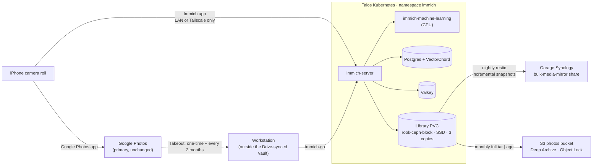

# 📸 Immich: Owned Photo Library

> [!NOTE]
> **Status (2026-10-20): Plan approved (decisions D1–D6 final), nothing deployed. Next: Phase 0.** This replaces the earlier "decommissioned" reference doc. That decision assumed a 500 GB library and GPU-accelerated ML. The real library is ~25 GB, and the RTX 4070 on `pc-node-05` now belongs to the Bazzite VM ([[303-kubevirt-bazzite-gpu-vm|KubeVirt GPU VM]]), so this plan runs ML on CPU.

## 🎯 Goal and non-goals

**Goal:** a complete copy of the photo library that I own and control. It should not depend on any single provider or account, and it must be restorable without Google.

**Non-goals (for now):**
- Replacing Google Photos. Google stays the **primary** app for browsing, editing and sharing.
- Public sharing links or internet exposure. Immich is reachable only on the LAN and the tailnet.

### Why this is needed

Google is currently the **only** home for these photos. An account lockout, a policy flag or a billing mistake would make the library unreachable, and nothing could be appealed or restored from my side. Google also cannot be synced automatically: since the 2025 Photos Library API changes, third-party tools (rclone etc.) can only see media they uploaded themselves. Google Takeout is the only bulk export.

So ownership has to come from **the phone itself** (new photos) plus a **one-time Takeout import** (history).

---

## 🏛️ Architecture

### Copies after the plan is done (3-2-1 plus Google)

| # | Copy | Media / location | Protects against |
| :--- | :--- | :--- | :--- |
| 1 | Immich library | Ceph SSD pool, 3 replicas across hosts | Disk or node failure |
| 2 | restic repository | Garage Synology (separate building zone, separate power) | Cluster loss, bad upgrade, accidental deletion (snapshots) |
| 3 | Monthly encrypted archive | S3 Deep Archive, Object Lock, `us-east-2` | House-level disaster, ransomware on the LAN |
| 4 | Google Photos | Google | Everything above, as long as the account exists |

---

## ⚖️ Decisions

All decisions confirmed 2026-10-20. The chosen option in each is marked **(chosen)**; the alternatives stay listed for context.

### D1. Library storage class  *(decided 2026-10-20)*
- **`rook-ceph-block` (SSD, size 3) (chosen).** Per the [[104-phase2-rook-ceph-storage|storage placement policy]], the HDD EC pool is for re-creatable data and must never hold the only copy. ~30 GB × 3 = ~90 GB raw, which is trivial on 16 TB.
- `rook-ceph-hdd-ec`: allowed only because Google and the backups hold other copies. That's a weaker argument for irreplaceable data, and EC is slower on small random writes (thumbnail generation).

### D2. Local backup format (Synology)  *(decided 2026-10-20)*
- **restic (chosen):** incremental, deduplicated, encrypted, with point-in-time snapshots, so a deletion in Immich doesn't spread into the backup. **Trade-off:** the restic password must live in the cluster, so the cluster *can* read this copy. That breaks the "cluster cannot decrypt" rule in the backup design (`kubernetes/infrastructure/backups/README.md`). It's accepted for the local LAN copy only.
- Nightly full `tar | age`: keeps the rule, but 35 days × 30 GB = ~1 TB, which won't fit the 600 GB share.

### D3. Offsite backup target  *(decided 2026-10-20)*
- **A new, dedicated bucket (chosen)**, e.g. `s3-aws-photos-prod-use2-001`: Deep Archive storage class, Object Lock (governance) for ~180 days to match Deep Archive's minimum billing period, and keep the last ~6 monthly archives. The uploader keeps the existing **write-only, `*.age` only** model, so the cluster can never read or delete it. Cost: ~30 GB × 6 × ~$0.001/GB-month ≈ **$0.20/month**.
- Reusing `s3-aws-backups-prod-use2-001`: its lifecycle rule (`filter {}`, expire after 35 days) would delete the archives. Fixing that would mean rewriting a rule that protects every other backup.

### D4. Remote access for the phone  *(decided 2026-10-20)*
- **LAN plus Tailscale (chosen):** the Immich app supports a local Wi-Fi URL and an external URL, and switches between them automatically. Uploads go over Wi-Fi at home, and over the tailnet when away (on demand). Nothing is exposed publicly.
- Cloudflare Tunnel: the free plan's 100 MB upload limit breaks long videos, and Cloudflare Access in front of the app needs custom-header workarounds. Not needed while Google handles sharing.

### D5. Sign-in  *(decided 2026-10-20)*
- **Authentik OIDC (chosen)**, matching the other apps, plus one local admin account kept as break-glass access (in Apple Passwords).

### D6. ML acceleration (GPU)  *(decided 2026-10-20)*

The RTX 4070 can't be used by cluster pods. It is bound to `vfio-pci` at boot and passed whole to the Bazzite VM (see [[303-kubevirt-bazzite-gpu-vm#🧠 GPU Ownership & Bazzite as a GPU Server|GPU ownership]]). The order of preference:

1. **Now: CPU.** The in-cluster `immich-machine-learning` pod runs on CPU. For ~25 GB that means a few hours for the first indexing pass, then seconds per new photo. This is always deployed, because it's the fallback.
2. **Next: Bazzite as the GPU server.** Run a CUDA build of the Immich ML container *inside* the Bazzite VM, which already has the NVIDIA driver and CUDA. Expose it to the cluster with a Kubernetes Service. Immich accepts **several ML URLs, tried in order**: list the Bazzite URL first and the in-cluster CPU service second, so ML keeps working when the VM is off or busy.
3. **Last resort: buy hardware.** Only if 1 and 2 aren't enough (e.g. LLMs that need VRAM while gaming): add a second GPU, such as an Intel Arc A310/A380 in `pc-node-04` (pc-node-05 is Mini-ITX with one slot).

**Why not hand the 4070 to the cluster?** Passthrough is all-or-nothing and chosen at boot. Switching between "VM mode" and "cluster mode" means a Talos config change and a reboot every time.

---

## 🗺️ Phases

Each phase ends with a verification step. Don't start the next phase until it passes.

### Phase 0: Prep (no cluster changes)
1. In Google Photos, check that the backup quality is **Original**, not "Storage saver". If it's "Storage saver", the phone copy is better than Google's, so the phone backup (Phase 3) matters more than Takeout.
2. Request a **Google Takeout** of Google Photos only, and schedule it to repeat every 2 months for a year.
3. Choose a download location **outside the vault** (e.g. `~/Downloads/takeout/`). 25 GB of zips inside Google Drive would sync straight back to Google.

**Verify:** Takeout archive downloaded; total size ≈ the storage shown in Google One.

### Phase 1: Deploy Immich (`kubernetes/apps/immich/`)
- Namespace `immich`, with Pod Security restricted where the images allow it.
- `immich-server` and `immich-machine-learning`, both **pinned to exact version tags** (never `release`). Server and ML versions must match.
- Postgres using Immich's own image with the **VectorChord** extension. Vanilla Postgres or a stock CNPG image won't work.
- Valkey, used only for the job queue. No persistence needed.
- Library PVC (D1); the ML model cache can use an `emptyDir` or a small PVC.
- Secrets created out of band (an `*.example.yaml` in git, the real values never committed), following the existing app pattern.
- ClusterIP Service plus a Tailscale ingress (D4) and the local DNS name.
- Authentik OIDC provider and application (D5).

**Verify:** web login via Authentik works; upload one test photo from the browser; check that the thumbnail appears and that search finds it.

### Phase 2: Import history from Takeout
- Run `immich-go` from the workstation (via `nix-mac`, not a global install) against the Takeout zips. It reads Google's JSON sidecars to restore dates, GPS, albums and favorites.

**Verify:** compare Immich's asset count with Google's (roughly; Google counts some edits differently). Spot-check a few old photos for correct dates and Live Photo playback.

### Phase 3: Phone backup
- Install the Immich iOS app, sign in with OIDC, set the LAN and external URLs (D4), and turn on background backup for the camera roll. Leave the Google Photos backup on.

**Verify:** take a photo and check that it appears in both Google and Immich within a day. Do it once at home and once away.

### Phase 4: Backups
- **NAS (D2):** a CronJob runs `restic backup` of the library PVC to the `bulk-media-mirror` share (600 GB quota). Retention: 7 daily, 4 weekly, 12 monthly.
- **Postgres:** add the Immich database to the existing Tier 2 `pg_dump` jobs (S3 and NAS). Immich also writes its own daily database dumps into the library, so restic captures those too.
- **S3 (D3):** a monthly CronJob runs `tar | age -r <public key> | aws s3 cp --storage-class DEEP_ARCHIVE`. The bucket, Object Lock and lifecycle go in Terraform, owned according to the existing split: guardrails in `bootstrap/aws`, the bucket body in `infra-cloud-deployments`.
- Alert via ntfy and Grafana when any photo backup job fails or hasn't succeeded in 36 hours (NAS) or 35 days (S3).

**Verify (restore drill, required):** restore a restic snapshot to a scratch PVC and diff it against the library. Restore one S3 archive with the offline age identity on the workstation. Note that Deep Archive retrieval takes up to 12 hours.

### Phase 5: Operate
| Cadence | Task |
| :--- | :--- |
| Every 2 months | Import the scheduled Takeout with `immich-go`. It skips duplicates, and picks up anything the phone missed, such as photos shared to me in Google. |
| Monthly | Check the backup job dashboard; look at the Immich job queue for stuck jobs. |
| Per release | Read the Immich release notes **before** bumping the pinned tags; check for required database migrations. |
| Twice a year | Repeat the restore drill. |

---

## ⚠️ Gotchas

- **iOS background backup is best-effort.** iOS decides when background apps run. Opening the Immich app occasionally forces a catch-up. The bi-monthly Takeout import is the safety net.
- **Deleting in Google doesn't delete in Immich, and vice versa.** That's intentional: Immich is the archive. Clean up in both places on purpose, if at all.
- **Takeout zips must stay outside the Drive-synced vault** (see the root `AGENTS.md` §6).
- **CPU ML backfill:** the first indexing pass over ~25 GB takes a few hours. Limit ML CPU so it doesn't starve other workloads on its node.
- **ML versions must match everywhere.** If the Bazzite ML container (D6) is used, pin it to the same version as `immich-server` and the in-cluster ML pod, and bump all three together.
