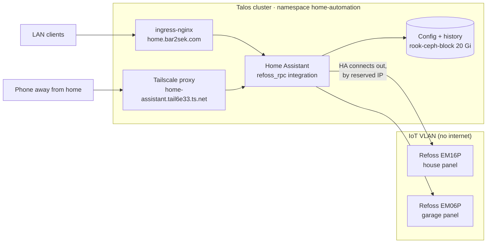
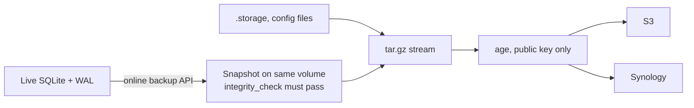

# 🏠 Home Assistant: Smart Home & Energy Monitoring

> [!NOTE]
> **Status (2026-11-05): deployed (2026.11.0) and onboarded, reachable on the LAN and tailnet. Still open: Refoss connection and firewall rule. Nightly encrypted backups run to S3 and the NAS, and a restore drill passed.**

**Why now:** Home Assistant is the daily-use anchor of the 24/7 "home-prod" cluster, and it's what collects the circuit-level energy data for solar and battery sizing. The monitors are a **Refoss EM16P** (house) and **EM06P** (garage). The breaker maps, CT-to-port plan and safe-install sequence live in the `home-projects` repo: `solar-battery/Electrical Panels & Monitor Port Plan.md`.

## 🏛️ Architecture



## ⚖️ Decisions

| Decision | Choice | Why |
| :--- | :--- | :--- |
| Refoss connection | **`refoss_rpc`** (custom integration, HACS default repo). MQTT is the fallback | Its README lists both the EM16P and EM06P. Home Assistant connects out to each device, so the IoT VLAN needs no path into the cluster and there's no broker to run |
| Networking | **No `hostNetwork`** | mDNS/SSDP discovery wouldn't cross into the IoT VLAN anyway. Devices are added by reserved IP. Flannel masquerades pod traffic, so devices see a K8S-CONTROL node address |
| Exposure | LAN plus tailnet, **no public record** | Same model as Immich. Adding a public record or tunnel hostname would put it on the internet |
| Login | Home Assistant's own accounts | Authentik would need a custom component, and the iOS Companion app is simpler without it. Revisit later |
| Pod security | `baseline` | The image runs as root under s6 init |
| Config | Seeded once by an init container | `.storage/http` (trusted proxies) and `configuration.yaml` are copied only if missing, then belong to the UI and the PVC |

> [!WARNING]
> **Not the core `refoss` integration.** The core integration relies on UDP discovery on port 9989 on the same network, which is why owners on IoT VLANs report "device not found". `refoss_rpc` is a separate integration. Entering an IP in its setup hasn't been tested on this hardware yet.

## 🚀 Deploy

```bash
just tf-apply unifi    # adds home.bar2sek.com (expect 1 to add)
just ha-apply
just ha-status
```

**Immediately after the rollout,** open the URL and create the owner account: **the first person to reach onboarding becomes the owner.** Set the home location, currency and unit system, because the Energy dashboard uses them.

> [!WARNING]
> **Don't put `http:` in `configuration.yaml`.** Since 2026.x, Home Assistant imports it once into `.storage/http` as a *pending* config, then reverts and restarts unless it's confirmed in the UI within 5 minutes. Behind a proxy nobody can reach that UI, so every page turns into 400 Bad Request after about 5 minutes, and YAML is ignored from then on (the log says `Pending HTTP config was not confirmed`). The manifest seeds the store as already stable instead. That file uses Home Assistant's internal format (version 3), so check it against a fresh install when upgrading, though it only matters on a fresh volume. To change proxy settings later, use Settings → System → Network.

**Verify:**

- **Check again after 6 minutes.** A check inside the 5-minute window proves nothing, which is how this bug first slipped through.
- The UI loads on both `https://home.bar2sek.com` and `https://home-assistant.tail6e33.ts.net`.
- A 400 Bad Request on either URL means `trusted_proxies` doesn't cover the proxy. Check `kubectl -n home-automation logs deploy/home-assistant`.

First deploy (2026-11-05): the pod reached GitHub and the IoT gateway. The first version used `http:` in YAML and broke as described above; the seeded store replaced it.

## ⚡ Connecting the Refoss Monitors

Install the **garage EM06P first** and prove the whole path before touching the house panel.

> [!CAUTION]
> Follow the safe-install sequence in the port plan: lock out, tag out, live–dead–live test. Switching off the **200A service disconnect takes down the whole homelab**, so run `just lab-down` first and `just lab-up` afterwards. Before switching off the garage feeder, check what else is powered from the garage panel (the Synology, the garage switch and the AP).

1. **Join Wi-Fi.** Hold the button for 5 seconds for AP mode, join `Refoss_xx_xxxx`, browse to `10.10.10.1` and set the IoT SSID (2.4 GHz only).

   > [!WARNING]
   > `10.10.10.1` is also the MGMT-IPMI gateway on this network. **Turn off Tailscale on the setup device first,** so traffic goes to the monitor.

2. **Reserve its IP** in UniFi, under the IoT network.
3. **Allow the cluster to reach it.** Add a UniFi firewall rule from K8S-CONTROL (`10.10.20.0/24`) to the monitors' reserved IPs, on the device's web port only. Return traffic is already allowed. Keep the existing IoT → private subnets block.
4. **Install HACS,** which needs a GitHub login, then restart:

   ```bash
   kubectl -n home-automation exec deploy/home-assistant -- sh -c 'wget -O - https://get.hacs.xyz | bash -'
   ```

5. **Install "Refoss RPC"** from HACS, restart, then add it under Settings → Devices & Services using the reserved IP.
6. **Set the CT channels** per the port plan, including circuit factor 2 on the balanced 240 V loads.
7. **Add sensors to the Energy dashboard** (Settings → Dashboards → Energy). Don't count both the house mains and the garage total as whole-home consumption: the garage feeder is downstream of the house mains.

**Verify:** apply a known load (a space heater on one circuit) and check that the matching channel reads a sensible value with the right sign. A negative reading means the CT is reversed (arrows go K → L toward the load).

### If `refoss_rpc` is unreliable: MQTT

Deploy Mosquitto with authentication, expose it on a MetalLB IP, add one IoT → broker rule on TCP 8883 or 1883, and point the monitors at it. Your notes rate this as more reliable across VLANs; it's the fallback because it adds a broker and a path from the IoT VLAN into the cluster.

## 📈 History Retention

Detailed history is kept for **180 days** (`recorder.purge_keep_days`), not the default 10, so the data survives for the heat pump cutoff analysis:

| Data | After `purge_keep_days` |
| :--- | :--- |
| Numeric sensors (outdoor temperature, circuit power) | Hourly averages kept forever |
| Non-numeric state (thermostat mode, aux on or off) | **Deleted** |

The heat strip and outdoor unit circuits give runtime from power alone, but hourly averages can't separate half an hour of strips from a full hour at half power. The review also runs 2–4 weeks into the heating season, past the default window.

> [!IMPORTANT]
> `configuration.yaml` belongs to the volume after first boot, so changing the seed in the manifest doesn't reach a running system. Change both: edit the live file, run `python3 -m homeassistant --script check_config -c /config --info recorder` in the pod, then restart.

**Check database size a week after the monitors go in** (`ls -l /config/home-assistant_v2.db`). With 22 CTs reporting often it could reach several GB. If it grows too fast, exclude sensors the analysis doesn't need, such as per-circuit voltage. The nightly backup needs room on the 20Gi volume for one extra copy.

## 💾 Backups

Energy history can't be recreated and solar sizing depends on it, so the volume is backed up nightly from the first reading. `kubernetes/apps/home-assistant/home-assistant-backup.yaml` follows the write-only model in `kubernetes/infrastructure/backups/README.md`: `age` ciphertext only, and the cluster can't decrypt it.

| Job | Schedule (UTC) | Destination |
| :--- | :--- | :--- |
| `backup-home-assistant` | 04:00 | `s3://…/apps/home-assistant/*.tar.gz.age` (35-day lifecycle, Object Lock) |
| `backup-home-assistant-nas` | 04:10 | Synology `k8s-backups/apps/home-assistant/` (35-day prune) |



**Why not tar the volume, as Actual Budget does:** the recorder writes every few seconds and recent data sits in the `-wal` file, so a plain copy can be torn. The job takes a snapshot with SQLite's online backup API, then fails rather than archive one that doesn't pass `PRAGMA integrity_check`.

> [!IMPORTANT]
> **The job must run on the app's node, with a read-write mount.** WAL readers use the shared-memory `-shm` file, which only works within one kernel. `podAffinity` enforces the node. The snapshot sits on the same volume, under `.backup-tmp/`, so the unencrypted copy never reaches node disk. That means the volume needs free space for one extra copy of the database.

> [!WARNING]
> **Don't swap in the image's `tar` to simplify this.** Its busybox build honors only the last `-C`, so `tar -C /config . -C /snapshot db` silently archives just the database and still exits 0. That's why `pack.py` uses Python's `tarfile`.

**Left out on purpose:** logs, `.ha_run.lock`, `deps`, `tts`, `backups`. Home Assistant re-creates all of them. Everything else, including `.storage` (accounts, tokens, integrations), is in the archive, which is why it's encrypted.

**Failures:** a failed job fires the existing `KubeJobFailed` alert. A job can't start without the app running, because of the affinity rule.

### Setup and verification

```bash
just ha-backup-bootstrap   # one time: copies the upload key, creates the NAS folder
just ha-backup-apply
just ha-backup-run         # both jobs now, with logs
```

The upload key can only add `*.age` objects under fixed prefixes, and `apps/*.age` already covers this path. It's a copy of the Secret in `backups`, so rotating that key has to update this namespace too.

### Restore drill

Decryption happens on the admin workstation, and the private key never enters the cluster. This restores the newest S3 archive into a throwaway `restore-drill` namespace, checks the database and accounts, and deletes the namespace:

```bash
just ha-restore-drill          # data checks only: safe at any time
just ha-restore-drill yes      # also boots the restored copy
```

**Drill result (2026-11-05):** restored from S3 with the offline key. `integrity_check` returned ok, the owner account and `.storage` were present, and the restored copy booted: `/` 200, `/api/` 401 (login still required), `/api/onboarding` 404. Production stayed up throughout. `statistics` had 0 rows because no monitors were connected yet, so **rerun the drill after the first energy data arrives** to prove that part too.

Expected noise at boot: *"could not validate that the sqlite3 database was shutdown"* (a snapshot isn't a clean shutdown) and *"Discovered another Home Assistant instance with the same instance ID"* from zeroconf (a copy shares the original's ID).

> [!NOTE]
> `/api/onboarding` returns **404 when onboarding is complete**, because Home Assistant stops serving it. That's the good answer. A 200 with unfinished steps would mean the accounts didn't restore.

> [!CAUTION]
> `boot=yes` is only safe with no devices connected. A second running copy would poll real devices and could fire real automations. Once the Refoss monitors are connected, use the default.

### Restoring production

1. `kubectl -n home-automation scale deploy/home-assistant --replicas=0`
2. Mount the volume in a temporary pod, clear it, and pipe `age -d -i <identity> <archive> | kubectl exec -i <pod> -- tar xzf - -C /config`.
3. Delete the temporary pod, then scale back to 1.

> [!NOTE]
> The production restore hasn't been exercised; only the drill has. The archive holds one consistent `home-assistant_v2.db` and no `-wal` or `-shm`, so clear those from the volume first: a stale `-wal` beside a restored database can corrupt it.

## ❓ Open Items

- [ ] Doc 201's firewall matrix doesn't match Terraform on VLAN numbering for IoT. Confirm the live rules in UniFi, then correct the doc.
- [ ] `refoss_rpc` with an entered IP across VLANs, on real hardware.
- [ ] Prometheus/Grafana export for the heat-pump balance-point analysis.
- [ ] Lennox S40 integration (`lennoxs30`).

---

## 🔗 Powerful Ecosystem Integrations in Our Cluster

Running Home Assistant inside our Talos cluster unlocks incredible cross-application automations:

1. **TeslaMate + Home Assistant (via MQTT)**:
   - Real-time Tesla battery levels, charging state, climate control, and door locks feed directly into Home Assistant.
   - *Example Automation*: *"If Tesla battery is below 50% and home electricity rates enter off-peak at 11 PM, start charging automatically."*
2. **UniFi Network Presence Detection**:
   - Integrates natively with your UniFi Dream Machine Pro / USW switches to track family smartphones joining home Wi-Fi for instant **Home vs Away** presence detection.
   - *Example Automation*: *"When all phones leave home Wi-Fi, turn off lights, set HVAC to eco mode, and arm cameras."*
3. **Mealie Integration**:
   - Displays tonight's planned meal and recipe instructions on wall-mounted smart home dashboards or TV screens.
4. **Frigate NVR + Local AI (planned)**:
   - Camera entities, per-zone occupancy sensors and snapshot notifications from [[507-frigate-nvr-cameras|Frigate]] over MQTT.
   - The Ollama server on the Bazzite VM's RTX 4070 doubles as Home Assistant's Assist **conversation agent**, with a cloud-agent pipeline as the fallback when the VM is off.
   - *Example Automation*: *"When a person is in the porch zone after dark, turn on the porch light and send the AI summary of the event to my phone."*
