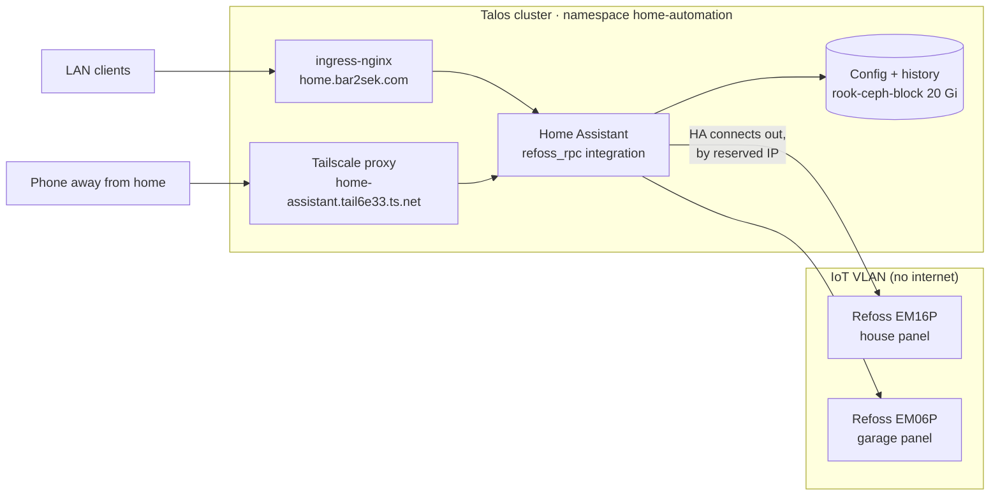
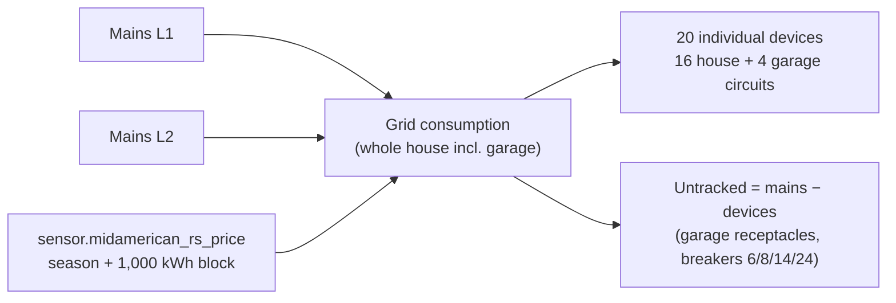
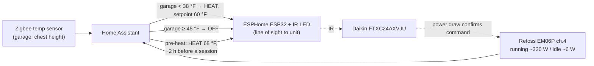
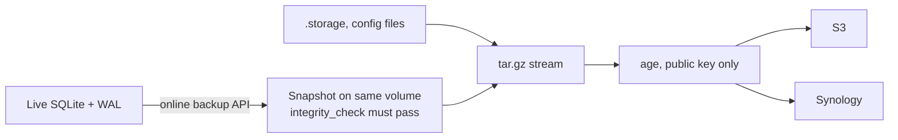

# 🏠 Home Assistant: Smart Home & Energy Monitoring

> [!NOTE]
> **Status (2026-11-08): deployed (2026.11.0) and onboarded, reachable on the LAN and tailnet. Garage EM06P installed and online (temporarily on the trusted Wi-Fi, see [[#Garage EM06P install (2026-11-07)]]). House EM16P installed 2026-11-08, all 18 channels load-tested, and added to Refoss RPC the same day (see [[#House EM16P install (2026-11-08)]]). Energy dashboard live with exact MidAmerican Rate RS pricing (see [[#⚡ Energy Dashboard & MidAmerican Pricing]]). Nightly encrypted backups run to S3 and the NAS, and a restore drill passed.**

**Why now:** Home Assistant is the daily-use anchor of the 24/7 "home-prod" cluster, and it's what collects the circuit-level energy data for solar and battery sizing. The monitors are a **Refoss EM16P** (house) and **EM06P** (garage). The breaker maps, CT-to-port plan and safe-install sequence live in the `home-projects` repo: `solar-battery/Electrical Panels & Monitor Port Plan.md`.

## 🏛️ Architecture



## ⚖️ Decisions

| Decision | Choice | Why |
| :--- | :--- | :--- |
| Refoss connection | **`refoss_rpc`** (community integration, installed from the built-in **Marketplace**). MQTT is the fallback | Its README lists both the EM16P and EM06P. Home Assistant connects out to each device, so the IoT VLAN needs no path into the cluster and there's no broker to run |
| Networking | **No `hostNetwork`** | mDNS/SSDP discovery wouldn't cross into the IoT VLAN anyway. Devices are added by reserved IP. Flannel masquerades pod traffic, so devices see a K8S-CONTROL node address |
| Exposure | LAN plus tailnet, **no public record** | Same model as Immich. Adding a public record or tunnel hostname would put it on the internet |
| Login | Home Assistant's own accounts | Authentik would need a custom component, and the iOS Companion app is simpler without it. Revisit later |
| Pod security | `baseline` | The image runs as root under s6 init |
| Config | Seeded once by an init container | `.storage/http` (trusted proxies) and `configuration.yaml` are copied only if missing, then belong to the UI and the PVC |

> [!WARNING]
> **Not the core `refoss` integration.** The core integration relies on UDP discovery on port 9989 on the same network, which is why owners on IoT VLANs report "device not found". `refoss_rpc` is a separate integration. Entering an IP in its setup hasn't been tested on this hardware yet.

## 🚀 Deploy

```bash
just tf-apply unifi    # adds home.bar2sek.com (expect 1 to add)
just ha-apply
just ha-status
```

**Immediately after the rollout,** open the URL and create the owner account: **the first person to reach onboarding becomes the owner.** Set the home location, currency and unit system, because the Energy dashboard uses them.

> [!WARNING]
> **Don't put `http:` in `configuration.yaml`.** Since 2026.x, Home Assistant imports it once into `.storage/http` as a *pending* config, then reverts and restarts unless it's confirmed in the UI within 5 minutes. Behind a proxy nobody can reach that UI, so every page turns into 400 Bad Request after about 5 minutes, and YAML is ignored from then on (the log says `Pending HTTP config was not confirmed`). The manifest seeds the store as already stable instead. That file uses Home Assistant's internal format (version 3), so check it against a fresh install when upgrading, though it only matters on a fresh volume. To change proxy settings later, use Settings → System → Network.

**Verify:**

- **Check again after 6 minutes.** A check inside the 5-minute window proves nothing, which is how this bug first slipped through.
- The UI loads on both `https://home.bar2sek.com` and `https://home-assistant.tail6e33.ts.net`.
- A 400 Bad Request on either URL means `trusted_proxies` doesn't cover the proxy. Check `kubectl -n home-automation logs deploy/home-assistant`.

First deploy (2026-11-05): the pod reached GitHub and the IoT gateway. The first version used `http:` in YAML and broke as described above; the seeded store replaced it.

## ⚡ Connecting the Refoss Monitors

Install the **garage EM06P first** and prove the whole path before touching the house panel.

> [!CAUTION]
> Follow the safe-install sequence in the port plan: lock out, tag out, live–dead–live test. Switching off the **200A service disconnect takes down the whole homelab**, so run `just lab-down` first and `just lab-up` afterwards. Before switching off the garage feeder, check what else is powered from the garage panel (the Synology, the garage switch and the AP).

1. **Join Wi-Fi.** Hold the button for 5 seconds for AP mode, join `Refoss_xx_xxxx`, browse to `10.10.10.1` and set the IoT SSID (2.4 GHz only).

   > [!WARNING]
   > `10.10.10.1` is also the MGMT-IPMI gateway on this network. **Turn off Tailscale on the setup device first,** so traffic goes to the monitor.

2. **Reserve its IP** in UniFi, under the IoT network.
3. **Allow the cluster to reach it.** Add a UniFi firewall rule from K8S-CONTROL (`10.10.20.0/24`) to the monitors' reserved IPs, on the device's web port only. Return traffic is already allowed. Keep the existing IoT → private subnets block.
4. **Open the Marketplace:** Settings → Marketplace, and accept the community-content warning once. Nothing to install: it ships with Home Assistant 2026.11+. A GitHub sign-in is optional (only for custom repositories and higher rate limits).

   > [!WARNING]
   > **HACS is gone as of 2026.11.** The Marketplace replaced it, and the `get.hacs.xyz` installer now exits with *"HACS does not work on Home Assistant 2026.11 and newer"* (seen 2026-11-07). Don't try to work around it. Template code that used `integration_entities('hacs')` must use `'marketplace'`.

5. **Install "Refoss RPC"** from the Marketplace, restart if a repair asks for it, then add it under Settings → Devices & Services using the device's reserved IP.
6. **Set the CT channels** per the port plan, including circuit factor 2 on the balanced 240 V loads.
7. **Add sensors to the Energy dashboard** (Settings → Dashboards → Energy). Don't count both the house mains and the garage total as whole-home consumption: the garage feeder is downstream of the house mains.

**Verify:** apply a known load (a space heater on one circuit) and check that the matching channel reads a sensible value with the right sign. A negative reading means the CT is reversed (arrows go K → L toward the load).

### Garage EM06P install (2026-11-07)

* **Breaker:** HOM215 in garage slots **8–10** (not 9–11 as first planned). Harness wires are about 0.35 mm, far below the breaker's 14–10 AWG range, so every harness wire is pigtailed to 12 AWG copper with Wago 221s. Details live in the port plan in `home-projects`.
* **Mount:** taped inside the top of the panel, antenna sideways. Wi-Fi reads **−38 dBm** through the closed steel panel, so no external enclosure is needed.
* **Network (temporary):** joined to the **trusted Wi-Fi**, not the IoT VLAN, because the IoT VLAN has **no SSID yet** (Terraform defines the network, not a WLAN). It sits on the same subnet as the Synology, which the cluster already reaches, so **no firewall rule was needed**: the Home Assistant pod gets HTTP answers from it.
* **Moving it later doesn't need the panel opened:** the monitor's own web page has Wi-Fi settings. It also has a second station slot (`sta_2`): add the IoT SSID there first, so a typo can't strand it.
* **Refoss RPC** installed from the Marketplace and added by IP; all six channels report (firmware 2.1.13).

**Channel → port → circuit** (inferred from live readings; the device only says `em:1…6`):

| Channel | Port | Circuit | Factor |
| :---: | :---: | :--- | :---: |
| 1 | A1 | Garage feeder L2 | 1 |
| 2 | B1 | Garage lights | 1 |
| 3 | C1 | Garage feeder L1 | 1 |
| 4 | A2 | Mini split (L2 pole) | **2** |
| 5 | B2 | Under-bench outlets | 1 |
| 6 | C2 | Tesla charger (L1 pole) | **2** |

**Verification:** every channel read positive power at PF ≈ 0.85, so arrows and legs are right. The feeders balance: L1 ≈ mini split leg + under-bench, L2 ≈ mini split leg + a few watts of unmonitored receptacles. With factor 2, channel 4's *power* doubles while its *current* stays per-leg. Load-tested 2026-11-07: lights on → channel 2 rose about 196 W (from a ~10 W standby floor) with feeder L1 rising to match; Tesla charging → channel 6 read 11.6 kW (48 A × 240 V, so factor 2 is right). At that moment the four branch channels summed to 12,222 W against 12,269 W on the two feeders.

**Device settings applied over its JSON-RPC API** (`POST http://<ip>/rpc` with `{"id":1,"src":"…","method":…,"params":…}`; method names come from the device's own `index.html.gz`):

```json
{"method": "Em.Config.Set", "params": {"config": [{"id": 4, "name": "Mini split", "factor": 2}]}}
{"method": "WiFi.Config.Set", "params": {"ap": {"enable": false}}}
```

> [!WARNING]
> **The setup AP stays on and open after Wi-Fi setup** (`ap.is_open: true`, `auth_en: false`), so anyone in range could reconfigure the monitor. It was disabled with the call above. Do the same on the EM16P. Device auth (`Refoss.Auth.Set`) is still off, because turning it on means re-entering credentials in the integration. `cloud.enable` is true and reaches the internet until the move to the IoT VLAN.

### House EM16P install (2026-11-08)

* **Breaker:** HOM215 at house slots **32–34** (planned 39–41), harness pigtailed to 12 AWG like the garage. Mounted low on the left wall of the panel, antenna through a side knockout.
* **Wi-Fi: fixed by enabling roaming, −87 → −41 dBm.** It read −86 to −89 dBm with 40–70 % ping loss even after the U7 Pro was moved into line of sight. Cause: Refoss ships with **`roam.enable: false`**, so the monitor stayed on the garage **U6-Lite** (the first access point it joined, heard through the house wall) and went straight back to it after every restart. `WiFi.Config.Set` `{"roam": {"enable": true, "rssi_thr": -60}}` and one `Refoss.Device.Reboot` moved it to the U7 Pro: **−41 dBm, 0 % loss**. UniFi rated the bad link "Excellent" throughout, so trust `WiFi.Status.Get` and ping, not the UniFi label. **The garage EM06P still has roaming off** (harmless today at −35 dBm, but enable it before moving it to the IoT SSID).
* **Network (temporary):** same trusted Wi-Fi as the garage unit, IP **10.0.1.36** (firmware 3.1.11). Open setup AP disabled with `WiFi.Config.Set` (`ap.enable: false`), verified with `WiFi.Config.Get`.
* **Channels are grouped by letter:** `em:1–6` = A1–A6, `em:7–12` = B1–B6, `em:13–18` = C1–C6. Names and factors were set on the device; the full table and load-test results live in the port plan in `home-projects`.
* **Mains read negative at first:** the red service conductor is L2 and the black is L1, the reverse of the plan, so A1 and B1 were each referenced to the wrong leg's voltage. Fixed with **`factor: -1`** on channels 1 and 7. The device accepts negative factors, and energy then accumulates in the normal (not return) counters.

```json
{"method": "Em.Config.Set", "params": {"config": [{"id": 7, "name": "Mains L1 (black)", "factor": -1}]}}
```

> [!IMPORTANT]
> **Getters are `Namespace.Thing.Get`, not `Namespace.GetThing`:** `Refoss.DeviceInfo.Get`, `Sys.Status.Get`, `WiFi.Config.Get`, `WiFi.Status.Get` (has `rssi`), `Em.Status.Get` and `Em.Config.Get` (both need `{"id": n}`). Shelly-style names like `Refoss.GetDeviceInfo` or `WiFi.GetConfig` make the device **close the connection with no reply**. That, not the network, is why the Mac "couldn't reach" the garage monitor on 2026-11-07: with the right method names, `curl -X POST http://<ip>/rpc` from the Mac works for both monitors.

* **Added to Refoss RPC (2026-11-08):** Settings → Devices & services → Refoss RPC → *Add device* → `10.0.1.36` (the integration was already installed for the EM06P, so no Marketplace step). Device `em16p`, firmware 3.1.11, **188 entities**: per channel power, voltage, current, power factor, today/week/month energy and matching return-energy sensors, plus RSSI, uptime, update and restart. One uptime duplicate is disabled by default. Entity IDs follow the device's channel names, e.g. `sensor.house_refoss_smart_energy_monitor_heat_pump_power`, so **rename channels on the device before adding it** (two were renamed first: `Washer-Dryer combo (21)`, `Dehumidifier (23)`). Channel names are limited to roughly 24 characters; longer ones return `Value out of range`.
* **Verified:** HA's latest recorder values matched `Refoss.Status.Get` within seconds (homelab ≈ 505 W, mains L1/L2 ≈ 682/75 W, fridge 3 W with the door open). All 18 channels were load-tested first; results live in the port plan in `home-projects`.
* **Energy dashboard: configured 2026-11-08**, with MidAmerican pricing. See [[#⚡ Energy Dashboard & MidAmerican Pricing]].

**Planned outage, lessons (2026-11-08):** `just lab-down` / `lab-up` worked, but the restart took over an hour. omni-server didn't power back on by itself, every node needed a manual power button, sm-node-03 hung at boot until power-cycled, and pc-node-05 came up briefly unreachable. `lab-up` then timed out because **osd.6 (SSD in sm-node-01) is not detected** ("no disk found with OSD ID 6"), and it waits for *all* OSDs. The remaining steps were run by hand with **`noout` left set** so Ceph doesn't start rebuilding osd.6 elsewhere. **Unset `noout` after osd.6 is reseated or removed.**

Watch out: Namespaces are case-sensitive (`WiFi`, not `Wifi`), and an unknown one answers `200 invalid namespace`.

### ⚡ Energy Dashboard & MidAmerican Pricing

**Configured 2026-11-08** by writing `/config/.storage/energy` (validated with HA's own `ENERGY_SOURCE_SCHEMA` / `DEVICE_CONSUMPTION_SCHEMA` inside the pod) and restarting, because the Energy settings have no YAML form and the API needs a token. HA only reads that file at startup.



| Piece | Setting | Why |
| :--- | :--- | :--- |
| Grid sources | **Mains L1** and **Mains L2** (`…_this_month_energy` + `…_power`), two unified grid sources | The house mains include the garage sub-panel (house breaker 17–19) |
| Devices | 16 EM16P branch circuits + garage Tesla, mini split, lights, under-bench | Each with energy and a live power sensor |
| Left out | Garage feeder channels | Their energy is already in the garage branch devices; adding them double-counts |
| Price | `entity_energy_price: sensor.midamerican_rs_price` on both legs | Rate RS has a winter block, so a fixed price would be wrong in Dec–Feb |
| Fixed charge | `cost_adjustment_day: 0.1502` per leg = **$0.3004/day** | $8.50/month basic charge × 1.075 franchise × 12 ⁄ 365 |

**Rate RS model (from 11 bills, Dec 2025 – Sep 2026).** Back-tested against the Sep 2026 bill: 849 kWh × (8.044¢ + 1.775¢) + $8.50, × 1.075 = **$98.75, exact.**

| Component | Value |
| :--- | :--- |
| Summer energy (usage ≈ May 4 → Aug 31; the bill read 9/30 was already winter) | 10.575¢ |
| Winter energy, first 1,000 kWh per billing cycle | 8.044¢ |
| Winter energy, above 1,000 kWh | 4.536¢ |
| Riders per kWh, Sep 2026: EAC 1.527 + transmission 0.356 + efficiency 0.115 + demand response 0.069 − income-tax adj. 0.292 | **1.775¢** |
| Franchise fee | × 1.075 on everything, including the basic charge |
| **All-in marginal price** | summer **13.28¢**, winter **10.56¢**, winter > 1,000 kWh **6.78¢** |

The model lives in a package on the PVC, `/config/packages/midamerican_rs.yaml` (enabled by `homeassistant: packages: !include_dir_named packages` appended to `configuration.yaml`; backup at `configuration.yaml.bak-20261108`). It creates:

* `sensor.house_grid_energy_month`: L1 + L2 monthly kWh (`total_increasing`)
* `sensor.midamerican_billing_cycle_energy`: `utility_meter`, monthly reset, the kWh that count toward the 1,000 kWh block
* `sensor.midamerican_rs_price`: USD/kWh, with `season` and `billing_cycle_kwh` attributes

> [!WARNING]
> **Maintenance.** (1) **Riders change** a few times a year (EAC went 0.802¢ → 1.527¢ in Aug 2026, income-tax adj. −0.081¢ → −0.292¢ in Apr 2026). When a bill shows new values, edit the `riders` line and restart. (2) **Billing cycles end on the meter-read date**, recently the last day or the 1st of the month, so the monthly reset is a close approximation. It only matters in months that cross 1,000 kWh (Dec–Feb). (3) The first cycle started counting on 2026-11-08, so November's block will be crossed a little later than on the real bill; use `utility_meter.calibrate` with the MidAmerican app's usage-to-date if it matters. (4) Neither the package nor `.storage/energy` is in Git (the PVC owns HA config after first boot); this section is the source of truth for rebuilding them. Nightly backups capture both.

> [!TIP]
> A one-month sanity check: on the next bill, compare its electric total with the Energy dashboard's grid cost for the same read dates. Expect agreement within a few dollars (differences come from the read-date approximation and the monitor's ±1 % accuracy).

### 🌡️ Lennox S40 & Outdoor Temperature

**Why:** heat pump balance-point tuning (the analysis plan lives in `home-projects`, `solar-battery/Load Analysis & Sizing.md`). It needs outdoor temperature, thermostat state and aux-heat state lined up with the Refoss strip (C1) and heat pump (C2) channels.

**`lennoxs30` (installed 2026-11-08 from the Marketplace):** S40 software 4.75.0161 (minimum 04.25.0070), **local** connection to the thermostat's fixed UniFi IP over HTTPS 443. Checked from the HA pod before installing: TLS connects in about 66 ms. The S40 has no setting to stop Lennox software updates. If the integration goes unavailable after a thermostat update, check for a `lennoxs30` release first.

| Option | Value | Why |
| :--- | :--- | :--- |
| Connection | Local, `cloud_connection: false` | S40 is local-only in this integration |
| `create_diagnostic_sensors` / `create_inverter_power` | **off** | The README warns diagnostics can be unstable while the S40 is also on the Lennox cloud (the phone app). The Refoss already measures power |
| `create_parameters` | **off** | When on, HA could change installer-level equipment parameters. Balance points stay set on the thermostat |
| `app_id` | `homeassistant` (default) | Only one HA instance |

37 entities (5 filter/maintenance reminders disabled by default). The useful ones:

* `climate.lennox_thermostat`: mode, setpoint, `hvac_action`, **`aux`** (true while strips run)
* `sensor.outside_lennox_heat_pump_lennox_signature_outdoor_temperature`: the heat pump's own outdoor sensor (`state_class: measurement`, so it's in long-term statistics)
* `binary_sensor.house_lennox_s40_lennox_signature_auxheat_hi_ambient_lockout`: on above the **high** balance point (strips locked out)
* `binary_sensor.house_lennox_s40_lennox_signature_hp_lo_ambient_lockout`: on below the **low** balance point (compressor locked out)
* Zone 1 temperature and humidity

Deprecation warnings at load (`temperature_unit`, `current_temperature`, etc. stop working in **HA 2027.11**) are the integration's to fix; update `lennoxs30` before upgrading HA past that.

> [!WARNING]
> **Installing from the Marketplace didn't restart HA**: the integration loaded live. Anything staged on the PVC in the meantime (here the outdoor package) only loads on a real restart, so restart after installs anyway.

**Outdoor backup sensor:** `/config/packages/outdoor_weather.yaml` turns the met.no forecast attributes into `sensor.outdoor_temperature_met_no` and `sensor.outdoor_humidity_met_no` (`state_class: measurement`). `weather.home` keeps temperature only as an attribute, which long-term statistics ignore. First readings: heat pump 64 °F, met.no 63 °F.

**S40 settings changed 2026-11-08:** low balance point 5 → **−20 °F**, Safety Protection **on**. High balance point stays at **50 °F** for a two-week baseline (review around 2026-11-22).

### If `refoss_rpc` is unreliable: MQTT

Deploy Mosquitto with authentication, expose it on a MetalLB IP, add one IoT → broker rule on TCP 8883 or 1883, and point the monitors at it. Your notes rate this as more reliable across VLANs; it's the fallback because it adds a broker and a path from the IoT VLAN into the cluster.

## 🌡️ Garage Mini Split: Freeze Guard & Pre-heat

**Goal:** the garage is rarely used, and nothing in it needs heat. It only has to stay **above freezing**, and be warm **during work sessions**. Home Assistant becomes the thermostat: the unit is off most of the time and is turned on only when the garage nears freezing or before a session.

**Status (2026-11-08):** **parked in the backlog**: [[backlog/garage-mini-split-ir-control|Backlog: Garage Mini Split Freeze Guard]] has the milestones, parts and pickup checklist. **Control method decided: ESPHome IR** (see below). No hardware bought. In the meantime the unit is kept **off with the remote, breaker on**: standby is ~6 W, and inverter outdoor units should be powered for several hours before running in the cold so the compressor oil stays warm. Fallback is manual: turn it on with the remote a few hours before a session. Last winter, with insulation and no heat, the garage stayed above freezing.

### The unit

| | |
| :--- | :--- |
| Model | Daikin **FTXC24AXVJU** (2 ton, 24k BTU/h, R32, built 2026-02) |
| Circuit | 240 V, Refoss EM06P **channel 4** (factor 2) |
| Heat setpoint range | **60–86 °F**: a firmware limit, not just the remote's |
| Control ports | `CN_S21` (optional Wi-Fi adapter), `CN_NS` (optional wired controller): from the wiring label on the electrical box (part 3P599152-1 D) |

> [!IMPORTANT]
> **Neither the remote nor Daikin Wi-Fi can go below 60 °F.** Daikin's operating manual for the sibling FTX/FTK AXVJU models gives 60–86 °F for every mode, and says remote settings override the Wi-Fi app. A 40–45 °F freeze guard therefore has to be done by switching the unit **on/off** from an external sensor, not by setting a low temperature.

### Baseline: what it cost holding ≥ 60 °F

Measured from Home Assistant's recorder (channel 4) over the first 13.5 h after the EM06P install, 2026-11-07 17:42 → 2026-11-08 07:12, with 48–56 °F outside:

| Metric | Value |
| :--- | :--- |
| Average power | **~300 W** |
| Energy | **~7.2 kWh/day**, about **$26/month** at ~$0.12/kWh |
| Duty cycle | **90%** running; 54 starts, median run ~13 min |
| Running / idle draw | ~330 W (peaks ~440 W) / ~6 W |

**Reading it:** ~330 W is close to the inverter's minimum output. It never "rests", because the garage leaks heat continuously and the unit replaces it. Short cycling means even its minimum output is more than the garage needs at a ~10–15 °F inside/outside difference. Expect this to grow a lot in midwinter: heat loss grows with that difference, and heat pump efficiency (COP) drops as it gets colder.

**Setback vs. holding:** heat loss is proportional to the inside/outside difference, so a cold garage loses less, and the reheat only replaces what was lost while it was warm. Rough estimate for a session: reheat 40 → 65 °F in ~2–3 h at 1.5–2.5 kW ≈ **3–6 kWh**, against **7+ kWh/day** to hold 60 °F. Recovery at high compressor speed is less efficient, but this indoor unit has no resistance backup strips, so setback wins easily. Verify with the experiment below.

### Planned design



**Daikin control: ESPHome IR blaster.** An ESP32 with an IR LED copies the remote. Config lives in the repo (declarative, no vendor app), and the device talks to Home Assistant over the ESPHome native API.

**Why IR is enough here:** the setup needs only three commands: **Off**, **freeze guard** (heat 60 °F, low fan) and **pre-heat** (heat 68 °F). Mini-split remotes send the unit's **complete state** with every press, so each command sets the unit exactly, whatever it was doing before. IR's usual weakness, not knowing whether the command arrived, is covered by Refoss channel 4: ~330 W means running, ~6 W means off. An automation resends if the power doesn't follow within a few minutes, then sends an alert.

**What IR gives up:** the unit's own temperatures and error codes, and seeing changes made with the physical remote. The Refoss and the Zigbee sensor cover what matters.

| Option | Verdict |
| :--- | :--- |
| **ESPHome IR** | ✅ **Chosen**: no need to open the unit, local, declarative |
| Faikout on `CN_S21` | ⏸️ Later upgrade (two-way). The port is confirmed on the wiring label, but **the front grille would not release after its 3 screws were removed** (2026-11-08). Have an HVAC tech pull the grille and fit it during a service visit. Untested on the AXVJU series |
| Broadlink RM4 Mini | Easier, but needs a vendor app for setup; not declarative |
| Official Daikin Wi-Fi adapter | ❌ Part number unconfirmed for this model; newer adapters are cloud-only; needs the grille off |

> [!NOTE]
> **IR protocol is unknown.** ESPHome has Daikin climate IR platforms (`daikin`, `daikin_arc`, `daikin_brc`), but which one this remote speaks (if any) is unknown. Plan: build the ESP32 with an IR **receiver** too. Dump the remote's codes with `remote_receiver` (`dump: all`). Use a matching `climate` platform if one decodes them; otherwise replay the three captured raw codes as `remote_transmitter` buttons.

**Room sensor: to be decided when the project is picked up.** Either a sensor wired to the same ESP32 (no Zigbee needed) or a Zigbee sensor; the backlog item compares them. For Zigbee, note there is no coordinator yet. Plan: an Ethernet/PoE network coordinator (SLZB-06 class), so there is no USB passthrough into the Home Assistant pod on Talos. Add one mains-powered Zigbee device in or near the garage to relay signals, plus a temperature/humidity sensor mounted away from the unit's airflow. The unit's own thermistor (`TH2`, on the display board) is near the ceiling, in its own airflow, so it reads high. ZHA vs. Zigbee2MQTT is still to be decided (Zigbee2MQTT means moving Mosquitto out of `teslamate` into a shared namespace, which [[507-frigate-nvr-cameras|Frigate]] wants anyway).

### Opening the indoor unit (to reach `CN_S21`)

> [!CAUTION]
> **Tried 2026-11-08 and stopped.** With the front panel up and filters visible, there are **3 exposed screws** along the strip below the filters (left, middle, right). With them removed, the grille still **would not budge**: something else holds it (hidden top hooks or the front panel's hinge arms). Don't force it without the FTXC AXVJU service manual or a technician.

1. Turn the unit off, then switch off its 2-pole breaker in the garage panel (channel 4 drops to 0 W). Wait a couple of minutes.
2. Lift the front panel by its bottom corners. It hinges at the top, like opening it to clean the filters.
3. The electrical box is on the right end, and the wiring label is on its cover. **The small cover on the right end only opens the field wiring compartment** (terminal block 1/2/3 + ground, seen 2026-11-08), not the control board. The board with `CN_S21` (a small white 5-pin connector) sits deeper inside the electrical box and probably needs the front grille removed. Check the model's installation or service manual for grille removal before forcing any clips.
4. Don't touch the outdoor-unit terminal block (1/2/3 + G/Y, 240 V), the refrigerant connections, or the coil thermistor (`TH1`) clipped to the coil.

### Experiment: measure a real pre-heat

1. Leave the unit off for a few days and log the garage's low temperatures against outdoor temperatures (`weather.home`).
2. Do one normal pre-heat to working temperature and read the kWh from channel 4's `today_energy`.
3. Compare with the 7.2 kWh/day baseline above. Record the results here.

## 📈 History Retention

Detailed history is kept for **180 days** (`recorder.purge_keep_days`), not the default 10, so the data survives for the heat pump cutoff analysis:

| Data | After `purge_keep_days` |
| :--- | :--- |
| Numeric sensors (outdoor temperature, circuit power) | Hourly averages kept forever |
| Non-numeric state (thermostat mode, aux on or off) | **Deleted** |

The heat strip and outdoor unit circuits give runtime from power alone, but hourly averages can't separate half an hour of strips from a full hour at half power. The review also runs 2–4 weeks into the heating season, past the default window.

> [!IMPORTANT]
> `configuration.yaml` belongs to the volume after first boot, so changing the seed in the manifest doesn't reach a running system. Change both: edit the live file, run `python3 -m homeassistant --script check_config -c /config --info recorder` in the pod, then restart.

**Check database size a week after the monitors go in** (`ls -l /config/home-assistant_v2.db`). With 22 CTs reporting often it could reach several GB. If it grows too fast, exclude sensors the analysis doesn't need, such as per-circuit voltage. The nightly backup needs room on the 20Gi volume for one extra copy.

## 💾 Backups

Energy history can't be recreated and solar sizing depends on it, so the volume is backed up nightly from the first reading. `kubernetes/apps/home-assistant/home-assistant-backup.yaml` follows the write-only model in `kubernetes/infrastructure/backups/README.md`: `age` ciphertext only, and the cluster can't decrypt it.

| Job | Schedule (UTC) | Destination |
| :--- | :--- | :--- |
| `backup-home-assistant` | 04:00 | `s3://…/apps/home-assistant/*.tar.gz.age` (35-day lifecycle, Object Lock) |
| `backup-home-assistant-nas` | 04:10 | Synology `k8s-backups/apps/home-assistant/` (35-day prune) |



**Why not tar the volume, as Actual Budget does:** the recorder writes every few seconds and recent data sits in the `-wal` file, so a plain copy can be torn. The job takes a snapshot with SQLite's online backup API, then fails rather than archive one that doesn't pass `PRAGMA integrity_check`.

> [!IMPORTANT]
> **The job must run on the app's node, with a read-write mount.** WAL readers use the shared-memory `-shm` file, which only works within one kernel. `podAffinity` enforces the node. The snapshot sits on the same volume, under `.backup-tmp/`, so the unencrypted copy never reaches node disk. That means the volume needs free space for one extra copy of the database.

> [!WARNING]
> **Don't swap in the image's `tar` to simplify this.** Its busybox build honors only the last `-C`, so `tar -C /config . -C /snapshot db` silently archives just the database and still exits 0. That's why `pack.py` uses Python's `tarfile`.

**Left out on purpose:** logs, `.ha_run.lock`, `deps`, `tts`, `backups`. Home Assistant re-creates all of them. Everything else, including `.storage` (accounts, tokens, integrations), is in the archive, which is why it's encrypted.

**Failures:** a failed job fires the existing `KubeJobFailed` alert. A job can't start without the app running, because of the affinity rule.

### Setup and verification

```bash
just ha-backup-bootstrap   # one time: copies the upload key, creates the NAS folder
just ha-backup-apply
just ha-backup-run         # both jobs now, with logs
```

The upload key can only add `*.age` objects under fixed prefixes, and `apps/*.age` already covers this path. It's a copy of the Secret in `backups`, so rotating that key has to update this namespace too.

### Restore drill

Decryption happens on the admin workstation, and the private key never enters the cluster. This restores the newest S3 archive into a throwaway `restore-drill` namespace, checks the database and accounts, and deletes the namespace:

```bash
just ha-restore-drill          # data checks only: safe at any time
just ha-restore-drill yes      # also boots the restored copy
```

**Drill result (2026-11-05):** restored from S3 with the offline key. `integrity_check` returned ok, the owner account and `.storage` were present, and the restored copy booted: `/` 200, `/api/` 401 (login still required), `/api/onboarding` 404. Production stayed up throughout. `statistics` had 0 rows because no monitors were connected yet, so **rerun the drill after the first energy data arrives** to prove that part too.

Expected noise at boot: *"could not validate that the sqlite3 database was shutdown"* (a snapshot isn't a clean shutdown) and *"Discovered another Home Assistant instance with the same instance ID"* from zeroconf (a copy shares the original's ID).

> [!NOTE]
> `/api/onboarding` returns **404 when onboarding is complete**, because Home Assistant stops serving it. That's the good answer. A 200 with unfinished steps would mean the accounts didn't restore.

> [!CAUTION]
> `boot=yes` is only safe with no devices connected. A second running copy would poll real devices and could fire real automations. Once the Refoss monitors are connected, use the default.

### Restoring production

1. `kubectl -n home-automation scale deploy/home-assistant --replicas=0`
2. Mount the volume in a temporary pod, clear it, and pipe `age -d -i <identity> <archive> | kubectl exec -i <pod> -- tar xzf - -C /config`.
3. Delete the temporary pod, then scale back to 1.

> [!NOTE]
> The production restore hasn't been exercised; only the drill has. The archive holds one consistent `home-assistant_v2.db` and no `-wal` or `-shm`, so clear those from the volume first: a stale `-wal` beside a restored database can corrupt it.

## ❓ Open Items

- [ ] Doc 201's firewall matrix doesn't match Terraform on VLAN numbering for IoT. Confirm the live rules in UniFi, then correct the doc.
- [ ] `refoss_rpc` with an entered IP across VLANs, on real hardware.
- [ ] Create an IoT SSID on IOT-SMART-HOME (2.4 GHz), codify it in `terraform/unifi/`, move the EM06P to it from its web page, then add the K8S-CONTROL → IoT rule.
- [ ] Prometheus/Grafana export for the heat-pump balance-point analysis.
- [x] Lennox S40 integration (`lennoxs30`), 2026-11-08. See [[#🌡️ Lennox S40 & Outdoor Temperature]].
- [ ] Garage mini split: build an ESPHome IR blaster (ESP32 + IR LED + IR receiver), capture the remote's codes, and keep the config in the repo. See [[#🌡️ Garage Mini Split: Freeze Guard & Pre-heat]].
- [ ] Later: Faikout on `CN_S21` when a technician has the grille off.
- [ ] Zigbee: choose ZHA or Zigbee2MQTT, deploy a network coordinator, add a garage relay device and temperature sensor.
- [ ] Freeze-guard (38/45 °F) and pre-heat automations, kept declaratively in the Home Assistant config.
- [ ] Run the pre-heat energy experiment and record the result.

---

## 🔗 Powerful Ecosystem Integrations in Our Cluster

Running Home Assistant inside our Talos cluster unlocks incredible cross-application automations:

1. **TeslaMate + Home Assistant (via MQTT)**:
   - Real-time Tesla battery levels, charging state, climate control, and door locks feed directly into Home Assistant.
   - *Example Automation*: *"If Tesla battery is below 50% and home electricity rates enter off-peak at 11 PM, start charging automatically."*
2. **UniFi Network Presence Detection**:
   - Integrates natively with your UniFi Dream Machine Pro / USW switches to track family smartphones joining home Wi-Fi for instant **Home vs Away** presence detection.
   - *Example Automation*: *"When all phones leave home Wi-Fi, turn off lights, set HVAC to eco mode, and arm cameras."*
3. **Mealie Integration**:
   - Displays tonight's planned meal and recipe instructions on wall-mounted smart home dashboards or TV screens.
4. **Frigate NVR + Local AI (planned)**:
   - Camera entities, per-zone occupancy sensors and snapshot notifications from [[507-frigate-nvr-cameras|Frigate]] over MQTT.
   - The Ollama server on the Bazzite VM's RTX 4070 doubles as Home Assistant's Assist **conversation agent**, with a cloud-agent pipeline as the fallback when the VM is off.
   - *Example Automation*: *"When a person is in the porch zone after dark, turn on the porch light and send the AI summary of the event to my phone."*
