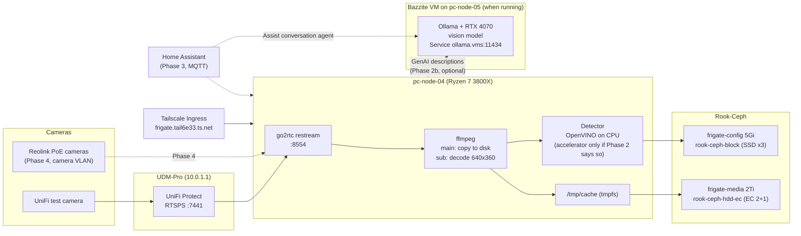

# 📹 Frigate NVR: Local Cameras & Object Detection

**Goal:** record every camera around the house to the cluster's own storage, detect people, cars and animals locally, and drive alerts and automations through [[505-home-assistant-smart-home|Home Assistant]]. No footage leaves the house. When the Bazzite VM is running, its RTX 4070 adds AI extras on top: plain-language event descriptions, smarter search, and a local assistant for Home Assistant.

**Availability goal:** best effort. A quiet neighborhood doesn't call for a hardened system, so short outages (node reboots, Ceph maintenance, the VM being off) are acceptable. The design keeps the *core* (recording and detection) independent of the gaming VM anyway, because that costs nothing.

Manifests live in `kubernetes/apps/frigate/`: `frigate.yaml` (namespace, PVCs, Deployment, Service, Tailscale Ingress), `config.yml` (Frigate's own config, loaded as a ConfigMap) and `frigate-secrets.example.yaml` (camera tokens template).

> [!NOTE]
> Status: **drafted, not deployed.** Phase 1 below is the first deployment.

---

## 🎯 Why Frigate (and Not Only UniFi Protect)

Protect is also fully local if UI.com remote access stays off, so "local" is not the deciding factor. Frigate wins on:

| | UniFi Protect | Frigate |
| :--- | :--- | :--- |
| Camera brands | UniFi only (cameras must be adopted) | Anything with RTSP/HTTP (Reolink, Amcrest, UniFi via restream) |
| Detection | Built-in, fixed models | Swappable detectors (CPU, Coral, GPU), zones, masks, face recognition, license plates |
| Storage | UDM-Pro's single HDD bay | Rook-Ceph EC pool, about 13 TiB free |
| Home Assistant | Integration exists, limited events | First-class integration: per-object sensors, snapshots in notifications, timelines |
| Learning value | Appliance | A real stateful workload: shared memory, tmpfs cache, device plugins, big-volume storage design |

Both can run side by side: Protect keeps adopting the UniFi test camera, and Frigate pulls its RTSP streams from the UDM-Pro.

---

## 🏛️ Architecture



### Key decisions

1. **Detection runs on the CPU; the 4070 only adds extras (decided 2026-10-22).** This follows the GPU rule in [[303-kubevirt-bazzite-gpu-vm|the Bazzite VM doc]] (2026-10-20): the 4070 belongs to the VM, GPU work is served from inside Bazzite, and every client keeps a CPU path. Frigate goes one step further and keeps *all* required work on the CPU, using the VM only for optional GenAI. Bazzite updates, game crashes and Install mode then never stop recording or alerts. Whether detection ever needs an accelerator is decided by measurement in Phase 2, not up front.
2. **Frigate is pinned to `pc-node-04`.** It has the most idle CPU (about 2% average, 64 GB RAM), and any accelerator Phase 2 calls for goes in there. It has no iGPU, so decoding runs on CPU. That's cheap because only the low-resolution sub stream is decoded; main streams are copied to disk as-is.
3. **The ConfigMap is the source of truth.** Frigate 0.18 can edit its whole config from the UI. The init container overwrites `/config/config.yml` from git on every start, so UI edits are a scratchpad: draw zones and masks in the UI, then `just frigate-config-pull` and commit.
4. **Only the authenticated port is exposed.** 8971 (login required) goes out through the Tailscale Ingress. 5000 (no auth) and 8554 (RTSP) stay cluster-internal. Nothing goes through the Cloudflare tunnel.

---

## 💾 Storage Design

| Volume | Class | Size | Contents |
| :--- | :--- | :--- | :--- |
| `frigate-config` | `rook-ceph-block` (SSD, 3 replicas) | 5Gi | `config.yml`, `frigate.db` (SQLite: events, review items) |
| `frigate-media` | `rook-ceph-hdd-ec` (HDD, EC 2+1) | 2Ti (thin cap) | `recordings/`, `clips/`, `exports/` |
| `/tmp/cache` | `emptyDir` in memory | 1Gi | Recording segments before they move to `/media` |
| `/dev/shm` | `emptyDir` in memory | 256Mi | Decoded detect frames (about 30 MiB per 640x360 camera) |

### Sizing math

A 4 MP main stream at about 4 Mbit/s writes about **43 GB a day**. Retention in `config.yml` keeps everything for 3 days, motion for 7, alerts for 30:

| Cameras | 3 days continuous | Raw on EC 2+1 (×1.5) |
| :--- | :--- | :--- |
| 1 (Phase 1) | ~130 GB | ~195 GB |
| 6 | ~775 GB | ~1.2 TB |
| 6 at 14 days | ~3.6 TB | ~5.4 TB |

Grow the PVC with `kubectl -n frigate edit pvc frigate-media` (the class allows expansion). Frigate also deletes the oldest recordings itself when free space drops below about an hour of footage.

> [!IMPORTANT]
> **Policy exception.** [[104-phase2-rook-ceph-storage|The storage policy]] says the HDD tier is scratch and never the only copy of anything. Camera footage is the only copy, and that is accepted on purpose: it ages out in days, the EC pool survives one host failure, and backing up 24/7 video to S3 would cost far more than it's worth. `frigate-config` (events database) is on the SSD pool and should join the NAS backup jobs in [[307-garage-synology-dr-time-machine|the Synology DR setup]].

---

## 🚀 Phase 1: One UniFi Camera, CPU Detection

**Done when:** the UniFi test camera shows live in Frigate, records to Ceph, and a person walking past creates a review item.

1. **Enable RTSP in Protect.** Protect → camera → Settings → Advanced → RTSP: enable **High** and **Low**. Each URL ends in a token (`rtsps://10.0.1.1:7441/<token>?enableSrtp`). Copy just the tokens.
2. **Create the Secret** (the real file is gitignored by `*-secrets.yaml`):
   ```bash
   cp kubernetes/apps/frigate/frigate-secrets.example.yaml kubernetes/apps/frigate/frigate-secrets.yaml
   # edit the two tokens, then:
   kubectl apply -f kubernetes/apps/frigate/frigate-secrets.yaml
   ```
   The apply fails until the namespace exists; if so, run `just frigate-apply` once first and re-apply.
3. **Deploy:**
   ```bash
   just frigate-apply
   ```
4. **Get the first admin password.** Frigate creates the `admin` user on first start and prints the password once:
   ```bash
   kubectl -n frigate logs deploy/frigate | grep -i -A2 "password"
   ```
   Open `https://frigate.tail6e33.ts.net`, log in, and change it.
5. **Tune.** In Settings, draw motion masks over the timestamp and anything that moves constantly (trees, the road), plus a `driveway` or `porch` zone. Then `just frigate-config-pull` and commit `config.yml`.

### Verification

```bash
kubectl -n frigate get pods,pvc -o wide        # Running on pc-node-04, both PVCs Bound
kubectl -n frigate logs deploy/frigate | grep -iE "error|warn" | head
kubectl -n frigate exec deploy/frigate -c frigate -- du -sh /media/frigate/recordings
```

In the UI, check **System → Metrics**: detector inference time (OpenVINO on CPU: about 10–20 ms is fine) and ffmpeg CPU per camera.

> [!WARNING]
> **Verify on first boot:** the 0.18.2 docs confirm the OpenVINO model paths and the `record:` retention keys. They document `{FRIGATE_*}` substitution for camera input paths but don't clearly cover `go2rtc.streams`. If the go2rtc page shows a literal `{FRIGATE_CAM01_HIGH_TOKEN}`, move the whole URL into the Secret instead.

---

## 📏 Phase 2: Measure, Then Choose a Detector

**Done when:** the detector choice is written down here with the numbers that justified it.

Run Phase 1 for a week, adding cameras as they arrive, and watch **System → Metrics** in Frigate plus node CPU on the homelab Grafana dashboard:

| Signal | Stay on CPU | Add an accelerator |
| :--- | :--- | :--- |
| Detector inference time | Under ~30 ms | Climbing past ~50 ms, or "detection fps" falling behind cameras |
| `pc-node-04` CPU | Comfortable headroom | Frigate dominating the node |
| Detection quality | Good enough with SSDLite MobileNet | Too many misses or false positives; want YOLO-class models |

If an accelerator is needed, options in order of preference (rule 3 of the 303 GPU table: a purchase is the last resort):

| Option | Cost | Fits when |
| :--- | :--- | :--- |
| **Intel Arc A310** (low-profile) in `pc-node-04` | ~$100 | Want better models (YOLOv9 via OpenVINO `device: GPU`) *and* hardware video decode. Needs a free PCIe slot next to the X520 and Talos's Intel GPU firmware extensions |
| **USB Coral** | ~$60 | Just need cheap, low-power detection for many cameras; fine with the older SSDLite model |
| Hailo-8L | ~$70–100 | Skip for now: needs an out-of-tree kernel driver, awkward on Talos |

### If it's a USB Coral

- A USB Coral uses `libusb` from userspace, so **Talos needs no extension**. (An M.2 Coral would need the `gasket-driver` system extension.)
- Kubernetes still has to hand the USB device to the pod. Use [squat/generic-device-plugin](https://github.com/squat/generic-device-plugin) to advertise it as a resource (e.g. `squat.ai/coral: 1`) instead of making the pod `privileged`, so the namespace can stay `baseline`.
- The Coral enumerates twice: as `1a6e:089a` (Global Unichip) before firmware load and `18d1:9302` (Google) after. The device plugin must match **both** IDs, or detection fails after the first restart.
- Swap the detector in `config.yml`:
  ```yaml
  detectors:
    coral:
      type: edgetpu
      device: usb
  ```
  and delete the `model:` block (Coral uses the bundled model).

---

## 🧠 Phase 2b: GenAI on the Bazzite VM's 4070 (Optional Extras)

**Done when:** a person walking past produces a review item titled in plain language (e.g. "Delivery driver drops package at door"), and turning the VM off changes nothing except that new items lack descriptions.

Independent of Phase 2: this can happen as soon as Phase 1 works.

### What it adds

- **Object descriptions:** each tracked object gets a sentence about what it's doing and why, searchable in *Explore* ("person carrying a ladder").
- **Review summaries:** each alert gets a title, a two-sentence summary and a threat level (0–2). Frigate's notifications show the summary instead of "Person detected".
- **Chat:** ask Frigate questions about recent activity in the UI.

### Design

| Piece | Choice | Why |
| :--- | :--- | :--- |
| Model server | **Ollama** in a Podman container inside Bazzite, using the guest's NVIDIA driver | The pattern decided in 303; Bazzite already has CUDA |
| Management | `ansible/playbooks/configure-bazzite-vm.yml` (a Podman quadlet), never by hand | Rebuilding the VM must bring it back |
| Exposure | A **ClusterIP** Service `ollama` in namespace `vms` selecting the VM, port 11434 | Ollama has **no authentication**, so it is never put on a MetalLB LAN IP or the Cloudflare tunnel |
| Vision model | `qwen3-vl:8b-instruct` (Frigate's recommended family, about 6–7 GB VRAM) | Leaves room on the 12 GB card; drop to `qwen3-vl:4b` if games stutter |
| VRAM sharing | `OLLAMA_KEEP_ALIVE=2m`, `OLLAMA_MAX_LOADED_MODELS=1` | The model unloads soon after the last request, so a game launched later gets the VRAM back |
| Roles | `descriptions` + `chat` on Ollama; **`embeddings` stay on Frigate's built-in CPU model** | Semantic search keeps working with the VM off; each role maps to exactly one provider, with no failover |

### Frigate config (add to `config.yml` once Ollama answers)

```yaml
genai:
  bazzite_4070:
    provider: ollama
    base_url: http://ollama.vms.svc.cluster.local:11434
    model: qwen3-vl:8b-instruct
    roles:
      - descriptions
      - chat

objects:
  genai:
    enabled: true

review:
  genai:
    enabled: true
```

Optionally, give review summaries an `activity_context_prompt` describing normal activity for this house (deliveries in the day, the family's cars), so the threat levels mean something.

### When the VM is off

Description and summary requests fail and the items are saved without them. Recording, detection, alerts and semantic search carry on. Descriptions can be regenerated later from the UI for anything important.

> [!TIP]
> **Check from the cluster:** `kubectl -n frigate exec deploy/frigate -c frigate -- curl -s http://ollama.vms.svc.cluster.local:11434/api/tags` lists the models Ollama has loaded. An empty reply or timeout means the VM is off or the guest firewall (firewalld in Bazzite) is blocking 11434.

---

## 🏠 Phase 3: Home Assistant, MQTT & AI

**Done when:** a person detected in a zone sends an iPhone notification with a snapshot and the AI summary, and "Hey, what happened in the driveway today?" gets an answer from Assist.

- Deploy [[505-home-assistant-smart-home|Home Assistant]] and an MQTT broker (Mosquitto is already in `kubernetes/apps/teslamate/teslamate.yaml`; move it to a shared namespace rather than running two).
- Set `mqtt.enabled: true` with the broker host and a user from a Secret.
- Install the **Frigate integration** (HACS) in Home Assistant, pointed at `http://frigate.frigate.svc:5000`. The integration provides camera entities, per-zone occupancy sensors and notification blueprints with snapshots and clips.
- Push alerts can go to [[106-observability-prometheus-grafana|ntfy]] or the Home Assistant app. With Phase 2b, Frigate's review summaries arrive over MQTT, so notifications can carry "Delivery driver left a package" instead of "Person detected".
- **AI in Home Assistant:** add the built-in **Ollama** integration pointed at the same `ollama.vms` Service, and use it as the **conversation agent** for Assist (voice or text control of the house in plain language).
  - The 4070 then serves both Frigate and Home Assistant with one model server.
  - Assist pipelines don't fail over. Keep a second pipeline on a cloud agent (Home Assistant's Anthropic or Google integrations) for when the VM is off, and the built-in non-AI intents keep handling simple commands ("turn off the garage lights") either way.

---

## 🎥 Phase 4: Reolink Cameras on a Camera VLAN

Moving future cameras to **Reolink PoE** breaks the UniFi lock-in and is the most common Frigate pairing. Once no camera depends on Protect, Frigate pulls streams straight from the cameras.

### Buying guidance

- **PoE models only** (e.g. RLC-810A / RLC-811A / RLC-820A, the Duo series for wide angles, the PoE doorbell). Wi-Fi and battery models don't keep a continuous stream open and are poor NVR cameras.
- **Avoid "NVR-only" kits.** Their cameras are meant to be paired with Reolink's NVR box; buy standalone cameras.
- **Stream protocol:** Frigate's docs recommend **HTTP-FLV** through go2rtc for most Reolink models (their RTSP is known to be flaky), and RTSP for 8 MP+ main streams. Follow the Reolink section of the Frigate camera docs for the exact URLs.
- **Firmware:** updates are manual downloads from Reolink. That's fine, since the cameras won't have internet access anyway.

### Network

- **New `cameras` VLAN** in `terraform/unifi/`, with **no internet access** and no access to other VLANs.
- **One allow rule:** the cluster VLAN may reach the camera VLAN, so Frigate can pull streams. Cameras never start a connection anywhere.
- **PoE budget:** the USW-24-G2 has no PoE and the garage USW-Lite-8-PoE has a 52 W budget. A dedicated PoE switch (e.g. USW-Lite-16-PoE) on the camera VLAN is the likely purchase. Plan about 6–8 W per camera, more with IR at night.
- **Time:** cameras need NTP for correct timestamps. Point them at the UDM-Pro, which stays reachable inside the VLAN.

> [!TIP]
> The UniFi test camera can stay on Protect indefinitely; Frigate treats it like any other stream. Retiring Protect only frees resources on the UDM-Pro, so there's no reason to rush.

---

## 🔧 Troubleshooting & Gotchas

| Symptom | Likely cause | Fix |
| :--- | :--- | :--- |
| Pod stuck in `ContainerCreating` | Secret `frigate-cameras` or ConfigMap missing | Create the Secret, re-run `just frigate-apply` |
| UI edits vanished after a restart | By design: the init container restores git's `config.yml` | `just frigate-config-pull` before restarting |
| `frigate-config-pull` refuses | The UI wrote a token into the config in plain text | Put `{FRIGATE_...}` back in the UI, pull again |
| Pod `OOMKilled` | tmpfs cache + shm count against the 4Gi limit | Raise the limit, or lower `sizeLimit` if fewer cameras |
| Green/grey frames, `No frames received` | Protect RTSP token rotated (happens after camera re-adoption) | Copy new tokens into the Secret, restart |
| Live view is laggy over Tailscale | MSE over the HTTP ingress | Fine for Phase 1. WebRTC needs port 8555 reachable; revisit if needed |
