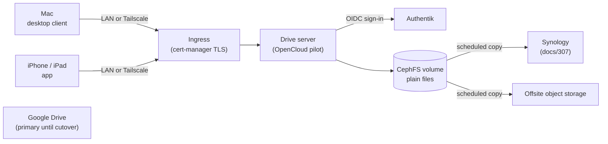

# ☁️ Self-Hosted Drive: Product Options & Trial Plan

> [!NOTE]
> **Status (2026-11-17): roadmap only. Nothing is deployed and no product is chosen.** Current lean: **pilot OpenCloud, with Nextcloud as the fallback.** Google Drive stays primary and stays on until the trial's cutover criteria pass. This follows the same pattern as the Immich trial in [[504-immich-photo-backup|docs/504]].

## 🎯 Goal and non-goals

**Goal:** a file store I own and control that can eventually replace Google Drive for day-to-day files on the Mac, iPhone and iPad. It also puts the always-on cluster to work for the power it already uses.

**Non-goals:**
- **Photos.** Immich owns the photo library ([[504-immich-photo-backup|docs/504]]). The Drive leaves photos out.
- **Git repositories.** Repos are never placed in a synced folder (see [[#⚠️ Invariant: no git repos in synced folders]]).
- **Public internet exposure.** Like Immich, reachable on the LAN and the tailnet only, with no public DNS record.
- **Hosting AI agents next to the files.** Considered and declined on 2026-11-17 (see [[#🤖 Why this does not bring back the agent pod]]).

---

## 📋 Requirements

| # | Requirement | Weight |
|---|---|---|
| R1 | Mac client with **files on demand** (like Google Drive's streaming mode), not only full copies | Must |
| R2 | Usable iPhone / iPad app (Files app integration, uploads) | Must |
| R3 | Sign-in through Authentik (OIDC) | Must |
| R4 | Files stored as **plain files** on disk, readable without the product | Strong |
| R5 | Runs well on Kubernetes: declarative manifests or a Helm chart, few stateful parts | Strong |
| R6 | Chunked or resumable uploads (large files over flaky links) | Strong |
| R7 | Calendar and contacts | Nice to have |
| R8 | Web UI and share links | Nice to have |

---

## 🧭 Options compared

| | **Nextcloud** | **OpenCloud** | **Seafile** | **Syncthing** |
|---|---|---|---|---|
| What it is | Full suite: files, calendar, contacts, office docs, hundreds of add-on apps | Go rewrite of ownCloud (fork of oCIS, 2025) | Built for fast, reliable sync | Device-to-device sync, no central server |
| Moving parts | PHP + Postgres + Redis + cron jobs | Single Go binary, no database | Server + MariaDB (+ memcached) | One small process per device |
| R5 Kubernetes fit | Workable, but heavy and stateful | Best: made for containers, Helm chart | OK: mostly Docker-first | Easy, as a sidecar or small pod |
| R3 Authentik | Via an add-on app, works fine | Built in: expects an external OIDC provider | Supported | No accounts at all |
| R1 Mac app | Mature; files on demand via macOS File Provider | Forked from the ownCloud app; **on-demand files on macOS must be tested** | SeaDrive virtual drive, very good | Full copy only |
| R2 iPhone / iPad | Mature | Newer and less polished | Good | Unofficial paid app (Möbius Sync) |
| R4 Files on disk | Plain files | Plain files (POSIX driver) | **Proprietary blocks** | Plain files |
| R6 Chunked uploads | Yes | Yes (TUS) | Yes | n/a (peer sync) |
| R7 Calendar / contacts | Yes | No | No | No |
| Main weakness | Slow, painful major upgrades | Young project, smaller community | Data locked in its format; Pro free only up to 3 users | Not a Drive: no web UI or share links |

Also considered and dropped: **Pydio Cells** (capable but niche), and **Filebrowser** / **Copyparty** (web file managers, they don't sync).

### Recommendation

1. **Pilot OpenCloud.** It fits this cluster's patterns best: stateless containers, no database to back up, native OIDC with Authentik, plain files on CephFS. It also builds skills that transfer to work. Risk: young project, so R1 and R2 are the pass/fail checks.
2. **Fallback: Nextcloud.** The safest choice if the clients matter most, and the only option that covers R7. The cost is running a PHP stack and its upgrades.
3. **Not chosen: Seafile.** Excellent sync, but its block storage format fails R4: backups would only be readable through Seafile.
4. **Helper, not a replacement: Syncthing.** Useful for one folder that should exist everywhere. Can't replace Drive's web access and sharing.

---

## 🏛️ Target architecture

- **Access:** LAN and tailnet only, same as Immich. This also avoids the Cloudflare Tunnel free-plan **100 MB per-request upload limit** ([[202-cloudflare-tunnel-zero-trust|docs/202]]).
- **Storage:** CephFS if the server will run more than one replica (ReadWriteMany). Ceph RBD is fine for a single replica, with `strategy: Recreate` like the other RBD apps.
- **Manifests:** `kubernetes/apps/<product>/`, declarative, image tags pinned, Pod Security `restricted` where the product allows it.

---

## 🛡️ Risks and what has to be true first

> [!IMPORTANT]
> **Backups before cutover.** Today Google Drive *is* the offsite copy. Self-hosting removes that, so a tested 3-2-1 backup (Synology per [[307-garage-synology-dr-time-machine|docs/307]] plus an offsite copy) and a restore drill must pass before Google Drive is turned off.

- **Sensitive data moves onto the cluster.** Finances and health records would rely on homelab security and uptime instead of Google's. Keep access LAN/tailnet only, and keep the cluster healthy first: `sm-node-01` and `osd.6` are still out ([[114-sm-node-01-sata-fault-osd6|docs/114]]).
- **More always-on infrastructure** to patch and monitor. That's welcome (more use of the hardware), but it needs Prometheus alerts and an upgrade routine.
- **Obsidian on iPad.** Obsidian on iOS can't read a vault from a Nextcloud or OpenCloud folder directly. Mobile vault sync is a separate decision: the Remotely Save plugin (WebDAV/S3) or Self-hosted LiveSync (CouchDB).

### ⚠️ Invariant: no git repos in synced folders

File-sync tools copy `.git/index`, refs and lock files one by one, with no idea they must change together. With two machines editing, this eventually corrupts the repo. That applies to every product here and to Google Drive. **Git syncs repos. The Drive syncs everything else.**

### 🤖 Why this does not bring back the agent pod

Having the files local to the cluster removes some blockers for an in-cluster Claude/AGY pod (no whole-Drive Google login on the cluster, no privileged FUSE mount, easy memory-file sync). It doesn't fix the main ones: the git-in-sync-folder problem above, and two working copies combined with the rule that agents never commit or push. The decision on 2026-11-17 stands: interactive coding stays on the Mac. Agent pods are worth revisiting only for batch jobs on data stored in the cluster (Immich libraries, Drive contents, metrics), where there's one copy of the data and no human editing at the same time.

---

## 🧪 Trial plan

| Phase | What | Done when |
|---|---|---|
| 0 | Pick the pilot (OpenCloud) and write manifests | Manifests reviewed in the repo |
| 1 | Deploy on LAN + tailnet with Authentik sign-in | Sign-in works on the Mac, iPhone and iPad |
| 2 | Test the clients with a non-sensitive folder | R1 on-demand files and R2 app pass, or switch to Nextcloud |
| 3 | Backups: Synology + offsite, then a restore drill | Restore of a deleted file and a full-volume restore both pass |
| 4 | Daily use for 2–3 months, Google Drive still on | No sync losses; upgrades done at least once |
| 5 | Cutover decision | All criteria below pass |

### Cutover criteria (all must pass)

- [ ] Restore drill passed from the offsite copy, not only from the Synology
- [ ] Mac on-demand files and the iPhone/iPad app used daily without sync errors
- [ ] At least one product upgrade completed without data loss
- [ ] Alerts for server down, low storage and backup failures
- [ ] Decision made for Obsidian mobile sync

---

## 🔗 Related

- [[504-immich-photo-backup|docs/504 Immich]]: photos, and the trial pattern this copies
- [[307-garage-synology-dr-time-machine|docs/307 Synology DR]]: backup target
- [[104-phase2-rook-ceph-storage|docs/104 Rook-Ceph]]: CephFS and RBD storage classes
- [[203-tailscale-mesh-vpn|docs/203 Tailscale]]: remote access
- [[306-hybrid-local-remote-ai-dev|docs/306 Remote AI dev]]: the decommissioned agent pod
