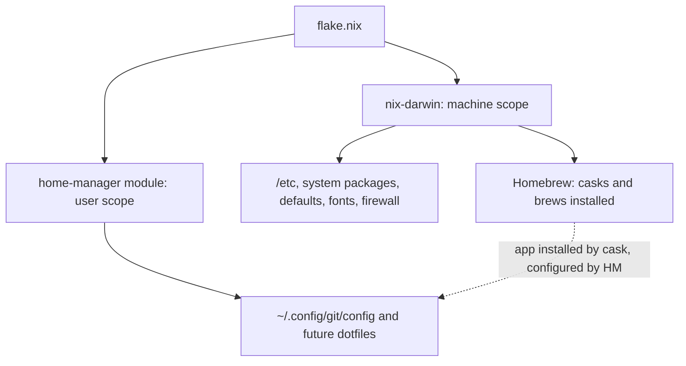

# 🏠 Home Manager: User-Scope Config as Code

## The Big Idea
`nix-darwin` manages the **machine**: `/etc`, system packages, Homebrew casks, macOS defaults, fonts, and the firewall. **home-manager** manages the **user's home directory**: dotfiles such as `~/.config/git/config` and `~/.zshrc`, plus per-user packages and environment variables.

It is wired in as a **nix-darwin module** in [[templates/flake.nix|flake.nix]], so it is part of the same system build. One `just switch` applies both layers together and rolls back together.



## How It Works
- **Symlinks into the Nix store.** Each file home-manager manages is a read-only symlink into `/nix/store`. Editing the file by hand fails, and that is deliberate: the flake is the only place to change it.
- **Ownership tracking.** home-manager remembers which files it created. A file you drop from the flake is removed on the next switch. Files it never created are left alone.
- **Clobber protection.** If an unmanaged file already sits where home-manager wants to write, it renames that file to `*.hm-backup` and continues (`backupFileExtension`). Without that setting, the switch fails rather than overwriting your file.
- **Same packages as the system.** `useGlobalPkgs` makes home-manager use the system's pinned nixpkgs and its `allowUnfree` setting, so there is one package set and no version drift.

## Module vs Standalone
| | nix-darwin module (chosen) | Standalone `home-manager switch` |
|---|---|---|
| Apply | One `just switch` (sudo) | A separate command, no sudo |
| Rollback | System and user roll back together | Two independent generation histories |
| Best for | One Mac, one user | Several machines, or Linux hosts without nix-darwin |

## Where Things Live (Target State)
| Concern | Scope | Owner |
|---|---|---|
| Casks, brews, macOS defaults, fonts, firewall, printer, debloat | Machine | nix-darwin |
| Git identity and defaults | User | home-manager ✅ (milestone 1a) |
| zsh aliases, plugins, p10k, prompt init | User | home-manager (next) |
| Ghostty and VS Code config (cask-installed apps) | User | home-manager (later) |
| Secrets (`~/.zshrc.local`) | User | **Never in Nix.** Stays a gitignored local file |

> [!IMPORTANT]
> Homebrew still **installs** GUI apps. home-manager only writes their **config files**. Keep that split: casks stay in the nix-darwin `homebrew` block.

> [!WARNING]
> VS Code writes to its own `settings.json` when you change a setting in the UI. Once that file is a read-only home-manager symlink, UI changes fail to save. Plan for this before moving VS Code settings: make all changes in the flake, or keep VS Code settings mutable. Today the activation script overwrites the file on every switch, so UI changes are already lost silently.

## Milestone 1a: Git (2026-10-19)
- `programs.git` writes `~/.config/git/config` with identity (the GitHub noreply email), the `osxkeychain` credential helper, and `fetch.prune = true`.
- Both Apple's `/usr/bin/git` and the Nix git read `~/.config/git/config`. That removes the earlier `/etc/gitconfig` + `GIT_CONFIG_SYSTEM` workaround, which was never activated.
- Git reads `~/.config/git/config` first and `~/.gitconfig` second, and the later file wins. The old `~/.gitconfig` holds the same identity, so it is harmless, but remove it after the switch so the flake is the only source.

### Verification
```bash
# Before switching: build without activating and inspect the generated file
nix build ~/.config/nix-darwin#darwinConfigurations.MacBook-Pro.system --dry-run
```

```bash
# After `just switch`, in a new terminal: every value should come from ~/.config/git/config
git config --list --show-origin --global
```

```bash
# Confirm the Nix git sees the same values
/run/current-system/sw/bin/git config --get fetch.prune
```

```bash
# Once verified, retire the hand-maintained file (it holds only user.name and user.email)
rm ~/.gitconfig
```

### Gotchas
- **`home.stateVersion`** records the home-manager release whose defaults you adopted. It is set once and is not a version to upgrade. Bumping it can silently change defaults.
- **Rollback:** `sudo darwin-rebuild --rollback` restores the previous generation, user files included.
- **"would be clobbered" or `*.hm-backup` files** mean an unmanaged file was in the way. Merge anything you need from the backup into the flake, then delete the backup.

## Related Notes
* [[Nix-Darwin Guide]]
* [[Declarative macOS Setup]]
