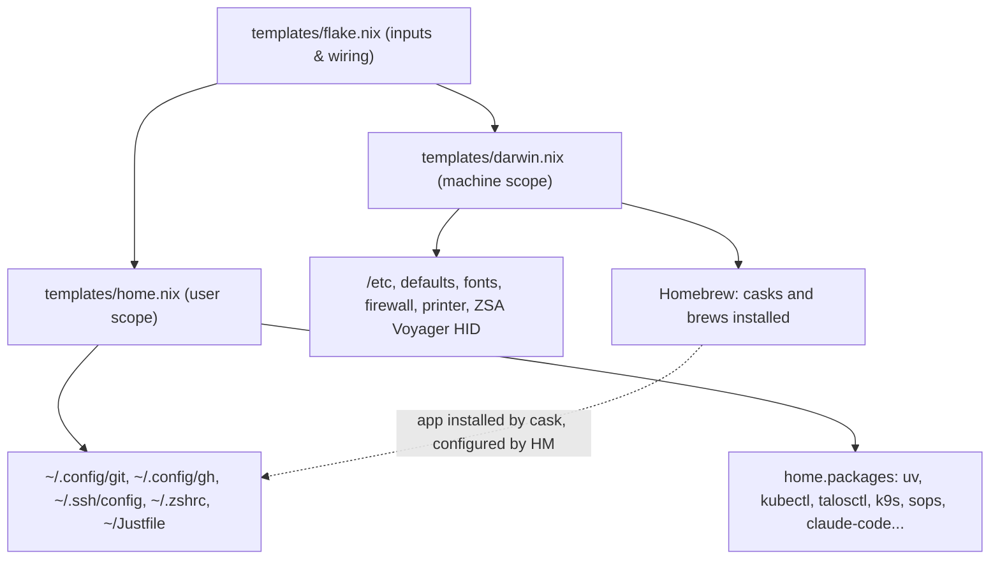

# 🏠 Home Manager: User-Scope Config as Code

## The Big Idea
`nix-darwin` manages the **machine** ([[templates/darwin.nix|darwin.nix]]): `/etc`, Homebrew casks, macOS defaults, fonts, the firewall, and hardware/printer activation. **home-manager** manages the **user's home directory** ([[templates/home.nix|home.nix]]): dotfiles such as `~/.config/git/config`, `~/.ssh/config`, and `~/.zshrc`, plus per-user CLI packages, IDE extensions, and environment variables.

Both layers are wired together by [[templates/flake.nix|flake.nix]], so they are part of the same system build. One `just switch` syncs the canonical files from `templates/` into `~/.config/nix-darwin/`, applies both layers together, and rolls back together.



## How It Works
- **3-File Modular Architecture:**
  - [[templates/flake.nix|flake.nix]] — Flake inputs (`nixpkgs`, `nix-darwin`, `home-manager`, `nix-vscode-extensions`) and system outputs.
  - [[templates/darwin.nix|darwin.nix]] — Machine-level state, Homebrew casks/brews, macOS `system.defaults`, and hardware/printer activation.
  - [[templates/home.nix|home.nix]] — User-level packages (`home.packages`), shell integrations, SSH/Git/GitHub configs, Ghostty, VS Code, and Roo Code.
- **Automated Flake Sync (`just switch` & `just update`):**
  - `~/.config/nix-darwin/` lives outside the Google Drive–synced vault so Nix builds never contend with Drive file locks.
  - Running `just switch` automatically invokes `just sync` first, copying `flake.nix`, `darwin.nix`, `home.nix`, `Justfile`, `p10k.zsh`, and `flake.lock` from `nix-mac/templates/` into `~/.config/nix-darwin/` before activating.
  - Running `just update` updates `~/.config/nix-darwin/flake.lock`, copies the updated lockfile back to `nix-mac/templates/flake.lock`, and activates the system.
- **Symlinks into the Nix store.** Each file home-manager manages is a read-only symlink into `/nix/store`. Editing the file by hand fails, and that is deliberate: `templates/home.nix` is the only place to change it.
- **Out-of-Store Symlinks (`mkOutOfStoreSymlink`).** For binaries bundled inside Homebrew `.app` bundles (like `/Applications/Tailscale.app/Contents/MacOS/Tailscale`), home-manager creates a declarative symlink at `~/.local/bin/tailscale` without copying the binary into `/nix/store`.
- **Clobber protection.** If an unmanaged file already sits where home-manager wants to write, it renames that file to `*.hm-backup` and continues (`backupFileExtension = "hm-backup"`).
- **Same packages as the system.** `useGlobalPkgs` makes home-manager use the system's pinned `nixpkgs`, `allowUnfree`, and overlays, so there is one package set and no version drift.

## Module vs Standalone
| | nix-darwin module (chosen) | Standalone `home-manager switch` |
|---|---|---|
| Apply | One `just switch` (auto-sync + sudo) | A separate command, no sudo |
| Rollback | System and user roll back together | Two independent generation histories |
| Best for | One Mac, one user | Several machines, or Linux hosts without nix-darwin |

## Where Things Live
| Concern | Scope | Owner |
|---|---|---|
| Casks, brews, macOS defaults, fonts, firewall, printer, ZSA Voyager HID | Machine | `darwin.nix` (`nix-darwin`) |
| Developer & homelab CLIs (`uv`, `kubectl`, `talosctl`, `k9s`, `sops`, `claude-code`, etc.) | User | `home.nix` (`home.packages`) |
| `~/Justfile` and `~/.local/bin/tailscale` | User | `home.nix` (`home.file`) |
| Git (`~/.config/git/config`), GitHub CLI (`~/.config/gh/config.yml`), SSH (`~/.ssh/config`) | User | `home.nix` (`programs.git`, `programs.gh`, `programs.ssh`) |
| Zsh, Powerlevel10k, `fzf`, `eza`, `bat`, `zoxide`, `direnv` | User | `home.nix` (`programs.zsh` + native HM modules) |
| Ghostty, VS Code, Roo Code config (cask-installed apps) | User | `home.nix` (`programs.ghostty`, `programs.vscode`, `home.file`) |
| Heavy disk cleanup (GarageBand/iMovie purge, APFS snapshot thinning) | On-Demand | `just debloat` / `just prune-all` |
| Secrets (`~/.zshrc.local`, `~/.ssh/id_ed25519`, `~/.config/gh/hosts.yml`) | User | **Never in Nix.** Local untracked files |

> [!IMPORTANT]
> Homebrew still **installs** GUI apps (`darwin.nix`). home-manager only writes their **config files** (`home.nix`). Keep that split: casks stay in the `darwin.nix` `homebrew` block.

---

## Milestone 1a: Git (2026-10-19)
- `programs.git` writes `~/.config/git/config` with identity (the GitHub noreply email), the `osxkeychain` credential helper, and `fetch.prune = true`.
- Both Apple's `/usr/bin/git` and the Nix git read `~/.config/git/config`.

## Milestone 1b: Zsh (2026-10-19)
- home-manager writes `~/.zshenv`, `~/.zprofile`, `~/.zshrc`, and `~/.p10k.zsh`.
- `darwin.nix` keeps `programs.zsh.enable = true` so `/etc/zshenv` puts Nix tools and their completions on `PATH`, while turning off system `compinit` and prompt so nothing loads twice.

## Milestone 2: Ghostty, VS Code, Roo Code (2026-10-19)
- `programs.ghostty` (`package = null`) manages `~/.config/ghostty/config`.
- `programs.vscode` (`package = null`, `mutableExtensionsDir = false`) manages `~/Library/Application Support/Code/User/settings.json` and `~/.vscode/extensions/` using the daily `nix-vscode-extensions` marketplace mirror (`vscode-marketplace-release`).
- `home.file` manages `~/.config/roo-code/settings.json` (linked into VS Code via `"roo-cline.autoImportSettingsPath": "~/.config/roo-code/settings.json"`) and Roo's `custom_modes.yaml`.

## Milestone 3: 3-File Modular Split, Auto-Sync & Native HM Modules (2026-10-20)
1. **Split into `flake.nix`, `darwin.nix`, and `home.nix`:**
   - Moved all user-scope CLI packages from `environment.systemPackages` into `home.packages` in `home.nix`, leaving only `git` and `just` at the machine level.
2. **Eliminated Manual Sync Drift:**
   - `home.file."Justfile".source = ./Justfile;` makes `~/Justfile` a read-only symlink into the Nix store so it never drifts from `templates/Justfile`.
   - `just switch` and `just update` automatically sync between `nix-mac/templates/` and `~/.config/nix-darwin/`.
3. **Moved User Chores out of `postActivation`:**
   - Replaced the imperative `ln -sf` + `chown` for the Tailscale CLI with `config.lib.file.mkOutOfStoreSymlink "/Applications/Tailscale.app/Contents/MacOS/Tailscale"`.
   - Removed slow `rm -rf /Applications/GarageBand.app` and `tmutil thinlocalsnapshots` from running on every `just switch` (they remain on-demand in `just debloat`).
4. **Enabled Native Home Manager Modules (`gh`, `ssh`, `fzf`, `eza`, `bat`, `direnv`):**
   - `programs.gh` manages `~/.config/gh/config.yml` (`git_protocol = "https"`, `co = "pr checkout"`) while leaving `hosts.yml` auth tokens untouched.
   - `programs.ssh` manages `~/.ssh/config` with `Include ~/.orbstack/ssh/config` at the top and macOS Keychain integration (`AddKeysToAgent yes`, `UseKeychain yes`, `IdentityFile ~/.ssh/id_ed25519`).
   - `programs.fzf` wires `Ctrl+R` history search and `Ctrl+T` file completion into Zsh.
   - `programs.direnv` hooks `.envrc` automatic environment loading into Zsh (`nix-direnv.enable = false` to avoid pulling a duplicate Nix binary alongside Determinate Nix).

### Verification
```bash
# Dry-run build (syncs templates -> ~/.config/nix-darwin and verifies zero evaluation warnings)
just sync && nix build ~/.config/nix-darwin#darwinConfigurations.MacBook-Pro.system --dry-run
```

```bash
# After `just switch`: verify symlinks for ~/Justfile, ~/.ssh/config, ~/.config/gh/config.yml, and tailscale
ls -la ~/Justfile ~/.ssh/config ~/.config/gh/config.yml ~/.local/bin/tailscale
```

```bash
# Verify SSH config includes OrbStack at the top and Keychain options under Host *
cat ~/.ssh/config
```

> [!WARNING] Troubleshooting: Windows Leave a 56px Gap at the Bottom of All Spaces
> If `Dock` is restarted while macOS **Mission Control** is open (which temporarily forces `autoHideOn=0`), the new `Dock` process registers its full 56px unhidden strut with `WindowManager` (`setDockInfo`) and fails to clear it when Mission Control closes—leaving `NSScreen.mainScreen.visibleFrame.origin.y = 56` even though the Dock is visually hidden.
> - **Why `killall Dock` alone won't clear it:** `WindowManager` (`PID` persists across Dock restarts) caches the last `setDockInfo` strut and `Dock` does not resend `setDockInfo` on normal startup when `autohide = true`.
> - **Fix:** Toggle Dock auto-hide off and back on (**`Cmd + Option + D`** twice, or run `osascript -e 'tell application "System Events" to set autohide of dock preferences to false' && sleep 1 && osascript -e 'tell application "System Events" to set autohide of dock preferences to true'`).
> - **Prevention:** `darwin.nix` no longer runs a second `killall Dock` inside `postActivation` after `brew bundle`; `nix-darwin`'s built-in `userDefaults` phase already restarts the Dock once.

## Related Notes
* [[Nix-Darwin Guide]]
* [[IDE Configuration Guide]]
* [[Declarative macOS Setup]]
