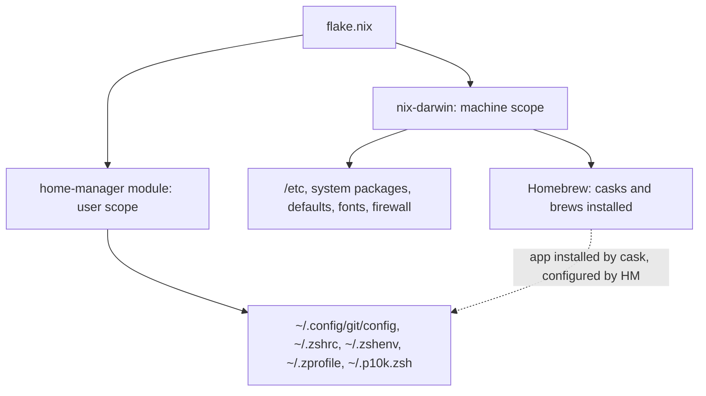
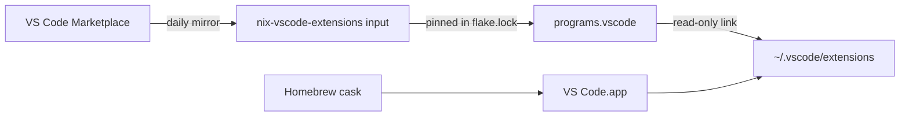

# 🏠 Home Manager: User-Scope Config as Code

## The Big Idea
`nix-darwin` manages the **machine**: `/etc`, system packages, Homebrew casks, macOS defaults, fonts, and the firewall. **home-manager** manages the **user's home directory**: dotfiles such as `~/.config/git/config` and `~/.zshrc`, plus per-user packages and environment variables.

It is wired in as a **nix-darwin module** in [[templates/flake.nix|flake.nix]], so it is part of the same system build. One `just switch` applies both layers together and rolls back together.



## How It Works
- **Symlinks into the Nix store.** Each file home-manager manages is a read-only symlink into `/nix/store`. Editing the file by hand fails, and that is deliberate: the flake is the only place to change it.
- **Ownership tracking.** home-manager remembers which files it created. A file you drop from the flake is removed on the next switch. Files it never created are left alone.
- **Clobber protection.** If an unmanaged file already sits where home-manager wants to write, it renames that file to `*.hm-backup` and continues (`backupFileExtension`). Without that setting, the switch fails rather than overwriting your file.
- **Same packages as the system.** `useGlobalPkgs` makes home-manager use the system's pinned nixpkgs and its `allowUnfree` setting, so there is one package set and no version drift.

## Module vs Standalone
| | nix-darwin module (chosen) | Standalone `home-manager switch` |
|---|---|---|
| Apply | One `just switch` (sudo) | A separate command, no sudo |
| Rollback | System and user roll back together | Two independent generation histories |
| Best for | One Mac, one user | Several machines, or Linux hosts without nix-darwin |

## Where Things Live (Target State)
| Concern | Scope | Owner |
|---|---|---|
| Casks, brews, macOS defaults, fonts, firewall, printer, debloat | Machine | nix-darwin |
| Git identity and defaults | User | home-manager ✅ (milestone 1a) |
| zsh aliases, plugins, p10k, prompt init | User | home-manager ✅ (milestone 1b) |
| Ghostty, VS Code, Roo Code config (cask-installed apps) | User | home-manager ✅ (milestone 2) |
| Secrets (`~/.zshrc.local`) | User | **Never in Nix.** Stays a gitignored local file |

> [!IMPORTANT]
> Homebrew still **installs** GUI apps. home-manager only writes their **config files**. Keep that split: casks stay in the nix-darwin `homebrew` block.

## Milestone 1a: Git (2026-10-19)
- `programs.git` writes `~/.config/git/config` with identity (the GitHub noreply email), the `osxkeychain` credential helper, and `fetch.prune = true`.
- Both Apple's `/usr/bin/git` and the Nix git read `~/.config/git/config`. That removes the earlier `/etc/gitconfig` + `GIT_CONFIG_SYSTEM` workaround, which was never activated.
- Git reads `~/.config/git/config` first and `~/.gitconfig` second, and the later file wins. The old `~/.gitconfig` holds the same identity, so it is harmless, but remove it after the switch so the flake is the only source.

### Verification
```bash
# Before switching: build without activating and inspect the generated file
nix build ~/.config/nix-darwin#darwinConfigurations.MacBook-Pro.system --dry-run
```

```bash
# After `just switch`, in a new terminal: every value should come from ~/.config/git/config
git config --list --show-origin --global
```

```bash
# Confirm the Nix git sees the same values
/run/current-system/sw/bin/git config --get fetch.prune
```

```bash
# Once verified, retire the hand-maintained file (it holds only user.name and user.email)
rm ~/.gitconfig
```

### Gotchas
- **`home.stateVersion`** records the home-manager release whose defaults you adopted. It is set once and is not a version to upgrade. Bumping it can silently change defaults.
- **Rollback:** `sudo darwin-rebuild --rollback` restores the previous generation, user files included.
- **"would be clobbered" or `*.hm-backup` files** mean an unmanaged file was in the way. Merge anything you need from the backup into the flake, then delete the backup.

## Milestone 1b: Zsh (2026-10-19)
home-manager now writes `~/.zshenv`, `~/.zprofile`, `~/.zshrc` and `~/.p10k.zsh`.

| Piece | Before | Now |
|---|---|---|
| Aliases | `environment.shellAliases` (system-wide, every user and shell) | `programs.zsh.shellAliases` (your zsh only) |
| Autosuggestions, syntax highlighting, compinit | nix-darwin `/etc/zshrc` | home-manager `~/.zshrc` |
| Powerlevel10k + zoxide init | nix-darwin `promptInit` | `initContent` + `programs.zoxide` |
| `~/.p10k.zsh` | Unmanaged copy | Link to `templates/p10k.zsh` |
| OrbStack init | Hand-added `~/.zprofile` | `profileExtra` |
| `~/.local/bin`, `~/.omlx/bin` on PATH | Hand-edited `~/.zshrc` | `initContent` |
| Secrets | `~/.zshrc.local` | Unchanged: sourced, never in Nix |

**What the system layer still does.** nix-darwin keeps `programs.zsh.enable` so `/etc/zshenv` puts Nix tools and their completions on the path. It turns off its own compinit and prompt so nothing loads twice.

**Dropped as stale or duplicate:** the Antigravity IDE PATH line (the IDE was removed), the second `~/.local/bin` export, and the `assume` alias in `~/.zshenv` (the flake already defines it).

> [!IMPORTANT]
> **Flake Sync now covers two files.** The flake references `./p10k.zsh`, so syncing means copying both `templates/flake.nix` and `templates/p10k.zsh` to `~/.config/nix-darwin/`. `bootstrap.sh` does this on a fresh Mac.

> [!TIP]
> **Changing the prompt.** `p10k configure` cannot write the read-only `~/.p10k.zsh`. Remove the link, run the wizard, copy the new file over `templates/p10k.zsh`, sync, and `just switch`. The switch restores the link.

### Verification
```bash
# After `just switch`: old hand-made files were moved aside
ls -la ~/.zshrc ~/.zshenv ~/.zprofile ~/.p10k.zsh ~/.*.hm-backup
```

```bash
# New terminal: prompt renders, then spot-check an alias, zoxide, and that ~/.zshrc.local is wired in
alias ll && type z && grep -c zshrc.local ~/.zshrc
```

```bash
# Startup time sanity check (should be well under a second)
time zsh -i -c exit
```

Once the new shell works, delete the backups with `rm ~/.*.hm-backup`. The leading dot matters, because zsh's `*` skips hidden files.

### Gotchas
- **History:** the same `~/.zsh_history` file, but home-manager keeps 10,000 entries (the system default was 2,000) and shares history across open terminals.
- **Hand edits to `~/.zshrc` fail.** Installers that append to it (OrbStack, oMLX, IDEs) will fail or print a warning. Add their lines to the flake instead.

## Milestone 2: Ghostty, VS Code, Roo Code (2026-10-19)
These files used to be rewritten by the activation script on every switch: untracked, never cleaned up, and VS Code UI changes silently reset. Now home-manager owns them, and the script only handles machine-level chores.

| File | Owner now |
|---|---|
| `~/.config/ghostty/config` | `programs.ghostty` (`package = null`; the cask installs the app) |
| `~/Library/Application Support/Code/User/settings.json` | `programs.vscode.profiles.default.userSettings` |
| `~/.vscode/extensions/` (whole folder, read-only) | `programs.vscode.profiles.default.extensions` |
| `~/.config/roo-code/settings.json`, Roo `custom_modes.yaml` | `home.file` |

**Extensions come from `nix-vscode-extensions`**, a nix-community flake that mirrors the whole VS Code marketplace as Nix packages and is rebuilt daily. The flake uses its `vscode-marketplace-release` set, which holds stable releases only. nixpkgs was missing three extensions (Antigravity, AWS Toolkit, Azure Resource Groups) and lagged on others.



### Design decisions
- **Fully managed, on purpose.** UI setting changes and Extensions-panel installs fail to save. Every change goes through the flake, so the flake always matches the machine.
- **Extensions update with `just update`, never on their own.** That's when `flake.lock` moves the marketplace mirror forward. Update notifications are off (`enableExtensionUpdateCheck = false`).
- **The VS Code app still updates itself.** The cask is marked `auto_updates`, so `brew upgrade` skips it. Turning off VS Code's own updater would freeze the app.
- **Dependencies must be listed.** VS Code can't fetch them into a read-only folder. `ms-python.python` needs Pylance, debugpy and Python Environments, and `vscode-docker` needs `vscode-containers`.
- **Ghostty theme fix:** Ghostty 1.3 theme names are case-sensitive. The old `tokyonight` never matched; `TokyoNight` does.

### Verification
```bash
# After `just switch`: each path should be a link into /nix/store
ls -la ~/.config/ghostty/config ~/.vscode/extensions "$HOME/Library/Application Support/Code/User/settings.json"
```

```bash
# VS Code sees exactly the declared set (20 extensions)
code --list-extensions | wc -l
```

```bash
# Ghostty accepts the config
/Applications/Ghostty.app/Contents/MacOS/ghostty +validate-config
```

Then open Ghostty (the TokyoNight theme should now apply) and VS Code (theme, icons and every extension load). Once all is well, list the backups, then delete them:

```bash
ls -d ~/.vscode/*.hm-backup ~/.config/ghostty/*.hm-backup ~/.config/roo-code/*.hm-backup "$HOME/Library/Application Support/Code/User/"*.hm-backup "$HOME/Library/Application Support/Code/User/globalStorage/rooveterinaryinc.roo-cline/settings/"*.hm-backup 2>/dev/null
```

### Gotchas
- **"Unable to write user settings" or an extension install error in VS Code** is expected. Make the change in the flake.
- **An extension needs a newer VS Code than you have.** Run `just switch` once so Homebrew/VS Code updates first, or pin through `pkgs.nix-vscode-extensions.forVSCodeVersion`.
- **Roo Code edits** to modes or profiles in its UI won't persist. Edit the flake instead.

## Related Notes
* [[Nix-Darwin Guide]]
* [[Declarative macOS Setup]]
