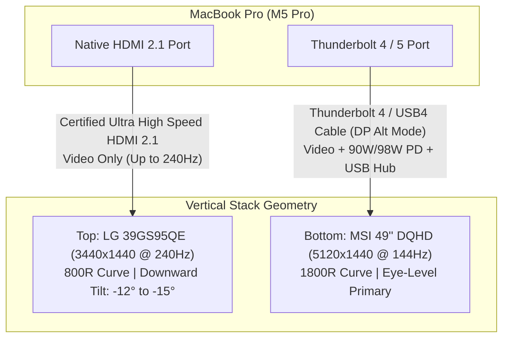

# 🖥️ Workstation Display & Monitor Mounting Guide

This guide details the architecture, cabling, ergonomic stack geometry, and wall-mounting options for a dual-ultrawide workstation driven by the **Apple M5 Pro MacBook Pro (48GB)**.

---

## 1. System Specifications & Topology

The display setup pairs two high-refresh curved ultrawide displays in a stacked vertical configuration:

* **Primary Bottom Display:** MSI 49" DQHD (5120 × 1440, 32:9 aspect ratio, 1800R gentle curve, ~22–24 lbs without stand).
* **Auxiliary Top Display:** LG UltraGear 39GS95QE (3440 × 1440, 21:9 aspect ratio, 800R aggressive curve, ~15.5 lbs without stand).
* **Host Machine:** MacBook Pro (Apple M5 Pro, 48GB Unified Memory).



---

## 2. Direct 2-Cable Connection Strategy

The M5 Pro's dual external display pipelines are driven independently without requiring an intermediate Thunderbolt docking station:

| Connection | Cable Specification | Functionality Delivered |
| :--- | :--- | :--- |
| **Cable 1: Mac to MSI 49"** | Certified **Thunderbolt 4 / USB4** (40 Gbps, 100W+ PD) | • 5120 × 1440 @ 120Hz/144Hz video (DP Alt Mode)<br/>• Fast charging (90W–98W Power Delivery)<br/>• Upstream data for MSI USB-A peripheral hub / KVM |
| **Cable 2: Mac to LG 39"** | Certified **Ultra High Speed HDMI 2.1** | • 3440 × 1440 @ up to 240Hz video directly from the native MBP HDMI port |

> [!IMPORTANT] Cable Selection Note
> Standard Apple white charge cables only transmit USB 2.0 data and power; they do **not** carry DisplayPort video. Ensure Cable 1 is a certified 40 Gbps Thunderbolt 4 or USB4 cable (e.g., Cable Matters, Anker, or OWC).

---

## 3. Ergonomic Vertical Stacking & Curve Geometry

### Why Stacking Outperforms Side-by-Side
1. **Span & Neck Fatigue:** Side-by-side, a 49" (~47" wide) and 39" (~35" wide) display span over **82 inches (~6.8 feet)** of horizontal glass, forcing excessive cervical spine rotation.
2. **Curve Discrepancy Elimination:** The LG's **800R** tight curve clashes horizontally against the MSI's **1800R** gentle curve. In a stacked configuration, the radius difference is visually harmonious because the LG's bottom edge wraps directly over the MSI's top bezel.
3. **Downward Tilt Requirement:** Because the 39" display sits above standard eye level, it must tilt downward by **-10° to -15°** so its OLED panel directly faces the seated eye line, preventing color shift and upward neck strain.

---

## 4. Wall Mount Options & Estimated Cost Breakdown

For displays of this size, **two independent wall mounts** (mounted vertically in-line) provide the strength, tilt range, and depth alignment that single vertical dual-monitor poles lack.

### Option A: Heavy-Duty Gas-Spring Articulating Arms *(Recommended for Corners & Fine Adjustment)*
Articulating arms provide dynamic 3D movement (height, depth, and tilt). They allow you to pull the top screen slightly forward to drape flush over the bottom screen, and make corner setups feasible.

| Model | Est. Cost (Single) | Est. Cost (Pair) | Weight Rating | Max Extension | Tilt Range | Key Advantages & Notes |
| :--- | :--- | :--- | :--- | :--- | :--- | :--- |
| **Ergotron HX Wall Mount**<br/>*(45-478-216)* | **~$380 – $410** | **~$760 – $820** | Up to **42 lbs** | ~23.6 in | +70° / -5° *(requires HD pivot for extreme tilt)* | Premium commercial build; flawless counterbalancing; zero sag under heavy ultrawide center of gravity. |
| **VIVO Heavy-Duty Gas Spring**<br/>*(MOUNT-V100A / V100AW)* | **~$75 – $95** | **~$150 – $190** | Up to **44 lbs** | ~22.0 in | +45° / -45° | Built specifically for 49" ultrawides; outstanding downward tilt range out of the box; exceptional value. |
| **Mount-It! Heavy-Duty Arm**<br/>*(MI-45112)* | **~$85 – $110** | **~$170 – $220** | Up to **44 lbs** | ~21.5 in | +45° / -45° | Reinforced gas-spring cylinder; integrated cable management channels; stiff tilt-lock bolts. |
| **WALI Single Heavy-Duty Arm**<br/>*(GSDM001 / HD-W)* | **~$65 – $80** | **~$130 – $160** | Up to **35 lbs** | ~20.5 in | +35° / -35° | Budget-friendly option; suitable for the top 39" LG (15.5 lbs); tight tolerance on 49" MSI. |

---

### Option B: Heavy-Duty Articulating TV / Display Brackets *(Rock Solid, Zero-Wobble Foundation)*
Steel TV-style articulating brackets bolt flat to the wall with heavy-duty dual arms. They offer rock-solid stability if you do not plan to adjust screen height frequently.

| Model | Est. Cost (Single) | Est. Cost (Pair) | Weight Rating | Max Extension | Tilt Range | Key Advantages & Notes |
| :--- | :--- | :--- | :--- | :--- | :--- | :--- |
| **Kanto PS300 / PS400**<br/>*Full-Motion Single-Stud* | **~$60 – $80** | **~$120 – $160** | Up to **88 lbs** | ~22.0 in | +14° / -3° | Solid steel construction; clean magnetic wall plate covers; tight 1.5" minimum wall collapse profile. |
| **Sanus Advanced Full-Motion**<br/>*(VSF716 / Premium Series)* | **~$70 – $100** | **~$140 – $200** | Up to **50 lbs** | ~16.0 in | +5° / -15° | Fluid fingertip tilt mechanism; precision post-installation level adjustments; low profile. |
| **Kanto PDX650**<br/>*Dual-Stud Heavy Duty* | **~$140 – $160** | **~$280 – $320** | Up to **125 lbs** | ~21.8 in | +15° / -3° | Spans dual 16" studs; maximum lateral shift capability for non-centered studs. |
| **VideoSecu / Mounting Dream**<br/>*Full-Motion Articulating* | **~$35 – $50** | **~$70 – $100** | Up to **60 lbs** | ~17.0 in | +5° / -15° | Extreme value; solid steel dual-arm structure; includes bubble level and extensive VESA hardware. |

---

## 5. Corner Installation Tactics & Considerations

If placing the desk diagonally across a 90° corner:

```
                  Wall A
       ┌──────────────────────────────
       │          [Stud] ◄── Mount Base A (Top Screen)
       │          [Stud] ◄── Mount Base B (Bottom Screen)
Wall B │            \
       │             \  Articulating Arms Extend ~18"-22"
       │              \
       │               ▼
       │         ┌────────────────────────┐
       │         │   MSI 49" / LG 39"     │  ◄── Screens float at 45° across corner
       │         └────────────────────────┘
       │
```

1. **Width Clearance in a 90° Corner:**
   * A 49" ultrawide is ~47 inches wide tip-to-tip.
   * Floating diagonally across a 90° corner creates a right triangle where hypotenuse $c \approx 47"$. The monitor touches the side walls when its center sits roughly **17 to 20 inches out from the corner vertex**.
2. **Arm Reach is Critical:**
   * Do not choose low-profile fixed mounts for a corner. You **must have an arm extension of at least 18" to 22"** so the display center can project out into the diagonal space without the display wings striking Wall A or Wall B.
   * Gas-spring arms (like the VIVO or Ergotron HX) excel here because their base can be bolted to a stud 12–16 inches away from the corner on either wall, and the articulating arm swings the display directly into the center diagonal.
3. **Vertical Base Stacking:**
   * If mounting both bases to the same wall stud, ensure the top mount's base is installed **at least 15 to 18 inches higher** than the bottom mount's base to allow the arms and gas pistons full clearance without colliding.

---

## 6. Pre-Installation Checklist

- [ ] **VESA Adapters:** Locate the proprietary metal VESA standoff brackets included in both the MSI and LG monitor boxes. Both use standard 100 × 100 mm patterns, but the sockets are recessed.
- [ ] **Stud Verification:** Use a magnetic or digital stud finder to locate the center of the wood stud. Never use hollow-wall anchors for 49" curved monitors.
- [ ] **Software Configuration:** Install **BetterDisplay** or **MonitorControl** on macOS to enable native keyboard brightness (`F1`/`F2`) control over DDC/CI across both displays.

---

## Related Notes
* [[Hardware & Memory Budget]]
* [[System Architecture]]
* [[Pre-Flight Preparation & Unboxing Master Plan]]
